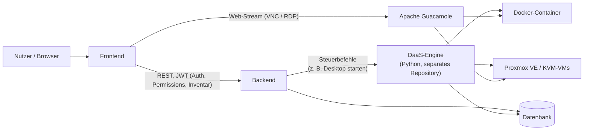
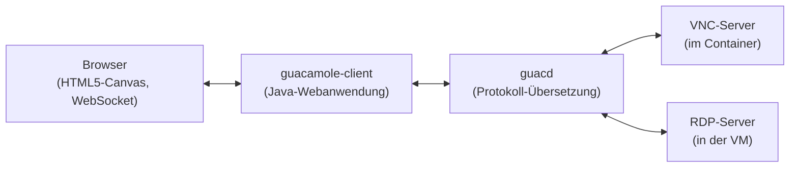
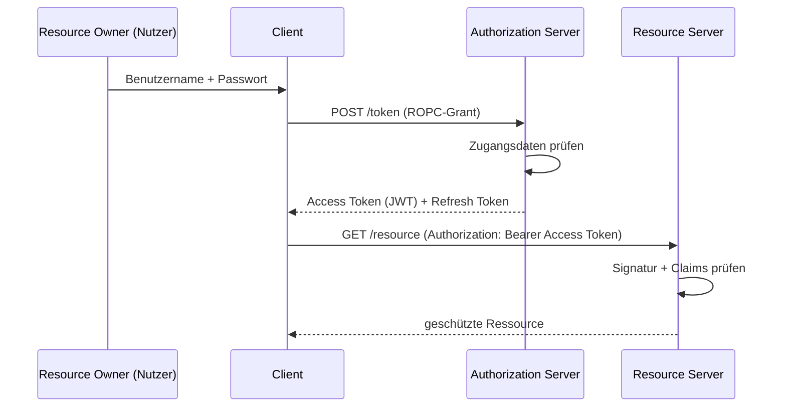
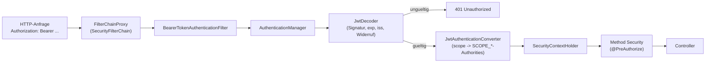
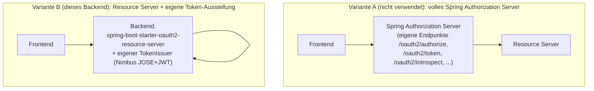

# 2 Theoretischer Hintergrund (Entwurf)

> Status: Überarbeiteter Entwurf, Ziel ~15-20 Seiten.
> Zitierte Quellen sind real und verifiziert: MobiWis-2024-Paper/Folien, OJCC-2023-Artikel, Informatik-Spektrum-2024-Artikel
> (alle aus der Ausschreibung), sowie offizielle RFCs, Standards und Dokumentationen für Virtualisierung,
> OAuth2/JWT/TLS/bcrypt, Zugriffskontrollmodelle, Spring/Maven/Hibernate/JUnit sowie ArchUnit/Flyway/JaCoCo.
> Platzhalter `[TODO]` / `[Quelle fehlt]` markieren Stellen, die noch ergänzt/belegt werden müssen.

---

Dieses Kapitel beschreibt die theoretischen Grundlagen, Standards, Bibliotheken und Werkzeuge, auf denen das
in dieser Arbeit entwickelte Backend aufbaut. Zunächst wird in 2.1 das Gesamtsystem DESIGN und die darin
verwendete Desktop-as-a-Service-Architektur vorgestellt, einschließlich der zugrundeliegenden
Virtualisierungskonzepte (Hypervisoren, Container) und der internen Funktionsweise von Apache Guacamole.
Anschließend werden drei Themenfelder behandelt: die Authentifizierung über OAuth2, JSON Web Token, RS256,
Transport Layer Security und Passwort-Hashing mit bcrypt (2.2), die Autorisierung über Zugriffskontroll-
modelle wie ACL, RBAC und ABAC sowie kaskadierende Entscheidungsmodelle (2.3) sowie Werkzeuge aus dem
Java-Ökosystem für Build-Automatisierung, Anwendungsentwicklung, Persistenz, Tests sowie Architektur- und
Qualitätssicherung, u. a. Maven, das Spring-Framework/Spring Boot, Hibernate/JPA, MariaDB, JUnit 5/Mockito,
ArchUnit, Flyway und JaCoCo (2.4).

## 2.1 Desktop-as-a-Service und die Architektur von DESIGN

Desktop-as-a-Service (DaaS) bezeichnet die Bereitstellung vollständiger Arbeitsumgebungen über das Netzwerk,
wobei Anwendungen nicht lokal installiert, sondern auf entfernten Ressourcen ausgeführt und über einen
Client dargestellt werden. Im Gegensatz zu klassischer lokaler Software bietet dieser Ansatz einfache
Fernzugriffsmöglichkeiten und zentrale Administration, bringt jedoch typische Nachteile von
Software-as-a-Service mit sich, etwa Abhängigkeit von einer Netzwerkverbindung und potenzielle
Datenschutz- und Sicherheitsbedenken [1].

Das System **DESIGN** verfolgt das Ziel, die Vorteile lokal installierter Anwendungen (Datenschutz,
Unterstützung von Legacy-Software, kein Vendor-Lock-in) mit denen webbasierter Software (geräteunabhängiger
Zugriff über den Browser, keine Installation) zu verbinden, ohne deren jeweilige Nachteile zu übernehmen [1], [2].
Um unveränderte Linux- und Windows-Anwendungen bereitzustellen, nutzt DESIGN Containervirtualisierung
(Docker) sowie virtuelle Maschinen (KVM, verwaltet über die Virtualisierungsplattform Proxmox VE); die
Fernsteuerung der jeweiligen Anwendung erfolgt über VNC- bzw. RDP-Dienste innerhalb des Containers/der VM,
die durch das Gateway **Apache Guacamole** in einen Web-Stream übersetzt und so im Browser des Nutzers
dargestellt werden [1]. Dieser Architekturansatz erlaubt drei Bereitstellungsvarianten: (1) Linux-Anwendungen
in Linux-Containern, (2) Windows-Anwendungen in Linux-Containern mittels Wine, sofern dies funktioniert, und
(3) Windows-Anwendungen in Windows-VMs, falls Wine nicht einsetzbar ist [1].

Die Autoren dokumentieren in [1] mehrere praktische Herausforderungen, die bei Entwicklung und Betrieb von
DESIGN auftraten, u. a. messbare Unterschiede in der Bereitstellungs- und Startzeit von Anwendungen
(Docker: Start ca. 5-10 s, Klonen ca. 5-30 s, Neuanlage ca. 8-10 min; Windows-VM: Start ca. 10-20 s, Klonen
ca. 4-5 min, Neuanlage ca. 30-60 min) sowie die fehlende native Unterstützung von Sound, Mikrofon und
Drucken durch VNC, die zusätzliche Komponenten gegenüber RDP erfordert [1].

Abbildung 2.1 fasst Proxmox VE/KVM, Docker und Apache Guacamole als Komponenten der DESIGN-Architektur
zusammen; die beiden folgenden Unterabschnitte vertiefen die technischen Grundlagen dieser Komponenten.



*Abbildung 2.1: Vereinfachte Architekturübersicht von DESIGN mit den beteiligten Komponenten (eigene
Darstellung, inhaltlich angelehnt an die Beschreibung der Komponenten in [1], [2]).*

[TODO: Abbildung 2.1 bei Bedarf als Vektorgrafik (draw.io/PlantUML-Export) statt Mermaid-Block einbinden,
falls das Vorlagen-Textsatzsystem kein Mermaid rendert.]

### 2.1.1 Virtualisierungsarten: Hypervisoren und Container

Die beiden in DESIGN eingesetzten Virtualisierungsformen beruhen auf unterschiedlichen technischen
Grundprinzipien. Bei der klassischen Hardware-Virtualisierung unterscheidet die grundlegende Arbeit von
Popek und Goldberg zwischen zwei Bauarten eines *Hypervisors*: Ein **Typ-1-Hypervisor** (auch *Bare-Metal-
Hypervisor* genannt) läuft direkt auf der physischen Hardware ohne zwischengeschaltetes Betriebssystem und
verwaltet selbst die virtuellen Maschinen, während ein **Typ-2-Hypervisor** als gewöhnliche Anwendung
innerhalb eines bestehenden Host-Betriebssystems ausgeführt wird [21]. KVM (Kernel-based Virtual Machine),
auf dem Proxmox VE aufbaut, verwandelt den Linux-Kernel selbst in einen Typ-1-Hypervisor, indem es dessen
Prozessor- und Speicherverwaltung um Virtualisierungserweiterungen der CPU (Intel VT-x/AMD-V) ergänzt; jede
virtuelle Maschine erhält dadurch ein vollständig eigenes Betriebssystem mit eigenem Kernel, eigenem
Dateisystem und eigenen Gerätetreibern, was hohe Isolation, aber auch höheren Ressourcenverbrauch und
längere Start- und Bereitstellungszeiten mit sich bringt.

Containervirtualisierung mit **Docker** verfolgt demgegenüber einen grundsätzlich anderen Ansatz: Statt ein
eigenes Betriebssystem zu virtualisieren, teilen sich alle Container denselben Host-Betriebssystem-Kernel
und werden lediglich durch zwei Linux-Kernel-Mechanismen voneinander isoliert: *Namespaces* kapseln pro
Container jeweils eigene Sichten auf Prozess-IDs, Netzwerkschnittstellen, Dateisystem-Mountpunkte und
Hostnamen, sodass ein Prozess innerhalb eines Containers glaubt, exklusiven Zugriff auf diese Ressourcen zu
haben, während *Control Groups* (cgroups) begrenzen, wie viel CPU-Zeit, Arbeitsspeicher und I/O-Bandbreite
ein Container maximal verbrauchen darf. Eine Docker-Anwendung wird zudem als *Image* ausgeliefert, ein
schreibgeschütztes, in übereinanderliegenden Schichten (*Layers*) aufgebautes Dateisystem-Archiv, aus dem zur
Laufzeit ein beschreibbarer Container-Prozess gestartet wird. Weil dabei kein vollständiges Betriebssystem
gebootet werden muss, lassen sich Container in der Regel in Sekunden statt Minuten starten und klonen, was
die in [1] gemessenen Zeitunterschiede zwischen Docker und Windows-VMs erklärt [22].

### 2.1.2 Apache Guacamole: clientloses Remote-Desktop-Gateway

Technisch besteht Apache Guacamole aus zwei Hauptkomponenten: dem *guacamole-client*, einer Java-
Webanwendung, die im Browser über HTML5 und WebSockets eine grafische Oberfläche bereitstellt, und *guacd*,
einem nativen Hintergrunddienst, der die eigentliche Übersetzung zwischen Remote-Desktop-Protokollen (VNC,
RDP, SSH) und dem schlanken, textbasierten *Guacamole-Protokoll* vornimmt [23]. Der Browser spricht dabei zu
keinem Zeitpunkt direkt VNC oder RDP; stattdessen sendet guacd die Anzeige des entfernten Containers bzw.
der virtuellen Maschine als eine Folge einfacher Zeichenbefehle (z. B. "zeichne dieses Bildfragment an
Position x,y") über eine WebSocket-Verbindung an den Browser, der daraus mittels eines HTML5-Canvas-Elements
das Bild zusammensetzt. Dieser Ansatz erklärt, warum Guacamole als *clientlos* bezeichnet wird: Es genügt ein
gewöhnlicher Webbrowser, ohne dass Plugins, Java-Applets oder native RDP-/VNC-Clients installiert werden
müssen.



*Abbildung 2.2: Vereinfachte interne Architektur von Apache Guacamole (eigene Darstellung nach der
Beschreibung in [23]).*

## 2.2 Authentifizierung: OAuth2, JSON Web Token und RS256

Die Authentifizierung über OAuth2 und JSON Web Token beruht auf drei Standards, die unterschiedliche
Aufgaben übernehmen und erst im Zusammenspiel das vollständige Bild ergeben. OAuth 2.0 (RFC 6749) legt fest,
*wer* unter welchen Bedingungen ein Zugriffstoken bekommen darf, und definiert dafür Rollen und Abläufe,
sagt aber nichts darüber aus, wie dieses Token konkret aussieht [3]. JSON Web Token (RFC 7519) ist genau
dieses konkrete Tokenformat: ein kompaktes, textbasiertes Format, mit dem sich Ansprüche (*Claims*) über
einen Nutzer transportieren lassen [5]. RS256 schließlich ist kein eigener Standard, sondern ein in RFC 7518
definierter Signaturalgorithmus, der festlegt, wie ein solches JWT gegen Manipulation abgesichert wird [7].
Die folgenden Unterabschnitte erläutern diese Bausteine einzeln und beschreiben anschließend in 2.2.5, wie
Spring Security sie technisch zu einem vollständigen Authentifizierungs- und Autorisierungsablauf
zusammensetzt.

### 2.2.1 OAuth2: Rollen, Protokollablauf und Grant-Typen

RFC 6749 unterscheidet vier Rollen: den *Resource Owner* (die Person, der die geschützten Daten gehören,
also der Nutzer eines Systems), den *Client* (die Anwendung, die stellvertretend für den Nutzer auf eine
Ressource zugreifen möchte, z. B. eine Frontend-Anwendung), den *Authorization Server* (die Stelle, die nach
erfolgreicher Prüfung der Zugangsdaten ein Zugriffstoken ausstellt) und den *Resource Server* (die Stelle,
die dieses Token entgegennimmt, prüft und daraufhin die eigentlich angefragte Ressource liefert) [3]. In
vielen OAuth2-Systemen sind Authorization Server und Resource Server getrennte, eigenständige Dienste, zum
Beispiel wenn sich eine Anwendung über einen externen Anbieter wie Google oder Microsoft anmeldet. In
sogenannten Single-Vendor-Systemen, in denen Client und die eigenen APIs von derselben Partei betrieben
werden, ist es dagegen üblich, dass ein und derselbe Dienst beide Rollen gleichzeitig übernimmt: Er prüft
die Zugangsdaten und stellt das Token aus (Authorization Server) und validiert dieses Token anschließend bei
jeder nachfolgenden API-Anfrage, um die eigenen Endpunkte zu schützen (Resource Server).

Der abstrakte Protokollablauf nach RFC 6749 besteht aus vier Schritten: Der Client fordert vom
Ressourceninhaber eine Autorisierung an, erhält im Erfolgsfall einen *Authorization Grant* (einen Nachweis
dieser Zustimmung), tauscht diesen Grant beim Authorization Server gegen ein Zugriffstoken ein und verwendet
dieses Token schließlich beim Resource Server, um auf die geschützte Ressource zuzugreifen [3]. RFC 6749
definiert für den zweiten Schritt mehrere *Grant-Typen*, von denen die wichtigsten sind: der
*Authorization-Code-Grant*, bei dem der Nutzer über eine Weiterleitung auf einer separaten Login-Seite des
Authorization Servers seine Zugangsdaten eingibt, ohne dass der Client sie je zu sehen bekommt (das
Standardverfahren für Anwendungen Dritter); der *Client-Credentials-Grant*, bei dem kein Nutzer beteiligt
ist und eine Anwendung im eigenen Namen auf eine Ressource zugreift (etwa für Server-zu-Server-Kommunikation);
und der *Resource Owner Password Credentials Grant* (ROPC), bei dem der Client Benutzername und Passwort
direkt entgegennimmt und im Austausch gegen ein Token an den Authorization Server weiterreicht [3]. Ergänzend
beschreibt RFC 6749 den *Refresh-Token*-Mechanismus, mit dem ein Client ein abgelaufenes Zugriffstoken erneuern
kann, ohne dass der Nutzer seine Zugangsdaten erneut eingeben muss [3].

Abbildung 2.3 zeigt diesen abstrakten Ablauf am Beispiel des ROPC-Grants als konkreter Ausprägung des
zweiten Schritts.



*Abbildung 2.3: Abstrakter OAuth2-Protokollablauf nach RFC 6749, Abschnitt 1.2, konkretisiert für den
Resource Owner Password Credentials Grant (eigene Darstellung).*

Die neuere IETF-Sicherheitsempfehlung RFC 9700 (*Best Current Practice for OAuth 2.0 Security*) empfiehlt,
auf den ROPC-Grant in neuen Systemen möglichst zu verzichten, unter anderem weil er sich schlecht mit
Mehr-Faktor-Authentifizierung verträgt und den Client dazu zwingt, mit Klartext-Zugangsdaten umzugehen [8].
Als sicherere Alternative gilt der Authorization-Code-Grant in Kombination mit der Erweiterung *Proof Key
for Code Exchange* (PKCE, RFC 7636) [24]: Der Client erzeugt dabei vor der Weiterleitung zufällig einen
geheimen Wert (*code_verifier*) und übermittelt nur dessen gehashten Wert (*code_challenge*) an den
Authorization Server; beim späteren Eintausch des Autorisierungscodes muss der Client den ursprünglichen
`code_verifier` erneut mitsenden, den der Authorization Server gegen die zuvor übermittelte
`code_challenge` prüft. Ein Angreifer, der lediglich den Autorisierungscode abfängt, kann diesen damit nicht
mehr gegen ein Token eintauschen, weil ihm der `code_verifier` fehlt. Abbildung 2.4 stellt diesen Ablauf dem
clientlosen Client-Credentials-Grant gegenüber, der ganz ohne Resource Owner auskommt.

Die Rückgabe und Verwendung des ausgestellten Tokens ist in RFC 6750 als sogenanntes *Bearer-Token*
beschrieben: Wer das Token besitzt, kann damit auf die Ressource zugreifen, unabhängig davon, ob er der
ursprüngliche Nutzer ist, weshalb die Übertragung ausschließlich über TLS erfolgen sollte [4]. Der Client
überträgt das Token bei jeder Anfrage im HTTP-Header `Authorization: Bearer <token>`; der Resource Server
muss daraus im Umkehrschluss keine eigene Sitzung führen, sondern kann die Anfrage allein anhand des
mitgesendeten Tokens beurteilen.

### 2.2.2 JSON Web Token: Aufbau und Claims

Ein JWT ist, unabhängig vom OAuth2-Kontext, zunächst nur ein Format, um eine Menge von Ansprüchen (*Claims*)
kompakt und überprüfbar zu kodieren [5]. Ein JWT besteht aus drei durch Punkte getrennten, jeweils
Base64url-kodierten Teilen: einem Header, der unter anderem den Signaturalgorithmus benennt, einer Payload
mit den eigentlichen Claims und einer Signatur über die ersten beiden Teile [5], [6]. RFC 7519 unterscheidet
dabei *registrierte Claims* mit festgelegter Bedeutung, etwa `iss` (Aussteller), `sub` (Subjekt, meist die
Nutzer-ID), `exp` (Ablaufzeitpunkt), `iat` (Ausstellungszeitpunkt) und `jti` (eine eindeutige Token-ID), von
frei definierbaren *privaten Claims*, die eine Anwendung nach eigenem Bedarf ergänzen kann [5]. Das
vorliegende Backend macht von beiden Kategorien Gebrauch: Die vom `TokenIssuer` ausgestellten Zugriffstoken
enthalten die registrierten Claims `iss`, `sub`, `iat`, `exp` und `jti` sowie die anwendungsspezifischen
Claims `email`, `name` und `scope`, über die unter anderem die in Kapitel 2.3 beschriebene Autorisierung
entscheidet.

Ein wichtiger Aspekt, der im Projekt bewusst anders gelöst wurde, betrifft die Zustandslosigkeit von JWTs:
Da ein signiertes JWT allein anhand seiner Signatur als gültig erkannt wird, lässt es sich vor Ablauf der
`exp`-Zeit nicht ohne Weiteres widerrufen. Für das *Zugriffstoken* wird das in diesem Projekt in Kauf
genommen, aber durch eine kurze Gültigkeitsdauer und die in 2.2.3 beschriebene zusätzliche
Widerrufsprüfung abgefedert. Für das begleitend ausgestellte *Refresh-Token*, mit dem sich ein abgelaufenes
Zugriffstoken erneuern lässt, wählt das Backend dagegen bewusst **kein** JWT, sondern einen zufällig
erzeugten, undurchsichtigen 256-Bit-Wert, der serverseitig in einer Datenbanktabelle gespeichert und beim
Abmelden oder Sperren eines Nutzers gezielt gelöscht werden kann. Dieser Kontrast verdeutlicht eine
grundsätzliche Abwägung beim Einsatz von JWTs: Ein JWT eignet sich gut für kurzlebige, häufig geprüfte
Token, bei denen der Verzicht auf eine Datenbankabfrage einen echten Performancevorteil bringt, während ein
langlebiges, sicherheitskritisches Token wie ein Refresh-Token von der serverseitigen Kontrollierbarkeit
eines klassischen, zustandsbehafteten Tokens profitiert.

### 2.2.3 Signaturverfahren: RS256 statt HS256

Damit ein JWT gegen Manipulation geschützt ist, muss es signiert werden. Das Format und die zulässigen
Algorithmen für diese Signatur sind in zwei weiteren RFCs geregelt: RFC 7515 (JSON Web Signature, JWS)
beschreibt den strukturellen Aufbau eines signierten Tokens aus Header, Payload und Signatur [6], und
RFC 7518 (JSON Web Algorithms, JWA) definiert die konkreten Signaturalgorithmen, unter anderem HS256 und
RS256 [7]. Der naheliegendste Algorithmus, HS256 (HMAC mit SHA-256), ist symmetrisch: Aussteller und Prüfer
eines Tokens benötigen denselben geheimen Schlüssel. In einem System mit mehreren Diensten, die Token nur
lesen und prüfen müssen, aber selbst keine Token ausstellen dürfen, ist das ein Problem, denn jeder Dienst,
der ein Token verifizieren können soll, müsste das geheime Schlüsselmaterial erhalten, mit dem sich auch
beliebige neue Token erzeugen ließen.

RS256 (RSASSA-PKCS1-v1_5 mit SHA-256) löst dieses Problem, weil es ein asymmetrisches Verfahren ist: Die
Signatur wird mit einem privaten RSA-Schlüssel erzeugt, die Prüfung erfolgt dagegen mit dem zugehörigen
öffentlichen Schlüssel. Der private Schlüssel bleibt ausschließlich bei der ausstellenden Stelle, während
der öffentliche Schlüssel beliebig verteilt werden kann, zum Beispiel über einen JWK-Set-Endpunkt, ohne dass
dadurch die Möglichkeit entsteht, selbst gültige Token zu fälschen. Für dieses Backend bedeutet das, dass nur
das Backend selbst den privaten Schlüssel besitzt und Zugriffstoken ausstellen darf, während andere
Komponenten des DESIGN-Systems, etwa das Frontend oder die DaaS-Anwendung, Token ausschließlich mit dem
öffentlichen Schlüssel prüfen können. Diese Trennung ist der Hauptgrund, warum im Rahmen dieser Arbeit RS256
anstelle von HS256 eingesetzt wird.

### 2.2.4 Zusammenspiel: wie OAuth2, JWT und RS256 in diesem Backend zusammenwirken

Die drei vorangegangenen Abschnitte lassen sich am konkreten Anmeldevorgang dieses Backends
nachvollziehen. Das Frontend sendet Benutzername und Passwort als ROPC-Grant an den Endpunkt
`/oauth2/user/token` (2.2.1). Das Backend prüft diese Zugangsdaten, und übernimmt bei Erfolg die Rolle des
Authorization Servers: Es erzeugt ein JWT mit den in 2.2.2 beschriebenen Claims und signiert es mit seinem
privaten RSA-Schlüssel nach dem RS256-Verfahren aus 2.2.3. Dieses signierte JWT wird, zusammen mit einem
opaken Refresh-Token, im von RFC 6749 vorgesehenen Antwortformat an das Frontend zurückgegeben. Für alle
weiteren Anfragen hängt das Frontend das Zugriffstoken als Bearer-Token (2.2.1, RFC 6750) an den
`Authorization`-Header an. Das Backend wechselt für diese Anfragen in die Rolle des Resource Servers: Es
prüft mit dem öffentlichen Schlüssel, ob die Signatur des Tokens zum privaten Schlüssel passt, mit dem es
ursprünglich ausgestellt wurde, und wertet anschließend die Claims aus, etwa ob das Token noch nicht
abgelaufen ist. Erst wenn diese Prüfung erfolgreich ist, wird die Anfrage an die in Kapitel 2.3 beschriebene
Autorisierungslogik weitergereicht. Technisch übernimmt diesen gesamten Ablauf auf Resource-Server-Seite
Spring Security, was im folgenden Abschnitt beschrieben wird.

### 2.2.5 Spring Security, OAuth2-Ressourcenserver und die Rolle von Spring Authorization Server

Spring Security ist die Sicherheitskomponente des Spring-Frameworks und stellt Authentifizierung und
Autorisierung über eine Kette von Servlet-Filtern bereit, die sogenannte *SecurityFilterChain* [9]. Technisch
registriert Spring Security dafür einen einzigen Servlet-Filter namens `DelegatingFilterProxy` beim
Anwendungsserver, der jede Anfrage an eine intern verwaltete Kette von Sicherheitsfiltern weiterreicht; diese
Kette lässt sich pro Anwendung frei konfigurieren, ohne dass der Anwendungsserver selbst etwas davon merkt
[9]. Jede eingehende Anfrage durchläuft diese Kette, bevor sie den eigentlichen Controller erreicht. Für
JWT-basierte APIs bietet Spring Security die Rolle des *OAuth2 Resource Server*: Über den Baustein
`spring-boot-starter-oauth2-resource-server` wird der Filterkette automatisch ein `BearerTokenAuthenticationFilter`
hinzugefügt, der den `Authorization`-Header einer Anfrage ausliest und das darin enthaltene Bearer-Token zur
Prüfung an einen `AuthenticationManager` weiterreicht [9]. Dieser delegiert an den in 2.2.3 beschriebenen
`JwtDecoder`, der Signatur, Ablaufdatum, Aussteller und den anwendungsspezifischen Widerruf prüft. Ist das
Token gültig, wandelt ein `JwtAuthenticationConverter` die Claims in ein Spring-Security-Berechtigungsobjekt
(`Authentication`) um; dabei greift standardmäßig ein `JwtGrantedAuthoritiesConverter`, der den Inhalt des
`scope`-Claims (siehe 2.2.2) in einzelne `GrantedAuthority`-Objekte mit dem Präfix `SCOPE_` übersetzt, etwa
`SCOPE_admin` oder `SCOPE_user` [9]. Genau diese beiden Werte definiert dieses Backend zentral in der Klasse
`Authorities` und verwendet sie sowohl in der URL-basierten Konfiguration (`SecurityConfig`) als auch in
methodenbasierten `@PreAuthorize`-Ausdrücken auf einzelnen Controller-Methoden, die durch die Annotation
`@EnableMethodSecurity` aktiviert werden. Erst nachdem die `Authentication` erfolgreich im
`SecurityContextHolder` abgelegt wurde, greifen die in diesem Backend konfigurierten Autorisierungsregeln
(siehe 2.3).

Abbildung 2.3 fasst diesen Ablauf für eine bereits authentifizierte Anfrage zusammen und zeigt, an welcher
Stelle die in 2.2.2 bis 2.2.4 beschriebenen Konzepte (Claims, RS256-Signatur, Widerrufsprüfung) technisch
verankert sind.



*Abbildung 2.3: Ablauf der Anfrageprüfung durch den OAuth2-Ressourcenserver in Spring Security, vereinfacht
auf die in diesem Backend tatsächlich genutzten Komponenten (eigene Darstellung nach der Beschreibung der
Resource-Server-Architektur in [9]).*

An dieser Stelle lohnt sich eine Begriffsklärung, weil sie im Projektverlauf häufig zu Verwechslungen führt.
Broadcom/VMware pflegt neben Spring Security auch ein eigenständiges Projekt namens *Spring Authorization
Server*, das einen vollständigen OAuth2- und OpenID-Connect-Autorisierungsserver mit eigenen Endpunkten für
Token-Ausstellung, Introspektion und Widerruf bereitstellt [10]. Dieses Projekt wird im vorliegenden Backend
nicht als Abhängigkeit eingebunden. Die zugehörige Bibliothek `spring-security-oauth2-authorization-server`
taucht in der Maven-Konfiguration lediglich in einem Kommentar auf, weil Spring Boot sie versionsseitig
mitverwaltet; sie wird jedoch nicht deklariert und nicht verwendet. Stattdessen implementiert das Backend
eine schlanke, auf den eigenen Anwendungsfall zugeschnittene Token-Ausstellung selbst: Der Baustein
`spring-boot-starter-oauth2-resource-server` bringt transitiv die Bibliothek *Nimbus JOSE+JWT* mit, die
Spring Security intern für das Erzeugen (`JwtEncoder`) und Prüfen (`JwtDecoder`) von JWTs nutzt [11]. Auf
dieser Grundlage erzeugt das Backend beim ersten Start ein RSA-Schlüsselpaar mit 2048 Bit, persistiert es
lokal als JSON Web Key und verwendet es fortan sowohl zum Signieren neu ausgestellter Token als auch, über
den zugehörigen öffentlichen Schlüssel, zu deren Prüfung. Zusätzlich zur Standardprüfung von Signatur,
Ablaufdatum und Aussteller (*issuer*) ist die Prüfkette um einen anwendungsspezifischen Validator erweitert,
der bereits ausgestellte, aber zwischenzeitlich widerrufene Token anhand eines Datenbankeintrags erkennt.
Das ist notwendig, weil ein JWT laut Spezifikation zustandslos ist und ohne eine solche Zusatzprüfung bis zu
seinem Ablauf gültig bliebe, selbst wenn sich der Nutzer zwischenzeitlich abgemeldet hat oder gesperrt wurde.

Abbildung 2.4 stellt die beiden Architekturvarianten einander gegenüber, um die Abgrenzung aus dem
vorigen Absatz auch visuell festzuhalten.



*Abbildung 2.4: Gegenüberstellung von Spring Authorization Server als eigenständigem Produkt und der in
diesem Backend tatsächlich gewählten, schlankeren Lösung auf Basis des Resource-Server-Starters (eigene
Darstellung).*

Alle Diagramme in diesem Kapitel (Abbildungen 2.1 bis 2.4) sind eigene Darstellungen, die als Mermaid-Code
geschrieben und aus den tatsächlichen Konfigurationsklassen dieses Backends abgeleitet wurden. Das hat den
Vorteil, dass keine fremden Abbildungen kopiert werden und jedes Diagramm bei Bedarf einfach angepasst werden
kann. Wer die Diagramme als `.drawio`-Datei weiterverwenden möchte, kann den Mermaid-Code auf
https://mermaid.live einfügen, daraus eine SVG- oder PNG-Datei exportieren und diese anschließend in
draw.io (https://app.diagrams.net) importieren; draw.io bietet dafür auch ein eigenes Mermaid-Insert-Werkzeug
unter "Extras" beziehungsweise "Arrange" an, mit dem sich der Code direkt in bearbeitbare Formen umwandeln
lässt. Für weiterführende, bereits fertige Diagramme zu Spring Security und OAuth2 eignen sich folgende
Quellen: Die offizielle Spring-Security-Referenzdokumentation enthält im Kapitel "Architecture" ein
ausführliches Diagramm der Filterkette und der beteiligten Komponenten [9]. Die Referenzdokumentation von
Spring Authorization Server zeigt für jeden unterstützten Grant-Typ ein eigenes Sequenzdiagramm des
Protokollablaufs [10]. Als Buchquelle bietet sich "Spring Security in Action" von Laurentiu Spilca an, das
die Filterkette und die Rolle des Resource Servers mit zahlreichen eigenen Abbildungen erklärt [19]; für den
allgemeinen OAuth2-Teil, unabhängig von Spring, liefert "OAuth 2 in Action" von Justin Richer und Antonio
Sanso anschauliche Protokolldiagramme aus Client-, Authorization-Server- und Resource-Server-Perspektive [20].

## 2.3 Autorisierung und Berechtigungsmodelle

Neben der Authentifizierung (Wer ist der Nutzer?) ist die Autorisierung (Was darf der Nutzer?) ein eigener
Belang. Ein verbreitetes Modell ist die rollenbasierte Zugriffskontrolle (*Role-Based Access Control*, RBAC),
die Berechtigungen nicht direkt an einzelne Nutzer, sondern an Rollen bindet, denen Nutzer zugeordnet werden.
Das Modell wurde durch den Standard ANSI/INCITS 359 formalisiert [12]. Systeme, die zusätzlich Berechtigungen
für Gruppen von Nutzern und für einzelne Endpunkte oder Funktionen getrennt verwalten, kombinieren RBAC
häufig mit mehrstufigen Entscheidungs-Kaskaden. Dabei werden mehrere Regelebenen nacheinander ausgewertet,
zum Beispiel zuerst eine nutzerspezifische Regel, dann eine gruppenspezifische Regel und erst zuletzt eine
Standardregel, bis die erste Regel greift, die zu dieser Anfrage passt.

Für den Fall, dass keine dieser Regeln zutrifft, stellt sich die Frage nach dem Standardverhalten des
Systems. Die hier gewählte Antwort folgt einem klassischen Prinzip des sicheren Systementwurfs, das bereits
1975 von Saltzer und Schroeder unter dem Namen *fail-safe defaults* beschrieben wurde: Eine
Zugriffsentscheidung sollte grundsätzlich auf Verweigerung beruhen, und Zugriff darf nur gewährt werden, wenn
eine Bedingung dies ausdrücklich erlaubt, nicht umgekehrt [13]. In der Praxis wird dieses Verhalten häufig
als *fail-closed* oder *deny-by-default* bezeichnet und taucht auch in aktuellen Sicherheitsempfehlungen
wieder auf, etwa in den OWASP Proactive Controls, die eine konsequente Durchsetzung von Zugriffskontrollen
mit Default-Deny als eine der wichtigsten Maßnahmen gegen fehlerhafte Autorisierung nennen [14]. Im
vorliegenden Backend wird dieses Prinzip an zwei Stellen umgesetzt: Auf Ebene von Spring Security verlangt
die Sicherheitskonfiguration standardmäßig eine Authentifizierung für jede Anfrage, und nur einzelne, bewusst
ausgewählte Endpunkte werden explizit davon ausgenommen. Auf Ebene der eigentlichen Berechtigungsprüfung
liefert die mehrstufige Kaskade nur dann ein Ergebnis ungleich "verweigert", wenn in mindestens einer der
vier Stufen (direkte Nutzerregel, Gruppenregel, Regel auf Endpunktgruppenebene für den Nutzer, Regel auf
Endpunktgruppenebene für die Gruppe) ausdrücklich eine erlaubende Regel gefunden wird; ist keine Regel
vorhanden oder ist der Nutzer unbekannt, bleibt es bei der Verweigerung.

[Quelle fehlt: generische Literatur zu mehrstufigen/kaskadierenden Autorisierungsmodellen über den
RBAC-Standard hinaus, wird noch recherchiert.]

## 2.4 Spring Boot, Schichtenarchitektur und Werkzeuge für Qualitätssicherung

Spring Boot ist ein Framework für das Java-Ökosystem, das auf dem klassischen Spring Framework aufbaut und
durch Konventionen und Auto-Konfiguration den Aufwand reduziert, eine eigenständig lauffähige,
produktionsreife Anwendung aufzusetzen [15]. Statt zahlreicher XML-Konfigurationsdateien genügt es in der
Regel, eine passende Abhängigkeit (einen sogenannten *Starter*) einzubinden, damit Spring Boot die zugehörige
Komponente automatisch mit sinnvollen Standardwerten konfiguriert; eigene Konfigurationsklassen überschreiben
diese Standardwerte bei Bedarf gezielt. Dieses Projekt nutzt dafür unter anderem folgende Bausteine:

- **spring-boot-starter-web** stellt die REST-Schicht bereit, also die Infrastruktur, über die Controller
  HTTP-Anfragen entgegennehmen und JSON-Antworten zurückgeben.
- **spring-boot-starter-security** und **spring-boot-starter-oauth2-resource-server** bilden zusammen die in
  2.2 beschriebene JWT-Authentifizierung.
- **spring-boot-starter-data-jpa** bindet Hibernate als Implementierung der Jakarta Persistence API (JPA)
  ein und bildet Java-Klassen (*Entities*) auf Tabellen der relationalen Datenbank ab, sodass Datenzugriffe
  weitgehend ohne handgeschriebenes SQL auskommen.
- **spring-boot-starter-validation** ermöglicht deklarative Eingabevalidierung über Jakarta-Bean-Validation-
  Annotationen (z. B. Pflichtfelder, Längen- oder Formatprüfungen) direkt an den Datenübertragungsobjekten.
- **spring-boot-starter-mail** und **spring-boot-starter-thymeleaf** werden zusammen für den Versand von
  E-Mails genutzt, etwa zur Bestätigung einer neuen Registrierung: Thymeleaf erzeugt dabei den HTML-Inhalt
  der E-Mail als serverseitig gerendertes Template, das anschließend über die Mail-Starter-Komponente
  verschickt wird.
- **mariadb-java-client** ist der JDBC-Treiber, über den die Anwendung produktiv mit einer MariaDB-Datenbank
  kommuniziert.
- **springdoc-openapi-starter-webmvc-ui** erzeugt aus den Controller- und DTO-Klassen automatisch eine
  OpenAPI-Beschreibung der Schnittstelle sowie eine interaktive Swagger-UI zum Testen der Endpunkte.
- **lombok** reduziert Boilerplate-Code (Getter, Setter, Konstruktoren) über Annotationen, die zur
  Kompilierzeit in echten Java-Code übersetzt werden.
- **spring-boot-starter-test**, **spring-security-test** und **h2** bilden die Testinfrastruktur: Der
  Test-Starter bringt JUnit 5 und Mockito mit, spring-security-test stellt Hilfsmittel bereit, um
  authentifizierte Anfragen in Tests zu simulieren, und die eingebettete Datenbank H2 ersetzt in
  Integrationstests die produktive MariaDB-Instanz, ohne dass dafür eine externe Datenbank laufen muss.
- **spring-boot-starter-actuator** stellt Health- und Monitoring-Endpunkte bereit, über die sich zur
  Laufzeit prüfen lässt, ob die Anwendung und ihre Abhängigkeiten (z. B. die Datenbankverbindung) korrekt
  funktionieren.

Spring Security selbst wurde bereits in 2.2.2 im Detail erläutert. Um zusätzlich die Einhaltung einer
vorgesehenen Schichtenarchitektur (z. B. Controller ruft nur Service, Service ruft nur Repository, nicht
umgekehrt) über die gesamte Projektlaufzeit hinweg automatisiert zu prüfen, setzt dieses Projekt das
Architektur-Testwerkzeug ArchUnit ein. Mit ArchUnit lassen sich Regeln über erlaubte und verbotene
Paketabhängigkeiten als ganz normale JUnit-5-Tests formulieren, die bei jedem Build mitlaufen und damit
verhindern, dass sich die Architektur unbemerkt im Laufe der Entwicklung auflöst [16].

### 2.4.1 Flyway: versionierte Datenbankmigrationen

Eine relationale Datenbank entwickelt sich über die Projektlaufzeit genauso weiter wie der Code: Tabellen
kommen hinzu, Spalten ändern sich, Indizes werden ergänzt. Flyway ist ein Werkzeug, das diese Änderungen als
nummerierte, unveränderliche SQL-Skripte (z. B. `V1__init.sql`, `V2__add_user_group.sql`) verwaltet [17]. Beim
Start der Anwendung vergleicht Flyway die im Projekt vorhandenen Migrationsskripte mit einer eigenen Tabelle
in der Zieldatenbank, in der bereits ausgeführte Migrationen protokolliert sind, und führt dann automatisch
genau die Skripte aus, die noch nicht angewendet wurden. Jedes ausgeführte Skript wird dabei mit einer
Prüfsumme versehen; wird eine bereits angewendete Migration nachträglich verändert, bricht Flyway beim
nächsten Start mit einem Fehler ab, anstatt eine möglicherweise inkonsistente Datenbank stillschweigend zu
akzeptieren. Für diese Arbeit ist das aus zwei Gründen relevant: Erstens lässt sich damit das Datenbankschema
unter Versionskontrolle nehmen und nachvollziehbar zwischen Entwicklungs-, Test- und Produktivumgebung
synchron halten. Zweitens bauen die in H2 laufenden Integrationstests (siehe oben) genau dieselben
Migrationsskripte auf, die auch gegen MariaDB laufen, wodurch Testumgebung und Produktivumgebung bezogen auf
das Schema weitgehend identisch bleiben.

### 2.4.2 JaCoCo: Testabdeckung messen

JaCoCo (Java Code Coverage) ist ein Werkzeug, das zur Laufzeit misst, welche Teile des kompilierten Bytecodes
während der Testausführung tatsächlich durchlaufen wurden [18]. Technisch geschieht das über einen
Java-Agenten, der sich beim Start der Testausführung in die JVM einklinkt (in diesem Projekt über das
Maven-Ziel `prepare-agent`) und jede ausgeführte Code-Zeile beziehungsweise jeden ausgeführten Zweig
(*branch*) mitzählt. Nach Abschluss der Tests erzeugt das zugehörige Maven-Ziel `report` einen HTML- und
XML-Bericht, der pro Klasse und Paket ausweist, wie hoch der Anteil an durch Tests abgedecktem Code ist. Im
Rahmen dieser Arbeit dient dieser Bericht als objektive, automatisiert erzeugte Kennzahl für die
Testabdeckung der implementierten Module und wird in Kapitel 3/4 zur Bewertung der Testqualität herangezogen.

## 2.5 Einordnung für diese Arbeit

Die vorangehenden Abschnitte liefern die Grundlage für die in Kapitel 4 beschriebenen Entscheidungen: Die
OAuth2-/JWT-basierte Authentifizierung mit RS256 (2.2) bildet die Basis für das Modul *auth*, das
RBAC-/Kaskaden-Modell mit Default-Deny (2.3) für das Modul *permission* (das die Berechtigungslogik des alten
PHP-Backends verhaltenskompatibel nachbildet, siehe Kapitel 3.1/4.3), und die Spring-Boot-/ArchUnit-/Flyway-
/JaCoCo-Grundlagen (2.4) für die in Kapitel 4.1 begründete Zielarchitektur und die in Kapitel 3/4 dargestellte
Qualitätssicherung. Eine vertiefte Darstellung allgemeiner Technologiegrundlagen (z. B. generelle
REST-Prinzipien) unterbleibt bewusst, da die Vorlage verlangt, nur das für diese Arbeit Relevante zu
beschreiben und allgemeine Technik eher zu zitieren als ausführlich zu erklären.

---

## Verwendete Quellen in diesem Kapitel (IEEE, vorläufige Nummerierung)

```
[1]  C. Baun and J. Bouché, "Challenges and Solutions of Developing and Implementing a Novel
     Desktop-as-a-Service," in Proc. 20th Int. Conf. Mobile Web Intell. Inf. Syst. (MobiWis 2024),
     Vienna, Austria, Aug. 2024.
[2]  C. Baun and J. Bouché, "Closing the Gap between Web Applications and Desktop Applications by
     designing a novel Desktop-as-a-Service (DaaS) with seamless support for Desktop Applications,"
     Open Journal of Cloud Computing (OJCC), vol. 8, no. 1, pp. 1-19, 2023.
[3]  D. Hardt, Ed., "The OAuth 2.0 Authorization Framework," IETF, RFC 6749, Oct. 2012.
[4]  M. Jones and D. Hardt, "The OAuth 2.0 Authorization Framework: Bearer Token Usage," IETF,
     RFC 6750, Oct. 2012.
[5]  M. Jones, J. Bradley, and N. Sakimura, "JSON Web Token (JWT)," IETF, RFC 7519, May 2015.
[6]  M. Jones, J. Bradley, and N. Sakimura, "JSON Web Signature (JWS)," IETF, RFC 7515, May 2015.
[7]  M. Jones, "JSON Web Algorithms (JWA)," IETF, RFC 7518, May 2015.
[8]  T. Lodderstedt, J. Bradley, A. Labunets, and D. Fett, "Best Current Practice for OAuth 2.0 Security,"
     IETF, BCP 240, RFC 9700, Jan. 2025.
[9]  VMware/Broadcom, "Spring Security Reference Documentation." https://docs.spring.io/spring-security/
     reference/ (accessed Oct. 2026).
[10] VMware/Broadcom, "Spring Authorization Server Reference Documentation."
     https://docs.spring.io/spring-authorization-server/reference/ (accessed Oct. 2026).
[11] Connect2id Ltd., "Nimbus JOSE + JWT." https://connect2id.com/products/nimbus-jose-jwt (accessed Oct. 2026).
[12] American National Standards Institute, "Role Based Access Control," ANSI/INCITS 359-2004, 2004.
[13] J. H. Saltzer and M. D. Schroeder, "The protection of information in computer systems,"
     Proceedings of the IEEE, vol. 63, no. 9, pp. 1278-1308, Sep. 1975.
[14] OWASP Foundation, "OWASP Proactive Controls: C7 Enforce Access Controls."
     https://owasp.org/www-project-proactive-controls/ (accessed Oct. 2026).
[15] VMware/Broadcom, "Spring Boot Reference Documentation." https://docs.spring.io/spring-boot/
     (accessed Oct. 2026).
[16] TNG Technology Consulting, "ArchUnit - User Guide." https://www.archunit.org/userguide/html/000_Index.html
     (accessed Oct. 2026).
[17] Redgate Software, "Flyway Documentation: Migrations." https://documentation.red-gate.com/flyway
     (accessed Oct. 2026).
[18] EclEmma/Mountainminds, "JaCoCo Java Code Coverage Library - Documentation."
     https://www.jacoco.org/jacoco/trunk/doc/ (accessed Oct. 2026).
[19] L. Spilca, "Spring Security in Action," 2nd ed., Shelter Island, NY, USA: Manning Publications, 2024.
[20] J. Richer and A. Sanso, "OAuth 2 in Action," Shelter Island, NY, USA: Manning Publications, 2017.
```

> Hinweis: Die Informatik-Spektrum-Quelle (doi: 10.1007/s00287-024-01583-x) ist inhaltlich sehr nah an [1]/[2]
> und sollte ergänzt werden, sobald geklärt ist, welche spezifischen Aussagen daraus zitiert werden
> (noch nicht im Volltext geprüft, `[Quelle fehlt]` falls ohne Volltextzugriff nicht verifizierbar).

## Offene Punkte zu diesem Kapitel
- [ ] Volltext des Informatik-Spektrum-Artikels (10.1007/s00287-024-01583-x) und des OJCC-Artikels beschaffen
      und die obigen Aussagen ggf. direkt daraus belegen/verfeinern (aktuell nur über die Folien gestützt).
- [ ] Generische Quelle für kaskadierende Autorisierungsmodelle über RBAC hinaus ergänzen.
- [ ] Abbildungen 2.1 bis 2.4 (Mermaid) bei Bedarf als Vektorgrafik bzw. als `.drawio`-Datei in das finale
      Textsatzsystem übernehmen (siehe Hinweis zum Export-Workflow am Ende von 2.2.5).
