# 2 Theoretischer Hintergrund (Entwurf)

> Status: Überarbeiteter Entwurf, Ziel ~15-20 Seiten.
> Zitierte Quellen sind real und verifiziert: MobiWis-2024-Paper/Folien, OJCC-2023-Artikel,
> Informatik-Spektrum-2024-Artikel
> (alle aus der Ausschreibung), sowie offizielle RFCs, Standards und Dokumentationen für Virtualisierung,
> OAuth2/JWT/TLS/bcrypt, Zugriffskontrollmodelle, Spring/Maven/Hibernate/JUnit sowie ArchUnit/Flyway/JaCoCo.
> Platzhalter `[TODO]` / `[Quelle fehlt]` markieren Stellen, die noch ergänzt/belegt werden müssen.

---

Dieses Kapitel beschreibt die theoretischen Grundlagen, Standards, Bibliotheken und Werkzeuge, auf denen das
in dieser Arbeit entwickelte Backend aufbaut. Zunächst wird in 2.1 das Gesamtsystem DESIGN und die darin
verwendete Desktop-as-a-Service-Architektur vorgestellt, einschließlich der zugrundeliegenden
Virtualisierungskonzepte (Hypervisoren, Container) und der internen Funktionsweise von Apache Guacamole.
Anschließend werden drei Themenfelder behandelt: die Authentifizierung über OAuth2, JSON Web Token, RS256,
Transport Layer Security und Passwort-Hashing mit bcrypt (2.2), die Autorisierung über Zugriffskontroll-
modelle wie ACL, RBAC und ABAC sowie kaskadierende Entscheidungsmodelle (2.3) sowie Werkzeuge aus dem
Java-Ökosystem für Build-Automatisierung, Anwendungsentwicklung, Persistenz, Tests sowie Architektur- und
Qualitätssicherung, u. a. Maven, das Spring-Framework/Spring Boot, Hibernate/JPA, MariaDB, JUnit 5/Mockito,
ArchUnit, Flyway und JaCoCo (2.4).

## 2.1 Desktop-as-a-Service und die Architektur von DESIGN

Desktop-as-a-Service (DaaS) bezeichnet die Bereitstellung vollständiger Arbeitsumgebungen über das Netzwerk,
wobei Anwendungen nicht lokal installiert, sondern auf entfernten Ressourcen ausgeführt und über einen
Client dargestellt werden. Im Gegensatz zu klassischer lokaler Software bietet dieser Ansatz einfache
Fernzugriffsmöglichkeiten und zentrale Administration, bringt jedoch typische Nachteile von
Software-as-a-Service mit sich, etwa Abhängigkeit von einer Netzwerkverbindung und potenzielle
Datenschutz- und Sicherheitsbedenken [1].

Das System **DESIGN** verfolgt das Ziel, die Vorteile lokal installierter Anwendungen (Datenschutz,
Unterstützung von Legacy-Software, kein Vendor-Lock-in) mit denen webbasierter Software (geräteunabhängiger
Zugriff über den Browser, keine Installation) zu verbinden, ohne deren jeweilige Nachteile zu übernehmen [1], [2].
Um unveränderte Linux- und Windows-Anwendungen bereitzustellen, nutzt DESIGN Containervirtualisierung (Docker) sowie
virtuelle Maschinen (KVM, verwaltet über die Virtualisierungsplattform Proxmox VE); die
Fernsteuerung der jeweiligen Anwendung erfolgt über VNC- bzw. RDP-Dienste innerhalb des Containers/der VM,
die durch das Gateway **Apache Guacamole** in einen Web-Stream übersetzt und so im Browser des Nutzers
dargestellt werden [1]. Dieser Architekturansatz erlaubt drei Bereitstellungsvarianten: (1) Linux-Anwendungen
in Linux-Containern, (2) Windows-Anwendungen in Linux-Containern mittels Wine, sofern dies funktioniert, und (3)
Windows-Anwendungen in Windows-VMs, falls Wine nicht einsetzbar ist [1].

Die Autoren dokumentieren in [1] mehrere praktische Herausforderungen, die bei Entwicklung und Betrieb von
DESIGN auftraten, u. a. messbare Unterschiede in der Bereitstellungs- und Startzeit von Anwendungen (Docker: Start ca.
5-10 s, Klonen ca. 5-30 s, Neuanlage ca. 8-10 min; Windows-VM: Start ca. 10-20 s, Klonen
ca. 4-5 min, Neuanlage ca. 30-60 min) sowie die fehlende native Unterstützung von Sound, Mikrofon und
Drucken durch VNC, die zusätzliche Komponenten gegenüber RDP erfordert [1].

Abbildung 2.1 fasst Proxmox VE/KVM, Docker und Apache Guacamole als Komponenten der DESIGN-Architektur
zusammen; die beiden folgenden Unterabschnitte vertiefen die technischen Grundlagen dieser Komponenten.

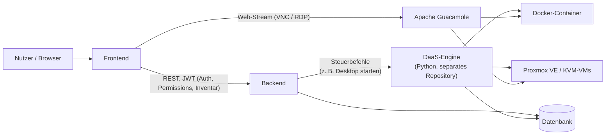

*Abbildung 2.1: Vereinfachte Architekturübersicht von DESIGN mit den beteiligten Komponenten (eigene
Darstellung, inhaltlich angelehnt an die Beschreibung der Komponenten in [1], [2]).*

### 2.1.1 Virtualisierungsarten: Hypervisoren und Container

Die beiden in DESIGN eingesetzten Virtualisierungsformen beruhen auf unterschiedlichen technischen
Grundprinzipien. Bei der klassischen Hardware-Virtualisierung unterscheidet die grundlegende Arbeit von
Popek und Goldberg zwischen zwei Bauarten eines *Hypervisors*: Ein **Typ-1-Hypervisor** (auch *Bare-Metal-
Hypervisor* genannt) läuft direkt auf der physischen Hardware ohne zwischengeschaltetes Betriebssystem und
verwaltet selbst die virtuellen Maschinen, während ein **Typ-2-Hypervisor** als gewöhnliche Anwendung
innerhalb eines bestehenden Host-Betriebssystems ausgeführt wird [21]. KVM (Kernel-based Virtual Machine),
auf dem Proxmox VE aufbaut, verwandelt den Linux-Kernel selbst in einen Typ-1-Hypervisor, indem es dessen
Prozessor- und Speicherverwaltung um Virtualisierungserweiterungen der CPU (Intel VT-x/AMD-V) ergänzt; jede
virtuelle Maschine erhält dadurch ein vollständig eigenes Betriebssystem mit eigenem Kernel, eigenem
Dateisystem und eigenen Gerätetreibern, was hohe Isolation, aber auch höheren Ressourcenverbrauch und
längere Start- und Bereitstellungszeiten mit sich bringt.

Containervirtualisierung mit **Docker** verfolgt demgegenüber einen grundsätzlich anderen Ansatz: Statt ein
eigenes Betriebssystem zu virtualisieren, teilen sich alle Container denselben Host-Betriebssystem-Kernel
und werden lediglich durch zwei Linux-Kernel-Mechanismen voneinander isoliert: *Namespaces* kapseln pro
Container jeweils eigene Sichten auf Prozess-IDs, Netzwerkschnittstellen, Dateisystem-Mountpunkte und
Hostnamen, sodass ein Prozess innerhalb eines Containers glaubt, exklusiven Zugriff auf diese Ressourcen zu
haben, während *Control Groups* (cgroups) begrenzen, wie viel CPU-Zeit, Arbeitsspeicher und I/O-Bandbreite
ein Container maximal verbrauchen darf. Eine Docker-Anwendung wird zudem als *Image* ausgeliefert, ein
schreibgeschütztes, in übereinanderliegenden Schichten (*Layers*) aufgebautes Dateisystem-Archiv, aus dem zur
Laufzeit ein beschreibbarer Container-Prozess gestartet wird. Weil dabei kein vollständiges Betriebssystem
gebootet werden muss, lassen sich Container in der Regel in Sekunden statt Minuten starten und klonen, was
die in [1] gemessenen Zeitunterschiede zwischen Docker und Windows-VMs erklärt [22].

### 2.1.2 Apache Guacamole: clientloses Remote-Desktop-Gateway

Technisch besteht Apache Guacamole aus zwei Hauptkomponenten: dem *guacamole-client*, einer Java-
Webanwendung, die im Browser über HTML5 und WebSockets eine grafische Oberfläche bereitstellt, und *guacd*,
einem nativen Hintergrunddienst, der die eigentliche Übersetzung zwischen Remote-Desktop-Protokollen (VNC,
RDP, SSH) und dem schlanken, textbasierten *Guacamole-Protokoll* vornimmt [23]. Der Browser spricht dabei zu
keinem Zeitpunkt direkt VNC oder RDP; stattdessen sendet guacd die Anzeige des entfernten Containers bzw.
der virtuellen Maschine als eine Folge einfacher Zeichenbefehle (z. B. "zeichne dieses Bildfragment an
Position x,y") über eine WebSocket-Verbindung an den Browser, der daraus mittels eines HTML5-Canvas-Elements
das Bild zusammensetzt. Dieser Ansatz erklärt, warum Guacamole als *clientlos* bezeichnet wird: Es genügt ein
gewöhnlicher Webbrowser, ohne dass Plugins, Java-Applets oder native RDP-/VNC-Clients installiert werden
müssen.

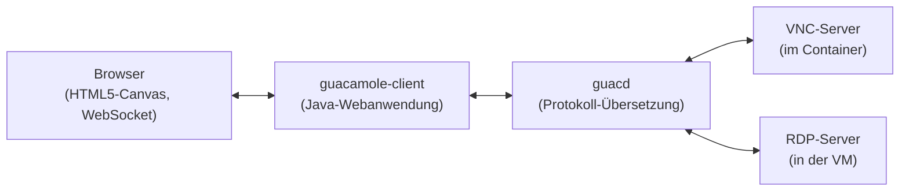

*Abbildung 2.2: Vereinfachte interne Architektur von Apache Guacamole (eigene Darstellung nach der
Beschreibung in [23]).*

## 2.2 Authentifizierung: OAuth2, JSON Web Token und RS256

Die Authentifizierung über OAuth2 und JSON Web Token beruht auf drei Standards, die unterschiedliche
Aufgaben übernehmen und erst im Zusammenspiel das vollständige Bild ergeben. OAuth 2.0 (RFC 6749) legt fest, *wer* unter
welchen Bedingungen ein Zugriffstoken bekommen darf, und definiert dafür Rollen und Abläufe,
sagt aber nichts darüber aus, wie dieses Token konkret aussieht [3]. JSON Web Token (RFC 7519) ist genau
dieses konkrete Tokenformat: ein kompaktes, textbasiertes Format, mit dem sich Ansprüche (*Claims*) über
einen Nutzer transportieren lassen [5]. RS256 schließlich ist kein eigener Standard, sondern ein in RFC 7518
definierter Signaturalgorithmus, der festlegt, wie ein solches JWT gegen Manipulation abgesichert wird [7].
Die folgenden Unterabschnitte erläutern diese Bausteine einzeln und beschreiben anschließend in 2.2.5, wie
Spring Security sie technisch zu einem vollständigen Authentifizierungs- und Autorisierungsablauf
zusammensetzt.

### 2.2.1 OAuth2: Rollen, Protokollablauf und Grant-Typen

RFC 6749 unterscheidet vier Rollen: den *Resource Owner* (die Person, der die geschützten Daten gehören,
also der Nutzer eines Systems), den *Client* (die Anwendung, die stellvertretend für den Nutzer auf eine
Ressource zugreifen möchte, z. B. eine Frontend-Anwendung), den *Authorization Server* (die Stelle, die nach
erfolgreicher Prüfung der Zugangsdaten ein Zugriffstoken ausstellt) und den *Resource Server* (die Stelle,
die dieses Token entgegennimmt, prüft und daraufhin die eigentlich angefragte Ressource liefert) [3]. In
vielen OAuth2-Systemen sind Authorization Server und Resource Server getrennte, eigenständige Dienste, zum
Beispiel wenn sich eine Anwendung über einen externen Anbieter wie Google oder Microsoft anmeldet. In
sogenannten Single-Vendor-Systemen, in denen Client und die eigenen APIs von derselben Partei betrieben
werden, ist es dagegen üblich, dass ein und derselbe Dienst beide Rollen gleichzeitig übernimmt: Er prüft
die Zugangsdaten und stellt das Token aus (Authorization Server) und validiert dieses Token anschließend bei
jeder nachfolgenden API-Anfrage, um die eigenen Endpunkte zu schützen (Resource Server).

Der abstrakte Protokollablauf nach RFC 6749 besteht aus vier Schritten: Der Client fordert vom
Ressourceninhaber eine Autorisierung an, erhält im Erfolgsfall einen *Authorization Grant* (einen Nachweis
dieser Zustimmung), tauscht diesen Grant beim Authorization Server gegen ein Zugriffstoken ein und verwendet
dieses Token schließlich beim Resource Server, um auf die geschützte Ressource zuzugreifen [3]. RFC 6749
definiert für den zweiten Schritt mehrere *Grant-Typen*, von denen die wichtigsten sind: der *Authorization-Code-Grant*,
bei dem der Nutzer über eine Weiterleitung auf einer separaten Login-Seite des
Authorization Servers seine Zugangsdaten eingibt, ohne dass der Client sie je zu sehen bekommt (das
Standardverfahren für Anwendungen Dritter); der *Client-Credentials-Grant*, bei dem kein Nutzer beteiligt
ist und eine Anwendung im eigenen Namen auf eine Ressource zugreift (etwa für Server-zu-Server-Kommunikation);
und der *Resource Owner Password Credentials Grant* (ROPC), bei dem der Client Benutzername und Passwort
direkt entgegennimmt und im Austausch gegen ein Token an den Authorization Server weiterreicht [3]. Ergänzend
beschreibt RFC 6749 den *Refresh-Token*-Mechanismus, mit dem ein Client ein abgelaufenes Zugriffstoken erneuern
kann, ohne dass der Nutzer seine Zugangsdaten erneut eingeben muss [3].

Abbildung 2.3 zeigt diesen abstrakten Ablauf am Beispiel des ROPC-Grants als konkreter Ausprägung des
zweiten Schritts.

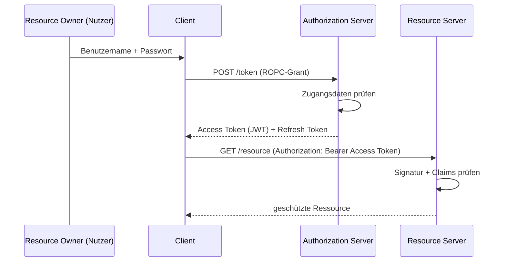

*Abbildung 2.3: Abstrakter OAuth2-Protokollablauf nach RFC 6749, Abschnitt 1.2, konkretisiert für den
Resource Owner Password Credentials Grant (eigene Darstellung).*

Die neuere IETF-Sicherheitsempfehlung RFC 9700 (*Best Current Practice for OAuth 2.0 Security*) empfiehlt,
auf den ROPC-Grant in neuen Systemen möglichst zu verzichten, unter anderem weil er sich schlecht mit
Mehr-Faktor-Authentifizierung verträgt und den Client dazu zwingt, mit Klartext-Zugangsdaten umzugehen [8].
Als sicherere Alternative gilt der Authorization-Code-Grant in Kombination mit der Erweiterung *Proof Key
for Code Exchange* (PKCE, RFC 7636) [24]: Der Client erzeugt dabei vor der Weiterleitung zufällig einen
geheimen Wert (*code_verifier*) und übermittelt nur dessen gehashten Wert (*code_challenge*) an den
Authorization Server; beim späteren Eintausch des Autorisierungscodes muss der Client den ursprünglichen
`code_verifier` erneut mitsenden, den der Authorization Server gegen die zuvor übermittelte
`code_challenge` prüft. Ein Angreifer, der lediglich den Autorisierungscode abfängt, kann diesen damit nicht
mehr gegen ein Token eintauschen, weil ihm der `code_verifier` fehlt. Abbildung 2.4 stellt diesen Ablauf dem
clientlosen Client-Credentials-Grant gegenüber, der ganz ohne Resource Owner auskommt.

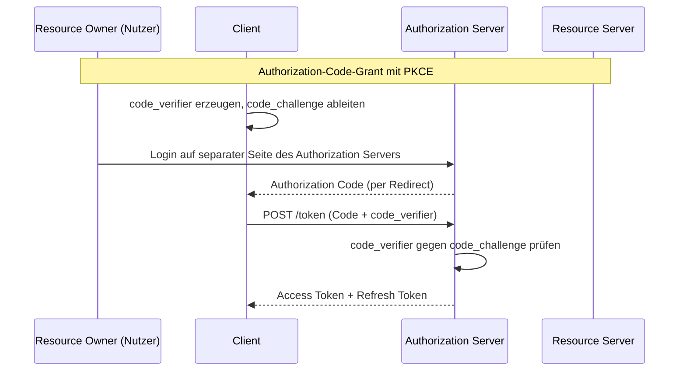

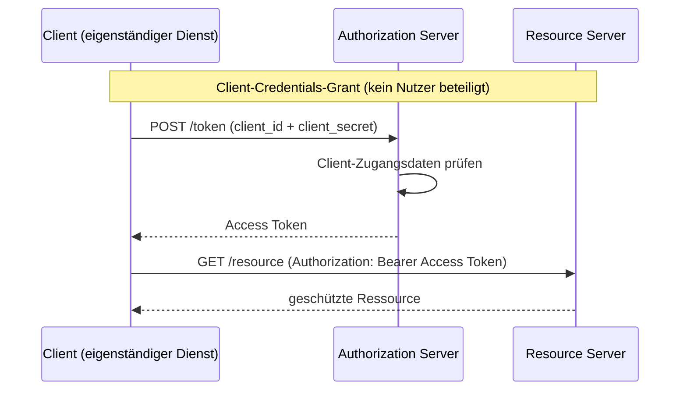

*Abbildung 2.4: Authorization-Code-Grant mit PKCE (oben) und Client-Credentials-Grant (unten) als zwei
weitere, in RFC 6749 bzw. RFC 7636 beschriebene Grant-Varianten (eigene Darstellung).*

Die Rückgabe und Verwendung des ausgestellten Tokens ist in RFC 6750 als sogenanntes *Bearer-Token*
beschrieben: Wer das Token besitzt, kann damit auf die Ressource zugreifen, unabhängig davon, ob er der
ursprüngliche Nutzer ist, weshalb die Übertragung ausschließlich über TLS erfolgen sollte [4]. *Transport
Layer Security* (TLS) ist ein kryptografisches Protokoll, das eine Netzwerkverbindung durch eine Kombination
aus asymmetrischer Schlüsselaushandlung und anschließender symmetrischer Verschlüsselung gegen Mitlesen und
Manipulation absichert und die Identität des Servers über ein Zertifikat bestätigt [26]; im Web wird TLS in
Kombination mit HTTP als HTTPS bezeichnet. Da ein Bearer-Token nicht an eine bestimmte Verbindung gebunden
ist, würde ein Angreifer, der ein Token auf einer unverschlüsselten Verbindung abfängt, damit uneingeschränkt
auf die Ressource zugreifen können; TLS ist daher für den produktiven Einsatz von Bearer-Token obligatorisch.
Der Client überträgt das Token bei jeder Anfrage im HTTP-Header `Authorization: Bearer <token>`; der
Resource Server muss daraus im Umkehrschluss keine eigene Sitzung führen, sondern kann die Anfrage allein
anhand des mitgesendeten Tokens beurteilen.

Da OAuth2 selbst keine Aussage über die *Identität* des angemeldeten Nutzers trifft, sondern nur über dessen
Zugriffsrechte, wurde darauf aufbauend der Standard *OpenID Connect* (OIDC) entwickelt: OIDC ergänzt OAuth2
um einen zusätzlichen, standardisierten *ID-Token* (selbst ein JWT) mit Identitätsangaben zum Nutzer sowie um
einen `/userinfo`-Endpunkt, über den weitere Profildaten abgerufen werden können [25]. OAuth2 allein
beantwortet damit die Frage "Darf dieser Client auf diese Ressource zugreifen?", während OIDC zusätzlich die
Frage "Wer ist der angemeldete Nutzer?" beantwortet.

### 2.2.2 JSON Web Token: Aufbau und Claims

Ein JWT ist, unabhängig vom OAuth2-Kontext, zunächst nur ein Format, um eine Menge von Ansprüchen (*Claims*)
kompakt und überprüfbar zu kodieren [5]. Ein JWT besteht aus drei durch Punkte getrennten, jeweils
Base64url-kodierten Teilen: einem Header, der unter anderem den Signaturalgorithmus benennt, einer Payload
mit den eigentlichen Claims und einer Signatur über die ersten beiden Teile [5], [6]. Abbildung 2.5 zeigt
diesen Aufbau schematisch.

```mermaid
flowchart LR
subgraph JWT["JWT = Base64url(Header) . Base64url(Payload) . Base64url(Signatur)"]
direction LR
H["Header\n{ \"alg\": \"RS256\",\n \"typ\": \"JWT\" }"]
P["Payload (Claims)\n{ \"iss\": ...,\n \"sub\": ...,\n \"exp\": ... }"]
S["Signatur\nüber Header + Payload"]
end
H -. " . " .-> P
P -. " . " .-> S
```

*Abbildung 2.5: Schematischer Aufbau eines JSON Web Tokens aus Header, Payload und Signatur nach RFC 7519
und RFC 7515 (eigene Darstellung).*

RFC 7519 unterscheidet dabei *registrierte Claims* mit festgelegter Bedeutung, etwa `iss` (Aussteller),
`sub` (Subjekt, meist die Nutzer-ID), `exp` (Ablaufzeitpunkt), `iat` (Ausstellungszeitpunkt) und `jti` (eine
eindeutige Token-ID), von frei definierbaren *privaten Claims*, die eine Anwendung nach eigenem Bedarf
ergänzen kann [5]. In der Praxis werden häufig beide Kategorien kombiniert: Ein Zugriffstoken enthält dann
sowohl die registrierten Claims (`iss`, `sub`, `iat`, `exp`, `jti`) als auch anwendungsspezifische private
Claims, über die beispielsweise eine Autorisierungsentscheidung getroffen werden kann (siehe 2.3).

Ein wichtiger Aspekt betrifft die Zustandslosigkeit von JWTs: Da ein signiertes JWT allein anhand seiner
Signatur als gültig erkannt wird, lässt es sich vor Ablauf der `exp`-Zeit nicht ohne Weiteres widerrufen.
Für kurzlebige *Zugriffstoken* wird dieses Verhalten häufig in Kauf genommen, weil eine kurze
Gültigkeitsdauer das Risiko begrenzt und sich durch eine zusätzliche Widerrufsprüfung (siehe 2.2.3) weiter
abfedern lässt. Für langlebigere, sicherheitskritische Token wie ein *Refresh-Token* wird dagegen häufig
bewusst **kein** JWT verwendet, sondern ein zufällig erzeugter, undurchsichtiger Wert, der serverseitig in
einer Datenbanktabelle gespeichert und bei Bedarf (z. B. beim Abmelden oder Sperren eines Nutzers) gezielt
gelöscht werden kann. Dieser Kontrast verdeutlicht eine grundsätzliche Abwägung beim Einsatz von JWTs: Ein
JWT eignet sich gut für kurzlebige, häufig geprüfte Token, bei denen der Verzicht auf eine Datenbankabfrage
einen echten Performancevorteil bringt, während ein langlebiges, sicherheitskritisches Token von der
serverseitigen Kontrollierbarkeit eines klassischen, zustandsbehafteten Tokens profitiert.

### 2.2.3 Signaturverfahren: RS256 statt HS256

Damit ein JWT gegen Manipulation geschützt ist, muss es signiert werden. Das Format und die zulässigen
Algorithmen für diese Signatur sind in zwei weiteren RFCs geregelt: RFC 7515 (JSON Web Signature, JWS)
beschreibt den strukturellen Aufbau eines signierten Tokens aus Header, Payload und Signatur [6], und
RFC 7518 (JSON Web Algorithms, JWA) definiert die konkreten Signaturalgorithmen, unter anderem HS256 und
RS256 [7]. Der naheliegendste Algorithmus, HS256 (HMAC mit SHA-256), ist symmetrisch: Aussteller und Prüfer
eines Tokens benötigen denselben geheimen Schlüssel. In einem System mit mehreren Diensten, die Token nur
lesen und prüfen müssen, aber selbst keine Token ausstellen dürfen, ist das ein Problem, denn jeder Dienst,
der ein Token verifizieren können soll, müsste das geheime Schlüsselmaterial erhalten, mit dem sich auch
beliebige neue Token erzeugen ließen.

RS256 (RSASSA-PKCS1-v1_5 mit SHA-256) löst dieses Problem, weil es ein asymmetrisches Verfahren ist: Die
Signatur wird mit einem privaten RSA-Schlüssel erzeugt, die Prüfung erfolgt dagegen mit dem zugehörigen
öffentlichen Schlüssel. Der private Schlüssel bleibt ausschließlich bei der ausstellenden Stelle, während
der öffentliche Schlüssel beliebig verteilt werden kann, zum Beispiel über einen JWK-Set-Endpunkt, ohne dass
dadurch die Möglichkeit entsteht, selbst gültige Token zu fälschen. In einer Systemlandschaft mit mehreren
Diensten bedeutet das: Nur die ausstellende Stelle besitzt den privaten Schlüssel und darf Token erzeugen,
während alle anderen Dienste Token ausschließlich mit dem öffentlichen Schlüssel prüfen können. Diese
Trennung ist der Hauptgrund, warum RS256 in Systemen mit mehreren Token-prüfenden Komponenten häufig
gegenüber HS256 bevorzugt wird.

Damit ein Resource Server den öffentlichen Schlüssel eines Ausstellers überhaupt kennt, definiert RFC 7517 (*JSON Web
Key*, JWK) ein standardisiertes JSON-Format, um einen einzelnen kryptografischen Schlüssel (Modulus und Exponent bei
RSA, Kurve und Punkt bei elliptischen Kurven) zu beschreiben [28]. Mehrere solche
Schlüssel lassen sich zu einem *JSON Web Key Set* (JWKS) zusammenfassen, das üblicherweise über einen
öffentlich erreichbaren HTTP-Endpunkt (häufig `/.well-known/jwks.json` oder `/oauth2/jwks`) bereitgestellt
wird. Jeder Schlüssel im Set trägt eine eindeutige Kennung (`kid`), die auch im Header eines JWT enthalten
ist, sodass ein Resource Server bei mehreren gleichzeitig gültigen Schlüsseln den passenden auswählen kann,
etwa während eines geplanten Schlüsselwechsels (*Key Rotation*), bei dem ein neuer Schlüssel bereits zum
Signieren neuer Token verwendet wird, während der alte öffentliche Schlüssel noch zur Prüfung bereits
ausgestellter, aber noch nicht abgelaufener Token vorgehalten wird.

### 2.2.4 Passwort-Hashing: bcrypt

Während RS256 und JWTs die Integrität und Übertragung eines bereits ausgestellten Tokens absichern, stellt
sich bei der ursprünglichen Anmeldung eine andere Frage: wie ein Passwort sicher gespeichert werden kann, um
es gegen einen erfolgreichen Datenbankeinbruch zu schützen. Die naheliegende Lösung, Passwörter mit einer
gewöhnlichen kryptografischen Hashfunktion wie SHA-256 zu speichern, ist dafür ungeeignet, weil solche
Hashfunktionen absichtlich sehr schnell berechenbar sind und sich damit in sehr kurzer Zeit Milliarden
möglicher Passwörter durchprobieren lassen (*Brute-Force*- bzw. *Rainbow-Table*-Angriffe). **bcrypt** ist
ein von Provos und Mazières vorgestelltes Passwort-Hashing-Verfahren, das auf der Blockchiffre Blowfish
aufbaut und absichtlich einen einstellbaren *Kostenfaktor* (auch *Work Factor* genannt) enthält, der
bestimmt, wie viele Runden der internen Schlüsselexpansion durchlaufen werden [27]. Eine Erhöhung dieses
Kostenfaktors um eins verdoppelt den Rechenaufwand pro Hash-Berechnung, wodurch sich bcrypt an steigende
Rechenleistung von Angreifern anpassen lässt, ohne den Algorithmus selbst zu ändern. Zusätzlich erzeugt
bcrypt für jedes Passwort automatisch einen zufälligen *Salt*, der zusammen mit Kostenfaktor und Hash-Wert in
einer einzigen Zeichenkette gespeichert wird; dadurch führt dasselbe Passwort bei zwei unterschiedlichen
Nutzern zu unterschiedlichen gespeicherten Werten, was vorberechnete Rainbow-Tables wirkungslos macht.

### 2.2.5 Spring Security, OAuth2-Ressourcenserver und die Rolle von Spring Authorization Server

Spring Security ist die Sicherheitskomponente des Spring-Frameworks und stellt Authentifizierung und
Autorisierung über eine Kette von Servlet-Filtern bereit, die sogenannte *SecurityFilterChain* [9]. Technisch
registriert Spring Security dafür einen einzigen Servlet-Filter namens `DelegatingFilterProxy` beim
Anwendungsserver, der jede Anfrage an eine intern verwaltete Kette von Sicherheitsfiltern weiterreicht; diese
Kette lässt sich pro Anwendung frei konfigurieren, ohne dass der Anwendungsserver selbst etwas davon merkt
[9]. Jede eingehende Anfrage durchläuft diese Kette, bevor sie den eigentlichen Controller erreicht. Für
JWT-basierte APIs bietet Spring Security die Rolle des *OAuth2 Resource Server*: Über den Baustein
`spring-boot-starter-oauth2-resource-server` wird der Filterkette automatisch ein `BearerTokenAuthenticationFilter`
hinzugefügt, der den `Authorization`-Header einer Anfrage ausliest und das darin enthaltene Bearer-Token zur
Prüfung an einen `AuthenticationManager` weiterreicht [9]. Dieser delegiert an den in 2.2.3 beschriebenen
`JwtDecoder`, der Signatur, Ablaufdatum, Aussteller und den anwendungsspezifischen Widerruf prüft. Ist das
Token gültig, wandelt ein `JwtAuthenticationConverter` die Claims in ein Spring-Security-Berechtigungsobjekt
(`Authentication`) um; dabei greift standardmäßig ein `JwtGrantedAuthoritiesConverter`, der den Inhalt des
`scope`-Claims (siehe 2.2.2) in einzelne `GrantedAuthority`-Objekte mit dem Präfix `SCOPE_` übersetzt, etwa
`SCOPE_admin` oder `SCOPE_user` [9]. Auf Basis dieser Authorities lassen sich sowohl URL-basierte
Sicherheitsregeln als auch methodenbasierte `@PreAuthorize`-Ausdrücke auf einzelnen Methoden formulieren, die
über die Annotation `@EnableMethodSecurity` aktiviert werden. Erst nachdem die `Authentication` erfolgreich im
`SecurityContextHolder` abgelegt wurde, können nachgelagerte Autorisierungsregeln (siehe 2.3) darauf
zugreifen.

Abbildung 2.6 fasst diesen Ablauf für eine bereits authentifizierte Anfrage zusammen und zeigt, an welcher
Stelle die in 2.2.2 bis 2.2.5 beschriebenen Konzepte (Claims, RS256-Signatur, Widerrufsprüfung) technisch
verankert sind.

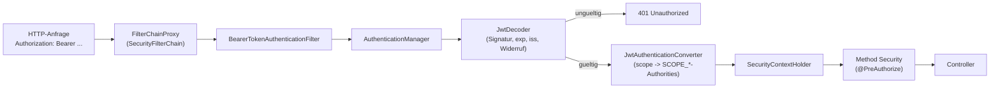

*Abbildung 2.6: Ablauf der Anfrageprüfung durch den OAuth2-Ressourcenserver in Spring Security, vereinfacht
auf die für JWT-basierte APIs relevanten Komponenten (eigene Darstellung nach der Beschreibung der
Resource-Server-Architektur in [9]).*

Neben Spring Security pflegt Broadcom/VMware ein eigenständiges Projekt namens *Spring Authorization
Server*, das einen vollständigen OAuth2- und OpenID-Connect-Autorisierungsserver mit eigenen Endpunkten für
Token-Ausstellung, Introspektion und Widerruf bereitstellt [10]. Dieses Projekt unterscheidet sich von der
in 2.2.5 beschriebenen Resource-Server-Rolle dadurch, dass es selbst sämtliche OAuth2-Endpunkte (`/oauth2/authorize`,
`/oauth2/token`, `/oauth2/introspect` usw.) bereitstellt, anstatt lediglich eingehende
Token zu prüfen. Als Alternative dazu kann ein Resource-Server-Baustein mit einer eigenen, schlankeren
Token-Ausstellung kombiniert werden: Der Starter `spring-boot-starter-oauth2-resource-server` bringt
transitiv die Bibliothek *Nimbus JOSE+JWT* mit, die Spring Security intern für das Erzeugen (`JwtEncoder`)
und Prüfen (`JwtDecoder`) von JWTs nutzt [11]. Auf dieser Grundlage lässt sich serverseitig ein
RSA-Schlüsselpaar erzeugen, lokal als JSON Web Key persistieren und sowohl zum Signieren neu ausgestellter
Token als auch, über den zugehörigen öffentlichen Schlüssel, zu deren Prüfung verwenden. Zusätzlich zur
Standardprüfung von Signatur, Ablaufdatum und Aussteller (*issuer*) lässt sich die Prüfkette um einen
anwendungsspezifischen Validator erweitern, der bereits ausgestellte, aber zwischenzeitlich widerrufene
Token anhand eines Datenbankeintrags erkennt. Das ist notwendig, weil ein JWT laut Spezifikation zustandslos
ist und ohne eine solche Zusatzprüfung bis zu seinem Ablauf gültig bliebe, selbst wenn sich der Nutzer
zwischenzeitlich abgemeldet hat oder gesperrt wurde.

Abbildung 2.7 stellt die beiden Architekturvarianten einander gegenüber.

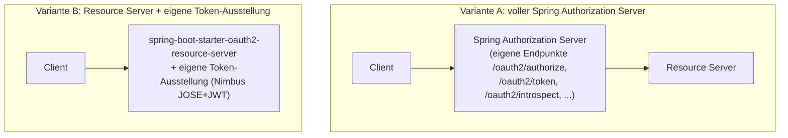

*Abbildung 2.7: Gegenüberstellung von Spring Authorization Server als eigenständigem Produkt und einer
schlankeren Lösung auf Basis des Resource-Server-Starters mit eigener Token-Ausstellung (eigene
Darstellung).*

Für weiterführende, bereits fertige Diagramme zu Spring Security und OAuth2 eignen sich folgende Quellen:
Die offizielle Spring-Security-Referenzdokumentation enthält im Kapitel "Architecture" ein ausführliches
Diagramm der Filterkette und der beteiligten Komponenten [9]. Die Referenzdokumentation von Spring
Authorization Server zeigt für jeden unterstützten Grant-Typ ein eigenes Sequenzdiagramm des
Protokollablaufs [10]. Als Buchquelle bietet sich "Spring Security in Action" von Laurentiu Spilca an, das
die Filterkette und die Rolle des Resource Servers mit zahlreichen eigenen Abbildungen erklärt [19]; für den
allgemeinen OAuth2-Teil, unabhängig von Spring, liefert "OAuth 2 in Action" von Justin Richer und Antonio
Sanso anschauliche Protokolldiagramme aus Client-, Authorization-Server- und Resource-Server-Perspektive [20].

## 2.3 Autorisierung und Berechtigungsmodelle

Neben der Authentifizierung (Wer ist der Nutzer?) ist die Autorisierung (Was darf der Nutzer?) ein eigener
Belang, für den sich in der Literatur mehrere grundlegende Modelle etabliert haben.

### 2.3.1 Zugriffskontrollmodelle: ACL, RBAC und ABAC

Das historisch älteste Modell ist die **Zugriffskontrollliste** (*Access Control List*, ACL): Jeder
geschützten Ressource wird dabei eine Liste zugeordnet, die für einzelne Nutzer oder Nutzergruppen festlegt,
welche Operationen (lesen, schreiben, ausführen usw.) erlaubt sind [30]. ACLs sind konzeptionell einfach,
skalieren aber schlecht, sobald sich Berechtigungen für viele Nutzer gleichzeitig ändern sollen, weil dann
unter Umständen jede einzelne Liste angepasst werden muss.

Die **rollenbasierte Zugriffskontrolle** (*Role-Based Access Control*, RBAC) löst dieses Skalierungsproblem,
indem sie eine zusätzliche Indirektionsebene einführt: Berechtigungen werden nicht direkt an einzelne Nutzer,
sondern an *Rollen* gebunden, denen wiederum beliebig viele Nutzer zugeordnet werden können. Eine Änderung an
den Rechten einer Rolle wirkt sich dadurch sofort auf alle ihr zugeordneten Nutzer aus. Das Modell wurde
durch den Standard ANSI/INCITS 359 formalisiert, der zusätzlich vier aufeinander aufbauende Ausbaustufen
unterscheidet: *Flat RBAC* als Minimalvariante mit reiner Nutzer-Rolle-Zuordnung, *Hierarchical RBAC*, das
zusätzlich Vererbungsbeziehungen zwischen Rollen erlaubt (eine spezialisierte Rolle erbt automatisch die
Rechte einer allgemeineren Rolle), *Constrained RBAC*, das Nebenbedingungen wie eine Pflicht zur
Funktionstrennung (*Separation of Duty*) zwischen bestimmten Rollen durchsetzt, und *Symmetric RBAC*, das
zusätzlich eine effiziente Abfrage ermöglicht, welche Nutzer eine bestimmte Berechtigung besitzen [12], [29].

Ein drittes, weiter gefasstes Modell ist die **attributbasierte Zugriffskontrolle** (*Attribute-Based Access
Control*, ABAC): Statt Berechtigungen über vordefinierte Rollen zu vergeben, trifft ABAC die
Zugriffsentscheidung zur Laufzeit anhand einer Kombination von Attributen des Nutzers (z. B. Abteilung,
Sicherheitsfreigabe), der Ressource (z. B. Vertraulichkeitsstufe), der geplanten Aktion und des Kontexts (z. B. Uhrzeit,
Standort, Netzwerk) [31]. ABAC ist dadurch deutlich ausdrucksstärker als RBAC und erlaubt
feingranulare, kontextabhängige Regeln, erkauft dies aber mit höherer Komplexität bei Entwurf, Pflege und
Nachvollziehbarkeit der Regeln. In der Praxis werden RBAC und ABAC häufig kombiniert, etwa indem eine Rolle
die grobe Zugriffskategorie vorgibt und zusätzliche Attributregeln diese im Einzelfall weiter einschränken.
Abbildung 2.8 stellt das Grundprinzip von RBAC dem von ABAC gegenüber.

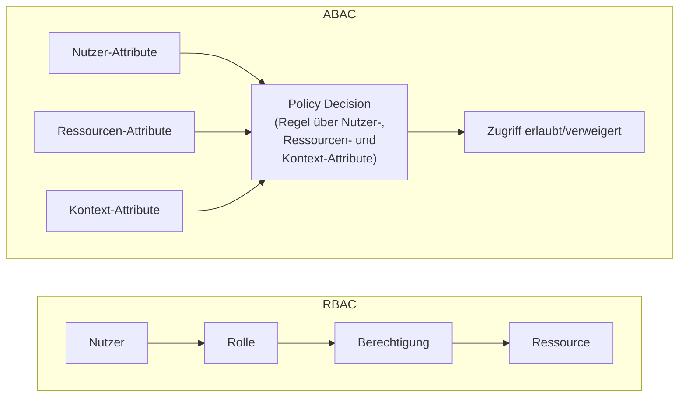

*Abbildung 2.8: Grundprinzip von RBAC (Zugriff über eine feste Rollen-Berechtigungs-Zuordnung) im Vergleich
zu ABAC (Zugriffsentscheidung zur Laufzeit anhand mehrerer Attribute) (eigene Darstellung).*

### 2.3.2 Mehrstufige Entscheidungskaskaden und Policy Enforcement

Systeme, die zusätzlich Berechtigungen für Gruppen von Nutzern und für einzelne Endpunkte oder Funktionen
getrennt verwalten, kombinieren RBAC häufig mit mehrstufigen Entscheidungs-Kaskaden. Dabei werden mehrere
Regelebenen nacheinander ausgewertet, zum Beispiel zuerst eine nutzerspezifische Regel, dann eine
gruppenspezifische Regel und erst zuletzt eine Standardregel, bis die erste Regel greift, die zu dieser
Anfrage passt. Begrifflich lässt sich eine solche Prüfung in zwei Rollen aufteilen, wie sie unter anderem im
XACML-Referenzmodell der OASIS verwendet werden: Der *Policy Enforcement Point* (PEP) ist die Stelle, die
eine Anfrage tatsächlich abfängt und entweder durchlässt oder blockiert (z. B. ein Sicherheitsfilter einer
Webanwendung), während der *Policy Decision Point* (PDP) die eigentliche Entscheidung anhand der
hinterlegten Regeln trifft und dem PEP lediglich ein Ergebnis ("erlaubt"/"verweigert") zurückliefert [32].
Diese Trennung erlaubt es, Entscheidungslogik (PDP) und Durchsetzung (PEP) unabhängig voneinander zu ändern,
etwa um dieselbe Entscheidungslogik an mehreren Durchsetzungspunkten wiederzuverwenden. Abbildung 2.9 zeigt
eine solche mehrstufige Kaskade als Entscheidungsbaum.

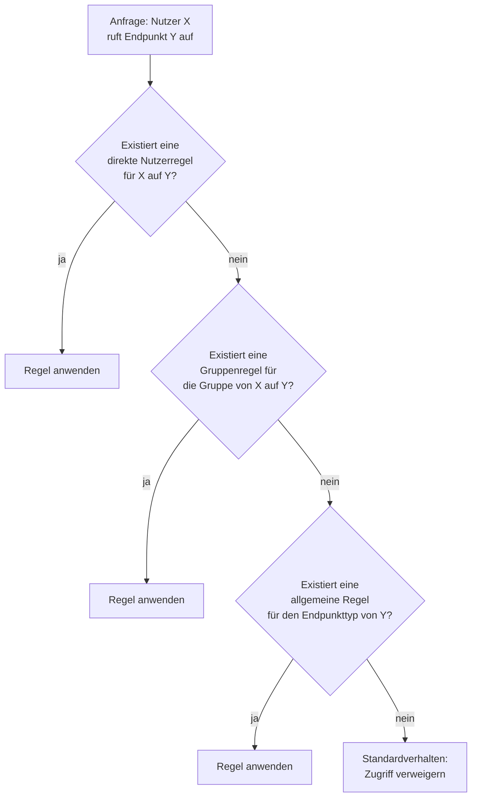

*Abbildung 2.9: Schematischer Entscheidungsbaum einer mehrstufigen Berechtigungskaskade (eigene
Darstellung).*

### 2.3.3 Fail-Safe Defaults und Default-Deny

Für den Fall, dass keine dieser Regeln zutrifft, stellt sich die Frage nach dem Standardverhalten des
Systems. Eine klassische Antwort liefert ein Prinzip des sicheren Systementwurfs, das bereits 1975 von
Saltzer und Schroeder unter dem Namen *fail-safe defaults* beschrieben wurde: Eine Zugriffsentscheidung
sollte grundsätzlich auf Verweigerung beruhen, und Zugriff darf nur gewährt werden, wenn eine Bedingung dies
ausdrücklich erlaubt, nicht umgekehrt [13]. In der Praxis wird dieses Verhalten häufig als *fail-closed* oder
*deny-by-default* bezeichnet und taucht auch in aktuellen Sicherheitsempfehlungen wieder auf, etwa in den
OWASP Proactive Controls, die eine konsequente Durchsetzung von Zugriffskontrollen mit Default-Deny als eine
der wichtigsten Maßnahmen gegen fehlerhafte Autorisierung nennen [14]. Dieses Prinzip lässt sich auf zwei
Ebenen anwenden: auf Ebene eines Sicherheits-Frameworks wie Spring Security, das standardmäßig eine
Authentifizierung für jede Anfrage verlangen und nur einzelne, bewusst ausgewählte Endpunkte davon ausnehmen
kann, sowie auf Ebene einer mehrstufigen Berechtigungskaskade, die nur dann ein Ergebnis ungleich
"verweigert" liefert, wenn in mindestens einer ihrer Stufen ausdrücklich eine erlaubende Regel gefunden
wird; ist keine Regel vorhanden oder ist der Nutzer unbekannt, bleibt es bei der Verweigerung.

## 2.4 Build-Werkzeuge, Spring Boot und Werkzeuge für Qualitätssicherung

### 2.4.1 Apache Maven: Build-Automatisierung und Abhängigkeitsverwaltung

Bevor eine Java-Anwendung ausgeführt werden kann, müssen ihre Quelldateien kompiliert, ihre Abhängigkeiten
aufgelöst und die Ergebnisse zu einem lauffähigen Artefakt (z. B. einer JAR-Datei) zusammengefügt werden. **Apache
Maven** ist ein Build-Automatisierungs- und Projektmanagement-Werkzeug für das Java-Ökosystem, das
diese Schritte deklarativ über eine zentrale Projektbeschreibungsdatei, die *Project Object Model*-Datei (`pom.xml`),
steuert [33]. In dieser Datei werden unter anderem die benötigten Abhängigkeiten (Bibliotheken
und deren Versionen) sowie zusätzliche *Plugins* für Spezialaufgaben (z. B. Testausführung, Code-Coverage-
Messung) deklariert; Maven lädt diese Abhängigkeiten automatisch aus einem zentralen Repository herunter und
löst dabei auch transitive Abhängigkeiten auf, also Abhängigkeiten der eigenen Abhängigkeiten. Maven
strukturiert jeden Build zudem in einen festen *Lifecycle* aus aufeinanderfolgenden Phasen, von denen die
wichtigsten `validate` (Projektstruktur prüfen), `compile` (Quellcode übersetzen), `test` (Tests ausführen),
`package` (Artefakt erzeugen) und `install` (Artefakt im lokalen Repository ablegen) sind; der Aufruf einer
späteren Phase führt dabei automatisch alle vorangehenden Phasen mit aus. Abbildung 2.10 zeigt diesen
Lifecycle vereinfacht.

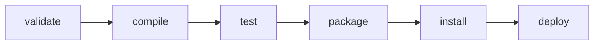

*Abbildung 2.10: Vereinfachter Maven-Build-Lifecycle mit den wichtigsten Standardphasen (eigene Darstellung
nach [33]).*

### 2.4.2 Spring Framework: Inversion of Control und Dependency Injection

Spring Boot baut auf dem klassischen **Spring Framework** auf, dessen zentrales Konzept die *Inversion of
Control* (IoC) ist: Statt dass ein Objekt seine benötigten Abhängigkeiten selbst erzeugt (z. B. über den
`new`-Operator), deklariert es lediglich, welche Abhängigkeiten es benötigt, und überlässt deren Erzeugung
und Verdrahtung einem übergeordneten *IoC-Container* [15]. Dieses Prinzip, bei dem die Kontrolle über den
Objektlebenszyklus vom Objekt selbst zu einem Container verlagert wird, wird auch als *Dependency Injection*
(DI) bezeichnet. Der Spring-IoC-Container verwaltet dafür sogenannte *Beans*: von Spring verwaltete
Objektinstanzen, die typischerweise über Annotationen wie `@Component`, `@Service` oder `@Repository`
markiert und beim Anwendungsstart automatisch erkannt werden. Benötigt eine Bean eine andere Bean, wird
diese Abhängigkeit meist über einen Konstruktorparameter deklariert; der Container erkennt diesen Bedarf,
sucht eine passende Bean-Instanz (oder erzeugt sie bei Bedarf selbst) und übergibt sie automatisch, ohne dass
die abhängige Klasse wissen muss, wie die konkrete Implementierung erzeugt wird. Dieser Mechanismus
erleichtert insbesondere automatisiertes Testen, weil sich echte Abhängigkeiten in Tests leicht durch
Platzhalterobjekte (*Mocks*, siehe 2.4.6) ersetzen lassen, sowie die lose Kopplung zwischen Schichten einer
Anwendung, da eine Klasse nur von einer Schnittstelle, nicht von einer konkreten Implementierung abhängt.
Spring Boot setzt auf diesem Container auf und ergänzt ihn um Auto-Konfiguration und Starter-Abhängigkeiten,
wie im folgenden Abschnitt beschrieben.

### 2.4.3 Spring Boot und ausgewählte Starter-Bausteine

Spring Boot ist ein Framework für das Java-Ökosystem, das auf dem klassischen Spring Framework aufbaut und
durch Konventionen und Auto-Konfiguration den Aufwand reduziert, eine eigenständig lauffähige,
produktionsreife Anwendung aufzusetzen [15]. Statt zahlreicher XML-Konfigurationsdateien genügt es in der
Regel, eine passende Abhängigkeit (einen sogenannten *Starter*) einzubinden, damit Spring Boot die zugehörige
Komponente automatisch mit sinnvollen Standardwerten konfiguriert; eigene Konfigurationsklassen überschreiben
diese Standardwerte bei Bedarf gezielt. Im Java-Ökosystem werden für typische Backend-Aufgaben unter anderem
folgende Bausteine eingesetzt:

- **spring-boot-starter-web** stellt die REST-Schicht bereit, also die Infrastruktur, über die Controller
  HTTP-Anfragen entgegennehmen und JSON-Antworten zurückgeben.
- **spring-boot-starter-security** und **spring-boot-starter-oauth2-resource-server** stellen zusammen die
  in 2.2 beschriebene JWT-basierte Authentifizierung als OAuth2-Ressourcenserver bereit.
- **spring-boot-starter-data-jpa** bindet Hibernate als Implementierung der Jakarta Persistence API (JPA)
  ein (siehe 2.4.4).
- **spring-boot-starter-validation** ermöglicht deklarative Eingabevalidierung über Jakarta-Bean-Validation-
  Annotationen (z. B. Pflichtfelder, Längen- oder Formatprüfungen) direkt an den Datenübertragungsobjekten.
- **spring-boot-starter-mail** und **spring-boot-starter-thymeleaf** werden häufig zusammen für den Versand
  von E-Mails mit dynamischem Inhalt genutzt: Thymeleaf ist eine serverseitige Template-Engine, die
  HTML-Inhalte aus Templates und Daten rendert; die resultierende HTML-Mail wird anschließend über die
  Mail-Starter-Komponente verschickt.
- **mariadb-java-client** ist der JDBC-Treiber, über den eine Java-Anwendung mit einer MariaDB-Datenbank
  kommuniziert (siehe 2.4.5).
- **springdoc-openapi-starter-webmvc-ui** erzeugt aus den Controller- und DTO-Klassen automatisch eine
  OpenAPI-Beschreibung der Schnittstelle sowie eine interaktive Swagger-UI zum Testen der Endpunkte.
- **lombok** reduziert Boilerplate-Code (Getter, Setter, Konstruktoren) über Annotationen, die zur
  Kompilierzeit in echten Java-Code übersetzt werden.
- **spring-boot-starter-test**, **spring-security-test** und **h2** bilden die Testinfrastruktur (siehe
  2.4.6): Der Test-Starter bringt JUnit 5 und Mockito mit, spring-security-test stellt Hilfsmittel bereit,
  um authentifizierte Anfragen in Tests zu simulieren, und die eingebettete Datenbank H2 ersetzt in
  Integrationstests eine produktive Datenbank, ohne dass dafür eine externe Datenbank laufen muss.
- **spring-boot-starter-actuator** stellt Health- und Monitoring-Endpunkte bereit, über die sich zur
  Laufzeit prüfen lässt, ob die Anwendung und ihre Abhängigkeiten (z. B. die Datenbankverbindung) korrekt
  funktionieren.

### 2.4.4 Objektrelationales Mapping: Hibernate und Jakarta Persistence API

Eine relationale Datenbank speichert Daten in Tabellen mit Zeilen und Spalten, während eine Java-Anwendung
mit Objekten und Referenzen zwischen ihnen arbeitet; dieser strukturelle Unterschied wird als *Impedance Mismatch*
bezeichnet. Die *Jakarta Persistence API* (JPA, vormals *Java Persistence API*) ist eine
Spezifikation, die festlegt, wie Java-Klassen (*Entities*) über Annotationen (`@Entity`, `@Id`, `@Column`,
`@OneToMany` usw.) auf Tabellen, Primärschlüssel, Spalten und Beziehungen abgebildet werden [34]. **Hibernate**
ist die am weitesten verbreitete Implementierung dieser Spezifikation und übernimmt die eigentliche Umsetzung:
Es übersetzt Lese- und Schreiboperationen auf Entity-Objekten automatisch in SQL-Anweisungen, verwaltet pro
Transaktion einen *Persistence Context* (auch *Session* genannt), der geladene Entities zwischenspeichert
und Änderungen an ihnen bis zum Transaktionsende sammelt, und erzeugt für häufige Zugriffsmuster automatisch
Datenbankabfragen, ohne dass dafür handgeschriebenes SQL notwendig ist. Abbildung 2.11 veranschaulicht diese
Abbildung zwischen einer Java-Klasse und einer Datenbanktabelle.

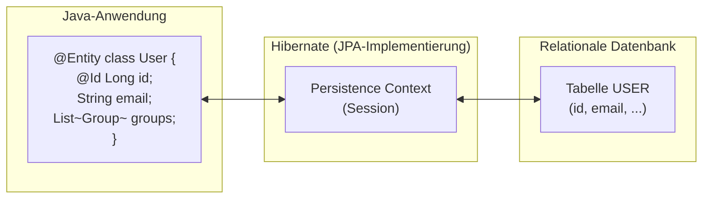

*Abbildung 2.11: Objektrelationales Mapping zwischen einer Java-Entity-Klasse und einer Datenbanktabelle über
Hibernate als JPA-Implementierung (eigene Darstellung).*

### 2.4.5 MariaDB

**MariaDB** ist ein quelloffenes, relationales Datenbankmanagementsystem, das 2009 als Fork von MySQL
entstand, nachdem MySQL von Oracle übernommen wurde, und seither von der unabhängigen MariaDB Foundation
weiterentwickelt wird [35]. MariaDB ist weitgehend protokoll- und datenformatkompatibel zu MySQL, bringt
darüber hinaus aber eigene Speicher-Engines (u. a. Aria, ColumnStore) und Erweiterungen mit. Der Zugriff
einer Java-Anwendung erfolgt klassisch über das *Java Database Connectivity*-API (JDBC), für das der
`mariadb-java-client` den datenbankspezifischen Treiber bereitstellt, der die JDBC-Aufrufe in das
MariaDB-eigene Netzwerkprotokoll übersetzt; Hibernate (siehe 2.4.4) setzt wiederum auf diesem JDBC-Treiber
auf.

### 2.4.6 Testwerkzeuge: JUnit 5 und Mockito

**JUnit 5** ist das Standard-Testframework für die JVM und stellt die Grundinfrastruktur bereit, um einzelne
Testfälle (annotiert mit `@Test`) zu deklarieren, zu gruppieren und automatisiert auszuführen; es bildet die
Basis der meisten Build-Werkzeuge (einschließlich Maven) zur Testausführung [36]. JUnit-Tests folgen
üblicherweise dem Schema *Arrange-Act-Assert*: Zunächst wird der Ausgangszustand hergestellt, dann die zu
testende Operation ausgeführt und abschließend das Ergebnis mit einer Erwartung verglichen. **Mockito** ist
eine Bibliothek, die dieses Schema um *Mock-Objekte* ergänzt: Statt eine echte Abhängigkeit (z. B. eine
Datenbankanbindung oder einen externen Dienst) in einem Test zu verwenden, erzeugt Mockito zur Laufzeit ein
Platzhalterobjekt, das dieselbe Schnittstelle implementiert, sich aber exakt so verhält, wie es der Test
vorgibt (z. B. "gib bei diesem Methodenaufruf diesen Wert zurück") [37]. Dadurch lässt sich eine einzelne
Klasse isoliert von ihren Abhängigkeiten testen (*Unit-Test*), ohne dass eine vollständige Anwendung mit
Datenbank oder Netzwerkzugriff gestartet werden muss; das durch die in 2.4.2 beschriebene Dependency
Injection ermöglichte lose Koppeln von Schnittstelle und Implementierung ist dabei die technische
Voraussetzung dafür, dass sich echte Abhängigkeiten überhaupt durch Mocks ersetzen lassen.

### 2.4.7 ArchUnit: Architekturregeln als Test

Spring Security selbst wurde bereits in 2.2 im Detail erläutert. Um die Einhaltung einer vorgesehenen
Schichtenarchitektur (z. B. Controller ruft nur Service, Service ruft nur Repository, nicht umgekehrt) über
die gesamte Projektlaufzeit hinweg automatisiert zu prüfen, existiert das Architektur-Testwerkzeug ArchUnit.
Mit ArchUnit lassen sich Regeln über erlaubte und verbotene Paketabhängigkeiten als ganz normale
JUnit-5-Tests formulieren, die bei jedem Build mitlaufen und damit verhindern, dass sich eine vorgesehene
Architektur unbemerkt im Laufe der Entwicklung auflöst [16].

### 2.4.8 Flyway: versionierte Datenbankmigrationen

Eine relationale Datenbank entwickelt sich über die Projektlaufzeit genauso weiter wie der Code: Tabellen
kommen hinzu, Spalten ändern sich, Indizes werden ergänzt. Flyway ist ein Werkzeug, das diese Änderungen als
nummerierte, unveränderliche SQL-Skripte (z. B. `V1__init.sql`, `V2__add_user_group.sql`) verwaltet [17]. Beim
Start der Anwendung vergleicht Flyway die im Projekt vorhandenen Migrationsskripte mit einer eigenen Tabelle
in der Zieldatenbank, in der bereits ausgeführte Migrationen protokolliert sind, und führt dann automatisch
genau die Skripte aus, die noch nicht angewendet wurden. Jedes ausgeführte Skript wird dabei mit einer
Prüfsumme versehen; wird eine bereits angewendete Migration nachträglich verändert, bricht Flyway beim
nächsten Start mit einem Fehler ab, anstatt eine möglicherweise inkonsistente Datenbank stillschweigend zu
akzeptieren. Das erlaubt es, ein Datenbankschema unter Versionskontrolle zu nehmen und nachvollziehbar
zwischen Entwicklungs-, Test- und Produktivumgebung synchron zu halten. Da dieselben Migrationsskripte auch
in Integrationstests gegen eine eingebettete Datenbank wie H2 ausgeführt werden können, lässt sich zudem
erreichen, dass Testumgebung und Produktivumgebung bezogen auf das Schema weitgehend identisch bleiben.

### 2.4.9 JaCoCo: Testabdeckung messen

JaCoCo (Java Code Coverage) ist ein Werkzeug, das zur Laufzeit misst, welche Teile des kompilierten Bytecodes
während der Testausführung tatsächlich durchlaufen wurden [18]. Technisch geschieht das über einen
Java-Agenten, der sich beim Start der Testausführung in die JVM einklinkt (bei Maven-Projekten üblicherweise
über das Build-Ziel `prepare-agent`) und jede ausgeführte Code-Zeile beziehungsweise jeden ausgeführten
Zweig (*branch*) mitzählt. Nach Abschluss der Tests erzeugt das zugehörige Ziel `report` einen HTML- und
XML-Bericht, der pro Klasse und Paket ausweist, wie hoch der Anteil an durch Tests abgedecktem Code ist. Ein
solcher Bericht dient häufig als objektive, automatisiert erzeugte Kennzahl zur Bewertung der Testabdeckung
und Testqualität eines Projekts.

---

## Verwendete Quellen in diesem Kapitel (IEEE, vorläufige Nummerierung)

```
[1]  C. Baun and J. Bouché, "Challenges and Solutions of Developing and Implementing a Novel
     Desktop-as-a-Service," in Proc. 20th Int. Conf. Mobile Web Intell. Inf. Syst. (MobiWis 2024),
     Vienna, Austria, Aug. 2024.
[2]  C. Baun and J. Bouché, "Closing the Gap between Web Applications and Desktop Applications by
     designing a novel Desktop-as-a-Service (DaaS) with seamless support for Desktop Applications,"
     Open Journal of Cloud Computing (OJCC), vol. 8, no. 1, pp. 1-19, 2023.
[3]  D. Hardt, Ed., "The OAuth 2.0 Authorization Framework," IETF, RFC 6749, Oct. 2012.
[4]  M. Jones and D. Hardt, "The OAuth 2.0 Authorization Framework: Bearer Token Usage," IETF,
     RFC 6750, Oct. 2012.
[5]  M. Jones, J. Bradley, and N. Sakimura, "JSON Web Token (JWT)," IETF, RFC 7519, May 2015.
[6]  M. Jones, J. Bradley, and N. Sakimura, "JSON Web Signature (JWS)," IETF, RFC 7515, May 2015.
[7]  M. Jones, "JSON Web Algorithms (JWA)," IETF, RFC 7518, May 2015.
[8]  T. Lodderstedt, J. Bradley, A. Labunets, and D. Fett, "Best Current Practice for OAuth 2.0 Security,"
     IETF, BCP 240, RFC 9700, Jan. 2025.
[9]  VMware/Broadcom, "Spring Security Reference Documentation." https://docs.spring.io/spring-security/
     reference/ (accessed Oct. 2026).
[10] VMware/Broadcom, "Spring Authorization Server Reference Documentation."
     https://docs.spring.io/spring-authorization-server/reference/ (accessed Oct. 2026).
[11] Connect2id Ltd., "Nimbus JOSE + JWT." https://connect2id.com/products/nimbus-jose-jwt (accessed Oct. 2026).
[12] American National Standards Institute, "Role Based Access Control," ANSI/INCITS 359-2004, 2004.
[13] J. H. Saltzer and M. D. Schroeder, "The protection of information in computer systems,"
     Proceedings of the IEEE, vol. 63, no. 9, pp. 1278-1308, Sep. 1975.
[14] OWASP Foundation, "OWASP Proactive Controls: C7 Enforce Access Controls."
     https://owasp.org/www-project-proactive-controls/ (accessed Oct. 2026).
[15] VMware/Broadcom, "Spring Boot Reference Documentation." https://docs.spring.io/spring-boot/
     (accessed Oct. 2026).
[16] TNG Technology Consulting, "ArchUnit - User Guide." https://www.archunit.org/userguide/html/000_Index.html
     (accessed Oct. 2026).
[17] Redgate Software, "Flyway Documentation: Migrations." https://documentation.red-gate.com/flyway
     (accessed Oct. 2026).
[18] EclEmma/Mountainminds, "JaCoCo Java Code Coverage Library - Documentation."
     https://www.jacoco.org/jacoco/trunk/doc/ (accessed Oct. 2026).
[19] L. Spilca, "Spring Security in Action," 2nd ed., Shelter Island, NY, USA: Manning Publications, 2024.
[20] J. Richer and A. Sanso, "OAuth 2 in Action," Shelter Island, NY, USA: Manning Publications, 2017.
[21] G. J. Popek and R. P. Goldberg, "Formal requirements for virtualizable third generation
     architectures," Communications of the ACM, vol. 17, no. 7, pp. 412-421, Jul. 1974.
[22] Docker Inc., "Docker overview" and "Namespaces, cgroups." https://docs.docker.com/get-started/overview/
     (accessed Oct. 2026).
[23] Apache Software Foundation, "Apache Guacamole Manual: Guacamole architecture." https://guacamole.
     apache.org/doc/gug/guacamole-architecture.html (accessed Oct. 2026).
[24] N. Sakimura, J. Bradley, and N. Agarwal, "Proof Key for Code Exchange by OAuth Public Clients," IETF,
     RFC 7636, Sep. 2015.
[25] N. Sakimura, J. Bradley, M. Jones, B. de Medeiros, and C. Mortimore, "OpenID Connect Core 1.0,"
     OpenID Foundation, Nov. 2014.
[26] E. Rescorla, "The Transport Layer Security (TLS) Protocol Version 1.3," IETF, RFC 8446, Aug. 2018.
[27] N. Provos and D. Mazières, "A future-adaptable password scheme," in Proc. USENIX Annual Technical
     Conference, Monterey, CA, USA, Jun. 1999.
[28] M. Jones, "JSON Web Key (JWK)," IETF, RFC 7517, May 2015.
[29] D. F. Ferraiolo, R. Sandhu, S. Gavrila, D. R. Kuhn, and R. Chandramouli, "Proposed NIST standard for
     role-based access control," ACM Transactions on Information and System Security, vol. 4, no. 3,
     pp. 224-274, Aug. 2001.
[30] P. Samarati and S. De Capitani di Vimercati, "Access control: Policies, models, and mechanisms," in
     Foundations of Security Analysis and Design, Lecture Notes in Computer Science, vol. 2171, Berlin,
     Germany: Springer, 2001, pp. 137-196.
[31] V. C. Hu et al., "Guide to Attribute Based Access Control (ABAC) Definition and Considerations,"
     NIST Special Publication 800-162, Jan. 2014.
[32] OASIS, "eXtensible Access Control Markup Language (XACML) Version 3.0," OASIS Standard, Jan. 2013.
[33] Apache Software Foundation, "Apache Maven: Introduction to the POM" and "Build Lifecycle Reference."
     https://maven.apache.org/guides/introduction/introduction-to-the-pom.html (accessed Oct. 2026).
[34] Eclipse Foundation, "Jakarta Persistence Specification," version 3.1, 2022;
     Red Hat, "Hibernate ORM User Guide." https://hibernate.org/orm/documentation/ (accessed Oct. 2026).
[35] MariaDB Foundation, "MariaDB Server Documentation." https://mariadb.com/kb/en/documentation/
     (accessed Oct. 2026).
[36] JUnit Team, "JUnit 5 User Guide." https://junit.org/junit5/docs/current/user-guide/ (accessed Oct. 2026).
[37] Mockito contributors, "Mockito Documentation." https://javadoc.io/doc/org.mockito/mockito-core/latest/
     org/mockito/Mockito.html (accessed Oct. 2026).
```

> Hinweis: Die Informatik-Spektrum-Quelle (doi: 10.1007/s00287-024-01583-x) ist inhaltlich sehr nah an [1]/[2]
> und sollte ergänzt werden, sobald geklärt ist, welche spezifischen Aussagen daraus zitiert werden
> (noch nicht im Volltext geprüft, `[Quelle fehlt]` falls ohne Volltextzugriff nicht verifizierbar).

## Offene Punkte zu diesem Kapitel

- [ ] Volltext des Informatik-Spektrum-Artikels (10.1007/s00287-024-01583-x) und des OJCC-Artikels beschaffen
  und die obigen Aussagen ggf. direkt daraus belegen/verfeinern (aktuell nur über die Folien gestützt).
- [ ] Alle Mermaid-Abbildungen (2.1 bis 2.11) bei Bedarf als Vektorgrafik bzw. als `.drawio`-Datei in das
  finale Textsatzsystem übernehmen.
- [ ] Quellenangaben [21]-[37] vor Abgabe noch einmal gegen Erstausgaben/offizielle Links verifizieren (bisher nur
  punktuell geprüft).

