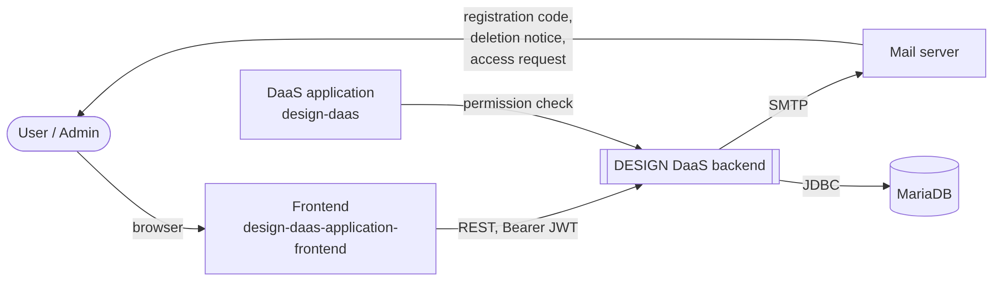
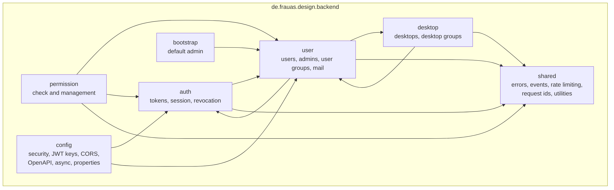
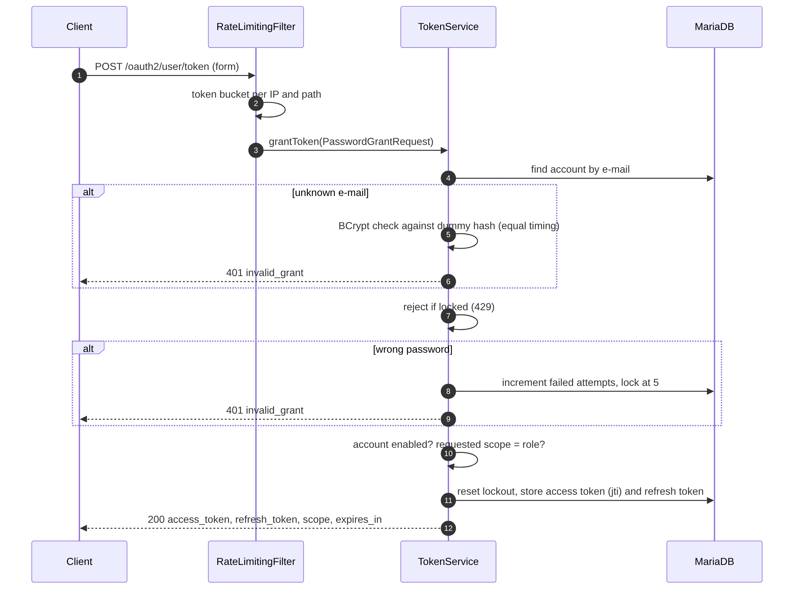
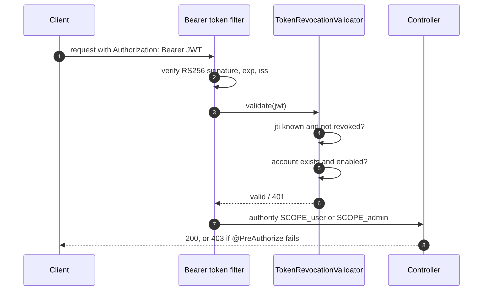
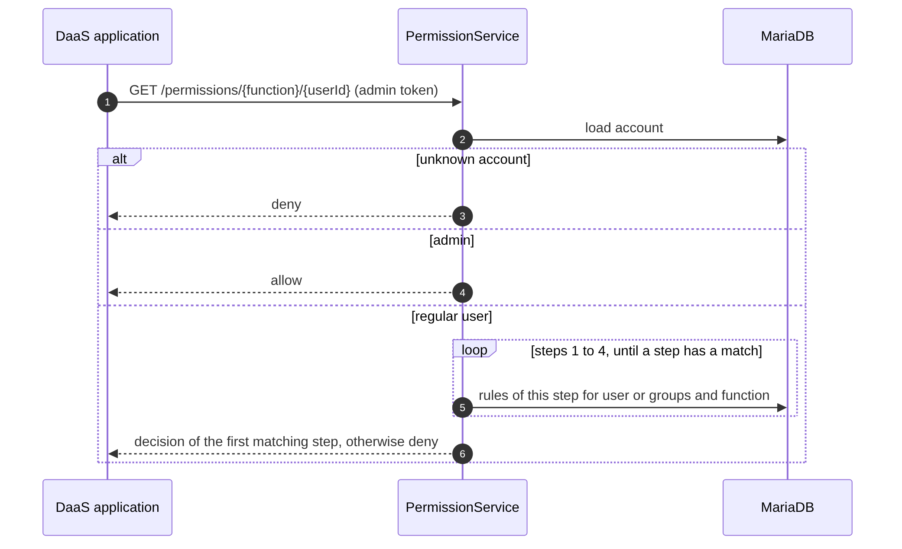
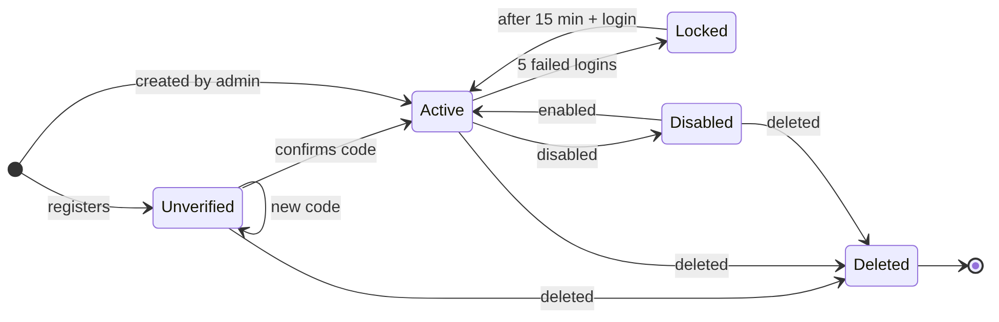
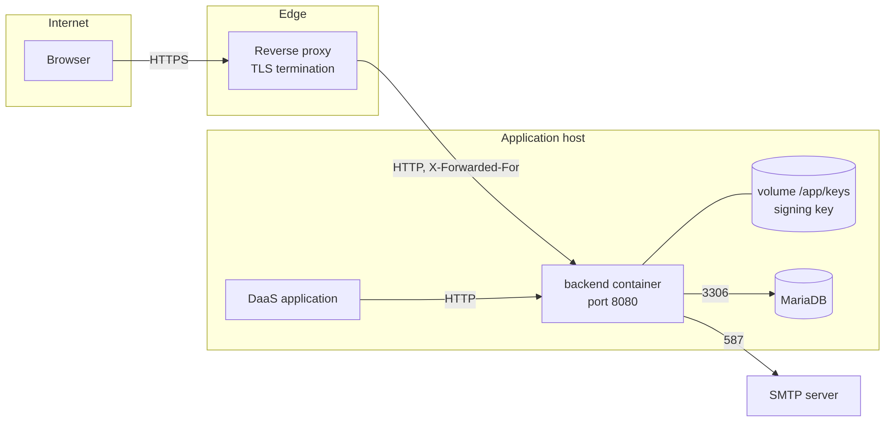
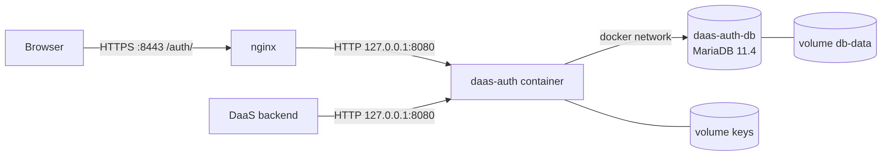
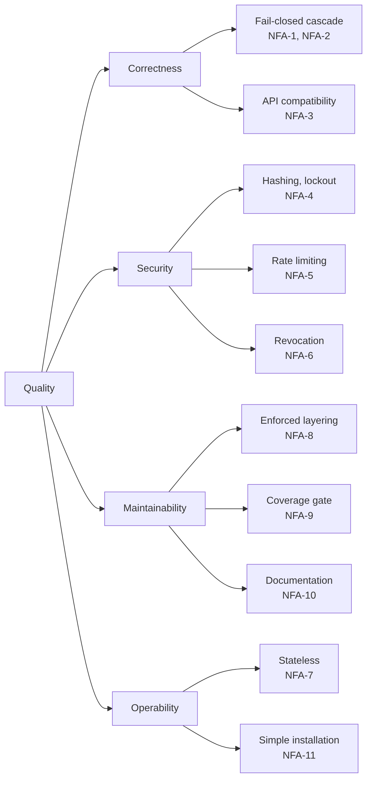

# Architecture documentation (arc42)

> **Audience:** architects and developers · **Template:** [arc42](https://arc42.org), version 8
> **Last reviewed:** 2026-11-13 · [Documentation index](../README.md#documentation)

This document explains how the DESIGN DaaS backend is built and why. It follows arc42, a common
template for architecture documentation. The requirement ids (FA-*n* for functional, NFA-*n* for
non-functional requirements) refer to chapter 3 of the accompanying master's thesis.

## At a glance

- **What it is:** one Spring Boot service that signs users in, manages accounts, groups and
  desktops, and answers the question *"may this user use this function?"* for the DaaS
  application.
- **Who uses it:** the web frontend (for people) and the DaaS application (for permission checks).
- **How it is built:** four feature modules (`auth`, `user`, `desktop`, `permission`), each split
  into the same layers. The build checks this structure automatically.
- **How it stays secure:** hashed passwords, signed tokens that can be cancelled at any time,
  account lockout, request limits, and a permission check that denies whenever in doubt.
- **How it runs:** a single container with a PostgreSQL database, configured through environment
  variables.

## How to read this document

| Section | Answers the question |
|---|---|
| [1. Introduction and goals](#1-introduction-and-goals) | What must the system do, and what matters most? |
| [2. Constraints](#2-constraints) | What was fixed from the start? |
| [3. Context and scope](#3-context-and-scope) | Which systems does it talk to? |
| [4. Solution strategy](#4-solution-strategy) | What is the basic approach to each goal? |
| [5. Building block view](#5-building-block-view) | Which parts does the code consist of? |
| [6. Runtime view](#6-runtime-view) | What happens during the important requests? |
| [7. Deployment view](#7-deployment-view) | Where and how does it run? |
| [8. Cross-cutting concepts](#8-cross-cutting-concepts) | Which rules apply everywhere (security, errors, logging)? |
| [9. Architecture decisions](#9-architecture-decisions) | Which important choices were made, and why? |
| [10. Quality requirements](#10-quality-requirements) | How do we know the goals are met? |
| [11. Risks and technical debt](#11-risks-and-technical-debt) | What is still weak, and what was fixed? |
| [12. Glossary](#12-glossary) | What do the terms mean? |

**Status markers** used in tables: ✅ implemented or passed · ❌ not implemented ·
high risk · medium risk.

---

## 1. Introduction and goals

### 1.1 Purpose

The backend is the identity, authorization and inventory service of DESIGN DaaS (Desktop as a
Service) at Frankfurt University of Applied Sciences. It replaces the earlier PHP/Symfony
backend. The frontend uses it to sign users in and to administer accounts, groups and desktops.
The DaaS application (design-daas) uses it to ask whether a user may call one of its functions.

### 1.2 Requirements overview

| Id | Requirement | Realized by | Status |
|---|---|---|---|
| FA-1 | Login with user name and password returns an access token | `POST /oauth2/user/token` (password grant) | ✅ |
| FA-2 | An expired access token can be renewed with a refresh token | `POST /oauth2/user/token` (refresh grant, rotation) | ✅ |
| FA-3 | Logout revokes the token on the server, before it expires | `POST /oauth2/user/logout` | ✅ |
| FA-4 | The session behind a valid token can be queried | `GET /oauth2/user/session` | ✅ |
| FA-5 | Self-registration with e-mail confirmation by a time-limited code | `POST /user`, `/user/validate_email`, `/user/resend_code` | ✅ |
| FA-6 | Admins list, view, change, enable/disable and delete users | `/users`, `/user/{id}` | ✅ |
| FA-7 | Admins create, list, view and delete admin accounts | `/admins`, `/admin`, `/admin/{id}` | ✅ |
| FA-8 | Admins manage user groups and link them to desktop groups | `/user_group*`, `/desktop_group/{id}/user_group/{ugId}` | ✅ |
| FA-9 | Users request access to an application; admins are notified by e-mail | `POST /user/request-application/…` | ✅ |
| FA-10 | Admins create, view and list desktops | `/desktops`, `/desktop` | ✅ |
| FA-11 | Admins create and list desktop groups and link them to user groups | `/desktop_groups`, `/desktop_group` | ✅ |
| FA-12 | Users check whether they have access to a desktop | Not provided, because neither client calls it (thesis, section 5.3) | ❌ |
| FA-13 | Check whether a user may call a function, using the four-step cascade | `/permissions/{fn}/{user}`, `/permissions_info` | ✅ |

### 1.3 Quality goals

| Priority | Quality goal | Related requirements | Main measures |
|---|---|---|---|
| 1 | **Correct, fail-closed authorization** | NFA-1, NFA-2 | Four-step cascade with fixed precedence, deny on any doubt, deny wins within a step |
| 2 | **Compatibility** with the clients of the PHP backend | NFA-3 | Same paths, methods, JSON fields and status codes for every endpoint the clients call |
| 3 | **Security** of accounts and tokens | NFA-4 – NFA-6 | BCrypt, account lockout, rate limiting, RS256 JWTs with server-side revocation |
| 4 | **Maintainability and testability** | NFA-8 – NFA-10 | Feature modules, ArchUnit rules, coverage gate in the build, generated API documentation |
| 5 | **Simple operation** | NFA-7, NFA-11 | Stateless service, one container, configuration through environment variables, Flyway |

### 1.4 Stakeholders

| Stakeholder | Expectation |
|---|---|
| Students and staff (end users) | Simple registration and login; reliable access to their desktops |
| Administrators | Manage accounts, groups, desktops and permissions without database access |
| Frontend developers | A stable, documented REST API |
| DaaS application (design-daas) | A fast and correct allow/deny answer |
| Operators | Simple installation, clear configuration, safe handling of secrets |
| Frankfurt UAS, future maintainers | A codebase that new contributors can understand and extend |

## 2. Constraints

| Category | Constraint | Background |
|---|---|---|
| Technical | Java 21, Spring Boot 4.1, PostgreSQL | Specified by the project; PostgreSQL is the one database server of the DESIGN stack |
| Technical | Deployable as a single container | Must fit the installer of the DaaS application (NFA-11) |
| Compatibility | Keep the API contract that the frontend and the DaaS application use | Both clients must keep working (NFA-3) |
| Organizational | University project with changing contributors | Documentation and automated checks matter more than personal knowledge |
| Legal | GDPR | Names and e-mail addresses are personal data. They are masked in logs and are part of the JWT, so tokens must be treated as personal data |
| Conventions | English code, comments and documentation | Common practice in open-source projects |

## 3. Context and scope

### 3.1 Business context



*Source: [`images/src/arc42-3-1-business-context.mmd`](images/src/arc42-3-1-business-context.mmd)*

| Partner | Exchanged data |
|---|---|
| Frontend | Credentials and tokens; users, admins, groups, desktops and permission data |
| DaaS application | Function name and user id (or token) → `allow` / `deny` |
| Mail server | Registration codes, account-deletion notices, application-access requests |
| PostgreSQL | All persistent state |

### 3.2 Technical context

| Interface | Protocol | Notes |
|---|---|---|
| REST API | HTTP/JSON; the token endpoint uses form encoding | TLS ends at the reverse proxy; the backend listens on port 8080 |
| Database | JDBC (PostgreSQL driver) | Schema owned by Flyway |
| Mail | SMTP with STARTTLS (port 587) | Optional; disabled by default |
| Health | `GET /actuator/health` | For container and load-balancer probes |
| Request correlation | `X-Request-ID` header | Shared by frontend, DaaS application and backend logs |

## 4. Solution strategy

| Goal | Approach |
|---|---|
| Compatibility (NFA-3) | Reproduce the used endpoints of the PHP backend exactly; drop unused ones; document every deviation ([API reference](api.md#14-differences-from-the-php-backend)) |
| Fail-closed authorization (NFA-1, NFA-2) | Port the permission cascade, but resolve conflicts within a step deterministically (deny wins) instead of by random group order |
| Revocable tokens (NFA-6) | Self-issued RS256 JWTs; every `jti` is stored and checked on each request |
| Stateless scaling (NFA-7) | No HTTP session; all state lives in PostgreSQL |
| Enforced architecture (NFA-8) | Package by feature, layered inside each module, checked by 19 ArchUnit rules |
| Enforced quality (NFA-9) | JaCoCo gate of 80 % line and branch coverage in `mvn verify`, run by CI on every push and pull request |
| Documentation that cannot drift (NFA-10) | OpenAPI generated from the code; Javadoc on every type and public method |
| Simple installation (NFA-11) | One container image, environment variables, schema created by Flyway, bootstrap admin |

## 5. Building block view

### 5.1 Level 1: modules



*Source: [`images/src/arc42-5-1-level-1-modules.mmd`](images/src/arc42-5-1-level-1-modules.mmd)*

| Module | Responsibility | Main classes |
|---|---|---|
| `auth` | Password and refresh grants, logout, session query, token revocation and cleanup | `TokenService`, `TokenIssuer`, `TokenRevocationValidator`, `TokenRevocationService` |
| `user` | Registration and verification, user and admin administration, user groups, e-mail | `UserService`, `AdminService`, `UserGroupService`, `MailService` |
| `desktop` | Desktop and desktop-group inventory, links to user groups | `DesktopService` |
| `permission` | Permission check (cascade) and maintenance of endpoints, endpoint groups and rules | `PermissionService`, `PermissionManagementService` |
| `shared` | Error mapping, cross-module events, rate limiting, request ids, password policy, log masking | `GlobalExceptionHandler`, `RateLimitingFilter`, `RequestIdFilter`, `AfterCommit` |
| `config` | Spring configuration and typed `app.*` properties | `SecurityConfig`, `AuthorizationServerConfig` |
| `bootstrap` | Startup tasks | `DataInitializer` |

The arrows show compile-time dependencies. `auth` ↔ `user` and `user` ↔ `desktop` depend on each
other in both directions; see [risk R-10](#111-open-risks-and-technical-debt).

### 5.2 Level 2: layers inside a module

```
controller ──► service ──► repository ──► model
     │            │
     └──► dto ◄───┘
```

| Layer | Responsibility | Enforced rule |
|---|---|---|
| `controller` | HTTP mapping, `@PreAuthorize`, request logging | Not used by any other layer |
| `service` | Business rules and transactions | Used only by controllers, config, other services and bootstrap |
| `repository` | Spring Data JPA queries | Used only by services, config and bootstrap |
| `model` | JPA entities | Does not depend on services or controllers |
| `dto` | Request and response types with `from(entity)` mappers | – |
| `exception` | Typed exceptions, each mapped to one HTTP status | – |

### 5.3 Level 2: authentication components

| Component | Responsibility |
|---|---|
| `TokenController` | Thin HTTP adapter for `/oauth2/user/token` and `/oauth2/user/logout` |
| `GrantRequest` | Sealed type with one record per grant; `TokenService` dispatches with an exhaustive `switch` |
| `TokenService` | Orchestrates both grants |
| `AccountLockoutService` | Five failures lock the account for 15 minutes |
| `ScopeResolver` | Scope equals the role; rejects any other requested scope |
| `TokenIssuer` | Signs JWTs and creates refresh tokens; stores both |
| `TokenRevocationValidator` | Part of the JWT decoder: rejects revoked tokens and missing or disabled users on every request |
| `TokenRevocationService` | Logout and revoke-all; listens for `UserSessionsInvalidatedEvent` |
| `TokenCleanupService` | Deletes expired tokens daily |

## 6. Runtime view

### 6.1 Login (password grant)



*Source: [`images/src/arc42-6-1-login-password-grant.mmd`](images/src/arc42-6-1-login-password-grant.mmd)*

### 6.2 Authenticated request



*Source: [`images/src/arc42-6-2-authenticated-request.mmd`](images/src/arc42-6-2-authenticated-request.mmd)*

### 6.3 Permission check by the DaaS application



*Source: [`images/src/arc42-6-3-permission-check-by-the-daas-application.mmd`](images/src/arc42-6-3-permission-check-by-the-daas-application.mmd)*

### 6.4 Registration and account deletion

Registration stores a disabled account with a code that is valid for 24 hours. After the
transaction commits, `AfterCommit` hands the e-mail to the asynchronous mail executor. Confirming
the code enables the account.

Deleting an account removes it with its tokens, memberships and rules (see
[Deletion behaviour](database.md#deletion-behaviour)) and e-mails a notice after the commit. An
admin cannot delete their own account or the last remaining admin.

### 6.5 Refresh-token rotation

The refresh grant reads the token with a pessimistic write lock (`SELECT … FOR UPDATE`). It
checks expiry and the account state, issues a new token pair and marks the old refresh token
revoked. Of two concurrent requests with the same token, exactly one succeeds; the other receives
`401 invalid_grant`.

### 6.6 Account lifecycle



*Source: [`images/src/arc42-6-6-account-lifecycle.mmd`](images/src/arc42-6-6-account-lifecycle.mmd)*

| State | Stored as | Can log in | Notes |
|---|---|---|---|
| Unverified | `enabled = false`, `registration_code` set | No | The code expires after 24 hours; a new one can be requested |
| Active | `enabled = true` | Yes | Admins start in this state |
| Locked | `locked_until` in the future | No | Lasts 15 minutes. Only a later successful login resets the counter |
| Disabled | `enabled = false` | No | All tokens are revoked at the moment of disabling |
| Deleted | Row removed | No | Tokens, memberships and rules are removed; a notice is e-mailed |

An admin enabling an account also enables an account whose e-mail was never verified.

### 6.7 Token lifecycle

| Event | Access token | Refresh token |
|---|---|---|
| Login | New one issued (valid 1 hour) | New one issued (valid 30 days) |
| Refresh | New one issued; the old one stays valid until it expires | Old one revoked; new one issued |
| Logout | The calling token is revoked | Revoked if sent with the request |
| Password change, disable, delete | All of the user's tokens revoked | All of the user's tokens revoked |
| Expiry | Rejected | Rejected; the row is deleted when it is next used |
| Daily cleanup (03:00) | Expired rows deleted | Expired rows deleted |

## 7. Deployment view

### 7.1 General deployment



*Source: [`images/src/arc42-7-1-general-deployment.mmd`](images/src/arc42-7-1-general-deployment.mmd)*

| Element | Notes |
|---|---|
| Container image | Multi-stage `Dockerfile`: Maven build, then `eclipse-temurin:21-jre-alpine` |
| Signing key | `rsa-jwk.json` in `/app/keys`; created on first start. Must persist and be shared by all replicas |
| Reverse proxy | Add its address to `RATE_LIMIT_TRUSTED_PROXIES`; otherwise all clients share one rate limit |
| Several replicas | Possible (NFA-7): revocation lives in the database. Rate-limit buckets are per instance, so the effective limit is *n* × the configured one |
| Installation | Locally with Maven, as a container, or with the other DESIGN components through the DaaS-application installer ([Operations guide](operations.md)) |

### 7.2 Reference installation with the DESIGN installer

The installer in the `design-daas` repository (`installer/auth/`) runs the backend on the same
host as the DaaS application:



*Source: [`images/src/arc42-7-2-reference-installation-with-the-design-installer.mmd`](images/src/arc42-7-2-reference-installation-with-the-design-installer.mmd)*

| Aspect | Setup |
|---|---|
| Service | systemd unit `daas-auth.service` starts a Docker Compose project with two containers: `daas-auth` (this backend) and `daas-auth-db` |
| Network | Port 8080 is bound to `127.0.0.1` only. Browsers reach the backend through nginx at `/auth/` on port 8443; the DaaS application connects locally |
| Proxy headers | nginx **overwrites** `X-Forwarded-For` with the client address, so clients cannot fake it. The backend trusts the header from `127.0.0.1`, `::1` and the Docker networks (`172.16.0.0/12`) |
| Configuration | `installer/daas.env` → generated `installer/auth/.env` (mode 600). Profile `prod` by default |
| Issuer | `AUTH_PUBLIC_URL`, by default the frontend URL plus `/auth` |
| Operations | `make auth-install`, `auth-check`, `auth-backup`, `auth-admin-password`, `auth-logs`, `auth-restart` (see the installer's README) |

## 8. Cross-cutting concepts

### 8.1 Security

| Concept | Implementation |
|---|---|
| Authentication | Stateless bearer JWTs, RS256 with a 2048-bit RSA key. Claims: `jti`, `iss`, `sub` (user id), `iat`, `exp`, `email`, `name`, `scope` |
| Authorization | `scope` → authority `SCOPE_user` / `SCOPE_admin`; `@PreAuthorize` on controllers |
| Revocation | Database lookup of `jti` and account state on every request. Disabling, changing the password and deleting revoke all of a user's tokens |
| Passwords | BCrypt with strength 12. Policy: 8–72 characters (BCrypt's input limit), upper and lower case, digit |
| Brute-force protection | Account lockout after five failures, plus per-IP token buckets on the four public endpoints |
| User enumeration | Equal timing for unknown accounts; `resend_code` always answers `202` |
| Secrets in logs | E-mails masked (`j***@example.org`); passwords and refresh tokens never logged |
| Transport | The backend speaks plain HTTP; TLS is provided by the reverse proxy |
| CSRF | Disabled: the API uses bearer tokens in a header, not cookies, so cross-site requests cannot authenticate |

#### Threats and countermeasures

| Threat | Countermeasure | Remaining risk |
|---|---|---|
| Password guessing for one account | Lockout after five failures; 20 logins per minute per IP | An attacker can keep a victim's account locked (R-5) |
| Password guessing across many accounts | Per-IP rate limit; BCrypt makes each check slow | Distributed attacks from many addresses |
| Finding out which e-mail addresses exist | Equal timing for unknown accounts; `resend_code` always `202` | Locked accounts and registration still reveal existence (R-3) |
| Stolen access token | Short lifetime (1 hour); revocation on logout, disable, password change | Usable until one of these happens |
| Stolen refresh token | Single use; rotation on every refresh | Plain-text storage in the database (R-1) |
| Forged token | RS256 signature and issuer check | Loss of the private key file |
| Privilege escalation | Scope fixed to the role; requested scopes checked; `@PreAuthorize` on every admin endpoint | – |
| Faked client address | `X-Forwarded-For` trusted only from configured proxies | Wrong proxy configuration |
| Information leakage in errors | Generic `500` body with a reference only | – |

### 8.2 Error handling

Services throw typed exceptions. Each one maps to exactly one HTTP status:

| Base type | Status |
|---|---|
| `NoSuchElementException` | 404 |
| `IllegalArgumentException` | 400 |
| `ConflictException` | 409 |
| `TokenGrantException`, `SessionException` | Status carried by the exception, with an OAuth2-style body |

`GlobalExceptionHandler` turns every other exception into a `500` whose support reference is the
request id. Stack traces and SQL details never leave the server.

### 8.3 Observability

- Every log line carries the request id (`[%X{requestId}]`). The id comes from the `X-Request-ID`
  header, or a new UUID is generated. It is echoed in the response, so one user action can be
  followed across frontend, DaaS application and backend.
- `GET /actuator/health` reports the overall status without component details.

### 8.4 Transactions and side effects

- Business operations are `@Transactional` at service level.
- The password grant uses `noRollbackFor = TokenGrantException`, so the failed-login counter is
  saved although the request fails.
- E-mails are sent only after the commit (`AfterCommit`), on a bounded executor (2–4 threads,
  queue of 100). A slow SMTP server never holds database locks or blocks requests.

### 8.5 Time and testability

All time-dependent logic (token expiry, lockout, registration codes) uses an injected `Clock`, so
tests can run with a fixed clock.

### 8.6 Data protection

| Personal data | Where | Retention |
|---|---|---|
| Name, e-mail address | `users` table; inside every access token | Until the account is deleted |
| Password | `users.password` as a BCrypt hash only | Until changed or deleted |
| Registration code | `users.registration_code` | Cleared after verification; replaced on resend |
| Login history | Not stored. Only the failed-login counter and lock time | Reset on successful login |
| Tokens | `access_tokens`, `refresh_tokens` (with user id) | Deleted daily after expiry, or with the account |
| Logs | Masked e-mail addresses, user ids, request ids | Depends on the log storage of the host |

- **Right to erasure:** `DELETE /user/{id}` removes the account and everything linked to it.
- **Right of access:** there is no export endpoint; an admin can read the account with
  `GET /user/{id}`.
- **Minimisation:** the backend stores no addresses, phone numbers or login history.

### 8.7 Configuration

All settings come from `application.yml`, overridden by a profile file (`application-<profile>.yml`)
and by environment variables. Secrets are passed only as environment variables. The full list is in
the [README](../README.md#configuration). Typed settings (`app.*`) are bound to classes in
`config.properties` and validated at startup, so a missing required value stops the application
immediately.

### 8.8 Testing

| Level | Tool | Count (2026-11-13) |
|---|---|---|
| Unit tests | JUnit 5, Mockito, AssertJ | 253 in 33 classes |
| Integration tests | Spring Boot test context, MockMvc, H2 | 96 in 12 classes |
| Migration test | Testcontainers with PostgreSQL 18 | 1 (needs Docker) |
| Architecture tests | ArchUnit | 19 rules |
| End-to-end tests | Playwright, in the `design-daas-e2e` repository | Separate suite |

The build fails if a test fails, an ArchUnit rule is broken, or line or branch coverage drops
below 80 %. The last run reached 95.6 % line and 87.3 % branch coverage.

### 8.9 Documentation

The API description is generated from the code (springdoc). Every type and public method has
Javadoc, and each module has a `package-info.java`. The conventions are in the
[Developer guide](development.md#code-documentation).

## 9. Architecture decisions

| Id | Decision | Rationale | Consequences |
|---|---|---|---|
| ADR-1 | Rewrite in Spring Boot, keeping the used API contract | Tender requirement; existing clients must keep working | Some unused PHP endpoints were dropped |
| ADR-2 | Self-issued JWTs instead of Spring Authorization Server or an external IdP | Only the password and refresh grants are needed; no extra service to operate | No SSO and no public key endpoint (JWKS): other services check tokens through `GET /oauth2/user/session`. Revisit if federated login is required |
| ADR-3 | Store every access token's `jti` and check it on each request | Logout and disabling must take effect immediately (NFA-6) | Two database reads per authenticated request |
| ADR-4 | Opaque, single-use refresh tokens with a row lock | Limits the damage of a stolen refresh token; prevents double redemption | One database write per refresh |
| ADR-5 | Package by feature with layering checked by ArchUnit | Architecture enforced by the build (NFA-8) | Rules must be kept in step with the package structure |
| ADR-6 | Flyway owns the schema; Hibernate only validates | Reproducible schema in every environment | Every schema change needs a migration |
| ADR-7 | Single-table inheritance for `Admin` and `User` | One e-mail namespace and one login path for both roles | A new role needs a new subclass and authority |
| ADR-8 | Resolve conflicts within a cascade step by "deny wins" | The PHP backend's result depended on random group order | Deterministic and fail-closed (NFA-1) |
| ADR-9 | Admins bypass the permission cascade | An empty rule table would otherwise lock admins out of the DaaS application | Single-user rules for admin accounts are rejected, because they would never be evaluated |
| ADR-10 | Permission data is maintained through the API; uniqueness enforced by V5 | Administrators need no database access | Duplicate rules are rejected with `409` |
| ADR-11 | In-memory rate limiting | Simple and sufficient for one instance | Limits are per instance; a gateway or Redis is needed for strict limits across replicas |

## 10. Quality requirements

### 10.1 Quality tree



*Source: [`images/src/arc42-10-1-quality-tree.mmd`](images/src/arc42-10-1-quality-tree.mmd)*

### 10.2 Quality scenarios

A quality scenario describes a concrete situation and the reaction the system must show. The
results are from the test run of 2026-11-13 (`mvn verify`: 369 tests, 0 failures, 1 skipped).

| Id | Scenario | Expected response | Requirement | Verified by | Result |
|---|---|---|---|---|---|
| QS-1 | The DaaS application checks a function for a user without matching rules | `deny` | NFA-1 | `PermissionServiceTest`, `PermissionControllerIntegrationTest` | ✅ Pass |
| QS-2 | A user is in two groups with an allow and a deny rule for the same function | `deny` | NFA-2, ADR-8 | `PermissionServiceTest` | ✅ Pass |
| QS-3 | An admin disables a user who is logged in | The user's next request returns `401` | NFA-6 | `AuthHardeningIntegrationTest` | ✅ Pass |
| QS-4 | An attacker tries passwords for one account | Locked after five attempts for 15 minutes | NFA-4 | `AccountLockoutServiceTest`, `AuthHardeningIntegrationTest` | ✅ Pass |
| QS-5 | A client sends more than 20 login requests per minute from one IP | `429` with `Retry-After` | NFA-5 | `RateLimitingFilterTest`, `TokenBucketTest` | ✅ Pass |
| QS-6 | A refresh token is used twice | The second use returns `401 invalid_grant` | FA-2 | `TokenControllerIntegrationTest` | ✅ Pass |
| QS-7 | A contributor puts a service in the wrong package | `mvn verify` fails | NFA-8 | `ArchitectureTest` | ✅ Pass |
| QS-8 | A change lowers line or branch coverage below 80 % | `mvn verify` fails | NFA-9 | JaCoCo `check` goal | ✅ Pass |
| QS-9 | A migration does not match the entities | The PostgreSQL integration test fails | ADR-6 | `FlywayPostgresIntegrationTest` | ✅ Pass (2026-11-17, PostgreSQL 18) |
| QS-10 | An unexpected exception occurs | `500` with a support reference only | Security | `GlobalExceptionHandlerTest` | ✅ Pass |

## 11. Risks and technical debt

Severity:  **High** (fix before production use) · **Medium** (fix soon) · **Low** (improve
when the code is touched) · **Info** (worth knowing). Each entry was checked against the code on
2026-11-13.

### 11.1 Open risks and technical debt

| Id | Severity | Finding | Location | Suggested measure |
|---|---|---|---|---|
| R-1 | Medium | Refresh tokens are stored in plain text. A database leak exposes usable tokens, and reusing a revoked token does not revoke the rest of the user's tokens | `TokenIssuer`, `RefreshTokenRepository` | Store a SHA-256 hash; revoke all of a user's tokens when a revoked token is reused |
| R-3 | Medium | Accounts can still be enumerated: a locked account answers `429` before the password check, and `POST /user` answers `400 Email already in use` | `TokenService`, `AccountValidator` | Accept and document, or return uniform responses |
| R-4 | Low | The application package logs at `DEBUG` in every profile, including `prod`. With mail disabled, registration codes appear in the log | `application.yml` | Set `INFO` in `application-prod.yml` |
| R-5 | Low | The account lockout is reset only by a successful login. One failure after the lock expires locks the account again, and admins cannot lift a lock | `AccountLockoutService` | Reset the counter when the lock expires; add an admin unlock |
| R-6 | Low | `EmailAlreadyInUseException` extends `IllegalArgumentException` and therefore returns `400` instead of `409` | `user.exception` | Extend `ConflictException`. This changes the API contract |
| R-7 | Low | The container runs as root and has no `HEALTHCHECK`. No Maven wrapper is committed (`.mvn/` is git-ignored) | `Dockerfile`, `.gitignore` | Add a `USER` and a `HEALTHCHECK`; commit `mvnw` |
| R-10 | Low | `auth` ↔ `user` and `user` ↔ `desktop` depend on each other in both directions. ArchUnit checks layers but not cycles between modules | Module structure | Add a `slices().should().beFreeOfCycles()` rule; move `JwtUserResolver` usage behind an interface |
| R-11 | Low | List endpoints are not paginated and load associations lazily (N+1 queries) | Services, DTO mappers | Fetch joins or `@EntityGraph`; `Pageable` |
| R-12 | Low | Each authenticated request makes two database reads (token and account) | `TokenRevocationValidator` | A short-lived cache or a single join query |
| R-13 | Low | `.env.example` uses `DB_PASSWORD=design_password`, while the defaults and the README use `design`. Its `MAIL_SMTP_AUTH` and `MAIL_SMTP_STARTTLS` are not read by the application | `.env.example`, `application.yml` | Align the values; remove the unused variables or wire them |
| R-14 | Info | CORS allows credentials, which bearer tokens do not need | `CorsConfig` | Disable unless cookies are introduced |
| R-15 | Info | The OpenAPI document reports version `1.0.0`; the build is `2.0.0` | `OpenApiConfig` | Read the version from build information |
| R-16 | Info | Token entities use `Instant.now()` in `revoke()` instead of the injected `Clock` | `auth.model` | Pass the time in |
| R-17 | Info | The `{isoCode}` path variable is validated but unused | `UserController` | Use it in the e-mail, or document it as reserved |
| R-18 | Info | Two classes are named `UserNotFoundException` (`auth.exception` → 401, `user.exception` → 404) | Exceptions | Rename the `auth` one |
| R-19 | Info | `AuthorizationServerConfig` configures JWT keys, not an authorization server | `config` | Rename to `JwtConfig` |
| R-21 | Info | The repository has no licence file | Repository root | Agree on a licence with the university and add `LICENSE` |
| R-22 | Low | An admin's own password cannot be changed through the API (`PATCH /user/{id}` only accepts regular users). The DESIGN installer works around this with a script that writes the hash into the database | `AdminController` | Add `PATCH /admin/{id}` or a "change my password" endpoint |
| R-23 | Low | The backend does not evaluate `X-Forwarded-Prefix`. Behind nginx at `/auth/`, Swagger UI may therefore show server URLs without the prefix. Not verified | `application.yml` | Set `server.forward-headers-strategy: framework` and test Swagger behind the proxy |
| R-24 | Info | The DaaS application caches permission answers for 30 seconds, so rule changes take up to 30 seconds to apply there | design-daas | Document for admins (done); shorten the cache if needed |

### 11.2 Resolved

| Former finding | Resolution | Status |
|---|---|---|
| Default admin with a well-known password created in production | Disabled in `prod` unless `ADMIN_INIT_ENABLED=true` | ✅ Fixed |
| Dummy hash cheaper than real hashes (timing-based enumeration) | Dummy hash is created at startup with the configured encoder | ✅ Fixed |
| Health endpoint required a token | `/actuator/health` is public and shows only the overall status | ✅ Fixed |
| `/version` was public but had no handler | Rule removed; the health endpoint replaces it | ✅ Fixed |
| Token endpoint accepted JSON but ignored it | Only form data is accepted; JSON returns `415` | ✅ Fixed |
| Migrations were never tested against the real database | `FlywayPostgresIntegrationTest` (Testcontainers; was `FlywayMariaDbIntegrationTest` until the move to PostgreSQL) | ✅ Fixed |
| Token bucket lost fractional refills; bucket map grew without bound | Fractions are kept; full buckets are evicted every five minutes | ✅ Fixed |
| No API for deleting resources or maintaining permission rules | Delete endpoints and the permission management API | ✅ Fixed |
| Duplicate rules possible | Unique constraints in V5 | ✅ Fixed |
| The last-admin check could be bypassed by two concurrent deletions | The admin rows are locked (`SELECT … FOR UPDATE`) and counted from the locked result | ✅ Fixed |
| The 500 support reference was a separate UUID, unrelated to the request's other log lines | The reference is now the request id | ✅ Fixed |
| Rules for admin accounts were accepted although admins bypass the cascade | Single-user rules for admins are rejected with `400` | ✅ Fixed |

## 12. Glossary

| Term | Definition |
|---|---|
| **Access token** | Short-lived signed JWT sent as `Authorization: Bearer …` |
| **Admin** | Account with the `admin` role; manages the platform and always passes the permission check |
| **Cascade** | The four-step permission check, from user-endpoint rules to group-endpoint-group rules |
| **DaaS** | Desktop as a Service: desktops delivered over the network |
| **DaaS application (design-daas)** | The DESIGN component that runs desktops and calls the permission check |
| **Desktop group** | A set of desktops that is granted to user groups as a whole |
| **Endpoint** | A DaaS-application function, identified by its function name, that rules can target |
| **Endpoint group** | A named bundle of endpoints |
| **Fail-closed** | Any doubt (unknown user, unknown function, no rule) results in deny |
| **jti** | JWT ID: the unique token id used for revocation |
| **Lockout** | Temporary login block after five consecutive failed attempts |
| **Refresh token** | Long-lived random value, exchanged once for a new token pair |
| **Request id** | Value of `X-Request-ID`, written into every log line of a request |
| **Revocation** | Making a token invalid before it expires |
| **Rule** | An allow or deny decision for one subject (user or user group) and one target (endpoint or endpoint group) |
| **Scope** | The permission level in the token; always equal to the account's role |
| **User group** | A set of regular users, for example a course |
