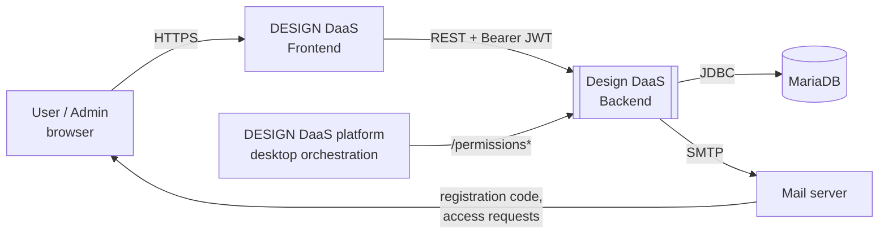
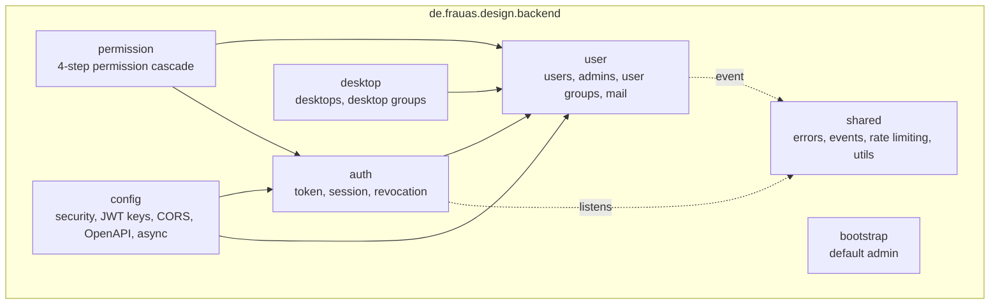
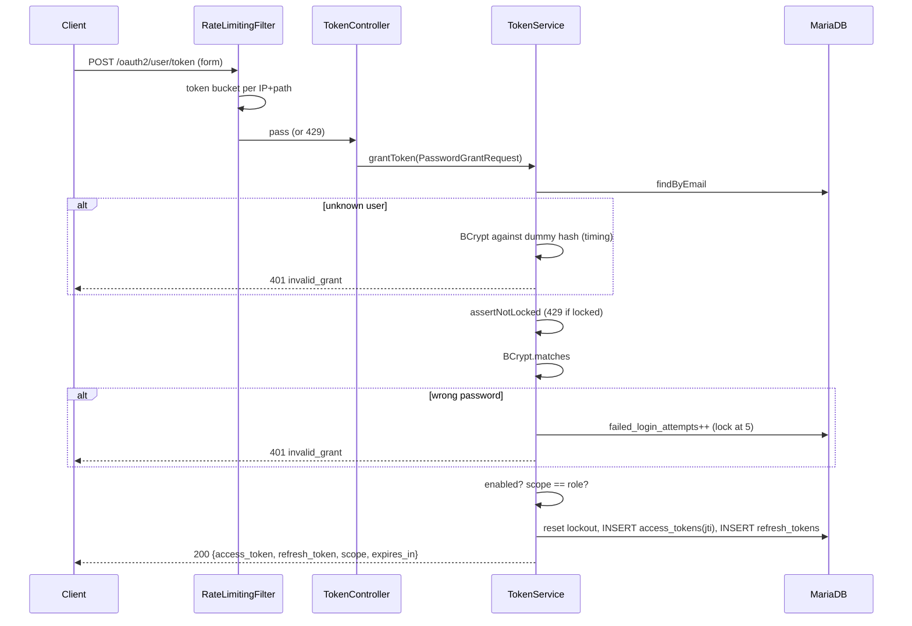
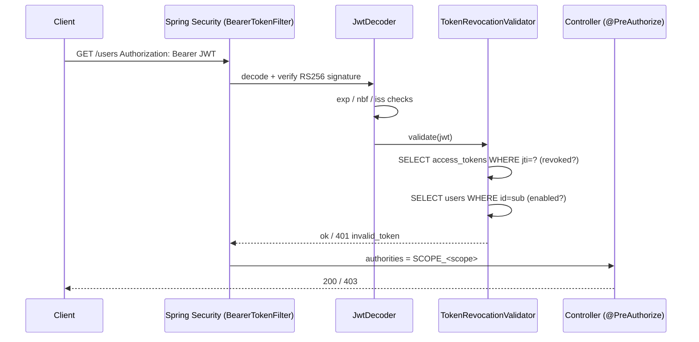
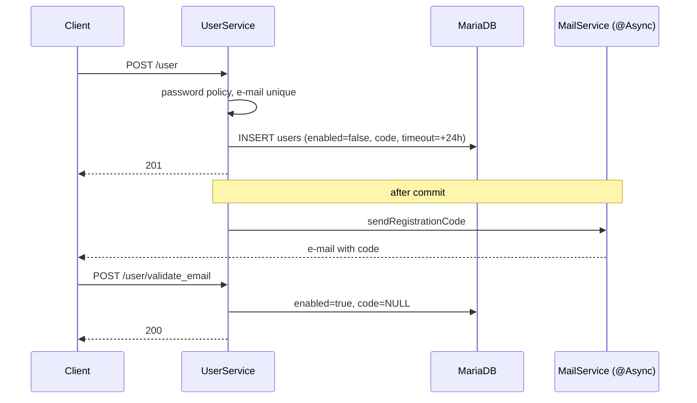
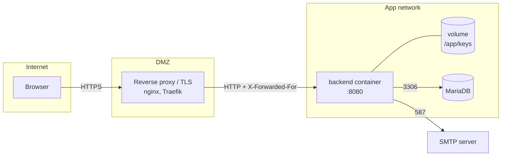

[README](../README.md) · [User manual](user-manual.md) · [API](api.md) · [Database](database.md) · [Architecture (arc42)](arc42.md) · [Development](development.md) · [Operations](operations.md)

# Architecture documentation (arc42)

## 1. Introduction and goals

**Purpose.** The backend is the identity, authorization and inventory service of DESIGN DaaS.
Frontends and the DESIGN DaaS platform use it to authenticate users, manage who may use which
desktops, and ask whether a user may run a given function.

**Main quality goals**

| Priority | Goal | How it is achieved |
|---|---|---|
| 1 | **Security** | BCrypt(12), RS256 JWTs, server-side revocation checked on every request, token rotation, account lockout, IP rate limiting, no stack traces in responses, PII masked in logs |
| 2 | **Compatibility** with the legacy PHP API | Same paths (`/user_group`, `/permissions_info`, ...), snake_case JSON, same permission cascade and response shape |
| 3 | **Maintainability** | Feature packages, thin controllers, ArchUnit-enforced layering, injected `Clock`, sealed `GrantRequest` type |
| 4 | **Operability** | Flyway migrations, 12-factor configuration through environment variables, Docker image, scheduled token cleanup |

**Stakeholders**

| Role | Expectation |
|---|---|
| End users (students, staff) | Easy registration and login, reliable access to their desktops |
| Admins | Manage users, groups, desktops and access |
| Frontend developers | A stable, documented REST API (Swagger) |
| DESIGN DaaS platform | A fast, correct allow/deny answer |
| Ops / DevOps | Simple deployment, clear configuration, safe secrets handling |
| Frankfurt UAS / maintainers | A codebase that students can understand and extend |

## 2. Constraints

| Type | Constraint |
|---|---|
| Technical | Java 21, Spring Boot 4.x, MariaDB, deployable as a single container |
| Technical | Must keep the PHP backend's API contract for existing clients |
| Organizational | University project; contributors change regularly, so documentation and tests matter |
| Legal | GDPR: e-mail addresses and names are personal data. JWTs contain `email` and `name`, and logs mask e-mails |
| Conventions | Classes end in `*Controller`, `*Service` and `*Repository` and live in the matching package (checked by ArchUnit) |

## 3. Context and scope



| Partner | Interface | Data |
|---|---|---|
| Frontend | REST/JSON, OAuth2-style token endpoint | Credentials, tokens, users, groups, desktops |
| DESIGN DaaS platform | `GET /permissions/{fn}/{user}`, `POST /permissions_info` | Function name, user id or token → allow/deny |
| MariaDB | JDBC | All persistent state |
| SMTP server | SMTP + STARTTLS | Registration codes, application-access requests |

## 4. Solution strategy

| Decision | Reason |
|---|---|
| **Self-issued JWTs** (Nimbus via Spring Security's `JwtEncoder`) instead of Spring Authorization Server or an external IdP | Simple password and refresh grants with the legacy API shape, and no extra infrastructure |
| **Stateful revocation** (every `jti` is stored and checked) | Logout, disable and password change must take effect immediately, not after the token expires |
| **Opaque, rotating refresh tokens** with a pessimistic lock | Stolen refresh tokens are single-use, and concurrent refreshes cannot both succeed |
| **Package by feature** (`auth`, `user`, `desktop`, `permission`) plus `shared` | Clear module boundaries and easier onboarding |
| **Events between modules** (`UserSessionsInvalidatedEvent`) | `user` can trigger token revocation without depending on `auth` |
| **Flyway + `ddl-auto: validate`** | Reproducible schema; Hibernate never changes production tables |
| **Mail after commit + bounded async pool** | A slow SMTP server never blocks requests or holds DB locks |

## 5. Building block view

### Level 1: modules



### Level 2: layers inside each module (checked by ArchUnit)

```
controller  →  service  →  repository  →  model
    ↓             ↓
   dto          dto
```

| Package | Responsibility |
|---|---|
| `*.controller` | HTTP mapping, `@PreAuthorize`, request logging. No business logic |
| `*.service` | Business rules, transactions |
| `*.repository` | Spring Data JPA interfaces and JPQL |
| `*.model` | JPA entities |
| `*.dto` | Request and response types, plus `from(entity)` mappers |
| `*.exception` | Typed exceptions mapped to HTTP status codes |

### Important classes

| Class | Role |
|---|---|
| `SecurityConfig` | Filter chain: stateless, CSRF off, public paths, JWT resource server |
| `AuthorizationServerConfig` | Loads or creates the RSA key; `JwtEncoder`; `JwtDecoder` with issuer and revocation validators |
| `TokenService` | Password and refresh grants (coordinates the next three classes) |
| `TokenIssuer` | Creates and stores access JWTs and refresh tokens |
| `AccountLockoutService` | 5 failures → 15 min lock |
| `ScopeResolver` | Scope = role; stops scope escalation |
| `TokenRevocationValidator` | Runs on **every** request: `jti` known and not revoked, user exists and is enabled |
| `TokenRevocationService` | Logout and revoke-all (listens for `UserSessionsInvalidatedEvent`) |
| `TokenCleanupService` | Daily purge of expired tokens |
| `PermissionService` | 4-step cascade |
| `RateLimitingFilter` / `RateLimiter` / `TokenBucket` | Per-IP, per-path limits in memory |
| `ClientIpResolver` | Trusts `X-Forwarded-For` only from trusted proxy CIDRs |
| `GlobalExceptionHandler` | Maps exceptions to `{message}`; returns a correlation ID for 500s |
| `DataInitializer` | Creates the bootstrap admin |

## 6. Runtime view

### Login (password grant)



### Authenticated request



### Registration



### Refresh-token rotation

The refresh grant runs `SELECT ... FOR UPDATE` on the token (`PESSIMISTIC_WRITE`), checks expiry
and that the user is enabled, issues a new access token and refresh token, and marks the old
refresh token `revoked`. A second request with the same token gets `401 invalid_grant`.

## 7. Deployment view



- TLS ends at the reverse proxy. Add the proxy's IP or CIDR to `RATE_LIMIT_TRUSTED_PROXIES`;
  otherwise all clients share the proxy's IP for rate limiting.
- **Running several replicas:** all of them must share the key volume (or the same key file).
  Rate-limit buckets are **per instance**, so the effective limit is N × the configured limit.
  Token revocation is safe because it lives in the database.

## 8. Cross-cutting concepts

| Concept | Implementation |
|---|---|
| **Authentication** | Stateless JWT bearer tokens. RS256 with a 2048-bit key from `rsa-jwk.json`. Claims: `jti, iss, sub (user id), iat, exp, email, name, scope` |
| **Authorization** | `scope` claim → authority `SCOPE_admin` / `SCOPE_user`; `@PreAuthorize(Authorities.IS_ADMIN)` on controllers or methods |
| **Revocation** | DB lookup of `jti` and user `enabled` on every request |
| **Passwords** | BCrypt strength 12; policy regex in `PasswordPolicy` |
| **Brute force** | Per-account lockout plus per-IP token bucket |
| **Validation** | Jakarta Bean Validation on DTOs and path variables; errors → `400 {message}` |
| **Error handling** | `GlobalExceptionHandler` (global) and `TokenExceptionHandler` / `SessionExceptionHandler` (scoped by marker annotations `@TokenEndpoint` / `@SessionEndpoint`) |
| **Logging** | SLF4J/Logback. E-mails masked with `LogMasking.maskEmail` (`j***@example.org`). Refresh tokens are never logged |
| **Time** | Injected `Clock` (UTC) for testable expiry logic |
| **Transactions** | Service-level `@Transactional`; `noRollbackFor = TokenGrantException` so the failed-login counter is saved even when login fails |
| **Async** | `@Async` mail on a bounded pool (2–4 threads, queue 100); tasks are dropped when the queue is full |
| **Scheduling** | `@Scheduled` token cleanup |
| **CORS** | Exact origin list, all common methods, credentials allowed |

## 9. Architecture decisions (summary)

| ID | Decision | Status |
|---|---|---|
| ADR-1 | Spring Boot rewrite of the PHP backend, keeping the API contract | Accepted |
| ADR-2 | Self-issued JWT plus DB-backed revocation instead of an external IdP (Keycloak) | Accepted; revisit if SSO is needed |
| ADR-3 | Single-table inheritance for `Admin` / `User` | Accepted |
| ADR-4 | Package by feature, layering enforced by ArchUnit | Accepted |
| ADR-5 | Flyway owns the schema; Hibernate only validates | Accepted |
| ADR-6 | In-memory rate limiting | Accepted for a single instance; Redis or a gateway is needed for scale-out |
| ADR-7 | Desktops and desktop groups identified by `description` (V3/V4) | Accepted |

## 10. Quality requirements

| Scenario | Expected response |
|---|---|
| An admin disables a user who is logged in | The user's next request returns `401` immediately |
| An attacker tries passwords for one account | Locked after 5 attempts for 15 min; IP limited to 20 req/min |
| A refresh token is used twice | The second use gets `401 invalid_grant` |
| An unexpected exception occurs | `500` with a correlation ID only; details stay in the log |
| A new contributor adds a service in the wrong package | ArchUnit test fails the build |
| A schema change is made without a migration | Startup fails (`ddl-auto: validate`) |

## 11. Risks and technical debt

Findings from the code review, most important first.

| # | Severity | Finding | Location | Suggested fix |
|---|---|---|---|---|
| 1 | ✅ Fixed | The bootstrap admin with the well-known password `Admin123!` was created in every profile. `prod` now disables it unless `ADMIN_INIT_ENABLED=true` | `application-prod.yml` | – (outside `prod` the default is still on, for convenience) |
| 2 | ✅ Fixed | Timing-based user enumeration: the hard-coded dummy hash used BCrypt cost 10 while real hashes use 12. The dummy hash is now created at startup with the configured `PasswordEncoder` | `TokenService` | – |
| 3 | 🟠 Medium | Other ways to find out whether an account exists: a locked account returns `429` **before** the password check; `POST /user` returns `400 Email already in use` | `TokenService`, `AccountValidator` | Accept the risk and document it, or return generic responses |
| 4 | ✅ Fixed | Javadoc mentioned an `expert` role that does not exist. The mentions were removed; roles are only `admin` and `user`. A `users.role='expert'` row would still make Hibernate fail | `SessionInfoDto`, `ScopeResolver` | – (add an `Expert` subclass and authority if the role is needed) |
| 5 | ✅ Fixed | `/actuator/health` required a token, so health probes got `401`. It is now public and shows only the overall status | `SecurityConfig` | – |
| 6 | ✅ Fixed | `/version` was allowed without a token in `SecurityConfig` but had no controller (404). The unused rule was removed | `SecurityConfig` | – |
| 7 | ✅ Fixed | The token endpoint accepted `application/json` but ignored the body (400). It now accepts only form data, so a JSON body gets a clear `415` | `TokenController` | – |
| 8 | 🟠 Medium | Tests run on H2 with **Flyway disabled** (`create-drop`), so the real migrations are never tested and the schema can drift from the entities | `application-test.yml` | Testcontainers MariaDB plus Flyway in integration tests |
| 9 | 🟠 Medium | `TokenBucket` resets its timestamp on every consume and stores only whole seconds, so partial refills are lost (steady traffic refills slower than configured). The `buckets` map is **never evicted** (memory grows with unique IPs) and the class comment is outdated | `shared/security/ratelimit` | Use Bucket4j or Caffeine with expiry, or store millisecond precision and keep the remainder |
| 10 | 🟠 Medium | Refresh tokens are stored **in plaintext**. A DB leak gives working tokens, and there is no reuse detection that would revoke the whole token family | `TokenIssuer`, `RefreshTokenRepository` | Store SHA-256(token); on reuse of a revoked token, revoke all of that user's tokens |
| 11 | 🟡 Low | DEBUG logging for `de.frauas.design.backend` in **all** profiles, including prod. With mail disabled, registration codes are logged at DEBUG | `application.yml`, `MailService` | INFO in `application-prod.yml` |
| 12 | 🟡 Low | `EmailAlreadyInUseException` extends `IllegalArgumentException`, so it returns **400** instead of 409 | `user/exception` | Extend `ConflictException` |
| 13 | 🟡 Low | Container runs as **root** and has no `HEALTHCHECK`; no Maven wrapper is committed | `Dockerfile`, `.gitignore` | `USER` directive; commit `mvnw` |
| 14 | 🟡 Low | Two DB queries per authenticated request (`jti` and user) | `TokenRevocationValidator` | A short-lived cache, or one join query |
| 15 | 🟡 Low | N+1 lazy loading in list endpoints (`DesktopGroupDto.from`, `UserDto.from`); no pagination | services and DTOs | `@EntityGraph` or fetch joins; `Pageable` |
| 16 | 🟡 Low | No API for permission rules, deletes, or admin disable/update | – | Add admin CRUD endpoints |
| 17 | 🟡 Low | `allowCredentials(true)` in CORS is not needed for bearer tokens | `CorsConfig` | Set it to false unless cookies are introduced |
| 18 | ⚪ Info | OpenAPI says version `1.0.0`, `pom.xml` says `2.0.0` | `OpenApiConfig` | Read the version from build info |
| 19 | ⚪ Info | `revoke()` on token entities uses `Instant.now()` instead of the injected `Clock` | `auth/model` | Pass in `Instant now` |
| 20 | ⚪ Info | The `{isoCode}` path variable is validated but never used | `UserController.requestApplication` | Use it in the mail, or drop it (this breaks the API) |
| 21 | ⚪ Info | `SessionService` repeats the checks of `TokenRevocationValidator` | `SessionService` | Keep it for clearer errors, or simplify |
| 22 | ⚪ Info | MariaDB `TIMESTAMP` ends at 2038-01-19 (MariaDB 11.5+ extends it to 2106) | migrations | Plan a move to `DATETIME(6)` with UTC handling |
| 23 | ⚪ Info | Two different classes are both called `UserNotFoundException` (`auth.exception` → 401, `user.exception` → 404), which is easy to mix up in imports | `auth/exception`, `user/exception` | Rename the auth one, e.g. `SessionUserNotFoundException` |
| 24 | ⚪ Info | `AuthorizationServerConfig` does not configure an authorization server; it only sets up the JWT keys, encoder and decoder | `config` | Rename, e.g. `JwtConfig` |

**What is already done well:** clear module structure enforced by ArchUnit, thin controllers,
thorough Javadoc, revocation on every request, refresh rotation with row locking, lockout counter
saved despite rollback (`noRollbackFor`), mail sent only after commit, masked PII in logs, sealed
`GrantRequest` with an exhaustive `switch`, an injected `Clock`, about 236 unit and integration
tests, and error responses that never leak internals.

## 12. Glossary


| Term | Meaning |
|---|---|
| **DaaS** | Desktop as a Service: virtual desktops delivered over the network |
| **Desktop** | One virtual desktop or VM template offered to users |
| **Desktop group** | A set of desktops that is granted as a whole |
| **User group** | A set of regular users (for example a course) |
| **Endpoint / function** | A named DESIGN DaaS operation (`function_name`) that permissions apply to |
| **Endpoint group** | A bundle of endpoints |
| **Access token** | A short-lived signed JWT sent as `Authorization: Bearer …` |
| **Refresh token** | A long-lived random string, exchanged for a new token pair; single use |
| **jti** | JWT ID, the unique token id used for revocation |
| **Scope** | The permission level in the token; here always equal to the user's role (`admin` / `user`) |
| **Revocation** | Making a token invalid before it expires (logout, disable, password change) |
| **Lockout** | A temporary login block after repeated wrong passwords |
| **Flyway** | Tool that applies versioned SQL migrations |
| **arc42** | A template for documenting software architecture (this document) |
