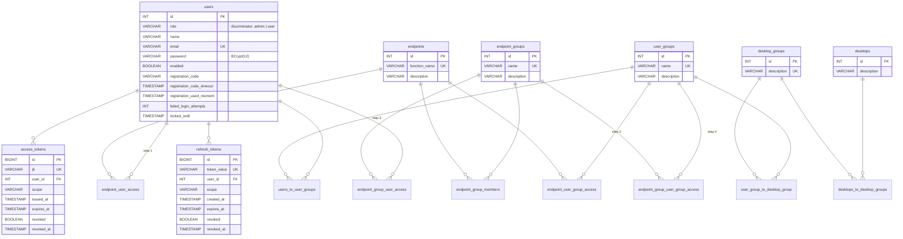
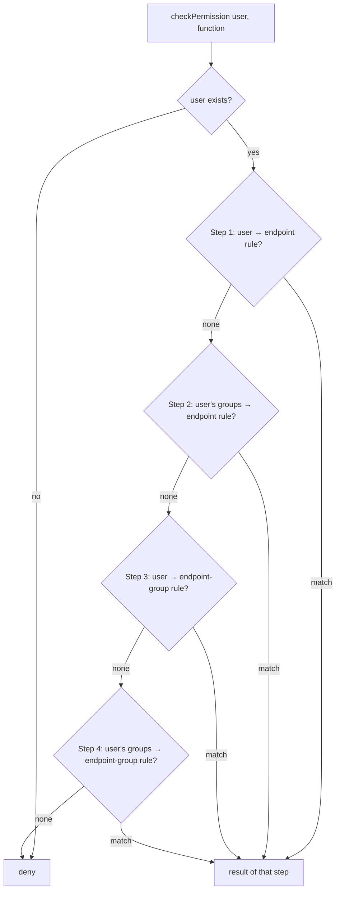

[README](../README.md) · [User manual](user-manual.md) · [API](api.md) · [Database](database.md) · [Architecture (arc42)](arc42.md) · [Development](development.md) · [Operations](operations.md)

# Database

- **Engine:** MariaDB with the InnoDB storage engine.
- **Migrations:** Flyway, `src/main/resources/db/migration`. Hibernate only *validates* the
  schema (`ddl-auto: validate`), so **every schema change needs a new `V<n>__*.sql` file.**
- **Time:** all timestamps are stored as UTC `Instant`s (`TIMESTAMP(6)`), and the app clock is
  `Clock.systemUTC()`.

## Migration history

| Version | Change |
|---|---|
| V1 | Initial schema (users, groups, desktops, permissions, tokens) |
| V2 | `registration_code_timeout` and `registration_used_moment` changed to `TIMESTAMP(6)` (UTC) |
| V3 | Dropped `desktops.name`; desktops are identified by `description` |
| V4 | Dropped `desktop_groups.name`; `description` is now `NOT NULL UNIQUE`. Fails if duplicate or empty descriptions exist, so clean those up first |

## Entity-relationship diagram



## Table overview

| Group | Table | Purpose |
|---|---|---|
| Identity | `users` | All accounts. **Single-table inheritance**: `role` = `admin` → `Admin`, `user` → `User` |
| | `user_groups` | Named groups of regular users |
| | `users_to_user_groups` | m:n join (users ↔ user groups); admins have no groups |
| Desktops | `desktops` | A virtual desktop |
| | `desktop_groups` | Named collection of desktops (unique description) |
| | `desktops_to_desktop_groups` | m:n join |
| | `user_group_to_desktop_group` | m:n: which user group may use which desktop group |
| Permissions | `endpoints` | A callable DESIGN DaaS function (`function_name`) |
| | `endpoint_groups` + `endpoint_group_members` | Bundles of endpoints |
| | `endpoint_user_access` | Rule: user → endpoint (allow/deny) |
| | `endpoint_user_group_access` | Rule: user group → endpoint |
| | `endpoint_group_user_access` | Rule: user → endpoint group |
| | `endpoint_group_user_group_access` | Rule: user group → endpoint group |
| Auth | `access_tokens` | One row per issued JWT (`jti`), for revocation |
| | `refresh_tokens` | Opaque 256-bit refresh tokens |

All foreign keys use `ON DELETE CASCADE`: deleting a user removes their group memberships, rules
and tokens.

## Permission resolution



- The **first step that matches** decides, from most specific to least specific.
- If several rows match in one step, **any deny wins** (fail-closed).
- If nothing matches, the result is **deny**.

Example of seeding rules with SQL (there is no API for this yet):

```sql
INSERT INTO endpoints (function_name, description) VALUES ('start_desktop', 'Start a VM');
INSERT INTO endpoint_user_group_access (user_group_id, endpoint_id, allow_access)
VALUES (1, LAST_INSERT_ID(), TRUE);
```
