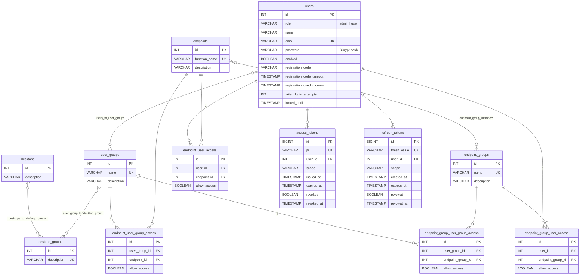
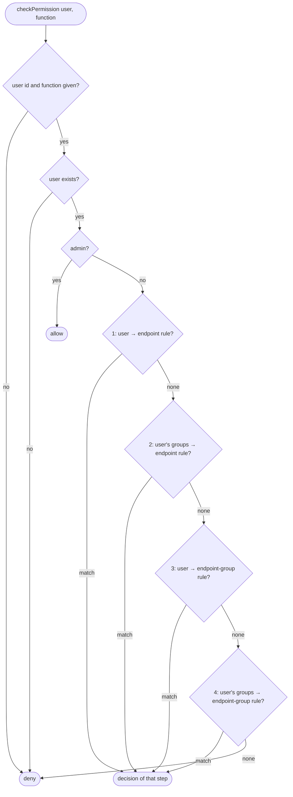

# Database

> **Audience:** developers and database administrators
> **Last reviewed:** 2026-11-13 · [Documentation index](../README.md#documentation)

## In short

- All data lives in one MariaDB database with 16 tables, in four areas: accounts, desktops,
  permissions and login tokens.
- The structure of the tables is created and changed only by numbered SQL scripts (Flyway
  migrations V1 to V5), never by hand.
- Deleting a record also removes everything that belongs only to it, for example a user's tokens.
- Admins always pass the permission check. For regular users, rules are checked in four steps, and
  the answer is "deny" when no rule matches.

## Contents

- [Overview](#overview)
- [Migration history](#migration-history)
- [Entity-relationship diagram](#entity-relationship-diagram)
- [Tables](#tables)
- [Column reference](#column-reference)
- [Useful queries](#useful-queries)
- [Deletion behaviour](#deletion-behaviour)
- [Permission resolution](#permission-resolution)
- [Working with the schema](#working-with-the-schema)

## Overview

| Aspect | Decision | In plain words |
|---|---|---|
| Engine | MariaDB 10.6 or later (InnoDB) | – |
| Schema ownership | Flyway migrations in `src/main/resources/db/migration`; Hibernate only validates (`ddl-auto: validate`) | Flyway runs the SQL scripts in order at startup. The application then checks that the tables match the Java classes and refuses to start if they do not |
| Time values | `TIMESTAMP(6)` in UTC, mapped to `java.time.Instant` | All times are stored in UTC, independent of the server's time zone |
| Inheritance | Single-table inheritance on `users`, discriminator column `role` | Users and admins are stored in the same table; the `role` column tells them apart |
| Referential integrity | Every foreign key uses `ON DELETE CASCADE` | When a row is deleted, the database also deletes the rows that point to it |

## Migration history

| Version | File | Change |
|---|---|---|
| V1 | `V1__init.sql` | Initial schema: accounts, groups, desktops, permissions and tokens |
| V2 | `V2__registration_timestamps_to_instant.sql` | `registration_code_timeout` and `registration_used_moment` become `TIMESTAMP(6)` (UTC) |
| V3 | `V3__drop_desktop_name.sql` | Drops `desktops.name`; desktops are identified by `description` |
| V4 | `V4__desktop_group_description_only.sql` | Drops `desktop_groups.name`; `description` becomes `NOT NULL UNIQUE` |
| V5 | `V5__unique_permission_rules.sql` | At most one rule per kind, subject and target (`uq_<table>` constraints on the four rule tables) |

> **Before upgrading an existing database:**
> - **V4** fails if two desktop groups share a description or one has none. Clean up those rows first.
> - **V5** deletes duplicate rules automatically. It keeps the row the permission check already
>   used: a deny before an allow, otherwise the oldest row.

## Entity-relationship diagram



The many-to-many relationships are labelled with their join tables. The numbers on the rule
tables are the order in which the permission check evaluates them.

## Tables

| Area | Table | Purpose |
|---|---|---|
| Accounts | `users` | All accounts. `role = 'admin'` maps to `Admin`, `role = 'user'` to `User` |
| | `user_groups` | Named groups of regular users, for example a course |
| | `users_to_user_groups` | Membership (users ↔ user groups). Admins have no groups |
| Desktops | `desktops` | One desktop offered to users |
| | `desktop_groups` | A set of desktops that is granted as a whole; unique description |
| | `desktops_to_desktop_groups` | Membership (desktops ↔ desktop groups) |
| | `user_group_to_desktop_group` | Which user group may use which desktop group |
| Permissions | `endpoints` | A DaaS-application function, identified by `function_name` |
| | `endpoint_groups`, `endpoint_group_members` | Named bundles of endpoints |
| | `endpoint_user_access` | Rule 1: user → endpoint |
| | `endpoint_user_group_access` | Rule 2: user group → endpoint |
| | `endpoint_group_user_access` | Rule 3: user → endpoint group |
| | `endpoint_group_user_group_access` | Rule 4: user group → endpoint group |
| Authentication | `access_tokens` | One row per issued JWT, keyed by its `jti`, for revocation |
| | `refresh_tokens` | Opaque refresh tokens (256 bits, hex-encoded), single-use |

A scheduled job deletes expired rows from both token tables daily at 03:00 (JVM time zone).

## Column reference

Types are as created by the migrations V1–V5. "PK" is the primary key, "UK" a unique key and "FK"
a foreign key (all foreign keys use `ON DELETE CASCADE`).

### `users`

| Column | Type | Null | Meaning |
|---|---|---|---|
| `id` | `INT AUTO_INCREMENT` | no | PK |
| `role` | `VARCHAR(16)` | no | `admin` or `user`; decides the Java class |
| `name` | `VARCHAR(255)` | no | Display name |
| `email` | `VARCHAR(255)` | no | UK; also the login name |
| `password` | `VARCHAR(255)` | no | BCrypt hash (strength 12), never the password itself |
| `enabled` | `BOOLEAN` | no | `false` until the e-mail is verified, or when an admin disables the account |
| `registration_code` | `VARCHAR(8)` | yes | Current verification code; cleared after verification |
| `registration_code_timeout` | `TIMESTAMP(6)` | yes | When the code expires (24 hours after it was issued) |
| `registration_used_moment` | `TIMESTAMP(6)` | yes | When the e-mail was verified |
| `failed_login_attempts` | `INT` | no | Consecutive failed logins; reset by a successful login |
| `locked_until` | `TIMESTAMP` | yes | Login blocked until this time |

### Groups, desktops and their links

| Table | Columns | Keys |
|---|---|---|
| `user_groups` | `id INT`, `name VARCHAR(255) NOT NULL`, `description VARCHAR(255)` | PK `id`; UK `name` |
| `desktops` | `id INT`, `description VARCHAR(255)` | PK `id` |
| `desktop_groups` | `id INT`, `description VARCHAR(255) NOT NULL` | PK `id`; UK `description` (`uq_desktop_groups_description`) |
| `users_to_user_groups` | `user_id`, `user_group_id` | PK on both; FK to `users`, `user_groups` |
| `desktops_to_desktop_groups` | `desktop_id`, `desktop_group_id` | PK on both; FK to `desktops`, `desktop_groups` |
| `user_group_to_desktop_group` | `user_group_id`, `desktop_group_id` | PK on both; FK to `user_groups`, `desktop_groups` |

### Permissions

| Table | Columns | Keys |
|---|---|---|
| `endpoints` | `id INT`, `function_name VARCHAR(255) NOT NULL`, `description VARCHAR(255)` | PK `id`; UK `function_name` |
| `endpoint_groups` | `id INT`, `name VARCHAR(255) NOT NULL`, `description VARCHAR(255)` | PK `id`; UK `name` |
| `endpoint_group_members` | `endpoint_group_id`, `endpoint_id` | PK on both; FK to both tables |
| `endpoint_user_access` | `id`, `user_id`, `endpoint_id`, `allow_access BOOLEAN` | PK `id`; UK (`user_id`, `endpoint_id`); FK to `users`, `endpoints` |
| `endpoint_user_group_access` | `id`, `user_group_id`, `endpoint_id`, `allow_access` | PK `id`; UK (`user_group_id`, `endpoint_id`); FK to `user_groups`, `endpoints` |
| `endpoint_group_user_access` | `id`, `user_id`, `endpoint_group_id`, `allow_access` | PK `id`; UK (`user_id`, `endpoint_group_id`); FK to `users`, `endpoint_groups` |
| `endpoint_group_user_group_access` | `id`, `user_group_id`, `endpoint_group_id`, `allow_access` | PK `id`; UK (`user_group_id`, `endpoint_group_id`); FK to `user_groups`, `endpoint_groups` |

### Tokens

| Column | `access_tokens` | `refresh_tokens` |
|---|---|---|
| `id` | `BIGINT`, PK | `BIGINT`, PK |
| Token identity | `jti VARCHAR(200)`, UK | `token_value VARCHAR(255)`, UK |
| `user_id` | `INT`, FK to `users` | `INT`, FK to `users` |
| `scope` | `VARCHAR(20)` | `VARCHAR(20)` |
| Issued | `issued_at TIMESTAMP(6)` | `created_at TIMESTAMP` |
| `expires_at` | `TIMESTAMP(6)` | `TIMESTAMP` |
| `revoked`, `revoked_at` | `BOOLEAN`, `TIMESTAMP(6)` | `BOOLEAN`, `TIMESTAMP(6)` |
| Extra indexes | `user_id`, `expires_at` | – |

## Deletion behaviour

| Deleted | Also removed | Kept |
|---|---|---|
| User or admin | Tokens, group memberships, rules with this user as subject | – |
| User group | Memberships, desktop-group links, rules with this group as subject | The member accounts |
| Desktop | Its desktop-group memberships | The desktop groups |
| Desktop group | Its desktop memberships and user-group links | The desktops and user groups |
| Endpoint | Rules that target it, its endpoint-group memberships | The endpoint groups |
| Endpoint group | Rules that target it, its memberships | The endpoints |

On MariaDB the cascading foreign keys guarantee this behaviour. The services also remove join
rows and rules explicitly where the H2 test database has no cascading keys.

## Permission resolution



1. **Admins are always allowed.** Otherwise an empty rule table would lock them out as soon as the
   DaaS application enables the check.
2. For regular users, the **first step with a matching rule decides**, from the most specific step
   to the least specific.
3. A step can match several rules, for example when a user is in two groups with opposite rules.
   **Any deny then wins** over an allow.
4. If no step matches, the result is **deny** (fail-closed).

## Useful queries

Read-only queries for support and troubleshooting. Change data through the API, not with SQL.

```sql
-- Admin accounts
SELECT id, name, email FROM users WHERE role = 'admin';

-- Accounts that are currently locked
SELECT id, email, failed_login_attempts, locked_until
FROM users WHERE locked_until > NOW();

-- Registrations that were never verified
SELECT id, email, registration_code_timeout
FROM users WHERE role = 'user' AND enabled = FALSE AND registration_code IS NOT NULL;

-- Number of rules per kind
SELECT 'USER_ENDPOINT' AS kind, COUNT(*) FROM endpoint_user_access
UNION ALL SELECT 'USER_GROUP_ENDPOINT', COUNT(*) FROM endpoint_user_group_access
UNION ALL SELECT 'USER_ENDPOINT_GROUP', COUNT(*) FROM endpoint_group_user_access
UNION ALL SELECT 'USER_GROUP_ENDPOINT_GROUP', COUNT(*) FROM endpoint_group_user_group_access;

-- Applied migrations
SELECT version, description, installed_on, success FROM flyway_schema_history ORDER BY installed_rank;
```

## Working with the schema

- **Changing the schema:** add a new file `V<next>__<short_description>.sql`. Never edit a
  migration that has already been applied: Flyway's checksum validation would stop the
  application at startup.
- **Testing a migration:** `FlywayMariaDbIntegrationTest` applies all migrations to a real
  MariaDB in a Testcontainers container and validates the entities against the result. It is
  skipped when Docker is not available.
- **Maintaining permission data:** use the
  [permission management API](api.md#9-permission-management) rather than SQL. The API checks
  that subjects and targets exist and rejects duplicate rules.
