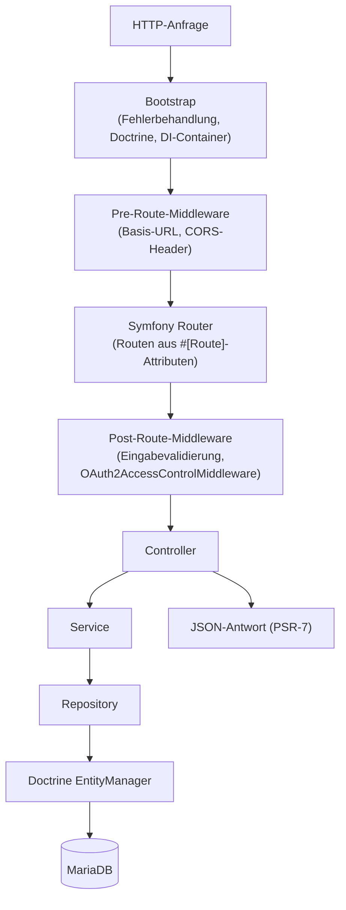
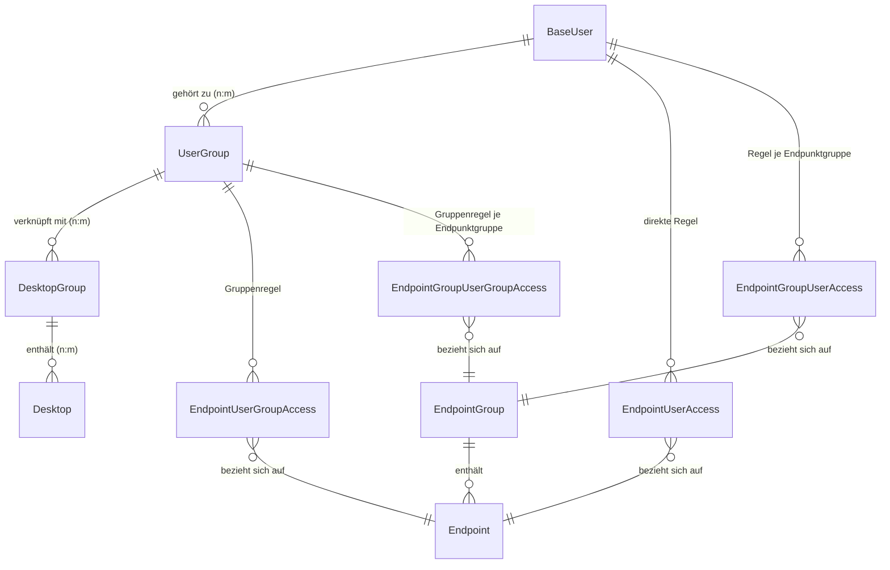
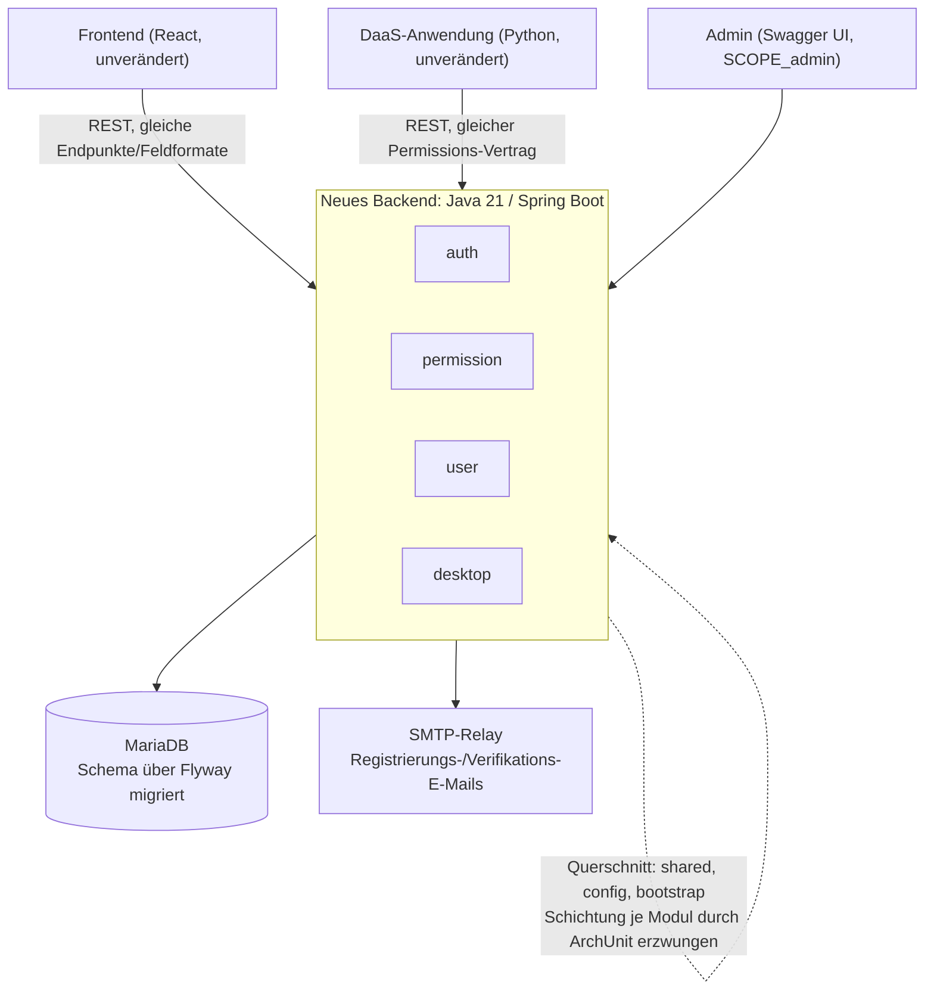
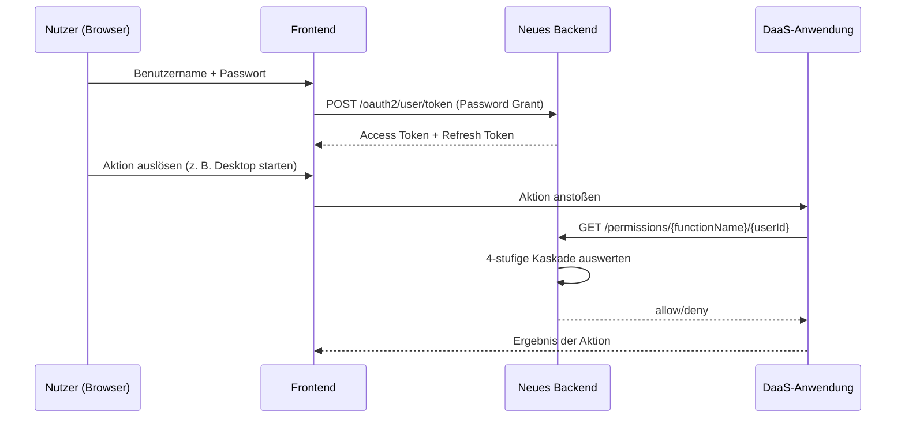

# 3 Anforderungsanalyse

Dieses Kapitel beschreibt, welches Problem gelöst werden soll und welche Eigenschaften die Lösung erfüllen
muss – nicht, mit welchen Klassen, Bibliotheken oder Algorithmen dies in Kapitel 4 geschieht. Grundlage sind
zwei Quellen: die offizielle Ausschreibung (Arbeitspakete AP1–AP6) und die vollständige Quellcode-Analyse
des bestehenden PHP-Backends `design-daas-application-backend` (Abschnitt 3.1). Jede genannte Anforderung
lässt sich auf eine konkrete Stelle im Code, in einer Konfigurationsdatei oder in der Ausschreibung
zurückführen. Abschnitt 3.4 beschreibt zusätzlich den tatsächlich erreichten Zielzustand anhand des neuen
Java-Quellcodes (Paketstruktur, Datenbankschema, Testklassen).

---

## 3.1 Generelle Zielsetzung

Das Backend des Desktop-as-a-Service-Systems **DESIGN** (Kapitel 2.1) soll vollständig neu entwickelt werden.
Das bestehende Backend ist in PHP implementiert und wird in der Ausschreibung ausdrücklich als „qualitativ
schwach" und „schlecht dokumentiert" bezeichnet; die beiden anderen Systemteile, DaaS-Anwendung und
Frontend, gelten dagegen als gut und dokumentiert. Daraus ergibt sich die doppelte Zielsetzung dieses
Kapitels: Erstens muss das sichtbare Verhalten des alten Backends (Schnittstellen, Datenformate,
Berechtigungslogik) vollständig verstanden werden – eine externe Dokumentation existiert dafür nicht, der
Quellcode ist die einzige verlässliche Quelle. Zweitens wird daraus ein Anforderungskatalog abgeleitet, der
festlegt, was ein funktional gleichwertiger, aber wart- und testbarer Nachfolgedienst leisten muss, ohne
bereits festzulegen, wie dies technisch umgesetzt wird (Kapitel 4).

### 3.1.1 Genereller Aufbau des Gesamtsystems

Das Gesamtsystem **DESIGN** besteht aus drei eigenständigen Repositories: der **DaaS-Anwendung** (Python;
verwaltet Container, virtuelle Maschinen, Proxmox VE und Apache Guacamole, also die eigentliche
Bereitstellung von Desktops), dem **Frontend** (React; grafische Oberfläche für Endnutzer und
Administratoren) und dem **Backend**, das Gegenstand dieser Arbeit ist. Die drei Teile kommunizieren
ausschließlich über REST-Schnittstellen; es gibt keine gemeinsame Codebasis. Frontend und DaaS-Anwendung
werden in dieser Arbeit nicht verändert (Kapitel 1, Abgrenzung). Das neue Backend muss daher deren
bestehende Schnittstellenerwartungen – Pfade, HTTP-Methoden, JSON-Feldnamen, Statuscodes und die Semantik
der Berechtigungsprüfung – exakt so erfüllen wie bisher das alte PHP-Backend. Diese sogenannte
*Verhaltenskompatibilität* ist der wichtigste limitierende Faktor für die in Abschnitt 3.2 abgeleiteten
Anforderungen.

### 3.1.2 Ist-Zustand des alten Backends (AP1/AP2)

Die folgende Analyse beruht auf der direkten Durchsicht des Quellcodes von `design-daas-application-backend`
(Klassenstruktur, Routen-Attribute, Entitäten, Migrationsskripte, `composer.json`, `docker-compose.yml`).

#### Technologie-Stack

Das alte Backend ist in PHP 8.2 implementiert und läuft als Apache-Modul in einem
Docker-Container. Tabelle 3.1 zeigt die eingesetzten Technologien je Schicht.

*Tabelle 3.1: Technologie-Stack des alten PHP-Backends*

| Schicht              | Technologie                             |
|----------------------|-----------------------------------------|
| Sprache              | PHP 8.2                                 |
| HTTP-Server          | Apache (im Container)                   |
| ORM / Datenbank      | Doctrine ORM 2.x + MariaDB              |
| Migrationen          | Doctrine Migrations                     |
| Dependency Injection | PHP-DI (Autowiring)                     |
| HTTP-Routing         | Symfony Routing (PSR-7-Adapter)         |
| OAuth2               | `league/oauth2-server` (Password Grant) |
| API-Doku             | OpenAPI/Swagger (`zircote/swagger-php`) |
| Logging              | Monolog (PSR-3)                         |
| Event-Bus            | Symfony EventDispatcher (PSR-14)        |
| Warteschlange        | DB-gestützt (`enqueue/dbal`)            |
| E-Mail               | Symfony Mailer                          |
| Cron                 | Yacron                                  |
| Container            | Docker + Docker Compose                 |
| Tests/Analyse        | PHPUnit 10, PHPStan, PHPCS, PHPat       |

#### Modulstruktur und Schichtung

Der Code ist nicht nach technischen Schichten, sondern nach fachlichen Bereichen in *vertikale Module* gegliedert:

- `Main`: Bootstrap, Fehlerbehandlung, Versions-Endpunkt
- `Util`: Querschnittsfunktionen wie Mailversand, OAuth2-Middleware, Swagger-Auslieferung
- `OAuth2`: Token-Endpunkt, Session-Info
- `User`: Nutzer-/Admin-Verwaltung, Gruppen, Registrierung
- `Desktop`: Desktop- und Desktop-Gruppen-Verwaltung
- `Permissions`: feingranulare Zugriffskontrolle

Jedes Modul ist intern gleich geschichtet: `Model → Repository → Service → Controller`, ergänzt um lokale `DTO`-,
`Enum`- und `Exception`-Unterpakete. Dieses Muster – fachliche Module mit identischer interner Schichtung – wird in
Abschnitt 3.4 1:1 in Java-Pakete übersetzt.

#### Anfrageverarbeitung (Request-Lifecycle)

Jede HTTP-Anfrage durchläuft denselben Ablauf: Nach dem Bootstrap (Fehlerbehandlung, Doctrine-Konfiguration,
Dependency-Injection-Container) übernimmt ein `HttpDispatcher` auf Basis von Symfony Routing die Anfrage.
Vor dem Routing laufen Middleware-Komponenten zur Auflösung der Basis-URL und zum Setzen der CORS-Header;
nach dem Routing folgen zwei weitere: eine zur Behandlung ungültiger Eingaben und die `OAuth2AccessControlMiddleware`.
Letztere liest eine je Route hinterlegte OpenAPI-Sicherheitsannotation (z. B.
`#[OA\Get(security: [["oauth2-user" => ["admin"]]])]`), validiert das mitgesendete Zugriffstoken und
injiziert den authentifizierten Benutzer in die Anfrage. Erst danach wird die passende Controller-Aktion
aufgerufen, die über Service- und Repository-Schicht auf den Doctrine `EntityManager` und damit auf MariaDB
zugreift; die Antwort wird als JSON über eine PSR-7-Response zurückgegeben.



*Abbildung 3.1: Anfrageverarbeitung im alten PHP-Backend*

#### Domänenmodell

Abbildung 3.2 zeigt die zentralen Entitäten und ihre Beziehungen. `BaseUser` ist eine
abstrakte Basis-Entität, von der `Admin` und `User` per *Single Table Inheritance* (STI) erben: Beide
Rollen liegen in einer gemeinsamen Tabelle `users`, unterschieden über die Spalte `role`. Jeder Nutzer hat
zusätzlich eine `guid` (UUID v4), einen `registrationCode` (8-stelliger Hex-Wert, 24 Stunden gültig, für die
E-Mail-Verifikation) und ein `enabled`-Flag; Passwörter werden nur als Hash über ein `Password`-Value-Object
gespeichert. Nutzer stehen in einer n:m-Beziehung zu `UserGroup`, diese wiederum n:m zu `DesktopGroup`, die
selbst n:m mit `Desktop`-Entitäten verknüpft ist. Getrennt davon existiert ein eigenes Berechtigungsmodell:
`Endpoint`-Entitäten (identifiziert über `functionName`, plus URL und HTTP-Methode) können zu
`EndpointGroup`s zusammengefasst werden; vier Zuordnungstabellen (`EndpointUserAccess`,
`EndpointUserGroupAccess`, `EndpointGroupUserAccess`, `EndpointGroupUserGroupAccess`) verknüpfen einzelne
Nutzer bzw. Nutzergruppen mit einzelnen Endpunkten bzw. Endpunktgruppen und tragen je ein Allow/Deny-Flag.
Alle Entitäten sind `final`, um unerwartete Vererbung zu verhindern.



*Abbildung 3.2: Domänenmodell des alten PHP-Backends*

#### Berechtigungsmodell (Permissions-Engine)

Zusätzlich zur groben OAuth2-Unterscheidung zwischen den Scopes `user` und `admin` besitzt das alte Backend
ein zweites, feingranulares, datenbankgetriebenes Berechtigungssystem. Die zentrale Methode
`PermissionCalculationService::getPermission($functionName,$userId)` prüft in fester Reihenfolge vier Regeltypen
und wählt die erste zutreffende:

1. `EndpointUserAccess`: Regel für genau diesen Nutzer und genau diesen Endpunkt,
2. `EndpointUserGroupAccess`: Regel für eine Nutzergruppe des Nutzers und genau diesen Endpunkt,
3. `EndpointGroupUserAccess`: Regel für genau diesen Nutzer und eine Endpunktgruppe, der dieser Endpunkt
   angehört,
4. `EndpointGroupUserGroupAccess`: Regel für eine Nutzergruppe des Nutzers und eine Endpunktgruppe.

Greift keine dieser vier Regeln, gilt per Voreinstellung **Zugriffsverweigerung** (*fail-closed*). Dieses
Verhalten – insbesondere die Reihenfolge der vier Stufen und die Default-Deny-Regel – ist für die
DaaS-Anwendung sicherheitskritisch, da sie sich bei jeder Nutzeraktion darauf verlässt. Das neue Backend
muss es daher in gleicher Reihenfolge reproduzieren (NFA-1/NFA-2, Abschnitt 3.2). Innerhalb der Schritte 2
und 4 iteriert die Methode über alle Nutzergruppen des Nutzers und gibt das Ergebnis der *ersten* Gruppe
zurück, für die eine passende Regel existiert. Da die Reihenfolge, in der `BaseUser::groups()` diese
Gruppen liefert, im Code nicht sortiert wird, ist das Verhalten bei mehreren widersprüchlichen
Gruppenregeln desselben Nutzers nicht deterministisch, sondern hängt von der internen Reihenfolge der
Doctrine-Collection ab. Diese Beobachtung ist Ausgangspunkt für die Entscheidung in Abschnitt 3.4.2, im
neuen Backend eine explizite, deterministische Konfliktauflösung zu ergänzen, statt die unspezifizierte
alte Reihenfolge nachzubilden. Ergänzend existiert ein Desktop-Zugriffstest (`GET
/users/access/{desktopId}`), der prüft, ob der authentifizierte Nutzer über seine Nutzergruppe mit einer
Desktop-Gruppe verknüpft ist, die den angefragten Desktop enthält.

#### Vollständige Schnittstelle (Ist-Zustand)

Tabelle 3.2 listet alle vom alten Backend bereitgestellten Endpunkte auf, wie sie sich aus den Routen-Attributen
der Controller-Klassen ergeben. Diese Tabelle bildet die Grundlage für die funktionalen Anforderungen in
Abschnitt 3.2, da jeder Endpunkt, den das alte Backend anbietet, vom neuen Backend in äquivalenter Form angeboten
werden muss, damit Frontend und DaaS-Anwendung unverändert funktionieren.

*Tabelle 3.2: API-Endpunkte des alten PHP-Backends (Ist-Zustand)*

| Modul         | Endpunkt (Methode + Pfad)                                | Beschreibung (Rolle)                          |
|---------------|----------------------------------------------------------|-----------------------------------------------|
| Main          | `GET /version`                                           | Anwendungsversion (offen)                     |
| OAuth2        | `POST /oauth2/user/token`                                | Token anfordern (offen)                       |
| OAuth2        | `GET /oauth2/user/session`                               | Session-Info (user/admin)                     |
| OAuth2        | `GET /ping/{rolle}`                                      | Diagnose (user/admin)                         |
| User          | `POST /user`                                             | Registrieren (offen)                          |
| User          | `GET /users`                                             | Nutzer auflisten (admin)                      |
| User          | `GET/PATCH/DELETE /user/{id}`                            | Nutzer lesen/ändern/löschen (admin)           |
| User          | `POST /user/{id}/enable`\|`/disable`                     | Konto (de)aktivieren (admin)                  |
| User          | `POST /user/validate_email`                              | E-Mail verifizieren (offen)                   |
| User          | `GET /users/access/{desktopId}`                          | Desktop-Zugriff prüfen (user)                 |
| User          | `POST /user/request-application/{app}/{lang}`            | Freischaltung anfragen (user)                 |
| Admin         | `GET /admins`, `/admin/{id}`                             | Admins auflisten/lesen (admin)                |
| Admin         | `POST/DELETE /admin`, `/admin/{id}`                      | Admin anlegen/löschen (admin)                 |
| Desktop       | `POST/GET /desktop(s)`, `/desktop/{id}`                  | Desktop anlegen/lesen/auflisten (admin)       |
| Desktop       | `POST/GET /desktop-group`, `/desktop_group/{id}`         | Desktop-Gruppe anlegen/lesen (admin)          |
| Desktop       | `POST /desktop_group/{dgId}/user_group/{ugId}`           | Nutzergruppe verknüpfen (admin)               |
| Permissions   | `GET /permissions/{fn}/{userId}`                         | Berechtigung abfragen (admin)                 |
| Permissions   | `POST /permissions_info`                                 | Berechtigung per Token abfragen (token/admin) |
| UserGroup     | `POST/PATCH/GET /user_group(s)`, `/user_group/{id}`      | Nutzergruppe anlegen/ändern/auflisten (admin) |
| UserGroup     | `POST /user_group/{ugId}/{dgId}`                         | Mit Desktop-Gruppe verknüpfen (admin)         |
| EndpointGroup | `PUT/DELETE /endpoint_group/{name}/{ugId}/{allow\|deny}` | Zugriffsregel setzen/entfernen (admin)        |

Die `Endpoint`- und `EndpointGroup`-Stammdaten (welche Funktion zu welcher Endpunktgruppe gehört) werden
nicht über HTTP verwaltet, sondern per CLI-Kommando (`permissions:import`) aus einer JSON-Datei importiert.
Über die HTTP-API lassen sich nur die Allow/Deny-Zuordnungen zwischen Nutzergruppen und bestehenden
Endpunktgruppen pflegen.

#### Konfiguration und Betrieb

Die Konfiguration erfolgt über Umgebungsvariablen, die beim Containerstart in den Dependency-Injection-Container
abgebildet werden. Der Betrieb läuft über Docker Compose mit zwei Profilen (`dev-environment`,
`release-test-environment`); die Test-Datenbank ist eine eigenständige, flüchtige MariaDB-Instanz im
Arbeitsspeicher (`tmpfs`), getrennt von der Entwicklungsdatenbank. Cronjobs (z. B. zum Aufräumen abgelaufener
Registrierungscodes) laufen als separater `yacron`-Dienst; Jobs sind bewusst kurz und über eine
Nachrichtenwarteschlange entkoppelt, da verpasste Ausführungen nicht automatisch nachgeholt werden.

### 3.1.3 Umfeldbeschreibung

Tabelle 3.3 fasst die vorhandene Infrastruktur und die daraus resultierenden Rahmenbedingungen für das neue
Backend zusammen.

*Tabelle 3.3: Umfeld und Rahmenbedingungen*

| Umfeldelement         | Beschreibung                                                      | Auswirkung auf das neue Backend                                         |
|-----------------------|-------------------------------------------------------------------|-------------------------------------------------------------------------|
| MariaDB               | Alleiniger Datenspeicher (Nutzer, Gruppen, Permissions, Desktops) | Bleibt Datenspeicher; Schema muss versioniert migrierbar sein           |
| SMTP-Relay            | Versand von Registrierungs-/Verifikations-E-Mails                 | Muss weiterhin HTML-E-Mails für dieselben Anlässe versenden             |
| React-Frontend        | Konsumiert Auth-/User-/Desktop-Endpunkte                          | Erwartet unveränderte REST-Verträge; CORS muss Frontend-Origin erlauben |
| Python-DaaS-Anwendung | Konsumiert nur die Permissions-Endpunkte                          | Erwartet unveränderten Permissions-Vertrag inkl. 4-stufiger Kaskade     |
| Docker/Docker Compose | Alleinige Betriebsform (Dev-/Testprofile)                         | Muss ebenfalls containerisiert und per Docker betreibbar sein           |
| Linux-Zielplattform   | Produktionsbetrieb auf Linux mit Apache                           | Muss ohne Anpassung auf vergleichbarer Linux-Infrastruktur laufen       |

Frontend und DaaS-Anwendung liegen außerhalb des Scopes dieser Arbeit (Kapitel 1, Abgrenzung) und werden
nicht angepasst; jede hier genannte Rahmenbedingung ist daher eine feste, nicht verhandelbare Vorgabe.

## 3.2 Klärung der Anforderungen

Die Anforderungen wurden ausschließlich durch Quellcode-Analyse des alten PHP-Backends sowie durch die
Ausschreibung ermittelt. Dieses Vorgehen entspricht einer *Reverse-Engineering*-Anforderungsanalyse: Statt
Anforderungen aus Interviews mit Stakeholdern oder einem Pflichtenheft abzuleiten, werden sie aus dem
beobachtbaren Verhalten des bestehenden Systems rekonstruiert.

### 3.2.1 Klärung der Hauptfunktionalität und Problemfeldabgrenzung

Die Hauptfunktionalität lässt sich aus der Modulstruktur des alten Systems (Abschnitt 3.1.3) in vier
Bereiche gliedern, die das neue Backend unverändert anbieten muss:

1. **Authentifizierung**: Ausstellen, Erneuern, Widerrufen und Prüfen von Zugriffstoken (vormals
   `OAuth2`-Modul).
2. **Autorisierung**: Beantwortung der Frage „darf Nutzer X Funktion Y aufrufen?" über die 4-stufige
   Kaskade aus Abschnitt 3.1.3 (vormals `Permissions`-Modul).
3. **Benutzerverwaltung**: Selbstregistrierung mit E-Mail-Verifikation, administrative Verwaltung von
   Nutzern, Admins und Nutzergruppen sowie Anfragen einer Anwendungsfreischaltung (vormals `User`-Modul).
4. **Desktop-Inventarverwaltung**: Anlegen, Auflisten und Verknüpfen von Desktops und Desktop-Gruppen mit
   Nutzergruppen (vormals `Desktop`-Modul).

**Nicht** Teil dieser Arbeit ist die eigentliche Bereitstellung von Desktops – das Starten, Klonen oder
Beenden von Containern und virtuellen Maschinen sowie die Steuerung von Apache Guacamole. Diese Aufgaben
übernimmt ausschließlich die Python-DaaS-Anwendung. Das Backend stellt dafür nur die Stammdaten (welcher
Desktop existiert, welcher Nutzergruppe ist er zugeordnet) sowie Authentifizierungs- und
Berechtigungsauskünfte bereit, auf deren Basis die DaaS-Anwendung ihre eigenen Entscheidungen trifft.
Ebenfalls außerhalb des Scopes liegen funktionale Änderungen an Frontend oder DaaS-Anwendung, die über die
in Kapitel 1 genannten punktuellen Korrekturen hinausgehen.

### 3.2.2 Ableitung der funktionalen Anforderungen

Die meisten funktionalen Anforderungen (FA) entsprechen mindestens einem Endpunkt aus Tabelle 3.2 und sind
unabhängig von der Implementierungssprache formuliert: Sie beschreiben, welche Funktion das System erfüllen
muss, nicht, mit welcher Klasse oder welchem Framework dies geschieht. Eine Ausnahme (FA-3) hat kein Gegenstück
im alten Backend; sie leitet sich aus den nicht-funktionalen Anforderungen in Abschnitt 3.2.4 ab.

*Tabelle 3.4: Funktionale Anforderungen (FA)*

| ID    | Anforderung                                                                                      |
|-------|--------------------------------------------------------------------------------------------------|
| FA-1  | Login mit Benutzername/Passwort liefert ein Zugriffstoken                                        |
| FA-2  | Ein abgelaufenes Zugriffstoken kann per Refresh-Token erneuert werden, ohne erneute Zugangsdaten |
| FA-3  | Aktives Abmelden widerruft das Token serverseitig, auch vor Ablauf                               |
| FA-4  | Zu einem gültigen Token kann die Session/Identität abgefragt werden                              |
| FA-5  | Selbstregistrierung mit E-Mail-Bestätigung über zeitlich begrenzten Code                         |
| FA-6  | Admin kann Nutzer auflisten, einsehen, ändern, aktivieren/deaktivieren                           |
| FA-7  | Admin kann weitere Admin-Konten anlegen, auflisten, löschen                                      |
| FA-8  | Admin kann Nutzergruppen anlegen, ändern, auflisten und mit Desktop-Gruppe verknüpfen            |
| FA-9  | Nutzer kann Anwendungsfreischaltung anfragen; Admin wird per E-Mail benachrichtigt               |
| FA-10 | Admin kann Desktops anlegen, einsehen und auflisten                                              |
| FA-11 | Admin kann Desktop-Gruppen anlegen, einsehen und mit Nutzergruppen verknüpfen                    |
| FA-12 | Nutzer kann prüfen, ob er Zugriff auf einen Desktop hat                                          |
| FA-13 | Prüfung, ob ein Nutzer eine Funktion aufrufen darf, über die 4-stufige Kaskade                   |

Im Vergleich zum ersten Entwurf wurde FA-12 ergänzt, da dieser Endpunkt im `User`-Controller separat vom
allgemeinen Permissions-Endpunkt implementiert ist und eine eigene, Desktop-Gruppen-basierte Prüflogik
besitzt – nicht zu verwechseln mit der generischen Kaskade aus FA-13. FA-3 hat kein Altsystem-Pendant:
Die Prüfung von `OAuth2HttpController` und `UserHttpController` zeigt, dass das alte Backend keinen
Logout-Endpunkt besitzt.

### 3.2.4 Ableitung der nicht-funktionalen Anforderungen

Die nicht-funktionalen Anforderungen (NFA) ergeben sich zum einen aus Eigenschaften, die das alte Backend
bereits besitzt und die aus Kompatibilitätsgründen erhalten bleiben müssen (NFA-1 bis NFA-3), zum anderen
aus generischen Sicherheits- und Betriebsanforderungen, die üblicherweise an einen Authentifizierungsdienst
gestellt werden und die in Kapitel 2.2–2.4 theoretisch hergeleitet werden (NFA-4 bis NFA-7), sowie aus
Qualitätszielen, die der Ausschreibung ausdrücklich entnommen sind: Das neue Backend soll, im Gegensatz zum
alten, wart- und testbar sein (NFA-8 bis NFA-10).

*Tabelle 3.5: Nicht-funktionale Anforderungen (NFA)*

| ID     | Anforderung                                                                                                                                                                                                                                         | Begründung                                                                                                   |
|--------|-----------------------------------------------------------------------------------------------------------------------------------------------------------------------------------------------------------------------------------------------------|--------------------------------------------------------------------------------------------------------------|
| NFA-1  | Fail-closed-Sicherheitsverhalten: Ein unbekannter Nutzer, eine unbekannte Funktion oder das Fehlen jeder passenden Regel führt stets zu Zugriffsverweigerung, nie zu impliziter Erlaubnis                                                           | Übernahme des Sicherheitsprinzips aus dem alten Backend (Abschnitt 3.1.3)                                    |
| NFA-2  | Verhaltenskompatibilität der Berechtigungskaskade: identische Priorität der vier Regelstufen (direkte Nutzerregel vor Gruppenregel vor Endpunktgruppenregel vor Gruppen-Endpunktgruppenregel) sowie fail-closed als Voreinstellung wie im alten Backend | Die DaaS-Anwendung verlässt sich auf dieses Verhalten und wird nicht angepasst                               |
| NFA-3  | API-Formkompatibilität: identische Pfade, HTTP-Methoden, JSON-Feldnamen und Statuscodes zu Frontend und DaaS-Anwendung wie beim alten Backend                                                                                                       | Beide Clients werden nicht angepasst (Kapitel 1, Abgrenzung)                                                 |
| NFA-4  | Passwörter werden ausschließlich als Hash gespeichert; Konten werden nach wiederholten Fehlversuchen vorübergehend gesperrt                                                                                                                         | Sicherheit (Kapitel 2.2)                                                                                     |
| NFA-5  | Sicherheitsrelevante Endpunkte (insbesondere Login, Registrierung) sind ratenbegrenzt                                                                                                                                                               | Schutz vor Missbrauch/Brute-Force (Kapitel 2.2)                                                              |
| NFA-6  | Zugriffstoken sind serverseitig widerrufbar, obwohl sie als JSON Web Token grundsätzlich zustandslos und selbstbeschreibend sind                                                                                                                    | Ein Logout oder eine erzwungene Abmeldung durch einen Administrator muss sofort wirksam werden (Kapitel 2.2) |
| NFA-7  | Der Dienst ist zustandslos und damit horizontal skalierbar; es existiert kein Server-seitiger Session-State außerhalb der Datenbank                                                                                                                 | Betriebsfähigkeit hinter einem Load Balancer                                                                 |
| NFA-8  | Die interne Schichtung jedes fachlichen Moduls (Controller → Service → Repository → Model) wird automatisiert über den Build geprüft, nicht nur durch Konvention                                                                                    | Wartbarkeit; direkte Antwort auf die in der Ausschreibung kritisierte Qualität des alten Backends            |
| NFA-9  | Eine Mindest-Testabdeckung wird im Build erzwungen und ein fehlgeschlagener Build verhindert das Mergen von Änderungen                                                                                                                              | Wartbarkeit/Qualitätssicherung                                                                               |
| NFA-10 | Das Datenbankschema wird ausschließlich über versionierte, nachvollziehbare Migrationen verändert und nie automatisch aus dem Code generiert                                                                                                        | Nachvollziehbarkeit/Reproduzierbarkeit über Umgebungen hinweg                                                |

Die Reihenfolge NFA-1 bis NFA-3 ist bewusst gewählt: Sie bilden zusammen die Bedingung, unter der das neue
Backend als „funktional gleichwertig" zum alten gelten darf, und sind damit die Messlatte für die in Kapitel
4.8 beschriebene Evaluation. NFA-2 beschränkt sich bewusst auf die Reihenfolge der vier Regelstufen und die
Default-Deny-Regel, da genau dies die beiden Eigenschaften sind, auf die sich die DaaS-Anwendung laut
Quellcode-Prüfung verlässt. Wie in Abschnitt 3.1.3 gezeigt, löst der alte
`PermissionCalculationService` mehrere zueinander widersprüchliche Gruppenregeln desselben Nutzers
innerhalb einer Stufe nicht nach einer dokumentierten Regel auf, sondern nach der nicht spezifizierten
internen Reihenfolge der Gruppen-Collection; dieses unspezifizierte Verhalten wird daher in NFA-2 bewusst
nicht als nachzubildende Anforderung übernommen. Stattdessen wird in Abschnitt 3.4.2 eine zusätzliche,
im alten System nicht vorhandene nicht-funktionale Eigenschaft eingeführt: Die neue Kaskade löst mehrere
gleichrangige, widersprüchliche Regeln innerhalb derselben Stufe deterministisch auf, indem ein expliziter
Deny-Eintrag stärker wiegt als ein Allow-Eintrag.

## 3.3 Zeitliche Rahmenbedingungen

Dieser Abschnitt hält den Start- und Endzeitpunkt der Arbeit sowie die zugehörigen Meilensteine fest. Die
folgenden vier Termine sind durch die Prüfungsordnung bzw. die Vorgaben des Prüfungsamts fest vorgegeben und
nicht verhandelbar; alle übrigen Meilensteine wurden davon ausgehend eigenständig in strikter, sequenzieller
Abfolge der Arbeitspakete AP1–AP6 geplant, wie sie in der Ausschreibung vorgegeben sind.

- **Start der Arbeit:** 22.06.2026
- **Ende der Arbeit:** 25.11.2026
- **Anforderungsanalyse an den Betreuer:** 29.06.2026 (1 Woche nach Start)
- **Entwurf der Ausarbeitung:** 28.10.2026 (4 Wochen vor Abgabe)
- **Vollständiger schriftlicher Entwurf:** 11.11.2026 (2 Wochen vor Abgabe)
- **Abgabe im Prüfungsamt:** 25.11.2026

Eigene Meilensteine (strikt sequenzielle Abfolge AP1–AP6):

| Meilenstein                                                | Zeitraum                      |
|------------------------------------------------------------|-------------------------------|
| AP1 – Recherche Gesamtsystem DESIGN                        | 22.06.–29.06.2026             |
| Abgabe der Anforderungsanalyse an den Betreuer             | 29.06.2026                    |
| AP2 – Analyse altes PHP-Backend                            | 30.06.–13.07.2026             |
| AP3 – Entwurf neues Backend (Konzept/Architektur)          | 14.07.–03.08.2026             |
| AP4 – Implementierung neues Backend (Java/Spring Boot)     | 04.08.–21.09.2026             |
| AP5 – Aufbau des Demonstrators                             | 22.09.–05.10.2026             |
| AP6 – Test, Evaluation, Dokumentation                      | 06.10.–28.10.2026             |
| Literaturrecherche / Kapitel 2 (theoretischer Hintergrund) | 22.06.–10.08.2026, begleitend |
| Anfertigung der schriftlichen Ausarbeitung                 | 22.06.–11.11.2026, begleitend |
| Abgabe des Entwurfs der Ausarbeitung an den Betreuer       | 28.10.2026                    |
| Einarbeiten der Vorschläge des Betreuers                   | 28.10.–11.11.2026             |
| Abgabe des vollständigen schriftlichen Entwurfs            | 11.11.2026                    |
| Ende der Bearbeitungszeit, Einreichen im Prüfungsamt       | 25.11.2026                    |

AP1 und AP2 überschneiden sich bewusst in den ersten beiden Wochen, da das Verständnis des Gesamtsystems
DESIGN (AP1) und die Detailanalyse des alten Backends (AP2) in der Praxis nicht vollständig trennbar sind:
Ohne die in Abschnitt 3.1 beschriebene Code-Analyse ließen sich die Rolle und Schnittstellen des Backends
innerhalb von DESIGN nicht einordnen. Die schriftliche Ausarbeitung sowie die Literaturrecherche zu Kapitel
2 laufen während der gesamten Bearbeitungszeit begleitend mit, da Erkenntnisse aus AP3–AP6 unmittelbar in
Kapitel 4 und 5 einfließen.

## 3.4 Zielzustand

Dieser Abschnitt beschreibt, wie das neue Backend die in Abschnitt 3.2 abgeleiteten Anforderungen erfüllt:
zunächst den strukturellen Architekturüberblick (3.4.1), danach die konkrete Umsetzung der Berechtigungs-
kaskade (3.4.2), die wichtigsten Anwendungsfälle als UML-Sequenz (3.4.3) und schließlich die technischen
Maßnahmen zur Absicherung von Wartbarkeit und Testbarkeit (3.4.4).

### 3.4.1 Architekturüberblick

Das Zielsystem ist ein eigenständiger Java-21-/Spring-Boot-Dienst (`de.frauas.design.backend`), der dasselbe
Konzept vertikaler, fachlicher Module wie das alte Backend übernimmt (Abschnitt 3.1.3), jedoch mit einer
automatisiert erzwungenen statt nur konventionell eingehaltenen internen Schichtung. Die vier fachlichen
Module **auth**, **permission**, **user** und **desktop** entsprechen den vier in Abschnitt 3.2.2 genannten
Funktionsbereichen und damit den alten Modulen `OAuth2`, `Permissions`, `User` und `Desktop`; ergänzt werden
sie durch drei Querschnittspakete: **shared** (modulübergreifend genutzte DTOs, Exceptions,
Sicherheits-/Hilfsklassen, ohne Abhängigkeit zu einem fachlichen Modul), **config** (typisierte
Spring-`@Configuration`-Klassen) und **bootstrap** (Aufgaben beim Anwendungsstart, z. B. Anlage eines
Standard-Administratorkontos). Jedes fachliche Modul ist intern identisch geschichtet in
`controller → service → repository → model`, ergänzt um lokale `dto`- und `exception`-Unterpakete: eine
direkte Übersetzung des alten `Model → Repository → Service → Controller`-Musters in eine für Spring Boot
idiomatische Reihenfolge. Anders als im alten Backend ist diese Schichtung nicht nur Konvention, sondern wird
durch eine dedizierte ArchUnit-Testklasse automatisiert geprüft (Abschnitt 3.4.4).



*Abbildung 3.3: Zielzustand des neuen Backends (eigene Darstellung nach der im Rahmen dieser Arbeit
entstandenen Paketstruktur `../../src/main/java/de/frauas/design/backend`).*

### 3.4.2 Authentifizierungs- und Autorisierungskonzept

Authentifizierung erfolgt zustandslos über RS256-signierte JSON Web Token (Kapitel 2.2): Ein eigener
Token-Aussteller validiert Benutzername und Passwort bzw. ein vorgelegtes Refresh-Token und stellt im
Erfolgsfall ein JWT aus, dessen Signatur über ein beim ersten Start erzeugtes und persistiertes
RSA-Schlüsselpaar geprüft werden kann; ein Verlust dieses Schlüssels entwertet alle zuvor ausgestellten
Tokens. Damit ein an sich zustandsloses Token dennoch, wie in NFA-6 gefordert, serverseitig widerrufen werden
kann, führt das Zielsystem zwei Datenbanktabellen (`access_tokens`, `refresh_tokens`, definiert in der
Flyway-Migration `V1__init.sql`) mit je einem `revoked`-Flag und einem `revoked_at`-Zeitstempel, die bei
jeder Prüfung eines Tokens zusätzlich zur kryptografischen Signatur konsultiert werden; `access_tokens`
referenziert den Nutzer zusätzlich über ein eindeutiges `jti`-Feld, über das ein einzelnes Token gezielt
widerrufen werden kann, ohne alle Tokens des Nutzers ungültig zu machen. Ergänzend begrenzt ein
`RateLimitingFilter` (Paket `shared.security.filter`, auf Basis eines Token-Bucket-Algorithmus in
`shared.security.ratelimit`) die Anzahl zulässiger Login- und Registrierungsversuche je Client-IP (NFA-5);
die Nutzer-Entität selbst führt zusätzlich die Felder `failedLoginAttempts` und `lockedUntil`, über die ein
Konto nach wiederholten Fehlversuchen vorübergehend gesperrt wird (NFA-4). Autorisierung erfolgt zweistufig:
Grobgranular über OAuth2-Scopes (`SCOPE_user`/`SCOPE_admin`, geprüft durch Spring Security), feingranular über
die in Abschnitt 3.1.3 beschriebene 4-stufige, fail-closed Kaskade. Die Priorität der vier Regelstufen und das
Fail-closed-Verhalten übernimmt das Zielsystem unverändert aus dem alten `PermissionCalculationService`
(NFA-2). Für den in Abschnitt 3.2.4 beschriebenen, im alten Backend nicht spezifizierten Fall mehrerer
gleichrangiger, widersprüchlicher Regeln innerhalb derselben Stufe führt die neue `PermissionService`-Klasse
hingegen eine zusätzliche, deterministische Konfliktauflösung ein: Ein expliziter Deny-Eintrag wiegt stärker
als ein Allow-Eintrag. Diese Regel ist eine bewusste Neuerung gegenüber dem alten Backend und schließt eine
dort vorhandene Verhaltenslücke, statt eine bestehende Regel nachzubilden.

### 3.4.3 Datenhaltung und Betrieb

MariaDB dient, wie im alten Backend, als alleiniger Datenspeicher; das Schema wird jedoch ausschließlich
über versionierte Flyway-Migrationsskripte unter `../../src/main/resources/db/migration` (`V1__init.sql` für das
initiale Schema, gefolgt von inkrementellen Skripten wie `V2__registration_timestamps_to_instant.sql`,
`V3__drop_desktop_name.sql` und `V4__desktop_group_description_only.sql`) verändert, während Hibernate die
gemappten Entitäten beim Start lediglich gegen das bestehende Schema validiert (`ddl-auto: validate`), aber
nie selbst Schemaänderungen vornimmt (NFA-10). Ein SMTP-Relay versendet, wie im alten Backend, Registrierungs- und
Verifikations-E-Mails sowie
Benachrichtigungen über angefragte Anwendungsfreischaltungen (FA-9), hier auf Basis von
Thymeleaf-HTML-Vorlagen. Der Dienst ist als einzelnes Docker-Image paketiert (eine Spring-Boot-Fat-JAR), über
Umgebungsvariablen konfigurierbar (12-Factor-Prinzip, mit separaten Profilen `local`/`dev`/`prod`) und hält
keinerlei Server-seitigen Sitzungszustand außerhalb der Datenbank bzw. des signierten Tokens selbst; mehrere
Instanzen können daher hinter einem Load Balancer betrieben werden (NFA-7), sofern sie dasselbe
RSA-Schlüsselpaar und dieselbe Datenbank teilen.

### 3.4.4 Qualitätssicherung

Die in NFA-8 und NFA-9 geforderte automatisierte Prüfung von Architektur und Testabdeckung wird im
Zielsystem über zwei Build-Bausteine umgesetzt: Eine ArchUnit-Testklasse (`ArchitectureTest`,
`../../src/test/java/de/frauas/design/backend/arch`) prüft bei jedem Build unter anderem, dass
Controller nie direkt von anderen Controllern aufgerufen werden, dass Services nicht von Repositories
abhängen, dass Entitäten (`model`) nur aus Service-, Repository-, Konfigurations- oder DTO-Code heraus
referenziert werden, dass Klassen gemäß ihrer Spring-Annotation (`@Service`, `@Repository`,
`@RestController`) im passenden Unterpaket liegen und dass ausschließlich Konstruktor-Injektion statt
Feld-Injektion verwendet wird; JaCoCo erzwingt zusätzlich eine Mindest-Zeilenabdeckung von 70 % durch Tests.
Beide Prüfungen sind, anders als beim alten Backend, verbindlicher Bestandteil des Builds und verhindern bei
Verletzung das Zusammenführen von Änderungen, als unmittelbare technische Antwort auf die in der
Ausschreibung kritisierte mangelnde Qualität und Dokumentation des Ist-Systems (Abschnitt 3.1.1). Das alte
Backend ist dabei nicht völlig ohne automatisierte Prüfung: Eine PHPat-Testklasse
(`tests/src/Arch/Main/BasicArchitectureTest.php`) stellt die Trennung der Top-Level-Module (`Core`,
`Migrations`, `Test`, `Main`) sowie die komponistengebundene Isolation des `Util`-Moduls sicher. Sie prüft
jedoch nicht die hier relevante interne Schichtenrichtung Controller → Service → Repository → Model
innerhalb eines fachlichen Moduls; genau diese Lücke schließt NFA-8 im neuen Backend.

## 3.5 Anwendungsfälle für den Prototyp

Zur Demonstration der Funktionalität (AP5, Kapitel 4.7) wird der Prototyp des neuen Backends gegen die
unveränderten Clients (Frontend, DaaS-Anwendung) über acht Anwendungsfälle gezeigt, die zusammen alle in
Abschnitt 3.2.3 abgeleiteten funktionalen Anforderungen abdecken. Tabelle 3.6 gibt einen Überblick, die
anschließenden Beschreibungen legen für jeden Anwendungsfall Vorbedingung, Ablauf und Nachbedingung fest.

*Tabelle 3.6: Anwendungsfälle für den Prototyp*

| # | Anwendungsfall                                                                               | Beteiligte Module | Abgedeckte FA    |
|---|----------------------------------------------------------------------------------------------|-------------------|------------------|
| 1 | Login per Password Grant und anschließende Berechtigungsprüfung durch die DaaS-Anwendung     | auth, permission  | FA-1, FA-13      |
| 2 | Token-Erneuerung per Refresh-Token-Grant                                                     | auth              | FA-2             |
| 3 | Logout mit serverseitigem Tokenwiderruf                                                      | auth              | FA-3             |
| 4 | Selbstregistrierung inkl. E-Mail-Verifikation                                                | user              | FA-5, FA-14      |
| 5 | Admin legt Benutzer/Admin/Nutzergruppe an und (de)aktiviert Konten                           | user              | FA-6, FA-7, FA-8 |
| 6 | Admin legt Desktop und Desktop-Gruppe an und verknüpft sie mit einer Nutzergruppe            | desktop           | FA-10, FA-11     |
| 7 | DaaS-Anwendung fragt für eine gegebene Funktion und einen Nutzer die Zugriffsentscheidung ab | permission        | FA-13            |
| 8 | Nutzer fragt Freischaltung einer Anwendung an (Benachrichtigungs-E-Mail an Admin)            | user              | FA-9             |

**AF-1: Login und Berechtigungsprüfung.** *Vorbedingung:* Ein aktiviertes Nutzerkonto existiert. *Ablauf:* Der Nutzer
meldet sich über das Frontend mit Benutzername und Passwort an; das Backend stellt ein
Zugriffs- und ein Refresh-Token aus. Der Nutzer löst daraufhin über das Frontend eine Aktion aus, die eine
design-daas-Funktion betrifft; die DaaS-Anwendung fragt das Backend, ob der Nutzer diese Funktion aufrufen
darf. *Nachbedingung:* Der Nutzer besitzt ein gültiges Token, und die DaaS-Anwendung erhält eine
eindeutige Allow-/Deny-Antwort gemäß der 4-stufigen Kaskade.



*Abbildung 3.4: Ablauf von AF-1 (eigene Darstellung).*

**AF-2: Token-Erneuerung.** *Vorbedingung:* Ein gültiges, nicht widerrufenes Refresh-Token liegt vor. *Ablauf:* Das
Frontend sendet das Refresh-Token an `POST /oauth2/user/token` mit `grant_type=refresh_token`,
ohne dass der Nutzer erneut Zugangsdaten eingeben muss. *Nachbedingung:* Ein neues Zugriffstoken (und
üblicherweise ein neues Refresh-Token) wird ausgestellt; das alte Zugriffstoken verliert seine Gültigkeit.

**AF-3: Logout.** *Vorbedingung:* Ein gültiges Zugriffstoken liegt vor. *Ablauf:* Der Nutzer meldet sich
über das Frontend ab (`POST /oauth2/user/logout`); das Backend markiert das zugehörige Token in der
Widerrufsliste (Abschnitt 3.4.2) als widerrufen. *Nachbedingung:* Das Token wird von keinem nachfolgenden
Request mehr akzeptiert, selbst wenn es formal noch nicht abgelaufen ist (NFA-6).

**AF-4: Selbstregistrierung mit E-Mail-Verifikation.** *Vorbedingung:* Es existiert noch kein Konto mit der
angegebenen E-Mail-Adresse. *Ablauf:* Der Nutzer registriert sich über das Frontend (`POST /user`); das
Backend legt ein deaktiviertes Konto mit zeitlich begrenztem Verifikationscode an und versendet diesen per
E-Mail. Der Nutzer bestätigt den Code (`POST /user/validate_email`) oder fordert bei Bedarf einen neuen Code
an (`POST /user/resend_code`). *Nachbedingung:* Das Konto ist aktiviert und kann sich anschließend wie in
AF-1 anmelden.

**AF-5: Administrative Verwaltung von Nutzern, Admins und Nutzergruppen.** *Vorbedingung:* Ein
angemeldeter Administrator (Scope `admin`) ist vorhanden. *Ablauf:* Der Administrator legt über das
Frontend neue Nutzer oder weitere Administratoren an, ordnet Nutzer Nutzergruppen zu und aktiviert bzw.
deaktiviert Konten bei Bedarf. *Nachbedingung:* Die Nutzer-, Admin- und Gruppendaten sind konsistent in der
Datenbank gepflegt und wirken sich unmittelbar auf nachfolgende Berechtigungsprüfungen (AF-7) aus.

**AF-6: Anlegen von Desktops und Desktop-Gruppen.** *Vorbedingung:* Ein angemeldeter Administrator ist
vorhanden. *Ablauf:* Der Administrator legt einen Desktop sowie eine Desktop-Gruppe an und verknüpft diese
Desktop-Gruppe mit einer bestehenden Nutzergruppe. *Nachbedingung:* Alle Mitglieder der verknüpften
Nutzergruppe gelten gemäß der in Abschnitt 3.1.3 beschriebenen Zuordnungskette (Nutzer → Nutzergruppe →
Desktop-Gruppe → Desktop) fortan als zugriffsberechtigt für diesen Desktop (FA-12).

**AF-7: Berechtigungsabfrage durch die DaaS-Anwendung.** *Vorbedingung:* Die DaaS-Anwendung besitzt ein
gültiges Admin-Token. *Ablauf:* Die DaaS-Anwendung fragt für eine design-daas-Funktion und einen Nutzer die
Zugriffsentscheidung ab (`GET /permissions/{functionName}/{userId}` oder `POST /permissions_info`); das
Backend durchläuft die 4-stufige Kaskade aus Abschnitt 3.1.3 und liefert eine eindeutige Allow-/Deny-Antwort.
*Nachbedingung:* Die DaaS-Anwendung führt die angefragte Aktion nur bei einer Allow-Antwort aus; bei jedem
unklaren Fall (unbekannter Nutzer, unbekannte Funktion, keine passende Regel) wird aufgrund von NFA-1
verweigert.

**AF-8: Anfrage einer Anwendungsfreischaltung.** *Vorbedingung:* Ein angemeldeter Nutzer ist vorhanden. *Ablauf:* Der
Nutzer fragt über das Frontend die Freischaltung einer bestimmten Anwendung an
(`POST /user/request-application/{application}/{isoCode}`); das Backend versendet eine Benachrichtigungs-
E-Mail an die zuständigen Administratoren. *Nachbedingung:* Die Administratoren sind informiert und können
die Freischaltung außerhalb des hier beschriebenen Anwendungsfalls über AF-5/AF-6 vornehmen.

---

## Quellen in diesem Kapitel

```
[1] C. Baun and J. Bouché, "Challenges and Solutions of Developing and Implementing a Novel
    Desktop-as-a-Service," in Proc. 20th Int. Conf. Mobile Web Intell. Inf. Syst. (MobiWis 2024),
    Vienna, Austria, Aug. 2024.
[2] C. Baun and J. Bouché, "Closing the Gap between Web Applications and Desktop Applications by
    designing a novel Desktop-as-a-Service (DaaS) with seamless support for Desktop Applications,"
    Open Journal of Cloud Computing (OJCC), vol. 8, no. 1, pp. 1-19, 2023.
```

Beide Quellen sind Teil des vollständigen Literaturverzeichnisses in Kapitel 2. Alle übrigen Aussagen dieses
Kapitels stützen sich auf die offizielle Ausschreibung sowie auf die direkte Analyse des Quellcodes: des
alten PHP-Backends (`design-daas-application-backend`, Abschnitt 3.1) und des im Rahmen dieser Arbeit
entstandenen neuen Java-Backends (Abschnitt 3.4), jeweils einschließlich Konfigurationsdateien (`../../pom.xml`,
`application.yml`), Datenbankmigrationen (`src/main/resources/db/migration`) und Testklassen (`src/test/java`).
