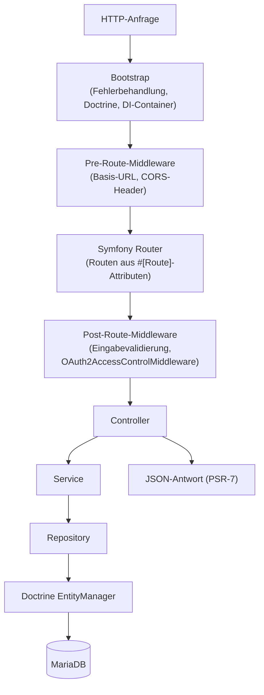
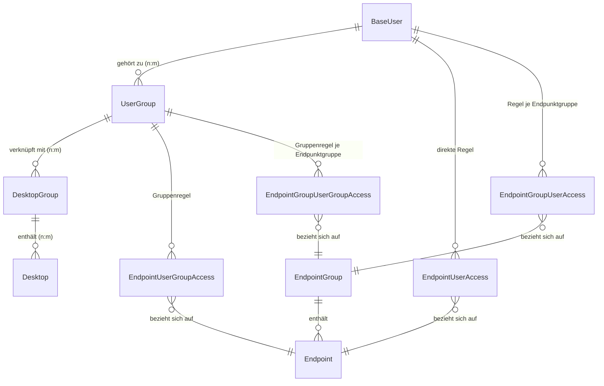
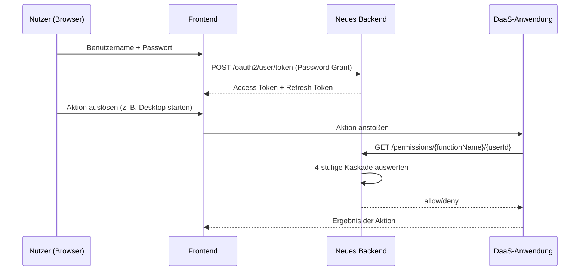

# 3 Anforderungsanalyse

Dieses Kapitel beschreibt, welches Problem mit dieser Arbeit gelöst werden soll und welche Eigenschaften die
Lösung erfüllen muss — nicht, mit welchen Klassen, Bibliotheken oder Algorithmen dies in Kapitel 4 geschieht.
Es stützt sich auf zwei Quellen: die offizielle Aufgabenstellung (Ausschreibung, Arbeitspakete AP1–AP6) und
die vollständige Quellcode-Analyse des bestehenden PHP-Backends (`design-daas-application-backend`,
Abschnitt 3.1). Keine der im Folgenden genannten Anforderungen ist frei erfunden; jede lässt sich auf eine
konkrete Stelle im Code, einer Konfigurationsdatei oder der Ausschreibung zurückführen. Abschnitt 3.4
beschreibt zusätzlich den tatsächlich realisierten Zielzustand anhand des in dieser Arbeit entstandenen
Java-Quellcodes selbst (Paketstruktur, Datenbankschema, Testklassen), nicht anhand einer separaten
Architekturbeschreibung.

---

## 3.1 Generelle Zielsetzung

### 3.1.1 Ausgangslage und Zielsetzung des Backends

Im Rahmen dieser Arbeit soll das Backend des Desktop-as-a-Service-Systems **DESIGN** (Kapitel 2.1)
vollständig neu entwickelt werden. Das bestehende Backend ist in PHP implementiert und wird in der
Ausschreibung ausdrücklich als „qualitativ schwach" und „schlecht dokumentiert" bezeichnet, während die
beiden anderen Systemteile — DaaS-Anwendung und Frontend — nach gleicher Quelle als qualitativ gut und
dokumentiert gelten. Daraus ergibt sich die doppelte Zielsetzung dieses Kapitels: Erstens muss der
Ist-Zustand des alten Backends so weit analysiert werden, dass sein nach außen sichtbares Verhalten (Schnittstellen,
Datenformate, Berechtigungslogik) vollständig verstanden ist, da hierzu — anders als bei
DaaS-Anwendung und Frontend — keine brauchbare externe Dokumentation existiert und der Quellcode die
einzige verlässliche Quelle ist. Zweitens muss daraus ein Anforderungskatalog abgeleitet werden, der
festlegt, was ein funktional gleichwertiger, aber wart- und testbarer Nachfolgedienst leisten muss, ohne
bereits festzulegen, wie dies technisch umgesetzt wird (Gegenstand von Kapitel 4).

### 3.1.2 Genereller Aufbau des Gesamtsystems

Das Gesamtsystem **DESIGN** besteht laut Ausschreibung aus drei eigenständigen Repositories: der **DaaS-Anwendung**
(Python, verwaltet laut Kapitel 2.1 Container, virtuelle Maschinen, Proxmox VE und
Apache Guacamole und damit die eigentliche Bereitstellung von Desktops), dem **Frontend** (React,
grafische Oberfläche für Endnutzer und Administratoren) und dem **Backend**, das Gegenstand dieser Arbeit
ist. Diese drei Teile kommunizieren ausschließlich über REST-Schnittstellen miteinander; es gibt keine
gemeinsame Codebasis oder gemeinsam genutzte Bibliotheken zwischen ihnen. Frontend und DaaS-Anwendung
werden im Rahmen dieser Arbeit nicht verändert (siehe Abgrenzung in Kapitel 1); das neue Backend muss daher
deren bestehende Schnittstellenerwartungen — Pfade, HTTP-Methoden, Feldnamen in JSON-Antworten,
Statuscodes sowie die Semantik der Berechtigungsprüfung — exakt so weiter erfüllen, wie es das alte
PHP-Backend bislang tut. Diese Bedingung zieht sich als sogenannte *Verhaltenskompatibilität* durch das
gesamte Kapitel und ist der wichtigste limitierende Faktor für die in Abschnitt 3.2 abgeleiteten
Anforderungen.

### 3.1.3 Ist-Zustand des alten Backends (AP1/AP2)

Die folgende Analyse beruht auf der direkten Durchsicht des Quellcodes des Repositories
`design-daas-application-backend` (Klassenstruktur, Routen-Attribute, Entitäten, Migrationsskripte,
`composer.json`, `docker-compose.yml`).

**Technologie-Stack.** Das alte Backend ist in PHP 8.2 implementiert und läuft als Apache-Modul innerhalb
eines Docker-Containers. Tabelle 3.1 fasst die eingesetzten Bibliotheken und Werkzeuge je Schicht zusammen.

*Tabelle 3.1: Technologie-Stack des alten PHP-Backends*

| Schicht                  | Technologie                                           |
|--------------------------|-------------------------------------------------------|
| Sprache                  | PHP 8.2                                               |
| HTTP-Server              | Apache (im PHP-Container)                             |
| ORM / Datenbank          | Doctrine ORM 2.x + MariaDB                            |
| Schema-Migrationen       | Doctrine Migrations                                   |
| Dependency Injection     | PHP-DI (Autowiring + Annotationen)                    |
| HTTP-Routing             | Symfony Routing (über PSR-7-Adapter)                  |
| HTTP-Nachrichten         | PSR-7 (Guzzle-Implementierung)                        |
| OAuth2                   | `league/oauth2-server` (Password Grant)               |
| API-Dokumentation        | OpenAPI/Swagger (`zircote/swagger-php`)               |
| Logging                  | Monolog (PSR-3)                                       |
| Event-Bus                | Symfony EventDispatcher (PSR-14)                      |
| Nachrichtenwarteschlange | DB-gestützt, über `enqueue/dbal`                      |
| E-Mail-Versand           | Symfony Mailer                                        |
| Cron                     | Yacron                                                |
| Containerisierung        | Docker + Docker Compose                               |
| Tests/Statische Analyse  | PHPUnit 10, PHPStan, PHPCS, PHPat (Architektur-Tests) |

**Modulstruktur und Schichtung.** Der Code ist nicht nach technischen Schichten, sondern nach fachlichen
Bereichen in sogenannte *vertikale Module* gegliedert: `Main` (Skeleton-Kern: Bootstrap, Exception-Handling,
Versions-Endpunkt), `Util` (Querschnittsfunktionen wie Mailversand, OAuth2-Middleware, Swagger-Auslieferung,
ohne fachliche Abhängigkeiten), `OAuth2` (Token-Endpunkt, Session-Info), `User` (Nutzer-/Admin-Verwaltung,
Gruppen, Registrierung), `Desktop` (Desktop- und Desktop-Gruppen-Verwaltung) sowie `Permissions`
(feingranulare Zugriffskontrolle). Jedes dieser Module folgt innerhalb seiner Grenzen derselben internen
Schichtung `Model → Repository → Service → Controller`, ergänzt um lokale `DTO`-, `Enum`- und
`Exception`-Unterpakete. Dieses Muster — fachliche Module mit identischer interner Schichtung — ist für die
in Abschnitt 3.4 beschriebene Zielarchitektur bedeutsam, da es dort 1:1 in Java-Pakete übersetzt wird.

**Anfrageverarbeitung (Request-Lifecycle).** Jede HTTP-Anfrage durchläuft denselben Ablauf: Nach dem
Bootstrap (Laden von Fehlerbehandlung, Doctrine-Konfiguration und Dependency-Injection-Container) übernimmt
ein `HttpDispatcher` auf Basis von Symfony Routing die Anfrage. Vor dem eigentlichen Routing durchläuft sie
eine Kette von Middleware-Komponenten zur Auflösung der Basis-URL und zum Setzen von
CORS-Response-Headern; nach dem Routing greifen zwei weitere Middleware-Komponenten: eine zur Behandlung
ungültiger Nutzereingaben und `OAuth2AccessControlMiddleware`, die anhand einer je Route hinterlegten
OpenAPI-Sicherheitsannotation (z. B. `#[OA\Get(security: [["oauth2-user" => ["admin"]]])]`) das mitgesendete
Zugriffstoken validiert und den authentifizierten Benutzer in die Anfrage injiziert. Erst danach wird die
passende Controller-Aktion aufgerufen, die über Service- und Repository-Schicht auf den Doctrine
`EntityManager` und damit auf MariaDB zugreift; die Antwort wird abschließend als JSON über eine
PSR-7-Response zurückgegeben.



*Abbildung 3.1: Anfrageverarbeitung im alten PHP-Backend (eigene Darstellung nach Quellcode-Analyse des
`HttpDispatcher` und der Middleware-Kette).*

**Domänenmodell.** Abbildung 3.2 zeigt die zentralen Entitäten und ihre Beziehungen. `BaseUser` ist eine
abstrakte Basis-Entität, von der `Admin` und `User` per *Single Table Inheritance* (STI) erben — beide
Rollen liegen also in einer gemeinsamen Datenbanktabelle `users`, unterschieden über eine
Diskriminator-Spalte `role`. Jeder Nutzer besitzt zusätzlich eine `guid` (UUID v4), einen
`registrationCode` (8-stelliger Hexadezimalwert mit 24 Stunden Gültigkeit, für die E-Mail-Verifikation) und
ein `enabled`-Flag; Passwörter werden ausschließlich als Hash über ein eigenes `Password`-Value-Object
gespeichert. Nutzer stehen in einer n:m-Beziehung zu `UserGroup`, `UserGroup` wiederum in einer n:m-Beziehung
zu `DesktopGroup`, die selbst n:m mit einzelnen `Desktop`-Entitäten verknüpft ist. Getrennt davon existiert
ein eigenständiges Berechtigungsmodell: `Endpoint`-Entitäten (identifiziert über einen `functionName`,
zusätzlich URL und HTTP-Methode) können zu `EndpointGroup`s zusammengefasst werden; vier Zuordnungstabellen
(`EndpointUserAccess`, `EndpointUserGroupAccess`, `EndpointGroupUserAccess`,
`EndpointGroupUserGroupAccess`) verknüpfen einzelne Nutzer bzw. Nutzergruppen mit einzelnen Endpunkten bzw.
Endpunktgruppen und tragen jeweils ein Allow/Deny-Flag. Alle Entitäten sind als `final` deklariert, um
unerwartete Vererbung zu verhindern.



*Abbildung 3.2: Domänenmodell des alten PHP-Backends (eigene Darstellung nach den Doctrine-Entitätsklassen).
`BaseUser` wird per Single-Table-Inheritance in `Admin` und `User` spezialisiert (hier aus
Platzgründen nicht gesondert dargestellt).*

**Berechtigungsmodell (Permissions-Engine).** Über die reine OAuth2-Unterscheidung zwischen den Scopes
`user` und `admin` hinaus besitzt das alte Backend ein zweites, feingranulares,
datenbankgetriebenes Berechtigungssystem. Die zentrale Methode
`PermissionCalculationService::getPermission($functionName, $userId)` prüft in einer festen
Prioritätsreihenfolge vier Regeltypen und wählt die erste zutreffende Regel:

1. `EndpointUserAccess` — eine Regel für genau diesen Nutzer und genau diesen Endpunkt,
2. `EndpointUserGroupAccess` — eine Regel für eine Nutzergruppe des Nutzers und genau diesen Endpunkt,
3. `EndpointGroupUserAccess` — eine Regel für genau diesen Nutzer und eine Endpunktgruppe, der dieser
   Endpunkt angehört,
4. `EndpointGroupUserGroupAccess` — eine Regel für eine Nutzergruppe des Nutzers und eine Endpunktgruppe.

Greift keine dieser vier Regeln, ist das Ergebnis per Voreinstellung **Zugriffsverweigerung** (*fail-closed*).
Dieses Verhalten — insbesondere die genaue Reihenfolge der vier Stufen und die Default-Deny-Regel — ist für
die DaaS-Anwendung sicherheitskritisch, da sie sich bei jeder Aktion eines Nutzers auf dieses Ergebnis
verlässt, und muss im neuen Backend identisch reproduziert werden (siehe NFA-1/NFA-2 in Abschnitt 3.2).
Ergänzend existiert ein spezieller Desktop-Zugriffstest (`GET /users/access/{desktopId}`), der prüft, ob der
authentifizierte Nutzer über seine Nutzergruppe mit einer Desktop-Gruppe verknüpft ist, die den
angefragten Desktop enthält.

**Vollständige Schnittstelle (Ist-Zustand).** Tabelle 3.2 listet alle vom alten Backend bereitgestellten
Endpunkte auf, wie sie sich aus den Routen-Attributen der Controller-Klassen ergeben. Diese Tabelle bildet
die Grundlage für die funktionalen Anforderungen in Abschnitt 3.2, da jeder Endpunkt, den das alte Backend
anbietet, vom neuen Backend in äquivalenter Form angeboten werden muss, damit Frontend und DaaS-Anwendung
unverändert funktionieren.

*Tabelle 3.2: API-Endpunkte des alten PHP-Backends (Ist-Zustand)*

| Modul         | Methode          | Pfad                                      | Berechtigung | Beschreibung                                       |
|---------------|------------------|-------------------------------------------|--------------|----------------------------------------------------|
| Main          | GET              | `/version`                                | keine        | Anwendungsversion                                  |
| OAuth2        | POST             | `/oauth2/user/token`                      | keine        | Zugriffstoken anfordern (Password/Refresh Grant)   |
| OAuth2        | GET              | `/oauth2/user/session`                    | user/admin   | Session-Info                                       |
| OAuth2        | GET              | `/ping/user` \| `/ping/admin`             | user/admin   | Diagnose-Endpunkt                                  |
| User          | POST             | `/user`                                   | keine        | Nutzer registrieren                                |
| User          | GET              | `/users`                                  | admin        | Nutzer auflisten (paginiert)                       |
| User          | GET/PATCH/DELETE | `/user/{id}`                              | admin        | Nutzer lesen/ändern/löschen                        |
| User          | POST             | `/user/{id}/enable` \| `/disable`         | admin        | Nutzerkonto (de)aktivieren                         |
| User          | POST             | `/user/validate_email`                    | keine        | E-Mail-Adresse verifizieren                        |
| User          | GET              | `/users/access/{desktopId}`               | user         | Desktop-Zugriff prüfen                             |
| User          | POST             | `/user/request-application/{app}/{lang}`  | user         | Anwendungsfreischaltung anfragen (E-Mail)          |
| Admin         | GET              | `/admins`, `/admin/{id}`                  | admin        | Admins auflisten/lesen                             |
| Admin         | POST/DELETE      | `/admin`, `/admin/{id}`                   | admin        | Admin anlegen/löschen                              |
| Desktop       | POST/GET         | `/desktop`, `/desktop/{id}`, `/desktops`  | admin        | Desktop anlegen/lesen/auflisten                    |
| Desktop       | POST/GET         | `/desktop-group`, `/desktop_group/{id}`   | admin        | Desktop-Gruppe anlegen/lesen                       |
| Desktop       | POST             | `/desktop_group/{dgId}/user_group/{ugId}` | admin        | Nutzergruppe mit Desktop-Gruppe verknüpfen         |
| Permissions   | GET              | `/permissions/{fn}/{userId}`              | admin        | Berechtigung für Nutzer/Funktion abfragen          |
| Permissions   | POST             | `/permissions_info`                       | token/admin  | Berechtigung anhand Token + Funktionsname abfragen |
| UserGroup     | diverse          | `/user-group/*`                           | admin        | CRUD für Nutzergruppen                             |
| EndpointGroup | diverse          | `/endpoint-group/*`                       | admin        | CRUD für Endpunktgruppen                           |

**Konfiguration und Betrieb.** Sämtliche Konfiguration erfolgt über Umgebungsvariablen, die beim
Containerstart in den Dependency-Injection-Container abgebildet werden; ein direkter Zugriff auf
`$_SERVER`/`getenv()` ist durch Konvention untersagt, um die Testbarkeit zu erhalten. Der Betrieb erfolgt
über Docker Compose mit zwei Profilen (`dev-environment`, `release-test-environment`); die
Test-Datenbank läuft als eigenständige, flüchtige MariaDB-Instanz im Arbeitsspeicher (`tmpfs`), getrennt von
der Entwicklungsdatenbank. Cronjobs (z. B. zum Aufräumen abgelaufener Registrierungscodes) laufen als
separater `yacron`-Dienst; die Konfiguration schreibt dabei bewusst kurze, in eine Nachrichtenwarteschlange
entkoppelte Jobs vor, da verpasste Ausführungen nicht automatisch nachgeholt werden.

### 3.1.4 Vorhergehende Arbeiten

Grundlage dieser Arbeit sind zum einen die Veröffentlichungen zum DESIGN-System selbst — das
MobiWis-2024-Paper und der OJCC-Artikel [1], [2] (siehe Kapitel 2.1) —, die Architektur, Motivation und
eingesetzte Virtualisierungstechnologien von DESIGN beschreiben, jedoch das Backend selbst nur am Rande
behandeln. Zum anderen ist die bestehende Implementierung des PHP-Backends die einzige verfügbare
Ist-Dokumentation dieses Teilsystems, da laut Ausschreibung keine darüberhinausgehende, aktuell gepflegte
Dokumentation existiert. Die in Abschnitt 3.1.3 beschriebene Analyse ersetzt insofern eine sonst übliche
vorhandene Fachkonzept- oder Architekturdokumentation und ist Teil des Arbeitspakets AP2.

### 3.1.5 Umfeldbeschreibung

Tabelle 3.3 fasst die vorhandene Hard- und Software-Infrastruktur sowie die daraus resultierenden
Rahmenbedingungen für das neue Backend zusammen.

*Tabelle 3.3: Umfeld und Rahmenbedingungen*

| Umfeldelement         | Beschreibung                                                                                              | Auswirkung auf das neue Backend                                                                         |
|-----------------------|-----------------------------------------------------------------------------------------------------------|---------------------------------------------------------------------------------------------------------|
| MariaDB               | Alleiniger Datenspeicher des alten Backends (Nutzer, Gruppen, Permissions, Desktops)                      | Muss als Datenspeicher weiterverwendet werden, Schema muss versioniert migrierbar bleiben               |
| SMTP-Relay            | Versand von Registrierungs-/Verifikations-E-Mails im alten Backend über Symfony Mailer + DB-Warteschlange | Muss weiterhin HTML-E-Mails für dieselben Anlässe versenden können                                      |
| React-Frontend        | Eigenständiges Repository, konsumiert Auth-/User-/Desktop-Endpunkte des Backends                          | Erwartet unveränderte REST-Verträge (Abschnitt 3.1.2); CORS-Konfiguration muss Frontend-Origin erlauben |
| Python-DaaS-Anwendung | Eigenständiges Repository, konsumiert ausschließlich die Permissions-Endpunkte                            | Erwartet unveränderten Permissions-Vertrag inkl. 4-stufiger Kaskade                                     |
| Docker/Docker Compose | Alleinige Betriebsform des alten Backends (Entwicklungs- und Testumgebung als separate Profile)           | Neues Backend muss ebenfalls containerisiert und per Docker betreibbar sein                             |
| Linux-Zielplattform   | Produktionsbetrieb des alten Backends auf Linux-Servern mit Apache                                        | Neues Backend muss ohne Anpassung auf vergleichbarer Linux-Infrastruktur lauffähig sein                 |

Beide bestehenden Clients (Frontend, DaaS-Anwendung) liegen außerhalb des Scopes dieser Arbeit (Kapitel 1,
Abgrenzung) und werden nicht angepasst; jede hier beschriebene Rahmenbedingung ist daher als feste,
nicht verhandelbare Vorgabe zu verstehen und nicht als Gestaltungsspielraum für das neue Backend.

## 3.2 Klärung der Anforderungen

### 3.2.1 Vorgehen

Die Anforderungen wurden ausschließlich durch Quellcode-Analyse des alten PHP-Backends (Controller-, Service-
und Entitätsklassen, Migrationsskripte, `composer.json`, siehe Abschnitt 3.1.3) sowie durch die
Aufgabenstellung der Ausschreibung ermittelt. Eine gesonderte Gesprächsreihe mit dem Betreuer zur
Anforderungsklärung hat über die in Abschnitt 3.3 genannten, fest vorgegebenen Abgabetermine hinaus nicht
stattgefunden; die Anforderungen stützen sich daher ausschließlich auf die Ausschreibung und die Analyse
des bestehenden Codes. Dieses Vorgehen entspricht einer *Reverse-Engineering*-Anforderungsanalyse: Statt
Anforderungen aus Interviews mit Stakeholdern oder einem Pflichtenheft abzuleiten, werden sie aus dem
beobachtbaren Verhalten eines bestehenden Systems rekonstruiert, dessen Ablösung gefordert ist.

### 3.2.2 Klärung der Hauptfunktionalität und Problemfeldabgrenzung

Die Hauptfunktionalität des Backends lässt sich aus der Modulstruktur des alten Systems (Abschnitt 3.1.3)
in vier Bereiche gliedern, die vom neuen Backend unverändert angeboten werden müssen:

1. **Authentifizierung** — Ausstellen, Erneuern, Widerrufen und Prüfen von Zugriffstoken für Nutzer (vormals `OAuth2`
   -Modul).
2. **Autorisierung** — Beantwortung der Frage „darf Nutzer X Funktion Y aufrufen?" über die in Abschnitt
   3.1.3 beschriebene 4-stufige Kaskade (vormals `Permissions`-Modul).
3. **Benutzerverwaltung** — Selbstregistrierung mit E-Mail-Verifikation, administrative Verwaltung von
   Nutzern, Admins und Nutzergruppen, sowie das Anfragen einer Anwendungsfreischaltung (vormals `User`-Modul).
4. **Desktop-Inventarverwaltung** — Anlegen, Auflisten und Verknüpfen von Desktops und Desktop-Gruppen mit
   Nutzergruppen (vormals `Desktop`-Modul).

Explizit **nicht** Teil dieser Arbeit — und damit außerhalb des Problemfelds — ist die eigentliche
Bereitstellung von Desktops, also das Starten, Klonen oder Beenden von Containern und virtuellen Maschinen
sowie die Steuerung von Apache Guacamole; diese Aufgaben übernimmt laut Ausschreibung und laut Kapitel 2.1
ausschließlich die Python-DaaS-Anwendung. Das Backend stellt dafür lediglich die zugehörigen
Inventar-/Stammdaten (welcher Desktop existiert, welcher Nutzergruppe ist er zugeordnet) sowie die
Authentifizierungs- und Berechtigungsauskünfte bereit, auf deren Basis die DaaS-Anwendung ihre eigenen
Entscheidungen trifft. Ebenfalls nicht Teil der Arbeit sind jegliche über die in Kapitel 1 (Abgrenzung)
genannten punktuellen Korrekturen hinausgehende funktionale Änderungen an Frontend oder DaaS-Anwendung.

### 3.2.3 Ableitung der funktionalen Anforderungen

Jede funktionale Anforderung (FA) entspricht mindestens einem Endpunkt aus Tabelle 3.2 (Ist-Zustand des
alten Backends) und wird so formuliert, dass sie unabhängig von der konkreten Implementierungssprache
gilt — sie beschreibt, welche Funktion das System erfüllen muss, nicht, mit welcher Klasse oder welchem
Framework dies geschieht.

*Tabelle 3.4: Funktionale Anforderungen (FA)*

| ID    | Anforderung                                                                                                                                                                                                              | Quelle (altes Backend)                    |
|-------|--------------------------------------------------------------------------------------------------------------------------------------------------------------------------------------------------------------------------|-------------------------------------------|
| FA-1  | Ein Nutzer authentifiziert sich mit Benutzername und Passwort und erhält im Erfolgsfall ein Zugriffstoken (`POST /oauth2/user/token`, Password Grant)                                                                    | `league/oauth2-server` Password Grant     |
| FA-2  | Ein abgelaufenes Zugriffstoken kann ohne erneute Eingabe von Zugangsdaten über ein Refresh-Token erneuert werden                                                                                                         | OAuth2-Modul, Refresh-Token-Mechanismus   |
| FA-3  | Ein Nutzer kann sich aktiv abmelden; das zugehörige Token wird serverseitig widerrufen, auch wenn es formal noch nicht abgelaufen ist (`POST /oauth2/user/logout`)                                                       | OAuth2-Modul                              |
| FA-4  | Zu einem gültigen Zugriffstoken kann die zugehörige Session/Identität abgefragt werden (`GET /oauth2/user/session`)                                                                                                      | OAuth2-Modul                              |
| FA-5  | Ein neuer Nutzer kann sich selbst registrieren und muss seine E-Mail-Adresse über einen zeitlich begrenzten Code bestätigen, bevor das Konto nutzbar ist (`POST /user`, `/user/validate_email`, `/user/resend_code`)     | User-Modul, `registrationCode` (24 h TTL) |
| FA-6  | Ein Administrator kann Nutzer auflisten (paginiert), einsehen, ändern sowie aktivieren/deaktivieren (`GET /users`, `GET/PATCH /user/{id}`, `POST /user/{id}/enable`\|`/disable`)                                         | User-Modul                                |
| FA-7  | Ein Administrator kann weitere Administratorkonten anlegen, auflisten und löschen (`GET /admins`, `POST /admin`, `DELETE /admin/{id}`)                                                                                   | Admin-Modul                               |
| FA-8  | Ein Administrator kann Nutzergruppen anlegen, auflisten und ändern (`/user-group/*`)                                                                                                                                     | UserGroup-Modul                           |
| FA-9  | Ein Nutzer kann die Freischaltung einer bestimmten Anwendung anfragen; der zuständige Administrator wird per E-Mail benachrichtigt (`POST /user/request-application/{application}/{isoCode}`)                            | User-Modul                                |
| FA-10 | Ein Administrator kann Desktops anlegen, einsehen und auflisten (`POST /desktop`, `GET /desktop/{id}`, `GET /desktops`)                                                                                                  | Desktop-Modul                             |
| FA-11 | Ein Administrator kann Desktop-Gruppen anlegen, einsehen und mit Nutzergruppen verknüpfen (`POST /desktop-group`, `GET /desktop_group/{id}`, `POST /desktop_group/{id}/user_group/{userGroupId}`)                        | Desktop-Modul                             |
| FA-12 | Ein Nutzer kann prüfen, ob er Zugriff auf einen bestimmten Desktop hat (über seine Nutzergruppen-/Desktop-Gruppen-Zuordnung, `GET /users/access/{desktopId}`)                                                            | User-Modul                                |
| FA-13 | Für eine gegebene Funktion und einen gegebenen Nutzer kann geprüft werden, ob Zugriff erlaubt ist, über die 4-stufige Kaskade aus Abschnitt 3.1.3 (`GET /permissions/{functionName}/{userId}`, `POST /permissions_info`) | Permissions-Modul                         |

Im Vergleich zum ersten Entwurf dieses Kapitels wurde FA-12 (Desktop-Zugriffsprüfung für Nutzer,
`GET /users/access/{desktopId}`) ergänzt, da dieser Endpunkt im `User`-Controller des alten Backends separat
vom allgemeinen Permissions-Endpunkt implementiert ist und eine eigene, Desktop-Gruppen-basierte Prüflogik
besitzt, die nicht mit der generischen Funktions-/Endpunkt-Kaskade (FA-13) verwechselt werden darf.

### 3.2.4 Ableitung der nicht-funktionalen Anforderungen

Die nicht-funktionalen Anforderungen (NFA) ergeben sich zum einen aus Eigenschaften, die das alte Backend
bereits besitzt und die aus Kompatibilitätsgründen erhalten bleiben müssen (NFA-1 bis NFA-3), zum anderen
aus generischen Sicherheits- und Betriebsanforderungen, die üblicherweise an einen Authentifizierungsdienst
gestellt werden und die in Kapitel 2.2–2.4 theoretisch hergeleitet werden (NFA-4 bis NFA-7), sowie aus
Qualitätszielen, die der Ausschreibung ausdrücklich entnommen sind: Das neue Backend soll — im Gegensatz zum
alten — wart- und testbar sein (NFA-8 bis NFA-10).

*Tabelle 3.5: Nicht-funktionale Anforderungen (NFA)*

| ID     | Anforderung                                                                                                                                                                                                                                         | Begründung                                                                                                   |
|--------|-----------------------------------------------------------------------------------------------------------------------------------------------------------------------------------------------------------------------------------------------------|--------------------------------------------------------------------------------------------------------------|
| NFA-1  | Fail-closed-Sicherheitsverhalten: Ein unbekannter Nutzer, eine unbekannte Funktion oder das Fehlen jeder passenden Regel führt stets zu Zugriffsverweigerung, nie zu impliziter Erlaubnis                                                           | Übernahme des Sicherheitsprinzips aus dem alten Backend (Abschnitt 3.1.3)                                    |
| NFA-2  | Verhaltenskompatibilität der Berechtigungskaskade: identische Priorität (direkte Nutzerregel vor Gruppenregel vor Endpunktgruppenregel) und identische Konfliktauflösung bei mehreren gleichrangigen, widersprüchlichen Regeln wie im alten Backend | Die DaaS-Anwendung verlässt sich auf dieses Verhalten und wird nicht angepasst                               |
| NFA-3  | API-Formkompatibilität: identische Pfade, HTTP-Methoden, JSON-Feldnamen und Statuscodes zu Frontend und DaaS-Anwendung wie beim alten Backend                                                                                                       | Beide Clients werden nicht angepasst (Kapitel 1, Abgrenzung)                                                 |
| NFA-4  | Passwörter werden ausschließlich als Hash gespeichert; Konten werden nach wiederholten Fehlversuchen vorübergehend gesperrt                                                                                                                         | Sicherheit (Kapitel 2.2)                                                                                     |
| NFA-5  | Sicherheitsrelevante Endpunkte (insbesondere Login, Registrierung) sind ratenbegrenzt                                                                                                                                                               | Schutz vor Missbrauch/Brute-Force (Kapitel 2.2)                                                              |
| NFA-6  | Zugriffstoken sind serverseitig widerrufbar, obwohl sie als JSON Web Token grundsätzlich zustandslos und selbstbeschreibend sind                                                                                                                    | Ein Logout oder eine erzwungene Abmeldung durch einen Administrator muss sofort wirksam werden (Kapitel 2.2) |
| NFA-7  | Der Dienst ist zustandslos und damit horizontal skalierbar; es existiert kein Server-seitiger Session-State außerhalb der Datenbank                                                                                                                 | Betriebsfähigkeit hinter einem Load Balancer                                                                 |
| NFA-8  | Die Schichtenarchitektur jedes fachlichen Moduls (Controller → Service → Repository → Model) wird automatisiert über den Build geprüft, nicht nur durch Konvention                                                                                  | Wartbarkeit; direkte Antwort auf die in der Ausschreibung kritisierte Qualität des alten Backends            |
| NFA-9  | Eine Mindest-Testabdeckung wird im Build erzwungen und ein fehlgeschlagener Build verhindert das Mergen von Änderungen                                                                                                                              | Wartbarkeit/Qualitätssicherung                                                                               |
| NFA-10 | Das Datenbankschema wird ausschließlich über versionierte, nachvollziehbare Migrationen verändert und nie automatisch aus dem Code generiert                                                                                                        | Nachvollziehbarkeit/Reproduzierbarkeit über Umgebungen hinweg                                                |

Die Reihenfolge NFA-1 bis NFA-3 ist bewusst gewählt: Sie bilden zusammen die Bedingung, unter der das neue
Backend als „funktional gleichwertig" zum alten gelten darf, und sind damit die Messlatte für die in Kapitel
4.8 beschriebene Evaluation. NFA-2 ist dabei besonders hervorzuheben, da die Prüfung des alten Codes
ergeben hat, dass die Kaskade nicht nur die *erste* zutreffende Regelstufe auswählt, sondern innerhalb einer
Stufe auch mit *mehreren* zueinander im Widerspruch stehenden Regeln desselben Nutzers (z. B. über zwei
unterschiedliche Nutzergruppen) umgehen können muss; eine korrekte Portierung muss dieses Verhalten
nachbilden und nicht nur den Normalfall einer eindeutig zutreffenden Regel abdecken.

## 3.3 Zeitliche Rahmenbedingungen

Dieser Abschnitt hält den Start- und Endzeitpunkt der Arbeit sowie die zugehörigen Meilensteine fest. Die
folgenden vier Termine sind durch die Prüfungsordnung bzw. die Vorgaben des Prüfungsamts fest vorgegeben und
nicht verhandelbar; alle übrigen Meilensteine wurden davon ausgehend eigenständig in strikter, sequenzieller
Abfolge der Arbeitspakete AP1–AP6 geplant, wie sie in der Ausschreibung vorgegeben sind.

- **Start der Arbeit:** 22.06.2026
- **Ende der Arbeit:** 25.11.2026
- **Anforderungsanalyse an den Betreuer:** 29.06.2026 (1 Woche nach Start)
- **Entwurf der Ausarbeitung:** 28.10.2026 (4 Wochen vor Abgabe)
- **Vollständiger schriftlicher Entwurf:** 11.11.2026 (2 Wochen vor Abgabe)
- **Abgabe im Prüfungsamt:** 25.11.2026

Eigene Meilensteine (strikt sequenzielle Abfolge AP1–AP6):

| Meilenstein                                                | Zeitraum                      |
|------------------------------------------------------------|-------------------------------|
| AP1 – Recherche Gesamtsystem DESIGN                        | 22.06.–29.06.2026             |
| Abgabe der Anforderungsanalyse an den Betreuer             | 29.06.2026                    |
| AP2 – Analyse altes PHP-Backend                            | 30.06.–13.07.2026             |
| AP3 – Entwurf neues Backend (Konzept/Architektur)          | 14.07.–03.08.2026             |
| AP4 – Implementierung neues Backend (Java/Spring Boot)     | 04.08.–21.09.2026             |
| AP5 – Aufbau des Demonstrators                             | 22.09.–05.10.2026             |
| AP6 – Test, Evaluation, Dokumentation                      | 06.10.–28.10.2026             |
| Literaturrecherche / Kapitel 2 (theoretischer Hintergrund) | 22.06.–10.08.2026, begleitend |
| Anfertigung der schriftlichen Ausarbeitung                 | 22.06.–11.11.2026, begleitend |
| Abgabe des Entwurfs der Ausarbeitung an den Betreuer       | 28.10.2026                    |
| Einarbeiten der Vorschläge des Betreuers                   | 28.10.–11.11.2026             |
| Abgabe des vollständigen schriftlichen Entwurfs            | 11.11.2026                    |
| Ende der Bearbeitungszeit, Einreichen im Prüfungsamt       | 25.11.2026                    |

AP1 und AP2 überschneiden sich bewusst in den ersten beiden Wochen, da das Verständnis des Gesamtsystems
DESIGN (AP1) und die Detailanalyse des alten Backends (AP2) in der Praxis nicht vollständig trennbar sind —
ohne die in Abschnitt 3.1 beschriebene Code-Analyse ließen sich die Rolle und Schnittstellen des Backends
innerhalb von DESIGN nicht einordnen. Die schriftliche Ausarbeitung sowie die Literaturrecherche zu Kapitel
2 laufen während der gesamten Bearbeitungszeit begleitend mit, da Erkenntnisse aus AP3–AP6 unmittelbar in
Kapitel 4 und 5 einfließen.

## 3.4 Zielzustand

### 3.4.1 Architekturüberblick

Das Zielsystem ist ein eigenständiger Java-21-/Spring-Boot-Dienst (`de.frauas.design.backend`), der dasselbe
Konzept vertikaler, fachlicher Module wie das alte Backend übernimmt (Abschnitt 3.1.3), jedoch mit einer
automatisiert erzwungenen statt nur konventionell eingehaltenen internen Schichtung. Die vier fachlichen
Module **auth**, **permission**, **user** und **desktop** entsprechen den vier in Abschnitt 3.2.2 genannten
Funktionsbereichen und damit den alten Modulen `OAuth2`, `Permissions`, `User` und `Desktop`; ergänzt werden
sie durch drei Querschnittspakete: **shared** (modulübergreifend genutzte DTOs, Exceptions,
Sicherheits-/Hilfsklassen, ohne Abhängigkeit zu einem fachlichen Modul), **config** (typisierte
Spring-`@Configuration`-Klassen) und **bootstrap** (Aufgaben beim Anwendungsstart, z. B. Anlage eines
Standard-Administratorkontos). Jedes fachliche Modul ist intern identisch geschichtet in
`controller → service → repository → model`, ergänzt um lokale `dto`- und `exception`-Unterpakete — eine
direkte Übersetzung des alten `Model → Repository → Service → Controller`-Musters in eine für Spring Boot
idiomatische Reihenfolge. Anders als im alten Backend ist diese Schichtung nicht nur Konvention, sondern wird
durch eine dedizierte ArchUnit-Testklasse automatisiert geprüft (Abschnitt 3.4.4).

```mermaid
flowchart TB
    FE["Frontend (React, unverändert)"] -- " REST — gleiche Endpunkte/Feldformate " --> BE
    DAAS["DaaS-Anwendung (Python, unverändert)"] -- " REST — gleicher Permissions-Vertrag " --> BE
    ADMIN["Admin (Swagger UI, SCOPE_admin)"] --> BE
    subgraph BE["Neues Backend — Java 21 / Spring Boot"]
        direction LR
        AUTH["auth"]
        PERM["permission"]
        USER["user"]
        DESK["desktop"]
    end
    BE -. " Querschnitt: shared, config, bootstrap\nSchichtung je Modul durch ArchUnit erzwungen " . - BE 
    BE --> DB[("MariaDB\nSchema über Flyway migriert")]
BE --> SMTP["SMTP-Relay\nRegistrierungs-/Verifikations-E-Mails"]
```

*Abbildung 3.3: Zielzustand des neuen Backends (eigene Darstellung nach der im Rahmen dieser Arbeit
entstandenen Paketstruktur `../../src/main/java/de/frauas/design/backend`).*

### 3.4.2 Authentifizierungs- und Autorisierungskonzept

Authentifizierung erfolgt zustandslos über RS256-signierte JSON Web Token (Kapitel 2.2): Ein eigener
Token-Aussteller validiert Benutzername und Passwort bzw. ein vorgelegtes Refresh-Token und stellt im
Erfolgsfall ein JWT aus, dessen Signatur über ein beim ersten Start erzeugtes und persistiertes
RSA-Schlüsselpaar geprüft werden kann — ein Verlust dieses Schlüssels entwertet alle zuvor ausgestellten
Tokens. Damit ein an sich zustandsloses Token dennoch, wie in NFA-6 gefordert, serverseitig widerrufen werden
kann, führt das Zielsystem zwei Datenbanktabellen (`access_tokens`, `refresh_tokens`, definiert in der
Flyway-Migration `V1__init.sql`) mit je einem `revoked`-Flag und einem `revoked_at`-Zeitstempel, die bei
jeder Prüfung eines Tokens zusätzlich zur kryptografischen Signatur konsultiert werden; `access_tokens`
referenziert den Nutzer zusätzlich über ein eindeutiges `jti`-Feld, über das ein einzelnes Token gezielt
widerrufen werden kann, ohne alle Tokens des Nutzers ungültig zu machen. Ergänzend begrenzt ein
`RateLimitingFilter` (Paket `shared.security.filter`, auf Basis eines Token-Bucket-Algorithmus in
`shared.security.ratelimit`) die Anzahl zulässiger Login- und Registrierungsversuche je Client-IP (NFA-5);
die Nutzer-Entität selbst führt zusätzlich die Felder `failedLoginAttempts` und `lockedUntil`, über die ein
Konto nach wiederholten Fehlversuchen vorübergehend gesperrt wird (NFA-4). Autorisierung erfolgt zweistufig:
Grobgranular
über OAuth2-Scopes (`SCOPE_user`/`SCOPE_admin`, geprüft durch Spring Security), feingranular über die in
Abschnitt 3.1.3 beschriebene 4-stufige, fail-closed Kaskade, die im Zielsystem 1:1 aus dem alten
`PermissionCalculationService` portiert wird und bei mehreren gleichrangigen, widersprüchlichen Regeln
innerhalb derselben Stufe deterministisch auflöst, indem ein expliziter Deny-Eintrag stärker wiegt als ein
Allow-Eintrag (vgl. NFA-2, Abschnitt 3.2.4).

### 3.4.3 Datenhaltung und Betrieb

MariaDB dient, wie im alten Backend, als alleiniger Datenspeicher; das Schema wird jedoch ausschließlich
über versionierte Flyway-Migrationsskripte unter `../../src/main/resources/db/migration` (`V1__init.sql` für das
initiale Schema, gefolgt von inkrementellen Skripten wie `V2__registration_timestamps_to_instant.sql`,
`V3__drop_desktop_name.sql` und `V4__desktop_group_description_only.sql`) verändert, während Hibernate die
gemappten Entitäten beim Start lediglich gegen das bestehende Schema validiert (`ddl-auto: validate`), aber
nie selbst Schemaänderungen vornimmt (NFA-10). Ein SMTP-Relay versendet, wie im alten Backend, Registrierungs- und
Verifikations-E-Mails sowie
Benachrichtigungen über angefragte Anwendungsfreischaltungen (FA-9), hier auf Basis von
Thymeleaf-HTML-Vorlagen. Der Dienst ist als einzelnes Docker-Image paketiert (eine Spring-Boot-Fat-JAR), über
Umgebungsvariablen konfigurierbar (12-Factor-Prinzip, mit separaten Profilen `local`/`dev`/`prod`) und hält
keinerlei Server-seitigen Sitzungszustand außerhalb der Datenbank bzw. des signierten Tokens selbst; mehrere
Instanzen können daher hinter einem Load Balancer betrieben werden (NFA-7), sofern sie dasselbe
RSA-Schlüsselpaar und dieselbe Datenbank teilen.

### 3.4.4 Qualitätssicherung

Die in NFA-8 und NFA-9 geforderte automatisierte Prüfung von Architektur und Testabdeckung wird im
Zielsystem über zwei Build-Bausteine umgesetzt: Eine ArchUnit-Testklasse (`ArchitectureTest`,
`../../src/test/java/de/frauas/design/backend/arch`) prüft bei jedem Build unter anderem, dass
Controller nie direkt von anderen Controllern aufgerufen werden, dass Services nicht von Repositories
abhängen, dass Entitäten (`model`) nur aus Service-, Repository-, Konfigurations- oder DTO-Code heraus
referenziert werden, dass Klassen gemäß ihrer Spring-Annotation (`@Service`, `@Repository`,
`@RestController`) im passenden Unterpaket liegen und dass ausschließlich Konstruktor-Injektion statt
Feld-Injektion verwendet wird; JaCoCo erzwingt zusätzlich eine Mindest-Zeilenabdeckung von 70 % durch Tests.
Beide Prüfungen sind, anders als beim alten Backend, verbindlicher Bestandteil des Builds und verhindern bei
Verletzung das Zusammenführen von Änderungen — die unmittelbare technische Antwort auf die in der
Ausschreibung kritisierte mangelnde Qualität und Dokumentation des Ist-Systems (Abschnitt 3.1.1).

## 3.5 Anwendungsfälle für den Prototyp

Zur Demonstration der Funktionalität (AP5, Kapitel 4.7) wird der Prototyp des neuen Backends gegen die
unveränderten Clients (Frontend, DaaS-Anwendung) über acht Anwendungsfälle gezeigt, die zusammen alle in
Abschnitt 3.2.3 abgeleiteten funktionalen Anforderungen abdecken. Tabelle 3.6 gibt einen Überblick, die
anschließenden Beschreibungen legen für jeden Anwendungsfall Vorbedingung, Ablauf und Nachbedingung fest.

*Tabelle 3.6: Anwendungsfälle für den Prototyp*

| # | Anwendungsfall                                                                               | Beteiligte Module | Abgedeckte FA    |
|---|----------------------------------------------------------------------------------------------|-------------------|------------------|
| 1 | Login per Password Grant und anschließende Berechtigungsprüfung durch die DaaS-Anwendung     | auth, permission  | FA-1, FA-13      |
| 2 | Token-Erneuerung per Refresh-Token-Grant                                                     | auth              | FA-2             |
| 3 | Logout mit serverseitigem Tokenwiderruf                                                      | auth              | FA-3             |
| 4 | Selbstregistrierung inkl. E-Mail-Verifikation                                                | user              | FA-5             |
| 5 | Admin legt Benutzer/Admin/Nutzergruppe an und (de)aktiviert Konten                           | user              | FA-6, FA-7, FA-8 |
| 6 | Admin legt Desktop und Desktop-Gruppe an und verknüpft sie mit einer Nutzergruppe            | desktop           | FA-10, FA-11     |
| 7 | DaaS-Anwendung fragt für eine gegebene Funktion und einen Nutzer die Zugriffsentscheidung ab | permission        | FA-13            |
| 8 | Nutzer fragt Freischaltung einer Anwendung an (Benachrichtigungs-E-Mail an Admin)            | user              | FA-9             |

**AF-1 — Login und Berechtigungsprüfung.** *Vorbedingung:* Ein aktiviertes Nutzerkonto existiert. *Ablauf:* Der Nutzer
meldet sich über das Frontend mit Benutzername und Passwort an; das Backend stellt ein
Zugriffs- und ein Refresh-Token aus. Der Nutzer löst daraufhin über das Frontend eine Aktion aus, die eine
design-daas-Funktion betrifft; die DaaS-Anwendung fragt das Backend, ob der Nutzer diese Funktion aufrufen
darf. *Nachbedingung:* Der Nutzer besitzt ein gültiges Token, und die DaaS-Anwendung erhält eine
eindeutige Allow-/Deny-Antwort gemäß der 4-stufigen Kaskade.



*Abbildung 3.4: Ablauf von AF-1 (eigene Darstellung).*

**AF-2 — Token-Erneuerung.** *Vorbedingung:* Ein gültiges, nicht widerrufenes Refresh-Token liegt vor. *Ablauf:* Das
Frontend sendet das Refresh-Token an `POST /oauth2/user/token` mit `grant_type=refresh_token`,
ohne dass der Nutzer erneut Zugangsdaten eingeben muss. *Nachbedingung:* Ein neues Zugriffstoken (und
üblicherweise ein neues Refresh-Token) wird ausgestellt; das alte Zugriffstoken verliert seine Gültigkeit.

**AF-3 — Logout.** *Vorbedingung:* Ein gültiges Zugriffstoken liegt vor. *Ablauf:* Der Nutzer meldet sich
über das Frontend ab (`POST /oauth2/user/logout`); das Backend markiert das zugehörige Token in der
Widerrufsliste (Abschnitt 3.4.2) als widerrufen. *Nachbedingung:* Das Token wird von keinem nachfolgenden
Request mehr akzeptiert, selbst wenn es formal noch nicht abgelaufen ist (NFA-6).

**AF-4 — Selbstregistrierung mit E-Mail-Verifikation.** *Vorbedingung:* Es existiert noch kein Konto mit der
angegebenen E-Mail-Adresse. *Ablauf:* Der Nutzer registriert sich über das Frontend (`POST /user`); das
Backend legt ein deaktiviertes Konto mit zeitlich begrenztem Verifikationscode an und versendet diesen per
E-Mail. Der Nutzer bestätigt den Code (`POST /user/validate_email`) oder fordert bei Bedarf einen neuen Code
an (`POST /user/resend_code`). *Nachbedingung:* Das Konto ist aktiviert und kann sich anschließend wie in
AF-1 anmelden.

**AF-5 — Administrative Verwaltung von Nutzern, Admins und Nutzergruppen.** *Vorbedingung:* Ein
angemeldeter Administrator (Scope `admin`) ist vorhanden. *Ablauf:* Der Administrator legt über das
Frontend neue Nutzer oder weitere Administratoren an, ordnet Nutzer Nutzergruppen zu und aktiviert bzw.
deaktiviert Konten bei Bedarf. *Nachbedingung:* Die Nutzer-, Admin- und Gruppendaten sind konsistent in der
Datenbank gepflegt und wirken sich unmittelbar auf nachfolgende Berechtigungsprüfungen (AF-7) aus.

**AF-6 — Anlegen von Desktops und Desktop-Gruppen.** *Vorbedingung:* Ein angemeldeter Administrator ist
vorhanden. *Ablauf:* Der Administrator legt einen Desktop sowie eine Desktop-Gruppe an und verknüpft diese
Desktop-Gruppe mit einer bestehenden Nutzergruppe. *Nachbedingung:* Alle Mitglieder der verknüpften
Nutzergruppe gelten gemäß der in Abschnitt 3.1.3 beschriebenen Zuordnungskette (Nutzer → Nutzergruppe →
Desktop-Gruppe → Desktop) fortan als zugriffsberechtigt für diesen Desktop (FA-12).

**AF-7 — Berechtigungsabfrage durch die DaaS-Anwendung.** *Vorbedingung:* Die DaaS-Anwendung besitzt ein
gültiges Admin-Token. *Ablauf:* Die DaaS-Anwendung fragt für eine design-daas-Funktion und einen Nutzer die
Zugriffsentscheidung ab (`GET /permissions/{functionName}/{userId}` oder `POST /permissions_info`); das
Backend durchläuft die 4-stufige Kaskade aus Abschnitt 3.1.3 und liefert eine eindeutige Allow-/Deny-Antwort.
*Nachbedingung:* Die DaaS-Anwendung führt die angefragte Aktion nur bei einer Allow-Antwort aus; bei jedem
unklaren Fall (unbekannter Nutzer, unbekannte Funktion, keine passende Regel) wird aufgrund von NFA-1
verweigert.

**AF-8 — Anfrage einer Anwendungsfreischaltung.** *Vorbedingung:* Ein angemeldeter Nutzer ist vorhanden. *Ablauf:* Der
Nutzer fragt über das Frontend die Freischaltung einer bestimmten Anwendung an
(`POST /user/request-application/{application}/{isoCode}`); das Backend versendet eine Benachrichtigungs-
E-Mail an die zuständigen Administratoren. *Nachbedingung:* Die Administratoren sind informiert und können
die Freischaltung außerhalb des hier beschriebenen Anwendungsfalls über AF-5/AF-6 vornehmen.

---

## Quellen in diesem Kapitel

```
[1] C. Baun and J. Bouché, "Challenges and Solutions of Developing and Implementing a Novel
    Desktop-as-a-Service," in Proc. 20th Int. Conf. Mobile Web Intell. Inf. Syst. (MobiWis 2024),
    Vienna, Austria, Aug. 2024.
[2] C. Baun and J. Bouché, "Closing the Gap between Web Applications and Desktop Applications by
    designing a novel Desktop-as-a-Service (DaaS) with seamless support for Desktop Applications,"
    Open Journal of Cloud Computing (OJCC), vol. 8, no. 1, pp. 1-19, 2023.
```

Beide Quellen sind Teil des vollständigen Literaturverzeichnisses in Kapitel 2. Alle übrigen Aussagen dieses
Kapitels stützen sich auf die offizielle Ausschreibung sowie auf die direkte Analyse des Quellcodes: des
alten PHP-Backends (`design-daas-application-backend`, Abschnitt 3.1) und des im Rahmen dieser Arbeit
entstandenen neuen Java-Backends (Abschnitt 3.4), jeweils einschließlich Konfigurationsdateien (`../../pom.xml`,
`application.yml`), Datenbankmigrationen (`src/main/resources/db/migration`) und Testklassen (`src/test/java`).
