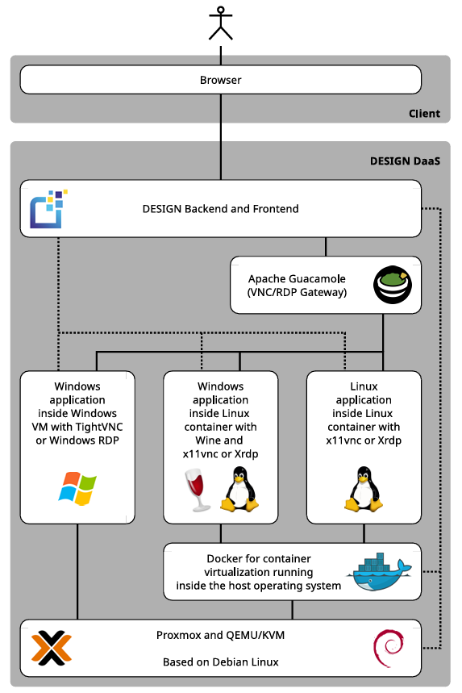
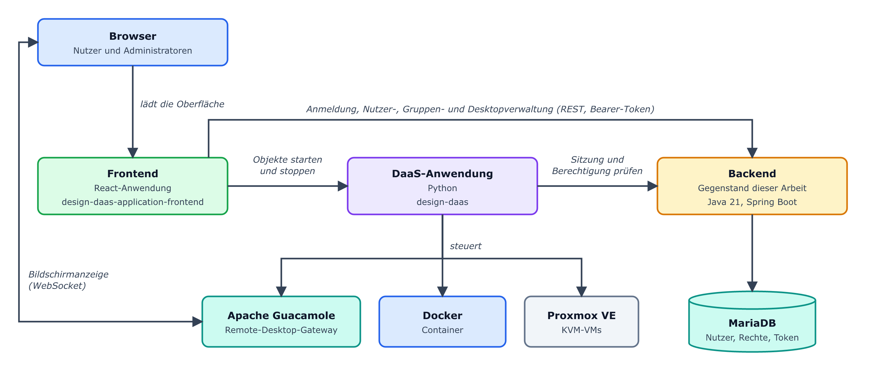
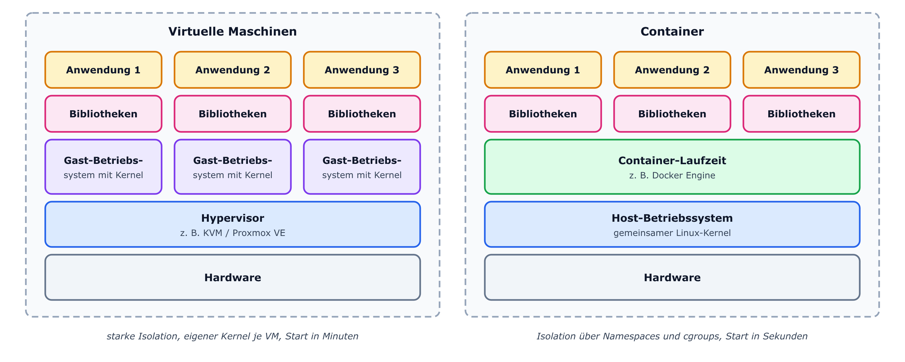
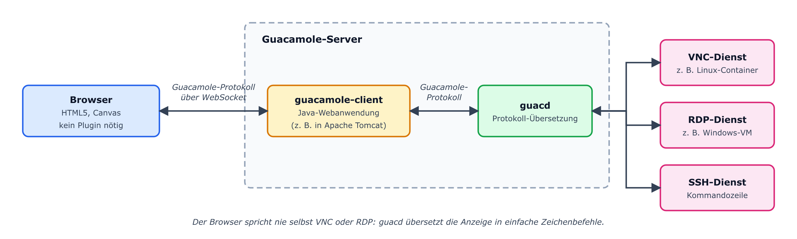
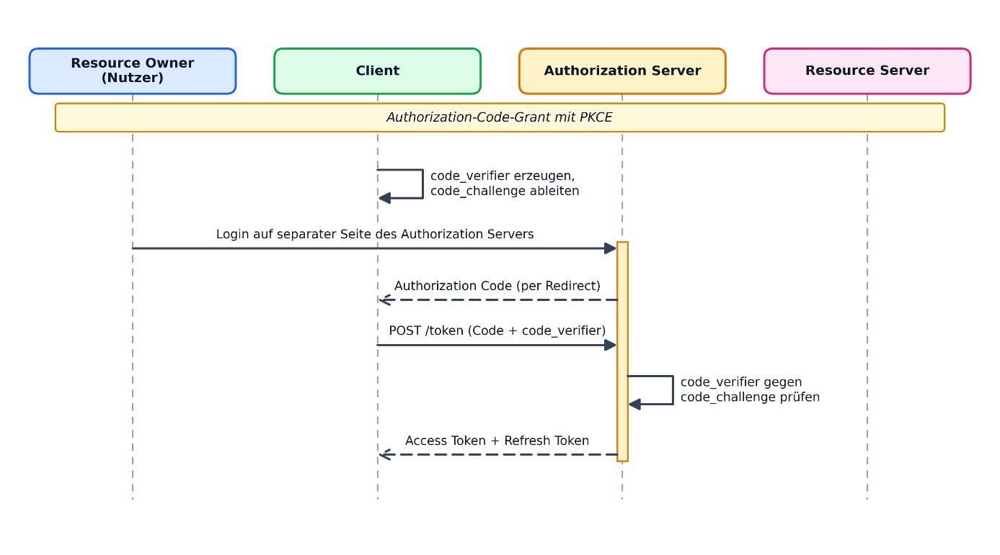
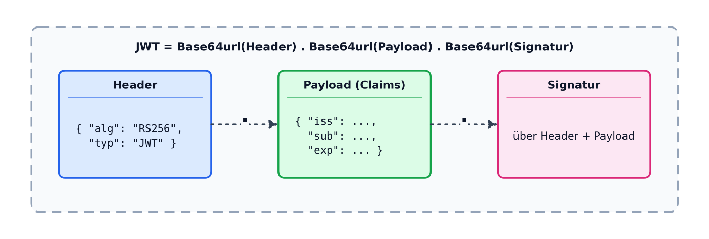
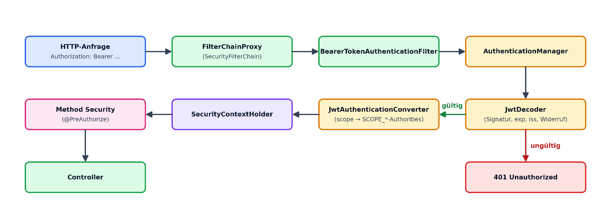
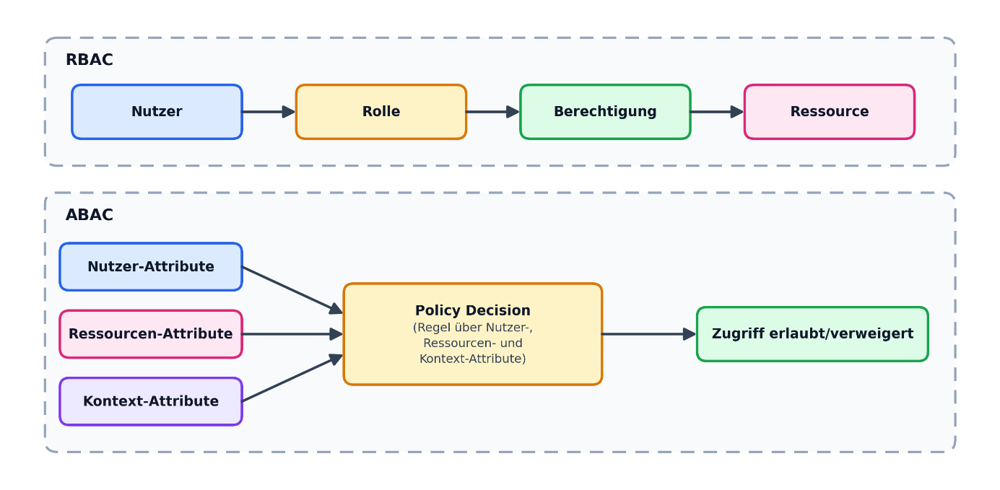
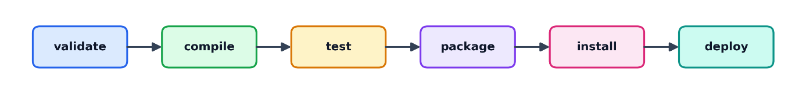
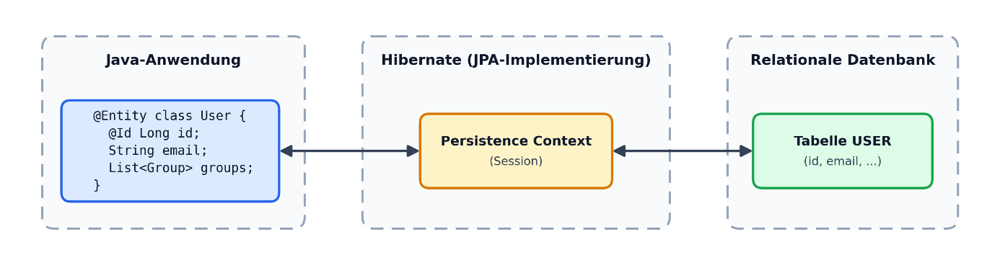

# 2 Theoretische Grundlagen

Dieses Kapitel stellt die Grundlagen, Standards und Werkzeuge vor, auf denen das
neue Backend aufbaut. Abschnitt 2.1 beschreibt das Gesamtsystem DESIGN und seine
Desktop-as-a-Service-Architektur, einschließlich der Virtualisierung mit
Hypervisoren und Containern sowie der Funktionsweise von Apache Guacamole.
Danach folgen drei Themenfelder. Abschnitt 2.2 behandelt die Authentifizierung
mit OAuth2, JSON Web Token, RS256, TLS und bcrypt. Abschnitt 2.3 stellt Modelle
der Zugriffskontrolle vor, darunter ACL, RBAC, ABAC und mehrstufige
Entscheidungskaskaden. Abschnitt 2.4 beschreibt die verwendeten Frameworks und
Werkzeuge, von Maven über Spring Boot, Hibernate und MariaDB bis zu JUnit 5,
Mockito, ArchUnit, Flyway und JaCoCo, ergänzt um Playwright für End-to-End-Tests
im Browser und GitHub Actions für die kontinuierliche Integration. Abschnitt 2.5
ordnet schließlich das Vorgehen dieser Arbeit in die Literatur zur Migration von
Altsystemen ein.

## 2.1 DaaS und die Architektur von DESIGN

Desktop-as-a-Service (DaaS) bedeutet, dass vollständige Arbeitsumgebungen über
das Netzwerk bereitgestellt werden. Die Anwendungen laufen nicht auf dem Gerät
des Nutzers, sondern auf entfernten Rechnern, und werden über einen Client
angezeigt. Gegenüber lokal installierter Software erleichtert das den
Fernzugriff und die zentrale Verwaltung. Der Ansatz teilt aber die typischen
Nachteile von Software-as-a-Service (SaaS): Ohne Netzwerkverbindung lässt sich
nicht arbeiten, und beim Datenschutz und bei der Sicherheit bleiben Bedenken
(Baun & Bouché, 2024).

**DESIGN** soll, wie in Kapitel 1 beschrieben, die Vorteile lokal installierter
Anwendungen mit denen webbasierter Software verbinden, ohne deren Nachteile zu
übernehmen (Baun & Bouché, 2023). Um unveränderte Linux- und Windows-Anwendungen
bereitzustellen, nutzt DESIGN Container (Docker) und virtuelle Maschinen (KVM,
verwaltet über Proxmox VE). Gesteuert wird die jeweilige Anwendung über einen
VNC- oder RDP-Dienst im Container oder in der virtuellen Maschine. Das Gateway
**Apache Guacamole** übersetzt diesen Dienst in einen Datenstrom, den der
Browser des Nutzers anzeigen kann (Baun & Bouché, 2024). Daraus ergeben sich
drei Varianten der Bereitstellung (Baun & Bouché, 2023): Linux-Anwendungen
laufen in Linux-Containern, Windows-Anwendungen nach Möglichkeit mit *Wine*
ebenfalls in Linux-Containern und, wo Wine nicht genügt, in Windows-VMs. Für den
Zugriff ist keine besondere Client-Software nötig. Atanassov et al. (2024)
beschreiben darüber hinaus das Nutzungskonzept von DESIGN sowie die Einbindung
von persistenter Datenhaltung, Drucken und Tonausgabe.

*Abbildung 2.1: Architekturübersicht von DESIGN mit den beteiligten Komponenten
(Baun & Bouché, 2024)*

Abbildung 2.1 zeigt Proxmox VE mit KVM, Docker und Apache Guacamole als
Bausteine der DESIGN-Architektur. Frontend und Backend erscheinen dort als ein
gemeinsamer Block. Tatsächlich sind es zwei getrennte Anwendungen, und die
Bausteine selbst steuert die DaaS-Anwendung. Das Backend, um das es in dieser
Arbeit geht, stellt keine Desktops bereit. Es liefert Frontend und
DaaS-Anwendung die Anmeldung, die Nutzer- und Desktopdaten sowie die
Entscheidung, ob ein Nutzer eine Funktion aufrufen darf. Abbildung 2.2 zeigt
dieses Zusammenspiel.

*Abbildung 2.2: Zusammenspiel von Frontend, DaaS-Anwendung und Backend in DESIGN
(eigene Darstellung)*

Die beiden folgenden Unterabschnitte erläutern die technischen Grundlagen der
Bausteine aus Abbildung 2.1.

### 2.1.1 Virtualisierungsarten: Hypervisoren und Container

DESIGN nutzt zwei Arten der Virtualisierung, die auf unterschiedlichen
Prinzipien beruhen. Bei der klassischen Hardware-Virtualisierung werden zwei
Bauarten von *Hypervisoren* unterschieden (Popek & Goldberg, 1974). Ein
**Typ-1-Hypervisor**, auch *Bare-Metal-Hypervisor* genannt, läuft direkt auf der
Hardware und verwaltet die virtuellen Maschinen ohne ein dazwischenliegendes
Betriebssystem. Ein **Typ-2-Hypervisor** läuft dagegen als gewöhnliche Anwendung
auf einem bestehenden Betriebssystem. KVM (Kernel-based Virtual Machine), die
Grundlage von Proxmox VE, macht den Linux-Kernel selbst zu einem
Typ-1-Hypervisor, indem es dessen Prozessor- und Speicherverwaltung um die
Virtualisierungsfunktionen der CPU erweitert. Jede virtuelle Maschine erhält
damit ein eigenes Betriebssystem mit eigenem Kernel, Dateisystem und
Gerätetreibern. Das sorgt für eine starke Isolation, kostet aber mehr Ressourcen
und verlängert die Start- und Bereitstellungszeiten.

*Abbildung 2.3: Schichtenaufbau virtueller Maschinen und Container im Vergleich
(eigene Darstellung nach Docker, Inc., 2023)*

Container mit **Docker** verfolgen einen grundlegend anderen Ansatz. Sie
virtualisieren kein eigenes Betriebssystem, sondern teilen sich den Kernel des
Host-Systems. Voneinander getrennt werden sie durch zwei Mechanismen des
Linux-Kernels. *Namespaces* geben jedem Container eine eigene Sicht auf
Prozess-IDs, Netzwerkschnittstellen, Einhängepunkte des Dateisystems und den
Hostnamen; ein Prozess im Container sieht diese Ressourcen so, als gehörten sie
ihm allein. *Control Groups* (cgroups) begrenzen, wie viel Rechenzeit,
Arbeitsspeicher und Ein-/Ausgabe-Bandbreite ein Container höchstens verbrauchen
darf (Docker, Inc., 2023). Ausgeliefert wird eine Docker-Anwendung als *Image*,
also als schreibgeschütztes Dateisystem-Archiv aus mehreren
übereinanderliegenden Schichten (*Layers*), aus dem zur Laufzeit ein
beschreibbarer Container gestartet wird. Weil dabei kein vollständiges
Betriebssystem hochfahren muss, starten Container meist in Sekunden statt in
Minuten. Das erklärt die Zeitunterschiede zwischen Docker-Containern und
Windows-VMs, die Baun und Bouché (2024) gemessen haben. Abbildung 2.3 stellt
beide Ansätze gegenüber.

Besteht eine Anwendung aus mehreren Containern, wie einem Dienst und seiner
Datenbank, beschreibt *Docker Compose* sie gemeinsam in einer YAML-Datei
(Docker, Inc., 2026). Darin stehen die zu startenden Images, ihre
Umgebungsvariablen, freigegebenen Ports und Volumes, also Speicherbereiche, die
einen Neustart der Container überdauern. Compose legt für jedes so beschriebene
Projekt ein eigenes Netzwerk an, in dem sich die Container über ihre Namen
erreichen, und startet sie in der angegebenen Reihenfolge.

### 2.1.2 Apache Guacamole: clientloses Remote-Desktop-Gateway

Apache Guacamole ist ein Open-Source-Gateway für Remote-Desktop-Verbindungen.
DESIGN nutzt es, um die Anwendungen aus Containern und virtuellen Maschinen im
Browser anzuzeigen. Guacamole besteht aus zwei Hauptkomponenten (Apache Software
Foundation, 2025). Der *guacamole-client* ist eine Java-Webanwendung, die im
Browser über HTML5 und *WebSockets* die Oberfläche bereitstellt. Der
Hintergrunddienst *guacd* übersetzt zwischen den Remote-Desktop-Protokollen VNC,
RDP oder SSH und dem schlanken, textbasierten *Guacamole-Protokoll*. Der Browser
spricht also nie selbst VNC oder RDP. *guacd* übersetzt die Anzeige des
Containers oder der virtuellen Maschine in eine Folge einfacher Zeichenbefehle,
etwa „zeichne dieses Bildstück an Position x, y“. Der *guacamole-client* reicht
diese Befehle über eine WebSocket-Verbindung an den Browser weiter, der daraus
mit einem HTML5-Canvas-Element das Bild zusammensetzt. Deshalb gilt Guacamole
als *clientlos*. Ein gewöhnlicher Browser genügt; Plugins oder eigene RDP- und
VNC-Programme braucht der Nutzer nicht. Abbildung 2.4 zeigt das Zusammenspiel
der beiden Komponenten.

*Abbildung 2.4: Vereinfachte Architektur von Apache Guacamole (eigene
Darstellung nach Apache Software Foundation, 2025)*

## 2.2 Authentifizierung mit OAuth2 und JSON Web Token

Die Authentifizierung mit OAuth2 und JSON Web Token beruht auf drei Standards,
die jeweils eine eigene Aufgabe haben. OAuth 2.0 *(RFC 6749)* legt fest, **wer**
unter welchen Bedingungen ein Zugriffstoken erhalten darf, und definiert dafür
Rollen und Abläufe. Wie das Token aussieht, lässt OAuth 2.0 offen (Hardt, 2012).
Dafür gibt es JSON Web Token *(JWT, RFC 7519)*, ein kompaktes Textformat, mit
dem sich Angaben über einen Nutzer, sogenannte Ansprüche *(Claims)*, übertragen
lassen (Jones et al., 2015a). RS256 ist kein eigener Standard, sondern ein in
RFC 7518 festgelegter Signaturalgorithmus, mit dem ein JWT gegen Manipulation
geschützt wird (Jones, 2015a). Die folgenden Unterabschnitte erläutern diese
Bausteine einzeln. Abschnitt 2.2.5 zeigt anschließend, wie Spring Security sie
zu einem vollständigen Ablauf zusammensetzt.

### 2.2.1 OAuth2: Rollen, Protokollablauf und Grant-Typen

RFC 6749 unterscheidet vier Rollen (Hardt, 2012; Richer & Sanso, 2017). Der
**Resource Owner** ist die Person, der die geschützten Daten gehören, also der
Nutzer. Der **Client** ist die Anwendung, die im Namen des Nutzers auf eine
Ressource zugreifen möchte, zum Beispiel ein Frontend. Der **Authorization
Server** prüft die Zugangsdaten und stellt danach ein Zugriffstoken aus. Der
**Resource Server** nimmt dieses Token entgegen, prüft es und liefert die
angefragte Ressource. In vielen OAuth2-Systemen sind *Authorization Server* und
*Resource Server* getrennte Dienste, zum Beispiel wenn sich eine Anwendung über
einen externen Anbieter wie Google oder Microsoft anmeldet. Betreibt dagegen
dieselbe Partei den Client und die eigenen Schnittstellen, übernimmt häufig ein
einziger Dienst beide Rollen. Er prüft die Zugangsdaten, stellt das Token aus
und prüft es bei jeder weiteren Anfrage, um die eigenen Endpunkte zu schützen.

Der allgemeine Ablauf nach RFC 6749 hat vier Schritte (Hardt, 2012). Der Client
bittet den Resource Owner um eine Autorisierung und erhält im Erfolgsfall einen
**Authorization Grant**, also einen Nachweis dieser Zustimmung. Diesen tauscht
er beim *Authorization Server* gegen ein Zugriffstoken ein, mit dem er
schließlich beim *Resource Server* auf die geschützte Ressource zugreift. Für
den Grant definiert RFC 6749 mehrere Typen. Beim **Authorization-Code-Grant**
gibt der Nutzer seine Zugangsdaten auf einer eigenen Anmeldeseite des
*Authorization Servers* ein; der Client bekommt sie nie zu sehen. Das ist das
übliche Verfahren für Anwendungen von Drittanbietern. Beim
**Client-Credentials-Grant** ist kein Nutzer beteiligt. Eine Anwendung greift
hier in eigenem Namen auf eine Ressource zu, wie es bei der Kommunikation
zwischen zwei Servern üblich ist. Beim **Resource Owner Password Credentials
Grant** (ROPC) nimmt der Client Benutzername und Passwort selbst entgegen und
reicht sie an den Authorization Server weiter, um ein Token zu erhalten.
Ergänzend beschreibt RFC 6749 **Refresh-Token**, mit denen ein Client ein
abgelaufenes Zugriffstoken erneuern kann, ohne dass der Nutzer seine
Zugangsdaten erneut eingeben muss.

Abbildung 2.5 zeigt diesen Ablauf am Beispiel des ROPC-Grants.

*Abbildung 2.5: Abstrakter OAuth2-Protokollablauf nach RFC 6749 am Beispiel des
ROPC-Grants (eigene Darstellung nach Hardt, 2012)*

Die neuere Sicherheitsempfehlung der IETF, RFC 9700 (*Best Current Practice for
OAuth 2.0 Security*), rät davon ab, den ROPC-Grant in neuen Systemen einzusetzen
(Lodderstedt et al., 2025). Er verträgt sich schlecht mit
Mehr-Faktor-Authentifizierung und zwingt den Client, mit Zugangsdaten im
Klartext umzugehen. Als sicherere Alternative gilt der Authorization-Code-Grant
zusammen mit der Erweiterung **Proof Key for Code Exchange** (PKCE, RFC 7636;
Sakimura et al., 2015). Dabei erzeugt der Client vor der Weiterleitung einen
zufälligen geheimen Wert (*code_verifier*) und schickt nur dessen Hashwert
(*code_challenge*) an den *Authorization Server*. Wenn der Client später den
Autorisierungscode gegen ein Token eintauscht, muss er den ursprünglichen
*code_verifier* mitsenden, und der *Authorization Server* vergleicht ihn mit der
zuvor erhaltenen *code_challenge*. Wer nur den Autorisierungscode abfängt, kann
damit kein Token erhalten, weil ihm der *code_verifier* fehlt. Abbildung 2.6
zeigt diesen Ablauf. Abbildung 2.7 zeigt zum Vergleich den
Client-Credentials-Grant, der ohne Resource Owner auskommt und deshalb für die
Kommunikation zwischen zwei Diensten gedacht ist.

*Abbildung 2.6: Authorization-Code-Grant mit PKCE (eigene Darstellung nach
Sakimura et al., 2015)*

*Abbildung 2.7: Client-Credentials-Grant (eigene Darstellung nach Hardt, 2012)*

Wie das ausgestellte Token übergeben und verwendet wird, regelt RFC 6750 unter
dem Begriff Bearer-Token (Jones & Hardt, 2012). Wer ein solches Token besitzt,
erhält Zugriff, unabhängig davon, ob er der ursprüngliche Nutzer ist. Deshalb
darf es nur über TLS übertragen werden. Transport Layer Security (TLS) ist ein
kryptografisches Protokoll, das eine Netzwerkverbindung gegen Mitlesen und
Manipulation schützt (Rescorla, 2018). Es handelt zunächst asymmetrisch einen
Schlüssel aus, verschlüsselt danach symmetrisch und bestätigt die Identität des
Servers über ein Zertifikat. HTTP über TLS wird als HTTPS bezeichnet. Weil ein
Bearer-Token nicht an eine bestimmte Verbindung gebunden ist, könnte ein
Angreifer, der es auf einer unverschlüsselten Verbindung abfängt, es
uneingeschränkt nutzen. Für den produktiven Einsatz ist TLS daher Pflicht. Oft
übernimmt nicht der Dienst selbst die TLS-Verbindung, sondern ein
vorgeschalteter *Reverse Proxy* wie nginx. Er nimmt die verschlüsselte
Verbindung des Browsers entgegen und leitet die Anfrage innerhalb des Servers an
den eigentlichen Dienst weiter (F5, Inc., 2026). Der Client sendet das Token bei
jeder Anfrage im HTTP-Header **Authorization: Bearer <token>**. Der *Resource
Server* braucht deshalb keine eigene Sitzung zu führen, sondern kann jede
Anfrage allein anhand des mitgesendeten Tokens beurteilen.

OAuth2 regelt nur Zugriffsrechte und sagt nichts über die Identität des
angemeldeten Nutzers aus. Diese Lücke schließt der darauf aufbauende Standard
OpenID Connect (OIDC). Er ergänzt OAuth2 um ein standardisiertes ID-Token,
selbst ein JWT, mit Angaben zur Identität des Nutzers sowie um einen
/userinfo-Endpunkt für weitere Profildaten (OpenID Foundation, 2023).
Vereinfacht beantwortet OAuth2 die Frage „Darf dieser Client auf diese Ressource
zugreifen?“, OIDC zusätzlich die Frage „Wer ist der angemeldete Nutzer?“.

### 2.2.2 JSON Web Token: Aufbau und Claims

Unabhängig von OAuth2 ist ein JWT zunächst nur ein Format, um Ansprüche
(*Claims*) kompakt und überprüfbar darzustellen (Jones et al., 2015a). Es
besteht aus drei Teilen, die durch Punkte getrennt und jeweils Base64url-kodiert
sind: einem Header, der unter anderem den Signaturalgorithmus nennt, einer
Payload mit den eigentlichen Claims und einer Signatur über die beiden ersten
Teile. Abbildung 2.8 zeigt diesen Aufbau.

*Abbildung 2.8: Schematischer Aufbau eines JSON Web Tokens aus Header, Payload
und Signatur (eigene Darstellung nach Jones et al., 2015a).*

RFC 7519 unterscheidet registrierte Claims mit festgelegter Bedeutung von
privaten Claims, die eine Anwendung nach eigenem Bedarf ergänzt (Jones et al.,
2015a). Registrierte Claims sind etwa **iss** (Aussteller), **sub** (Subjekt,
meist die Nutzer-ID), **iat** (Ausstellungszeitpunkt), **exp** (Ablaufzeitpunkt)
und **jti** (eindeutige Token-ID). In der Praxis werden beide Arten kombiniert:
Ein Zugriffstoken enthält dann die registrierten Claims und zusätzlich
anwendungsspezifische Angaben, auf die sich zum Beispiel eine
Autorisierungsentscheidung stützen kann (Abschnitt 2.3). Häufig verwendet wird
der Claim **scope**. Er enthält die dem Token gewährten Berechtigungen als durch
Leerzeichen getrennte Liste, beispielsweise *user* oder *admin*.

JWTs sind zustandslos. Ein signiertes JWT gilt allein aufgrund seiner Signatur
als gültig und lässt sich vor Ablauf der *exp*-Zeit nicht ohne Weiteres
widerrufen. Bei kurzlebigen Zugriffstoken wird das oft hingenommen, weil die
kurze Gültigkeit das Risiko begrenzt; eine zusätzliche Widerrufsprüfung
verringert es weiter (Abschnitt 2.2.5). Für langlebige und besonders
schützenswerte Token wie Refresh-Token verwendet man dagegen häufig kein JWT,
sondern einen zufälligen, nicht lesbaren Wert. Dieser wird auf dem Server in
einer Datenbanktabelle gespeichert und lässt sich gezielt löschen, etwa wenn
sich ein Nutzer abmeldet oder gesperrt wird. Ein JWT lohnt sich also vor allem
für kurzlebige, häufig geprüfte Token, weil die Prüfung ohne Datenbankabfrage
auskommt. Bei einem langlebigen Token zählt mehr, dass der Server es jederzeit
zurückziehen kann.

### 2.2.3 Signaturverfahren: RS256 statt HS256

Damit ein JWT vor Manipulation geschützt ist, muss es signiert werden. Format
und zulässige Algorithmen dafür regeln zwei weitere RFCs. RFC 7515 (**JSON Web
Signature, JWS**) beschreibt den Aufbau eines signierten Tokens aus Header,
Payload und Signatur (Jones et al., 2015b). RFC 7518 (**JSON Web Algorithms,
JWA**) legt die Signaturalgorithmen fest, darunter HS256 und RS256 (Jones,
2015a). Der naheliegende Algorithmus HS256 (HMAC mit SHA-256) ist symmetrisch:
Aussteller und Prüfer benötigen denselben geheimen Schlüssel. Das wird zum
Problem, wenn mehrere Dienste Token prüfen, aber selbst keine ausstellen sollen.
Jeder dieser Dienste bräuchte dann den geheimen Schlüssel und könnte damit auch
beliebige neue Token erzeugen.

RS256 (*RSASSA-PKCS1-v1_5 mit SHA-256*) löst dieses Problem, weil es
asymmetrisch arbeitet. Die Signatur wird mit einem privaten RSA-Schlüssel
erzeugt und mit dem zugehörigen öffentlichen Schlüssel geprüft. Der private
Schlüssel verbleibt beim Aussteller, während der öffentliche Schlüssel beliebig
verteilt werden kann, zum Beispiel über einen JWK-Set-Endpunkt. Wer nur den
öffentlichen Schlüssel kennt, kann Token prüfen, aber keine gültigen Token
fälschen. Vor allem wegen dieser Trennung setzen Systeme mit mehreren prüfenden
Komponenten meist RS256 statt HS256 ein.

Damit ein *Resource Server* den öffentlichen Schlüssel eines Ausstellers kennt,
definiert RFC 7517 (**JSON Web Key, JWK**) ein JSON-Format zur Beschreibung
eines einzelnen Schlüssels, bei RSA durch Modulus und Exponent (Jones,
2015b). Mehrere Schlüssel lassen sich zu einem **JSON Web Key Set (JWKS)**
zusammenfassen, das meist über einen öffentlichen HTTP-Endpunkt wie
*/.well-known/jwks.json* oder */oauth2/jwks* bereitsteht. Jeder Schlüssel trägt
eine eindeutige Kennung (**kid**), die auch im Header des JWT steht. So kann ein
Resource Server den passenden Schlüssel wählen, wenn mehrere gleichzeitig gültig
sind. Das ist bei einem geplanten Schlüsselwechsel (Key Rotation) der Fall: Neue
Token werden bereits mit dem neuen Schlüssel signiert, während der alte
öffentliche Schlüssel noch so lange bereitsteht, bis alle damit signierten Token
abgelaufen sind.

### 2.2.4 Passwort-Hashing: bcrypt

RS256 und JWT schützen ein bereits ausgestelltes Token. Bei der Anmeldung geht
es um etwas anderes, nämlich um die Frage, wie sich ein Passwort so speichern
lässt, dass es auch nach einem Einbruch in die Datenbank geschützt bleibt.
Gewöhnliche kryptografische Hashfunktionen wie SHA-256 eignen sich dafür nicht.
Sie sind absichtlich schnell, sodass Angreifer in kurzer Zeit Milliarden
möglicher Passwörter durchprobieren können, sei es per Brute Force oder mit
vorberechneten Rainbow Tables. **bcrypt**, von Provos und Mazières (1999)
vorgestellt, ist dagegen eigens für Passwörter entwickelt worden. Das Verfahren
baut auf der Blockchiffre Blowfish auf und besitzt einen einstellbaren
Kostenfaktor (Work Factor), der die Zahl der Runden bei der internen
Schlüsselexpansion bestimmt. Erhöht man ihn um eins, verdoppelt sich der
Rechenaufwand je Hash. So lässt sich bcrypt an die wachsende Rechenleistung von
Angreifern anpassen, ohne den Algorithmus zu ändern. Außerdem erzeugt *bcrypt*
für jedes Passwort automatisch einen zufälligen Salt, der zusammen mit
Kostenfaktor und Hashwert in einer einzigen Zeichenkette gespeichert wird.
Dasselbe Passwort ergibt deshalb bei zwei Nutzern unterschiedliche gespeicherte
Werte, und vorberechnete Rainbow Tables werden wirkungslos.

### 2.2.5 Spring Security und OAuth2-Ressourcenserver

Spring Security ist die Sicherheitskomponente des Spring-Frameworks.
Authentifizierung und Autorisierung laufen dort über eine Kette von
*Servlet-Filtern*, die **SecurityFilterChain** (VMware, 2026a; Spilca, 2024).
Dazu meldet Spring Security beim Anwendungsserver einen einzigen Filter an, den
**DelegatingFilterProxy**. Er reicht jede Anfrage an den **FilterChainProxy**
weiter, der die intern verwaltete Filterkette ausführt. Diese Kette lässt sich
je Anwendung frei konfigurieren, ohne dass der Anwendungsserver davon etwas
wissen muss. Jede Anfrage durchläuft die Kette, bevor sie den Controller
erreicht. Für JWT-basierte Schnittstellen stellt Spring Security die Rolle des
OAuth2-Resource-Servers bereit. Der Baustein
*spring-boot-starter-oauth2-resource-server* fügt der Kette einen
**BearerTokenAuthenticationFilter** hinzu. Er liest den Authorization-Header aus
und gibt das Bearer-Token an einen **AuthenticationManager** weiter. Dieser
beauftragt einen **JwtDecoder**, Signatur, Ablaufzeit, Aussteller und
gegebenenfalls einen anwendungsspezifischen Widerruf zu prüfen. Ist das Token
gültig, wandelt ein **JwtAuthenticationConverter** die Claims in ein
Authentication-Objekt um. Ein **JwtGrantedAuthoritiesConverter** übersetzt dabei
den scope-Claim (Abschnitt 2.2.2) in einzelne *GrantedAuthority*-Objekte mit dem
Präfix *SCOPE_*, etwa *SCOPE_admin* oder *SCOPE_user* (VMware, 2026a). Auf diese
Berechtigungen können sowohl Regeln für einzelne URLs als auch
*@PreAuthorize*-Ausdrücke an Methoden zugreifen; letztere werden mit der
Annotation *@EnableMethodSecurity* aktiviert. Erst wenn das
Authentication-Objekt im **SecurityContextHolder** liegt, stehen die Angaben den
nachgelagerten Autorisierungsregeln (Abschnitt 2.3) zur Verfügung.

Abbildung 2.9 fasst diesen Ablauf zusammen und zeigt, an welcher Stelle Claims,
RS256-Signatur und Widerrufsprüfung aus den Abschnitten 2.2.2 bis 2.2.5
technisch ansetzen.

*Abbildung 2.9: Ablauf der Anfrageprüfung durch den OAuth2-Ressourcenserver in
Spring Security (eigene Darstellung nach VMware, 2026a).*

Neben Spring Security pflegt Broadcom (vormals VMware) das eigenständige Projekt
Spring *Authorization Server* (VMware, 2026b). Es stellt einen vollständigen
Autorisierungsserver für OAuth2 und OpenID Connect bereit, mit eigenen
Endpunkten für die Ausstellung, Introspektion und den Widerruf von Token wie
*/oauth2/authorize*, */oauth2/token* und */oauth2/introspect*. Damit geht es
weit über die Rolle des Resource Servers hinaus, der eingehende Token nur prüft.
Alternativ lässt sich der Resource-Server-Baustein mit einer eigenen, schlanken
Token-Ausstellung kombinieren. Der Starter
*spring-boot-starter-oauth2-resource-server* bringt dafür die Bibliothek
**Nimbus JOSE+JWT** mit, die Spring Security intern zum Erzeugen (*JwtEncoder*)
und Prüfen (*JwtDecoder*) von JWTs verwendet (Connect2id Ltd., 2026). Auf dieser
Grundlage kann der Server ein RSA-Schlüsselpaar erzeugen, als *JSON Web Key*
speichern und damit neue Token signieren und prüfen. Zusätzlich zur Prüfung von
Signatur, Ablaufzeit und Aussteller (*issuer*) lässt sich ein eigener Validator
ergänzen, der widerrufene Token anhand eines Datenbankeintrags erkennt. Das ist
nötig, weil ein JWT sonst bis zu seinem Ablauf gültig bliebe, auch wenn sich der
Nutzer inzwischen abgemeldet hat oder gesperrt wurde.

Abbildung 2.10 stellt beide Varianten gegenüber.

*Abbildung 2.10: Spring Authorization Server und Resource-Server-Starter mit
eigener Token-Ausstellung (eigene Darstellung).*

## 2.3 Autorisierung und Berechtigungsmodelle

Neben der Authentifizierung („Wer ist der Nutzer?“) ist die Autorisierung („Was
darf der Nutzer?“) eine eigene Aufgabe. Dafür haben sich in der Literatur
mehrere grundlegende Modelle etabliert.

### 2.3.1 Zugriffskontrollmodelle: ACL, RBAC und ABAC

Das älteste Modell ist die Zugriffskontrollliste (*Access Control List, ACL*).
Dabei erhält jede geschützte Ressource eine Liste, die für einzelne Nutzer oder
Gruppen festlegt, welche Operationen wie Lesen, Schreiben oder Ausführen erlaubt
sind (Samarati & De Capitani di Vimercati, 2001). ACLs sind leicht zu verstehen,
lassen sich aber schlecht pflegen, sobald sich die Rechte vieler Nutzer
gleichzeitig ändern. Dann muss unter Umständen jede einzelne Liste angepasst
werden.

Die rollenbasierte Zugriffskontrolle (*Role-Based Access Control, RBAC*) löst
dieses Problem durch eine zusätzliche Ebene. Rechte werden nicht einzelnen
Nutzern zugewiesen, sondern Rollen, denen beliebig viele Nutzer angehören
können. Ändert man die Rechte einer Rolle, gilt die Änderung sofort für alle
ihre Mitglieder. Das NIST-Modell, aus dem später der Standard ANSI/INCITS 359
hervorging, unterscheidet vier aufeinander aufbauende Stufen (Sandhu et al.,
2000; Ferraiolo et al., 2001; American National Standards Institute, 2004).
*Flat RBAC* ist die einfachste Form
und ordnet Nutzer lediglich Rollen zu. *Hierarchical RBAC* erlaubt zusätzlich
die Vererbung zwischen Rollen, sodass eine speziellere Rolle die Rechte einer
allgemeineren erbt. *Constrained RBAC* ergänzt Nebenbedingungen wie die Trennung
von Aufgaben (Separation of Duty) zwischen bestimmten Rollen. *Symmetric RBAC*
ermöglicht schließlich auch die umgekehrte Abfrage, welche Nutzer eine bestimmte
Berechtigung besitzen.

Ein drittes, weiter gefasstes Modell ist die attributbasierte Zugriffskontrolle
(*Attribute-Based Access Control, ABAC*). Sie vergibt Rechte nicht über feste
Rollen, sondern entscheidet zur Laufzeit anhand von Attributen (Hu et al.,
2014). Dazu zählen Merkmale des Nutzers wie Abteilung oder Sicherheitsfreigabe,
Merkmale der Ressource wie ihre Vertraulichkeitsstufe, die geplante Aktion und
der Kontext der Anfrage, also Uhrzeit, Standort oder Netzwerk. ABAC ist damit
deutlich ausdrucksstärker als RBAC und erlaubt fein abgestufte, kontextabhängige
Regeln. Dafür sind Entwurf und Pflege aufwendiger, und einzelne Entscheidungen
lassen sich schwerer nachvollziehen. In der Praxis werden beide Modelle oft
kombiniert: Eine Rolle legt den groben Rahmen fest, und Attributregeln schränken
ihn im Einzelfall weiter ein. Abbildung 2.11 stellt die Grundprinzipien von RBAC
und ABAC gegenüber.

*Abbildung 2.11: Grundprinzip von RBAC im Vergleich zu ABAC (eigene Darstellung
nach Ferraiolo et al., 2001; Hu et al., 2014)*

### 2.3.2 Mehrstufige Entscheidungskaskaden und Policy Enforcement

Systeme, die Rechte für Nutzergruppen und für einzelne Endpunkte oder Funktionen
getrennt verwalten, verbinden RBAC häufig mit mehrstufigen Entscheidungskaskaden
(OASIS, 2013). Dabei werden mehrere Regelebenen nacheinander geprüft, etwa
zuerst eine Regel für den einzelnen Nutzer, dann eine für seine Gruppe und
zuletzt eine Standardregel. Es gilt die erste Regel, die zur Anfrage passt. Das
XACML-Referenzmodell der OASIS teilt eine solche Prüfung in zwei Rollen auf. Der
**Policy Enforcement Point (PEP)** fängt eine Anfrage ab und lässt sie durch
oder blockiert sie, zum Beispiel als Sicherheitsfilter einer Webanwendung. Der
**Policy Decision Point (PDP)** trifft die eigentliche Entscheidung anhand der
hinterlegten Regeln und meldet dem PEP nur das Ergebnis „erlaubt“ oder
„verweigert“ zurück. Durch diese Trennung lassen sich Entscheidung und
Durchsetzung unabhängig voneinander ändern, und dieselbe Entscheidungslogik kann
an mehreren Stellen genutzt werden. Abbildung 2.12 zeigt eine solche Kaskade als
Entscheidungsbaum.

*Abbildung 2.12: Schematischer Entscheidungsbaum einer mehrstufigen
Berechtigungskaskade (eigene Darstellung).*

### 2.3.3 Fail-Safe Defaults und Default-Deny

Offen ist noch, was gelten soll, wenn keine Regel zutrifft. Saltzer und
Schroeder haben dafür schon 1975 den Grundsatz der *fail-safe defaults*
formuliert (Saltzer & Schroeder, 1975). Danach soll eine Zugriffsentscheidung
grundsätzlich von der Verweigerung ausgehen; Zugriff wird nur gewährt, wenn eine
Bedingung ihn ausdrücklich erlaubt, nicht umgekehrt. In der Praxis spricht man
von *fail-closed* oder *deny-by-default*. Aktuelle Empfehlungen greifen diesen
Grundsatz weiterhin auf. Die OWASP Proactive Controls nennen die konsequente
Durchsetzung von Zugriffskontrollen mit Default-Deny als eine der wichtigsten
Maßnahmen gegen fehlerhafte Autorisierung (OWASP Foundation, 2024, C1). Der
Grundsatz lässt sich auf zwei Ebenen anwenden. Ein Sicherheits-Framework wie
Spring Security kann für jede Anfrage eine Authentifizierung verlangen und nur
einzelne, ausgewählte Endpunkte davon ausnehmen. Eine mehrstufige
Berechtigungskaskade liefert nur dann ein anderes Ergebnis als „verweigert“,
wenn mindestens eine ihrer Stufen eine erlaubende Regel enthält. Fehlt eine
solche Regel oder ist der Nutzer unbekannt, bleibt es bei der Verweigerung.

## 2.4 Frameworks und Werkzeuge für Implementierung und Test

Das neue Backend ist in Java 21 mit Spring Boot geschrieben (Abschnitt 1.3).
Dieser Abschnitt stellt die dafür verwendeten Frameworks und Werkzeuge vor: den
Build mit Maven (2.4.1), das Spring Framework und Spring Boot (2.4.2 und 2.4.3),
die Datenhaltung mit Hibernate und MariaDB (2.4.4 und 2.4.5) sowie die Werkzeuge
der Qualitätssicherung, von Unit-Tests über Architekturregeln, versionierte
Migrationen und Testabdeckung bis zu End-to-End-Tests und kontinuierlicher
Integration (2.4.6 bis 2.4.11).

### 2.4.1 Apache Maven: Build-Automatisierung und Abhängigkeitsverwaltung

Bevor eine Java-Anwendung laufen kann, müssen ihre Quelldateien übersetzt, ihre
Abhängigkeiten aufgelöst und das Ergebnis zu einem lauffähigen Paket wie einer
JAR-Datei zusammengefügt werden. Apache Maven automatisiert diese Schritte
(Apache Software Foundation, 2026). Gesteuert wird es über eine zentrale
Projektbeschreibung, die Datei *pom.xml* (Project Object Model). Darin stehen
unter anderem die benötigten Bibliotheken mit ihren Versionen sowie Plugins für
Zusatzaufgaben wie das Ausführen von Tests oder das Messen der Testabdeckung.
Maven lädt die Bibliotheken aus einem zentralen Repository und löst dabei auch
transitive Abhängigkeiten auf, also die Abhängigkeiten der eigenen
Abhängigkeiten. Jeder Build folgt einem festen Lebenszyklus aus Phasen. Die
wichtigsten sind *validate* (Projektstruktur prüfen), *compile* (Quellcode
übersetzen), *test* (Tests ausführen), *package* (Paket erzeugen), *install*
(Paket im lokalen Repository ablegen) und *deploy* (Paket in ein entferntes
Repository hochladen). Ruft man eine spätere Phase auf, führt Maven alle
vorhergehenden automatisch mit aus. Abbildung 2.13 zeigt diesen Lebenszyklus
vereinfacht.

*Abbildung 2.13: Maven-Build-Lifecycle mit den Standardphasen (eigene
Darstellung nach Apache Software Foundation, 2026).*

### 2.4.2 Spring Framework: Inversion of Control und Dependency Injection

Spring Boot baut auf dem Spring Framework auf, dessen Kernidee die *Inversion of
Control* (IoC) ist (VMware, 2026d). Eine Klasse legt die Objekte, mit denen sie
arbeitet, nicht selbst mit dem *new*-Operator an. Sie gibt nur an, was sie
braucht, und ein übergeordneter *IoC-Container* erzeugt die passenden Objekte
und verbindet sie miteinander. Diese Form der IoC wird auch *Dependency
Injection* (DI) genannt. Der Spring-Container verwaltet dazu sogenannte Beans,
also Objekte, die meist über Annotationen wie *@Component*, *@Service* oder
*@Repository* gekennzeichnet sind und beim Start automatisch erkannt werden.
Braucht eine Bean eine andere, gibt sie das meist als Konstruktorparameter an.
Der Container sucht dann eine passende Instanz oder erzeugt sie und übergibt
sie, ohne dass die abhängige Klasse wissen muss, wie die konkrete
Implementierung entsteht. Das erleichtert vor allem das Testen, weil sich echte
Abhängigkeiten leicht durch Platzhalterobjekte ersetzen lassen (Mocks, Abschnitt
2.4.6). Zugleich bleiben die Schichten einer Anwendung lose gekoppelt, da eine
Klasse nur von einer Schnittstelle abhängt und nicht von deren konkreter
Umsetzung. Spring Boot ergänzt diesen Container um automatische Konfiguration
und sogenannte Starter, wie der folgende Abschnitt zeigt.

### 2.4.3 Spring Boot und ausgewählte Starter-Bausteine

Spring Boot verringert durch Konventionen und automatische Konfiguration den
Aufwand, eine eigenständig lauffähige und produktionsreife Anwendung aufzusetzen
(VMware, 2026c). Statt vieler XML-Konfigurationsdateien genügt es meist, eine
passende Abhängigkeit, einen sogenannten Starter, einzubinden. Spring Boot
konfiguriert die zugehörige Komponente dann mit sinnvollen Standardwerten, die
sich bei Bedarf durch eigene Konfigurationsklassen überschreiben lassen. Für
typische Backend-Aufgaben kommen unter anderem folgende Bausteine zum Einsatz:

- *spring-boot-starter-web* stellt die REST-Schicht bereit, über die Controller
  HTTP-Anfragen entgegennehmen und JSON-Antworten liefern.
- *spring-boot-starter-security* und
  *spring-boot-starter-oauth2-resource-server* stellen gemeinsam die in
  Abschnitt 2.2 beschriebene JWT-Authentifizierung als OAuth2-Ressourcenserver
  bereit.
- *spring-boot-starter-data-jpa* bindet Hibernate als Implementierung der
  Jakarta Persistence API (JPA) ein (Abschnitt 2.4.4).
- *spring-boot-starter-validation* ermöglicht es, Eingaben über Annotationen der
  Jakarta Bean Validation direkt an den Datenübertragungsobjekten zu prüfen,
  etwa auf Pflichtfelder, Längen oder Formate.
- *spring-boot-starter-mail* und *spring-boot-starter-thymeleaf* werden oft
  gemeinsam für E-Mails mit dynamischem Inhalt genutzt: *Thymeleaf* erzeugt aus
  Vorlagen und Daten HTML, das anschließend als E-Mail verschickt wird.
- *mariadb-java-client* ist der JDBC-Treiber, über den eine Java-Anwendung mit
  MariaDB kommuniziert (Abschnitt 2.4.5).
- *springdoc-openapi-starter-webmvc-ui* erzeugt aus den Controller- und
  DTO-Klassen eine OpenAPI-Beschreibung der Schnittstelle und eine Swagger-UI,
  in der sich die Endpunkte ausprobieren lassen.
- *lombok* erspart wiederkehrenden Code wie Getter, Setter und Konstruktoren,
  indem es ihn beim Übersetzen aus Annotationen erzeugt.
- *spring-boot-starter-test*, *spring-security-test* und *h2* bilden die
  Testumgebung (Abschnitt 2.4.6). Der Test-Starter bringt JUnit 5 und Mockito
  mit, *spring-security-test* hilft dabei, angemeldete Anfragen in Tests
  nachzubilden, und die eingebettete Datenbank H2 ersetzt in Integrationstests
  eine externe Datenbank.
- *spring-boot-starter-actuator* stellt Endpunkte für Health-Checks und
  Überwachung bereit, über die sich zur Laufzeit prüfen lässt, ob die Anwendung
  und ihre Datenbankverbindung funktionieren.

Hinzu kommen die Bausteine für Flyway (*spring-boot-flyway*, *flyway-mysql*),
ArchUnit (*archunit-junit5*) und Testcontainers (*spring-boot-testcontainers*,
*testcontainers-mariadb*), die die Abschnitte 2.4.6 bis 2.4.8 beschreiben.

### 2.4.4 Objektrelationales Mapping: Hibernate und Jakarta Persistence API

Eine relationale Datenbank speichert Daten in Tabellen aus Zeilen und Spalten,
eine Java-Anwendung arbeitet dagegen mit Objekten, die aufeinander verweisen.
Diesen strukturellen Unterschied bezeichnet man als *Impedance Mismatch*. Die
Jakarta Persistence API (JPA, früher Java Persistence API) ist eine
Spezifikation, die festlegt, wie Java-Klassen (Entities) über Annotationen wie
*@Entity*, *@Id*, *@Column* oder *@OneToMany* auf Tabellen, Primärschlüssel,
Spalten und Beziehungen abgebildet werden (Eclipse Foundation, 2022; Hibernate,
2026). Hibernate ist die verbreitetste Implementierung dieser Spezifikation. Es
übersetzt Lese- und Schreibzugriffe auf Entities in SQL-Anweisungen und erzeugt
für häufige Zugriffsmuster die Abfragen selbst, sodass kein handgeschriebenes
SQL nötig ist. Je Transaktion verwaltet Hibernate einen *Persistence Context*
(auch *Session*), der geladene Entities zwischenspeichert und Änderungen bis zum
Ende der Transaktion sammelt. Abbildung 2.14 veranschaulicht die Abbildung
zwischen einer Java-Klasse und einer Tabelle.

*Abbildung 2.14: Objektrelationales Mapping zwischen einer Java-Entity-Klasse
und einer Datenbanktabelle über Hibernate als JPA-Implementierung (eigene
Darstellung).*

### 2.4.5 MariaDB

MariaDB ist ein relationales Open-Source-Datenbanksystem. Es entstand 2009 als
Abspaltung von MySQL, nachdem Oracle MySQL übernommen hatte, und wird seither
von der unabhängigen MariaDB Foundation weiterentwickelt (MariaDB Foundation,
2026). MariaDB ist weitgehend kompatibel zu MySQL, bringt aber eigene
Speicher-Engines wie Aria und ColumnStore sowie weitere Erweiterungen mit.
Java-Anwendungen greifen über die Schnittstelle Java Database Connectivity
(JDBC) darauf zu. Der *mariadb-java-client* stellt dafür den Treiber bereit, der
JDBC-Aufrufe in das Netzwerkprotokoll von MariaDB übersetzt. Hibernate
(Abschnitt 2.4.4) baut wiederum auf diesem Treiber auf.

### 2.4.6 Testwerkzeuge: JUnit 5, Mockito und Testcontainers

JUnit 5 ist das Standard-Testframework für die Java Virtual Machine (JUnit Team,
2026). Es bietet die Grundlage, um Testfälle mit *@Test* zu kennzeichnen, zu
gruppieren und automatisch auszuführen, und wird von den meisten
Build-Werkzeugen einschließlich Maven verwendet. JUnit-Tests folgen meist dem
Schema *Arrange-Act-Assert*: Zuerst wird der Ausgangszustand hergestellt, dann
die zu prüfende Operation ausgeführt und schließlich das Ergebnis mit der
Erwartung verglichen. Mockito ergänzt dieses Schema um Mock-Objekte (Mockito
contributors, 2026). Statt eine echte Abhängigkeit wie eine Datenbank oder einen
externen Dienst zu verwenden, erzeugt Mockito ein Platzhalterobjekt mit
derselben Schnittstelle, das sich genau so verhält, wie der Test es vorgibt,
etwa „liefere bei diesem Aufruf diesen Wert“. So lässt sich eine einzelne Klasse
unabhängig von ihren Abhängigkeiten testen, ohne die ganze Anwendung mit
Datenbank und Netzwerk zu starten. Voraussetzung dafür ist die lose Kopplung
durch Dependency Injection (Abschnitt 2.4.2), denn nur dann lassen sich echte
Abhängigkeiten durch Mocks ersetzen. Soll ein Test dagegen gerade das
Zusammenspiel mit einer echten Datenbank prüfen, startet die Bibliothek
*Testcontainers* die benötigte Datenbank für die Dauer des Tests als
Docker-Container und entfernt sie danach wieder (Testcontainers, 2026).

### 2.4.7 ArchUnit: Architekturregeln als Test

Ob eine geplante Schichtenarchitektur über die gesamte Projektlaufzeit
eingehalten wird, etwa dass Controller nur Services und Services nur
Repositories aufrufen, lässt sich mit *ArchUnit* automatisch prüfen (ArchUnit,
n.d.). Mit diesem Werkzeug werden erlaubte und verbotene Abhängigkeiten zwischen
Paketen als gewöhnliche JUnit-5-Tests formuliert. Diese laufen bei jedem Build
mit und verhindern so, dass sich die geplante Architektur im Laufe der
Entwicklung unbemerkt auflöst.

### 2.4.8 Flyway: versionierte Datenbankmigrationen

Eine Datenbank entwickelt sich im Lauf eines Projekts ebenso weiter wie der
Code: Tabellen kommen hinzu, Spalten ändern sich, Indizes werden ergänzt.
*Flyway* verwaltet solche Änderungen als nummerierte, unveränderliche
SQL-Skripte wie *V1__init.sql* oder *V2__add_user_group.sql* (Redgate Software,
2026). Beim Start der Anwendung vergleicht Flyway die vorhandenen Skripte mit
einer eigenen Tabelle in der Datenbank, in der die bereits ausgeführten
Migrationen verzeichnet sind, und führt nur die noch fehlenden aus. Für jedes
ausgeführte Skript wird eine Prüfsumme gespeichert. Wird eine bereits
angewendete Migration nachträglich geändert, bricht Flyway beim nächsten Start
mit einem Fehler ab, statt eine möglicherweise inkonsistente Datenbank
stillschweigend hinzunehmen. Das Schema steht damit unter Versionskontrolle und
lässt sich zwischen Entwicklungs-, Test- und Produktivumgebung nachvollziehbar
gleich halten. Weil dieselben Skripte auch in Integrationstests gegen eine
eingebettete Datenbank wie H2 laufen können, unterscheidet sich das Schema der
Testumgebung kaum von dem der Produktion.

### 2.4.9 JaCoCo: Testabdeckung messen

JaCoCo (Java Code Coverage) misst, welche Teile des übersetzten Codes während
der Tests tatsächlich ausgeführt werden (Mountainminds GmbH & Co. KG, 2026).
Dazu klinkt sich beim Start der Tests ein Java-Agent in die JVM ein, bei
Maven-Projekten meist über das Build-Ziel *prepare-agent*. Er zählt jede
ausgeführte Zeile und jeden durchlaufenen Zweig (Branch). Nach den Tests
erstellt das Ziel *report* einen Bericht in HTML und XML, der für jede Klasse
und jedes Paket den Anteil des durch Tests abgedeckten Codes ausweist. Solche
Berichte dienen häufig als automatisch erzeugte Kennzahl für die Testabdeckung
eines Projekts.

### 2.4.10 Playwright: End-to-End-Tests im Browser

Unit- und Integrationstests prüfen einen einzelnen Dienst. Ob mehrere Dienste im
Zusammenspiel funktionieren, zeigen erst *End-to-End-Tests* (E2E-Tests). Sie
bedienen das System so, wie es ein Nutzer täte, also über die Oberfläche im
Browser, und prüfen das sichtbare Ergebnis. *Playwright* ist ein
Open-Source-Framework von Microsoft für solche Tests (Microsoft, 2026). Es
steuert die Browser-Engines Chromium, Firefox und WebKit über eine einheitliche
Programmierschnittstelle, unter anderem in TypeScript. Elemente einer Seite
werden bevorzugt über ihre Rolle und ihren zugänglichen Namen gesucht, etwa „die
Schaltfläche *Login*“, statt über interne CSS-Klassen. Dadurch bleiben Tests
stabil, wenn sich das Aussehen einer Seite ändert. Vor jeder Aktion wartet
Playwright automatisch, bis ein Element sichtbar und bedienbar ist
(*Auto-Waiting*), und Prüfungen wie *toHaveURL* oder *toBeVisible* wiederholen
sich bis zu einer Zeitgrenze. Das verringert unzuverlässige, zeitabhängige
Testergebnisse. Tests lassen sich in *Projekte* mit Abhängigkeiten gliedern. Ein
vorgeschaltetes Projekt kann sich zum Beispiel einmal anmelden und den
Anmeldezustand des Browsers (*storageState*) speichern, den nachfolgende
Projekte wiederverwenden. Schlägt ein Test fehl, hält Playwright auf Wunsch
einen Screenshot und einen *Trace* fest, der jeden Schritt samt DOM-Zustand und
Netzwerkanfragen nachvollziehbar macht.

### 2.4.11 Kontinuierliche Integration mit GitHub Actions

Die Prüfungen aus den Abschnitten 2.4.6 bis 2.4.9 wirken nur, wenn sie bei jeder
Änderung tatsächlich laufen. *Kontinuierliche Integration* (Continuous
Integration, CI) bedeutet, dass jede Änderung am Code automatisch gebaut und
getestet wird, bevor sie in den Hauptzweig übernommen wird (Fowler, 2006).
*GitHub Actions* ist der CI-Dienst der Plattform GitHub (GitHub, Inc., 2026).
Ein *Workflow* wird als YAML-Datei im Verzeichnis *.github/workflows* des
Repositorys beschrieben. Er legt fest, bei welchen Ereignissen er startet, etwa
bei einem Push oder einem Pull Request, und welche Schritte auf einer frisch
bereitgestellten virtuellen Maschine (*Runner*) ausgeführt werden. Schlägt ein
Schritt fehl, wird der Lauf und damit auch der zugehörige Pull Request als
fehlerhaft markiert. Über eine Schutzregel für den Hauptzweig lässt sich
zusätzlich festlegen, dass eine Änderung nur nach einem erfolgreichen Lauf
übernommen werden darf.

## 2.5 Migration von Altsystemen

Die vorangehenden Abschnitte beschreiben die Technologien, mit denen das neue
Backend umgesetzt wird. Dieser Abschnitt behandelt dagegen das Vorgehen, also
die Frage, wie sich ein bestehendes System verstehen und ersetzen lässt.

### 2.5.1 Reverse Engineering

Chikofsky und Cross verstehen unter Reverse Engineering die Analyse eines
bestehenden Systems mit dem Ziel, seine Bestandteile und deren Beziehungen zu
erkennen und das System in anderer Form oder auf einer höheren Abstraktionsebene
darzustellen (Chikofsky & Cross, 1990). Das System selbst wird dabei nicht
verändert. Eine Teilaufgabe ist die Design Recovery: Aus Code, vorhandener
Dokumentation und Wissen über die Anwendungsdomäne werden die ursprünglichen
Entwurfsentscheidungen rekonstruiert. Wird das System auf dieser Grundlage neu
umgesetzt, sprechen die Autoren von Reengineering. Diese Arbeit folgt diesem
Muster: Kapitel 3 rekonstruiert Schnittstelle, Domänenmodell und
Berechtigungslogik des alten Backends aus dem Quellcode, Kapitel 4 setzt sie neu
um.

### 2.5.2 Ablösung eines Altsystems

Für die Ablösung eines Altsystems gibt es zwei grundsätzliche Strategien. Bei
der vollständigen Ablösung wird das neue System parallel entwickelt und ersetzt
das alte zu einem Stichtag als Ganzes. Bei der schrittweisen Ablösung, die
Fowler als Strangler-Fig-Muster beschreibt, übernimmt das neue System dagegen
nach und nach einzelne Funktionen, während das alte System so lange weiterläuft,
bis es keine Aufgaben mehr hat (Fowler, 2004). Die schrittweise Ablösung
verringert das Risiko eines einzelnen großen Umstiegs, setzt aber voraus, dass
Anfragen zwischen altem und neuem System aufgeteilt werden können, etwa über
einen vorgeschalteten Proxy.

Unabhängig von der Strategie muss das neue System das von außen sichtbare
Verhalten des alten erhalten, soweit andere Systeme davon abhängen. Feathers
schlägt dafür Charakterisierungstests vor: Tests, die nicht das gewünschte,
sondern das tatsächliche Verhalten eines bestehenden Systems festhalten und
damit Verhaltensänderungen bei einer Überarbeitung sichtbar machen (Feathers,
2004).
