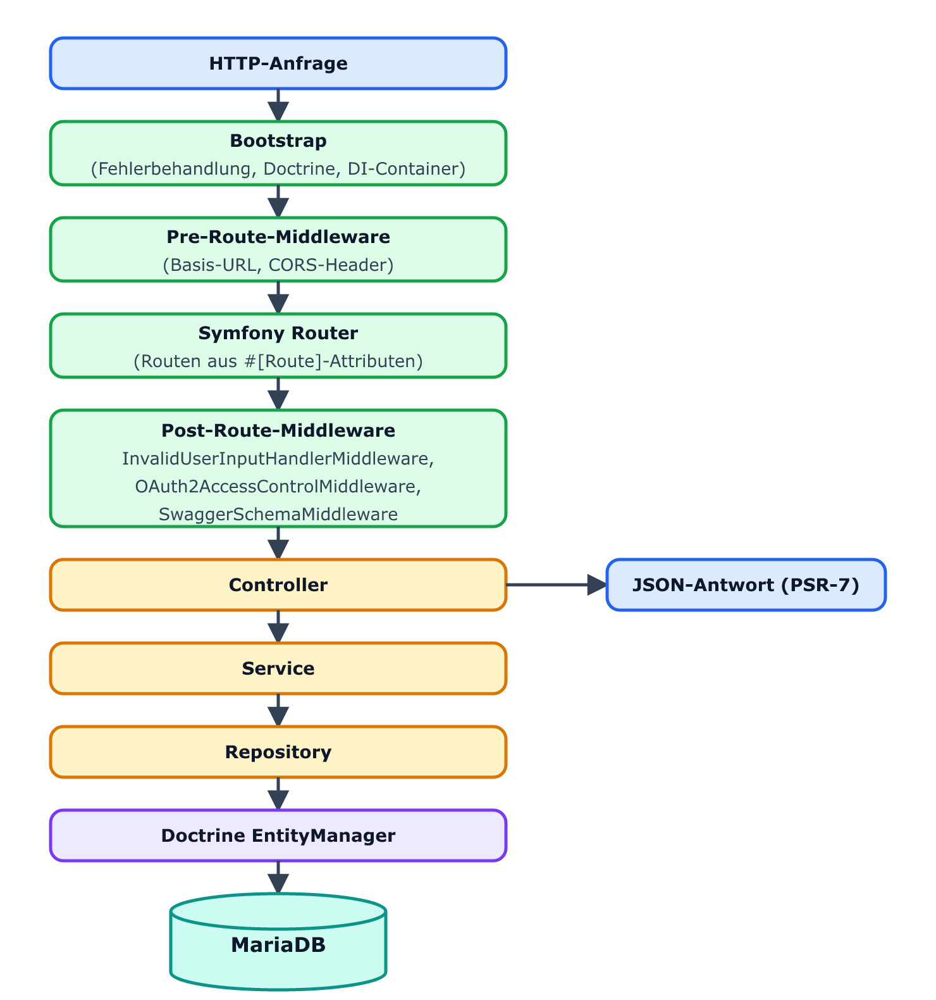
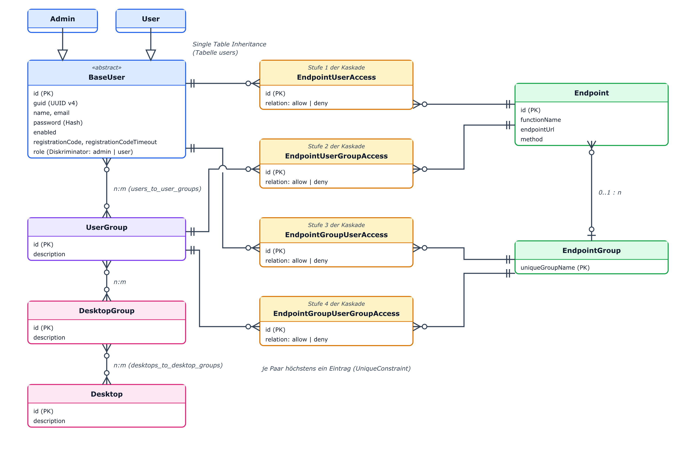
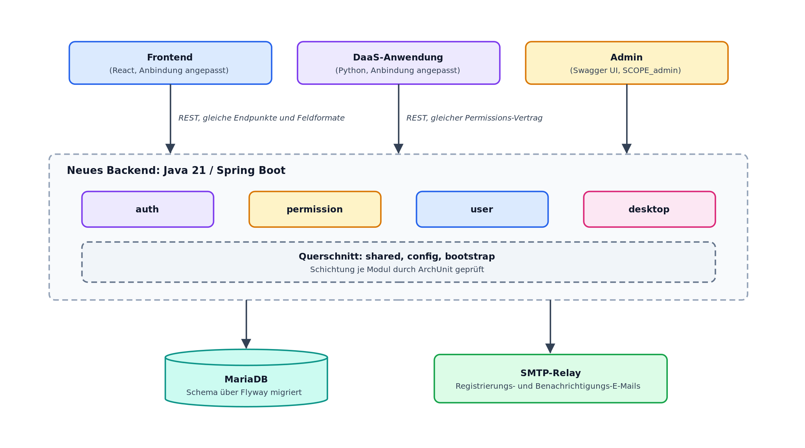
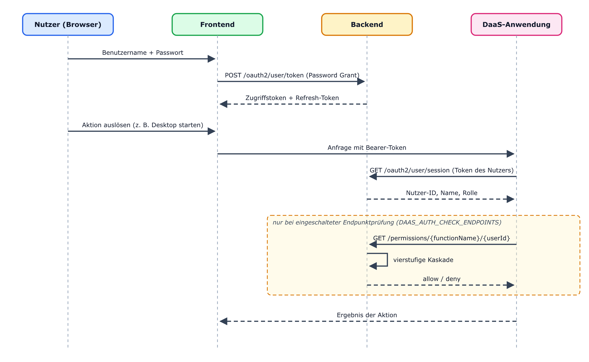

# 3 Anforderungsanalyse

Dieses Kapitel beschreibt, welches Problem gelöst werden soll und welche
Eigenschaften die Lösung haben muss. Mit welchen Klassen, Bibliotheken und
Algorithmen das geschieht, zeigt Kapitel 4. Grundlage sind die Ausschreibung mit
den Arbeitspaketen AP1 bis AP6 und eine vollständige Analyse des Quellcodes des
alten PHP-Backends *design-daas-application-backend* (Abschnitt 3.1). Jede
Anforderung lässt sich auf eine Stelle im Code, in einer Konfigurationsdatei
oder in der Ausschreibung zurückführen. Zusätzlich wurde im Quellcode von
Frontend und DaaS-Anwendung nachgesehen, welche Endpunkte die beiden tatsächlich
aufrufen (Abschnitt 3.2.2). Abschnitt 3.4 beschreibt schließlich den Zielzustand
anhand des neuen Java-Quellcodes.

## 3.1 Generelle Zielsetzung

Das Backend von **DESIGN** (Abschnitt 2.1) soll vollständig neu entwickelt
werden. Die Ausschreibung nennt das bestehende PHP-Backend ausdrücklich
„qualitativ schwach“ und hält fest: „die Dokumentation ist ebenfalls schlecht“.
DaaS-Anwendung und Frontend gelten dagegen als qualitativ gut, relativ einfach
installierbar und ausreichend gut dokumentiert (Baun, 2026). Daraus ergeben sich
zwei Aufgaben für dieses Kapitel. Erstens muss das von außen sichtbare Verhalten
des alten Backends vollständig verstanden werden, also Schnittstellen,
Datenformate und Berechtigungslogik. Eine Dokumentation dafür gibt es nicht; der
Quellcode ist die einzige verlässliche Quelle. Zweitens wird daraus ein Katalog
von Anforderungen abgeleitet. Er legt fest, was ein fachlich gleichwertiger,
aber wart- und testbarer Nachfolger leisten muss, ohne schon die technische
Umsetzung vorwegzunehmen.

### 3.1.1 Genereller Aufbau des Gesamtsystems (AP1)

Die drei Teile von **DESIGN** und ihre Aufgaben wurden in Kapitel 1 vorgestellt;
Abbildung 2.2 zeigt, wie sie zusammenarbeiten. Die drei Teile teilen
sich keinen Code und kommunizieren nur über REST-Schnittstellen. Gemeinsam
installiert werden sie über das Installationsprogramm im Verzeichnis *installer*
der DaaS-Anwendung; dort wird festgelegt, unter welchen Adressen die Teile
einander erreichen. Da Frontend und DaaS-Anwendung höchstens in ihrer Anbindung
angepasst werden (Abschnitt 1.5), muss das neue Backend deren Erwartungen so
erfüllen wie bisher das alte: Pfade, HTTP-Methoden, Feldnamen im JSON,
Statuscodes und die Bedeutung der Berechtigungsprüfung. Diese
*Verhaltenskompatibilität* bestimmt die Anforderungen in Abschnitt 3.2 stärker
als jede andere Randbedingung.

### 3.1.2 Ist-Zustand des alten Backends (AP2)

Die folgende Analyse beruht auf einer direkten Durchsicht des Quellcodes von
*design-daas-application-backend*: Klassenstruktur, Routen-Attribute, Entitäten,
Migrationsskripte, *composer.json* und *docker-compose.yml*.

#### 3.1.2.1 Technologie-Stack

Das alte Backend ist in PHP 8.2 geschrieben und läuft als Apache-Modul in einem
Docker-Container. Tabelle 3.1 zeigt die eingesetzten Technologien je Schicht.

*Tabelle 3.1: Technologie-Stack des alten PHP-Backends*

| **Schicht** | **Technologie** |
|---|---|
| Sprache | PHP 8.2 |
| HTTP-Server | Apache (im PHP-Container) |
| ORM / Datenbank | Doctrine ORM 2.x + MariaDB |
| Schema-Migrationen | Doctrine Migrations |
| Dependency Injection | PHP-DI (Autowiring + Annotationen) |
| HTTP-Routing | Symfony Routing (über PSR-7-Adapter) |
| HTTP-Nachrichten | PSR-7 (Guzzle-Implementierung) |
| OAuth2 | *league/oauth2-server* (Password Grant, Refresh Token Grant) |
| Eingabevalidierung | *league/openapi-psr7-validator* (Prüfung gegen die OpenAPI-Beschreibung) |
| API-Dokumentation | OpenAPI/Swagger (*zircote/swagger-php*) |
| Logging | Monolog (PSR-3) |
| Event-Bus | Symfony EventDispatcher (PSR-14) |
| Warteschlange | DB-gestützt, über *enqueue/dbal* |
| E-Mail-Versand | Symfony Mailer |
| Cron | Yacron |
| Containerisierung | Docker + Docker Compose |
| Tests/Statische Analyse | PHPUnit 10, PHPStan, PHPCS, PHPat |

#### 3.1.2.2 Modulstruktur und Schichtung

Der Code ist nicht nach technischen Schichten gegliedert, sondern nach
fachlichen Bereichen in *vertikale Module*:

- **Main**: Bootstrap, Fehlerbehandlung, Versions-Endpunkt
- **Util**: Querschnittsfunktionen wie Mailversand, OAuth2-Middleware, Swagger
- **OAuth2**: Token-Endpunkt, Session-Info
- **User**: Nutzer-/Admin-Verwaltung, Gruppen, Registrierung
- **Desktop**: Desktop- und Desktop-Gruppen-Verwaltung
- **Permissions**: feingranulare Zugriffskontrolle

Die fachlichen Module folgen derselben Schichtung **Model → Repository → Service
→ Controller**, meist ergänzt um Unterverzeichnisse für **DTOs**, **Enums** und
**Exceptions**. Ganz einheitlich ist die Ablage allerdings nicht: In *User* und
*Permissions* liegen Controller und Services in eigenen Unterverzeichnissen, in
*Desktop* und *OAuth2* direkt im Modulverzeichnis. Das Muster aus fachlichen
Modulen mit gleicher innerer Schichtung übernimmt das neue Backend in seine
Java-Pakete und setzt es dort einheitlich um (Abschnitt 3.4).

#### 3.1.2.3 Anfrageverarbeitung (Request-Lifecycle)

Jede HTTP-Anfrage durchläuft denselben Ablauf. Nach dem Start der Anwendung, bei
dem Fehlerbehandlung, Doctrine und der Dependency-Injection-Container
eingerichtet werden, übernimmt ein *HttpDispatcher* auf Basis von Symfony
Routing die Anfrage. Vor dem Routing ermitteln Middleware-Komponenten die
Basis-URL und setzen die CORS-Header. Nach dem Routing folgen drei weitere. Die
*InvalidUserInputHandlerMiddleware* fängt Ausnahmen wegen ungültiger Eingaben ab
und erzeugt daraus eine Fehlerantwort. Die *OAuth2AccessControlMiddleware* liest
die an jeder Route hinterlegte OpenAPI-Sicherheitsangabe, zum Beispiel
*#[OA\Get(security: [["oauth2-user" => ["admin"]]])]*, prüft das mitgesendete
Zugriffstoken und hängt den angemeldeten Nutzer an die Anfrage an. Die
*SwaggerSchemaMiddleware* prüft schließlich die Anfrage gegen die
OpenAPI-Beschreibung und lehnt sie bei Abweichungen mit dem Statuscode 400 ab.
Die OpenAPI-Annotationen dienen im alten Backend also nicht nur der
Dokumentation, sondern auch der Zugriffskontrolle und der Eingabeprüfung. Erst
nach diesen Schritten wird die passende Controller-Aktion aufgerufen. Sie greift
über Service- und Repository-Schicht auf den Doctrine *EntityManager* und damit
auf MariaDB zu und gibt die Antwort als JSON in einer PSR-7-Response zurück.
Abbildung 3.1 fasst diesen Ablauf zusammen.

*Abbildung 3.1: Anfrageverarbeitung im alten PHP-Backend (eigene Darstellung)*

#### 3.1.2.4 Domänenmodell

Abbildung 3.2 zeigt die wichtigsten Entitäten und ihre Beziehungen. **BaseUser**
ist eine abstrakte Entität, von der **Admin** und **User** per *Single Table
Inheritance (STI)* erben. Beide liegen in derselben Tabelle **users** und werden
über die Spalte **role** unterschieden. Jeder Nutzer hat außerdem eine **guid**
(UUID v4), ein **enabled**-Flag und einen **registrationCode**, einen
achtstelligen Hex-Wert, der 24 Stunden lang zur Bestätigung der E-Mail-Adresse
dient. Passwörter werden nur als Hash gespeichert. Nutzer stehen in einer
n:m-Beziehung zu **UserGroup**, Nutzergruppen wiederum n:m zu **DesktopGroup**
und Desktop-Gruppen n:m zu **Desktop**. Davon getrennt gibt es ein eigenes
Berechtigungsmodell. **Endpoint**-Entitäten, die über ihren **functionName**
sowie URL und HTTP-Methode bestimmt sind, gehören zu höchstens einer
**EndpointGroup**; deren Primärschlüssel ist kein Zahlenwert, sondern ein
eindeutiger Name (**uniqueGroupName**). Vier Zuordnungstabellen
(**EndpointUserAccess**, **EndpointUserGroupAccess**,
**EndpointGroupUserAccess**, **EndpointGroupUserGroupAccess**) verknüpfen
einzelne Nutzer oder Nutzergruppen mit einzelnen Endpunkten oder
Endpunktgruppen. Jede trägt im Feld **relation** den Wert *allow* oder *deny*,
und eine Eindeutigkeitsbedingung erlaubt je Paar aus Nutzer oder Gruppe und
Endpunkt oder Endpunktgruppe höchstens einen Eintrag. Nicht in Abbildung 3.2
enthalten sind die Tabellen, in denen *league/oauth2-server* Clients, Zugriffs-
und Refresh-Token speichert (**oauth2_clients**, **oauth2_access_token**,
**oauth2_refresh_tokens**). Services, Repositories und die meisten Controller
sind als **final** deklariert. Die Entitäten selbst sind es nicht, weil Doctrine
für das verzögerte Laden Unterklassen (Proxys) von ihnen erzeugt.

*Abbildung 3.2: Domänenmodell des alten PHP-Backends (eigene Darstellung)*

#### 3.1.2.5 Berechtigungsmodell (Permissions-Engine)

Neben der groben Unterscheidung zwischen den OAuth2-Scopes **user** und
**admin** besitzt das alte Backend ein zweites, feiner abgestuftes
Berechtigungssystem, das in der Datenbank gepflegt wird. Seine zentrale Methode
*PermissionCalculationService::getPermission($functionName, $userId)* prüft vier
Arten von Regeln in fester Reihenfolge und verwendet die erste, die zutrifft:

- **EndpointUserAccess**: eine Regel für genau diesen Nutzer und genau diesen
  Endpunkt,
- **EndpointUserGroupAccess**: eine Regel für eine Nutzergruppe des Nutzers und
  genau diesen Endpunkt,
- **EndpointGroupUserAccess**: eine Regel für genau diesen Nutzer und eine
  Endpunktgruppe, der dieser Endpunkt angehört,
- **EndpointGroupUserGroupAccess**: eine Regel für eine Nutzergruppe des Nutzers
  und eine Endpunktgruppe.

Trifft keine der vier Regeln zu, wird der Zugriff verweigert (*fail-closed*).
Ist der Funktionsname oder die Nutzer-ID unbekannt, kommt es gar nicht erst zur
Prüfung: Die Methode wirft eine Ausnahme, und der Controller antwortet mit dem
Statuscode 400. Auch das ist keine Erlaubnis, denn die DaaS-Anwendung wertet nur
eine Antwort mit dem Ergebnis *allow* als Freigabe.
Für die DaaS-Anwendung ist dieses Verhalten sicherheitskritisch, denn über diese
Prüfung soll sie jede Nutzeraktion absichern. Entscheidend sind dabei die
Reihenfolge der vier Stufen und die Verweigerung als Standard. Das neue Backend
muss beides unverändert übernehmen (Abschnitt 3.2). In den Stufen 2 und 4
durchläuft die Methode alle Gruppen des Nutzers und gibt das Ergebnis der ersten
Gruppe zurück, für die eine passende Regel existiert. Die Reihenfolge, in der
*BaseUser::groups()* diese Gruppen liefert, ist jedoch nicht festgelegt. Hat ein
Nutzer also mehrere Gruppen mit widersprüchlichen Regeln, hängt das Ergebnis von
der internen Reihenfolge der Doctrine-Collection ab und ist nicht vorhersagbar.
Deshalb wird im neuen Backend eine eindeutige Regel für solche Konflikte
ergänzt, statt die zufällige alte Reihenfolge nachzubilden (Abschnitt 3.4.2).
Außerdem gibt es eine eigene Prüfung des Desktop-Zugriffs (**GET
/users/access/{desktopId}**). Administratoren erhalten dort immer Zugriff. Für
alle anderen Nutzer vergleicht *UserService::hasAccessToDesktop()* die IDs der
Nutzergruppen des Nutzers direkt mit den IDs der Desktop-Gruppen des Desktops,
statt die Verknüpfung zwischen Nutzergruppe und Desktop-Gruppe auszuwerten. Das
Ergebnis stimmt deshalb nur, wenn die beiden IDs zufällig übereinstimmen.

#### 3.1.2.6 Vollständige Schnittstelle (Ist-Zustand)

Tabelle 3.2 listet alle Endpunkte des alten Backends auf, wie sie sich aus den
Routen-Attributen der Controller ergeben. Sie bildet die Grundlage der
funktionalen Anforderungen in Abschnitt 3.2. Welche dieser Endpunkte die Clients
tatsächlich nutzen und welche das neue Backend deshalb gleichwertig anbieten
muss, untersucht Abschnitt 3.2.2.

*Tabelle 3.2: API-Endpunkte des alten PHP-Backends (Ist-Zustand)*

| **Modul** | **Endpunkt (Methode + Pfad)** | **Beschreibung (Rolle)** |
|---|---|---|
| Main | GET /version | Anwendungsversion (offen) |
| OAuth2 | POST /oauth2/user/token | Token anfordern (offen) |
| OAuth2 | GET /oauth2/user/session | Session-Info (user/admin) |
| OAuth2 | GET /ping/user | Diagnose (user) |
| OAuth2 | GET /ping/admin | Diagnose (admin) |
| User | GET /users | Nutzer auflisten (admin) |
| User | GET /user/{id} | Einzelnen Nutzer abrufen (admin) |
| User | POST /user | Nutzer anlegen bzw. registrieren (offen) |
| User | PATCH /user/{id} | Nutzerdaten ändern (admin) |
| User | DELETE /user/{id} | Nutzer dauerhaft löschen (admin) |
| User | POST /user/{id}/enable | Konto aktivieren (admin) |
| User | POST /user/{id}/disable | Konto deaktivieren (admin) |
| User | POST /user/validate_email | E-Mail verifizieren (offen) |
| User | GET /users/access/{desktopId} | Desktop-Zugriff prüfen (user) |
| User | POST /user/request-application/{app}/{lang} | Freischaltung anfragen (user) |
| Admin | GET /admins | Alle Admins auflisten (admin) |
| Admin | GET /admin/{id} | Einzelnen Admin abrufen (admin) |
| Admin | POST /admin | Admin anlegen (admin) |
| Admin | DELETE /admin/{id} | Admin dauerhaft löschen (admin) |
| Desktop | GET /desktops | Desktops auflisten (admin) |
| Desktop | GET /desktop/{id} | Desktop lesen (admin) |
| Desktop | POST /desktop | Desktop anlegen (admin) |
| Desktop | GET /desktop_groups | Desktop-Gruppen auflisten (admin) |
| Desktop | GET /desktop_group/{id} | Desktop-Gruppe lesen (admin) |
| Desktop | POST /desktop-group | Desktop-Gruppe anlegen (admin) |
| Desktop | POST /desktop_group/{id}/user_group/{uId} | Nutzergruppe verknüpfen (admin) |
| Permissions | GET /permissions/{functionName}/{userId} | Berechtigung abfragen (admin) |
| Permissions | POST /permissions_info | Berechtigungsinfo abfragen (admin) |
| UserGroup | GET /user_groups | Alle Nutzergruppen auflisten (admin) |
| UserGroup | POST /user_group | Neue Nutzergruppe anlegen (admin) |
| UserGroup | PATCH /user_group/{id} | Nutzergruppe ändern (admin) |
| UserGroup | POST /user_group/{ugId}/{dgId} | Mit Desktop-Gruppe verknüpfen   (admin) |
| EndpointGroup | PUT /endpoint_group/{id}/{ugId}/{access} | Zugriffsregel setzen (admin) |
| EndpointGroup | DELETE /endpoint_group/{id}/{ugId} | Zugriffsregel entfernen (admin) |
| Util | GET /swagger, GET /swagger-by-role/{role} | API-Dokumentation (offen) |

Die Stammdaten der Endpunkte und Endpunktgruppen, also welche Funktion zu
welcher Gruppe gehört, werden nicht über HTTP gepflegt, sondern mit dem
Kommandozeilenbefehl **permissions:import** aus einer JSON-Datei eingelesen.
Über die HTTP-Schnittstelle lassen sich nur die Erlauben- und
Verweigern-Zuordnungen zwischen Nutzergruppen und bestehenden Endpunktgruppen
ändern.

#### 3.1.2.7 Konfiguration und Betrieb

Konfiguriert wird das Backend über Umgebungsvariablen, die beim Start des
Containers in den Dependency-Injection-Container übernommen werden. Betrieben
wird es mit Docker Compose in den Profilen **dev-environment** und
**release-test-environment**; ein drittes Profil **tools** enthält nur
Hilfscontainer für die Entwicklung. Die Testdatenbank ist eine eigene MariaDB-Instanz,
die ihre Daten nur im Arbeitsspeicher hält (**tmpfs**) und von der
Entwicklungsdatenbank getrennt ist. Zeitgesteuerte Aufgaben übernimmt ein
eigener **yacron**-Dienst. Er ruft einmal täglich um Mitternacht den Befehl
*maintenance:cleanup* auf, der ein *CleanupEvent* auslöst; daraufhin löscht ein
Listener abgelaufene OAuth2-Token. Parallele Läufe derselben Aufgabe sind
ausgeschlossen (*concurrencyPolicy: Forbid*).

### 3.1.3 Umfeldbeschreibung

Tabelle 3.3 fasst die vorhandene Infrastruktur und die daraus resultierenden
Rahmenbedingungen für das neue Backend zusammen.

*Tabelle 3.3: Umfeld und Rahmenbedingungen*

| **Umfeldelement** | **Beschreibung** | **Auswirkung auf das neue Backend** |
|---|---|---|
| MariaDB | Alleiniger Datenspeicher (Nutzer, Gruppen, Permissions, Desktops) | Bleibt Datenspeicher; Schema muss versioniert migrierbar sein |
| SMTP-Relay | Versand von Registrierungs-/Verifikations-E-Mails | Muss weiterhin HTML-E-Mails für dieselben Anlässe versenden |
| React-Frontend | Konsumiert Auth-/User-/Desktop-Endpunkte | Erwartet unveränderte REST-Verträge; CORS muss Frontend-Origin erlauben |
| Python-DaaS-Anwendung | Nutzt Token-, Sitzungs- und Berechtigungsendpunkte | Erwartet unveränderten Permissions-Vertrag inkl. 4-stufiger Kaskade |
| Docker/Docker Compose | Alleinige Betriebsform (Dev-/Testprofile) | Muss ebenfalls containerisiert und per Docker betreibbar sein |
| Linux-Zielplattform | Produktionsbetrieb auf Linux mit Apache | Muss ohne Anpassung auf vergleichbarer Linux-Infrastruktur laufen |

Frontend und DaaS-Anwendung werden in dieser Arbeit höchstens in ihrer Anbindung
angepasst (Abschnitt 1.5). Die genannten Rahmenbedingungen sind daher als feste
Vorgaben zu verstehen.

## 3.2 Klärung der Anforderungen

Die Anforderungen wurden aus dem Quellcode des alten PHP-Backends und der beiden
Clients sowie aus der Ausschreibung ermittelt. Es handelt sich also um eine
Anforderungsanalyse durch Reverse Engineering (Abschnitt 2.5.1). Interviews oder
ein Pflichtenheft gab es nicht; die Anforderungen wurden aus dem beobachtbaren
Verhalten des bestehenden Systems rekonstruiert.

### 3.2.1 Klärung der Hauptfunktionalität und Problemfeldabgrenzung

Aus der Modulstruktur des alten Systems (Abschnitt 3.1.2) ergeben sich vier
Funktionsbereiche, die auch das neue Backend abdecken muss:

- **Authentifizierung:** Zugriffstoken ausstellen, erneuern, widerrufen und
  prüfen (bisher Modul OAuth2).
- **Autorisierung:** die Frage „Darf Nutzer X Funktion Y aufrufen?“ über die
  vierstufige Kaskade aus Abschnitt 3.1.2 beantworten (bisher Modul
  Permissions).
- **Benutzerverwaltung:** Selbstregistrierung mit Bestätigung der
  E-Mail-Adresse, Verwaltung von Nutzern, Administratoren und Nutzergruppen
  sowie Anfragen zur Freischaltung von Anwendungen (bisher Modul User).
- **Desktop-Inventar:** Desktops und Desktop-Gruppen anlegen, auflisten und mit
  Nutzergruppen verknüpfen (bisher Modul Desktop).

**Nicht** Teil dieser Arbeit ist die eigentliche Bereitstellung der Desktops,
also das Starten, Klonen und Beenden von Containern und virtuellen Maschinen
sowie die Steuerung von Apache Guacamole. Das übernimmt allein die
DaaS-Anwendung. Das Backend liefert ihr dafür nur Stammdaten, etwa welche
Desktops existieren und welchen Nutzergruppen sie zugeordnet sind, sowie
Auskünfte zu Authentifizierung und Berechtigungen. Auf dieser Grundlage trifft
die DaaS-Anwendung ihre eigenen Entscheidungen. Ebenfalls nicht Teil der Arbeit
sind Änderungen an Frontend oder DaaS-Anwendung, die über die in Abschnitt 1.5
genannten Anpassungen hinausgehen.

### 3.2.2 Ableitung der funktionalen Anforderungen

Die meisten funktionalen Anforderungen (FA) entsprechen mindestens einem
Endpunkt aus Tabelle 3.2. Sie sind unabhängig von der Programmiersprache
formuliert und beschreiben, was das System leisten muss, nicht aber, mit welcher
Klasse oder welchem Framework. Eine Ausnahme ist FA-3: Sie hat kein Gegenstück
im alten Backend und folgt aus den nicht-funktionalen Anforderungen in Abschnitt
3.2.3.

*Tabelle 3.4: Funktionale Anforderungen (FA)*

| **ID** | **Anforderung** |
|---|---|
| FA-1 | Login mit Benutzername/Passwort liefert ein Zugriffstoken |
| FA-2 | Ein abgelaufenes Zugriffstoken kann per Refresh-Token erneuert werden, ohne erneute Zugangsdaten |
| FA-3 | Aktives Abmelden widerruft das Token serverseitig, auch vor Ablauf |
| FA-4 | Zu einem gültigen Token kann die Session/Identität abgefragt werden |
| FA-5 | Selbstregistrierung mit E-Mail-Bestätigung über zeitlich begrenzten Code |
| FA-6 | Admin kann Nutzer auflisten, einsehen, ändern, aktivieren/deaktivieren und löschen |
| FA-7 | Admin kann weitere Admin-Konten anlegen, auflisten, einsehen und löschen |
| FA-8 | Admin kann Nutzergruppen anlegen, ändern, auflisten und mit Desktop-Gruppen verknüpfen |
| FA-9 | Nutzer kann Anwendungsfreischaltung anfragen; Admin wird per E-Mail benachrichtigt |
| FA-10 | Admin kann Desktops anlegen, einsehen und auflisten |
| FA-11 | Admin kann Desktop-Gruppen anlegen, einsehen und mit Nutzergruppen verknüpfen |
| FA-12 | Nutzer kann prüfen, ob er Zugriff auf einen Desktop hat |
| FA-13 | Prüfung, ob ein Nutzer eine Funktion aufrufen darf, über die 4-stufige Kaskade |

FA-12 steht getrennt von FA-13, weil der zugehörige Endpunkt im User-Controller
unabhängig vom allgemeinen Permissions-Endpunkt umgesetzt ist und eine eigene
Prüflogik auf Basis der Desktop-Gruppen besitzt. Diese Prüflogik ist im
Altsystem fehlerhaft (Abschnitt 3.1.2.5). FA-3 hat dagegen kein Gegenstück im
Altsystem: Weder OAuth2HttpController noch UserHttpController enthalten einen
Logout-Endpunkt. Die Bibliothek *league/oauth2-server* speichert zwar Zugriffs-
und Refresh-Token mit einem Widerrufszeitpunkt und prüft diesen bei jeder
Anfrage, widerrufen werden Token aber nur beim Einlösen eines Refresh-Tokens.
Weder eine Abmeldung noch das Deaktivieren eines Kontos löst einen Widerruf aus.

Für die Kompatibilität kommt es nicht darauf an, welche Endpunkte das alte
Backend anbietet, sondern welche davon Frontend und DaaS-Anwendung tatsächlich
aufrufen. Deshalb wurde der Quellcode beider Clients nach Aufrufen des Backends
durchsucht. Tabelle 3.5 stellt das Ergebnis den Endpunkten aus Tabelle 3.2 gegenüber
und zeigt, wie das neue Backend mit jedem Endpunkt umgeht.

*Tabelle 3.5: Nutzung der Altschnittstelle durch Frontend und DaaS-Anwendung*

| **Endpunkt (alt)** | **Aufgerufen von** | **Umsetzung im neuen Backend** |
|---|---|---|
| POST /oauth2/user/token | Frontend, DaaS-Anwendung | übernommen |
| GET /oauth2/user/session | Frontend, DaaS-Anwendung | übernommen, Antwort um Feld role ergänzt |
| GET /users, PATCH /user/{id} | Frontend | übernommen |
| POST /user/{id}/enable, POST /user/{id}/disable | Frontend | als PATCH umgesetzt, Frontend angepasst |
| POST /user/validate_email | Frontend | übernommen |
| POST /user/request-application/{app}/{lang} | Frontend | übernommen |
| GET /admins, POST /admin | Frontend | übernommen |
| GET /desktops, GET /desktop/{id}, POST /desktop | Frontend | übernommen |
| GET /desktop_groups | Frontend | übernommen |
| POST /desktop-group | Frontend (ruft POST /desktop_group auf) | als POST /desktop_group umgesetzt |
| POST /desktop_group/{id}/user_group/{uId} | Frontend | übernommen |
| GET /user_groups, POST /user_group, PATCH /user_group/{id} | Frontend | übernommen |
| GET /permissions/{functionName}/{userId} | DaaS-Anwendung | übernommen |
| POST /permissions_info | – (bis Nov. 2026 DaaS-Anwendung) | übernommen; statt des Scopes admin genügt ein gültiges Token, geprüft wird dann der Aufrufer selbst |
| POST /user | Frontend | übernommen |
| GET /version, GET /ping/user, GET /ping/admin | – | entfällt; Health-Check über GET /actuator/health |
| GET /user/{id}, DELETE /user/{id} | – | übernommen; Löschen benachrichtigt den Nutzer per E-Mail |
| GET /admin/{id}, DELETE /admin/{id} | – | übernommen; eigenes und letztes Admin-Konto nicht löschbar |
| GET /desktop_group/{id} | – | entfällt |
| GET /users/access/{desktopId} | – | entfällt (FA-12) |
| POST /user_group/{ugId}/{dgId} | – | entfällt (gleichwertig zu POST /desktop_group/{id}/user_group/{uId}) |
| PUT /endpoint_group/…, DELETE /endpoint_group/… | – | ersetzt durch eigene Verwaltungsendpunkte für Endpunkte, Endpunktgruppen und Regeln (Abschnitt 4.3.7) |
| GET /swagger, GET /swagger-by-role/{role} | – | ersetzt durch springdoc (/swagger-ui.html, /v3/api-docs) |
| neu: POST /user/resend_code, POST /oauth2/user/logout | Frontend (Logout) | neu umgesetzt |
| neu: DELETE /user_group/{id}, DELETE /desktop/{id}, DELETE /desktop_group/{id} | – | neu umgesetzt |

Die Analyse zeigt, dass beide Clients nur einen Teil der alten Schnittstelle
nutzen. Daraus wurde folgende Regel abgeleitet: Alle genutzten Endpunkte
übernimmt das neue Backend mit unveränderten Pfaden, Feldern und Statuscodes.
Ungenutzte Endpunkte werden nur dann portiert, wenn sie für die Verwaltung des
Systems nötig sind, etwa um Konten zu löschen oder Berechtigungsregeln ohne
direkten Datenbankzugriff zu pflegen; sie sind dann auch durch Tests
abgesichert. Funktionen, die niemand aufruft und die für den Betrieb nicht
gebraucht werden, entfallen. Abweichungen vom alten Vertrag beschränken sich auf
die in Tabelle 3.5 genannten Fälle. Abschnitt 5.3 bewertet, was das für FA-11,
FA-12 und NFA-3 bedeutet.

### 3.2.3 Ableitung der nicht-funktionalen Anforderungen

Die nicht-funktionalen Anforderungen (NFA) haben drei Quellen. NFA-1 bis NFA-3
beschreiben Eigenschaften, die das alte Backend bereits hat und die aus Gründen
der Kompatibilität erhalten bleiben müssen. NFA-4 bis NFA-7 sind übliche
Sicherheits- und Betriebsanforderungen an einen Authentifizierungsdienst; ihr
Hintergrund wird in den Abschnitten 2.2 bis 2.4 erläutert. NFA-8 bis NFA-11
stammen aus der Ausschreibung. Diese bemängelt am alten Backend Qualität und
Dokumentation und hebt bei den anderen Teilen von DESIGN hervor, dass sie sich
relativ einfach installieren lassen (Baun, 2026). Das neue Backend soll deshalb
wart- und testbar sein (NFA-8 und NFA-9), vollständig dokumentiert sein (NFA-10)
und sich ebenso einfach installieren lassen wie die übrigen Teile (NFA-11).

*Tabelle 3.6: Nicht-funktionale Anforderungen (NFA)*

| **ID** | **Anforderung** |
|---|---|
| NFA-1 | Fail-closed: Unbekannter Nutzer, unbekannte Funktion oder keine passende Regel führt immer zu Zugriffsverweigerung, nie zu impliziter Erlaubnis |
| NFA-2 | Gleiche Priorität der vier Regelstufen (Nutzerregel vor Gruppenregel vor Endpunktgruppenregel vor Gruppen-Endpunktgruppenregel) sowie fail-closed als Standard |
| NFA-3 | Gleiche Pfade, HTTP-Methoden, JSON-Felder und Statuscodes wie im alten Backend |
| NFA-4 | Passwörter nur als Hash; Konten werden nach wiederholten Fehlversuchen gesperrt |
| NFA-5 | Login und Registrierung sind ratenbegrenzt |
| NFA-6 | Zugriffstoken sind serverseitig widerrufbar, obwohl JWTs grundsätzlich zustandslos sind |
| NFA-7 | Dienst ist zustandslos und horizontal skalierbar; kein Server-Session-State außerhalb der DB |
| NFA-8 | Interne Schichtung (*Controller → Service → Repository → Model*) wird automatisiert geprüft, nicht nur per Konvention |
| NFA-9 | Mindest-Testabdeckung wird im Build erzwungen; ein fehlgeschlagener Build verhindert das Mergen |
| NFA-10 | Das Backend ist für Nutzung, Weiterentwicklung und Betrieb dokumentiert; die API-Dokumentation kann nicht von der Implementierung abweichen |
| NFA-11 | Das Backend lässt sich mit wenigen, dokumentierten Schritten lokal, als Container und gemeinsam mit den übrigen Teilen über das Installationsprogramm der DaaS-Anwendung installieren |

NFA-1 bis NFA-3 stehen am Anfang, weil sie festlegen, wann das neue Backend als
fachlich gleichwertig zum alten gilt. In den Kapiteln 4 und 5 dienen sie als
Maßstab der Bewertung. NFA-2 beschränkt sich auf die Reihenfolge der Regelstufen
und die Verweigerung als Standard, denn nur darauf verlässt sich die
DaaS-Anwendung laut Quellcode. Wie Abschnitt 3.1.2 zeigt, löst der alte
*PermissionCalculationService* widersprüchliche Gruppenregeln innerhalb einer
Stufe nicht nach einer festen Regel auf, sondern nach der zufälligen Reihenfolge
der Gruppen. Dieses Verhalten wird deshalb nicht als Anforderung übernommen.
Stattdessen führt Abschnitt 3.4.2 eine neue Eigenschaft ein, die das alte System
nicht hatte: Widersprechen sich mehrere gleichrangige Regeln innerhalb einer
Stufe, entscheidet die neue Kaskade eindeutig, und ein ausdrückliches Verweigern
hat Vorrang vor einem Erlauben.

## 3.3 Zeitliche Rahmenbedingungen

Dieser Abschnitt hält Beginn und Ende der Arbeit sowie die Meilensteine fest.
Beginn und Ende der Bearbeitungszeit hat das Prüfungsamt vorgegeben. Die übrigen
Meilensteine wurden davon ausgehend entlang der Arbeitspakete AP1 bis AP6 aus
der Ausschreibung geplant.

*Tabelle 3.7: Zeitplan der Arbeit*

| **Meilenstein** | **Zeitraum** |
|---|---|
| AP1 – Recherche Gesamtsystem DESIGN | 22.06.–29.06.2026 |
| AP2 – Analyse altes PHP-Backend | 30.06.–13.07.2026 |
| AP3 – Entwurf neues Backend (Konzept/Architektur) | 14.07.–03.08.2026 |
| AP4 – Implementierung neues Backend (Java/Spring Boot) | 04.08.–02.10.2026 |
| AP6 – Test, Evaluation, Dokumentation | 03.10.–28.10.2026 |
| AP5 – Aufbau des Demonstrators, Einbindung in *design-daas* | 29.10.–09.11.2026 |
| Literaturrecherche / Kapitel 2 (Theoretische Grundlagen) | 22.06.–10.08.2026 |
| Anfertigung der schriftlichen Ausarbeitung | 22.06.–11.11.2026 |
| Abgabe des vollständigen schriftlichen Entwurfs | 11.11.2026 |
| Ende der Bearbeitungszeit, Einreichen im Prüfungsamt | 25.11.2026 |

AP1 und AP2 folgen direkt aufeinander und lassen sich inhaltlich kaum trennen:
Ohne die Code-Analyse aus Abschnitt 3.1 wäre nicht zu erkennen gewesen, welche
Rolle das Backend in DESIGN spielt und welche Schnittstellen es bietet. Die
Literaturrecherche für Kapitel 2 fiel in die ersten sieben Wochen. Die
schriftliche Ausarbeitung lief dagegen über die gesamte Bearbeitungszeit mit, da
die Ergebnisse von AP3 bis AP6 direkt in die Kapitel 4 und 5 einflossen. Der Demonstrator (AP5) wurde erst nach Test und
Evaluation (AP6) eingeplant, damit er auf einem bereits getesteten Stand des
Backends aufbaut.

## 3.4 Zielzustand

Dieser Abschnitt beschreibt, wie das neue Backend die Anforderungen aus
Abschnitt 3.2 erfüllen soll. Er beginnt mit einem Überblick über die Architektur
(3.4.1) und behandelt danach Authentifizierung und Autorisierung (3.4.2),
Datenhaltung und Betrieb (3.4.3) sowie die Qualitätssicherung (3.4.4). Die
Anwendungsfälle für den Prototyp folgen in Abschnitt 3.5.

### 3.4.1 Architekturüberblick

Das neue Backend ist ein eigenständiger Dienst in Java 21 und Spring Boot mit
dem Basispaket *de.frauas.design.backend*. Es übernimmt die fachlichen Module
des alten Backends (Abschnitt 3.1.2), prüft ihre innere Schichtung aber
automatisch, statt sich auf Konventionen zu verlassen. Die vier Module **auth**,
**permission**, **user** und **desktop** entsprechen den vier Funktionsbereichen
aus Abschnitt 3.2.1 und damit den alten Modulen *OAuth2*, *Permissions*, *User*
und *Desktop*. Hinzu kommen drei übergreifende Pakete: **shared** für gemeinsam
genutzte DTOs, Exceptions sowie Sicherheits- und Hilfsklassen, **config** für
die Spring-Konfiguration und **bootstrap** für Aufgaben beim Start, etwa das
Anlegen eines Standard-Administrators. Jedes Modul ist intern in *controller →
service → repository → model* gegliedert und hat eigene Unterpakete für *dto*
und *exception*. Das entspricht dem alten Muster des alten PHP-Backends. Anders 
als im alten Backend prüft eine eigene ArchUnit-Testklasse diese Schichtung 
automatisch (Abschnitt 3.4.4). Abbildung 3.3 zeigt die Struktur zusammen mit den
angebundenen Systemen.

*Abbildung 3.3: Zielzustand des neuen Backends (eigene Darstellung).*

### 3.4.2 Authentifizierungs- und Autorisierungskonzept

Die Authentifizierung ist zustandslos und beruht auf RS256-signierten JSON Web
Token (Abschnitt 2.2). Ein eigener Token-Aussteller prüft Benutzername und
Passwort oder ein Refresh-Token und stellt im Erfolgsfall ein JWT aus. Signiert
und geprüft wird mit einem RSA-Schlüsselpaar, das beim ersten Start erzeugt
wird. Geht dieser Schlüssel verloren, werden alle zuvor ausgestellten Token
ungültig. Damit sich ein an sich zustandsloses Token trotzdem auf dem Server
widerrufen lässt (NFA-6), legt das Backend zwei Tabellen an, **access_tokens**
und **refresh_tokens** (Flyway-Migration *V1__init.sql*), jeweils mit einem
**revoked**-Flag und einem Zeitstempel **revoked_at**. Bei jeder Anfrage wird
neben der Signatur geprüft, ob das Zugriffstoken widerrufen wurde; ein
Refresh-Token wird beim Einlösen ebenso geprüft. Über das eindeutige Feld
**jti** in **access_tokens** lässt sich ein einzelnes Token gezielt widerrufen,
ohne alle Token des Nutzers ungültig zu machen. Ein **RateLimitingFilter** nach
dem Token-Bucket-Verfahren begrenzt außerdem die Anmelde- und
Registrierungsversuche je Client-IP (NFA-5). Die Felder **failedLoginAttempts**
und **lockedUntil** des Nutzers sperren ein Konto nach wiederholten
Fehlversuchen für eine gewisse Zeit (NFA-4).

Die Autorisierung hat zwei Ebenen. Grob unterscheidet Spring Security anhand der
OAuth2-Scopes **SCOPE_user** und **SCOPE_admin**. Fein entscheidet die
vierstufige Kaskade aus Abschnitt 3.1.2, die im Zweifel den Zugriff verweigert.
Reihenfolge der Stufen und Verweigerung als Standard übernimmt das neue Backend
unverändert aus dem alten **PermissionCalculationService** (NFA-2). Für den
Fall, dass sich mehrere gleichrangige Regeln einer Stufe widersprechen, legt der
neue **PermissionService** eine eindeutige Regel fest: Ein ausdrückliches
Verweigern hat Vorrang vor einem Erlauben. Im alten Backend war dieser Fall
nicht geregelt (Abschnitt 3.2.3). Administratoren werden zudem vor der ersten
Stufe zugelassen, damit sie bei leerer Regeltabelle nicht ausgesperrt sind
(Abschnitt 4.3.6).

### 3.4.3 Datenhaltung und Betrieb

Wie im alten Backend speichert MariaDB alle Daten. Das Schema wird jedoch nur
über versionierte Flyway-Skripte unter *src/main/resources/db/migration*
geändert. *V1__init.sql* legt das ursprüngliche Schema an, die Skripte
*V2__registration_timestamps_to_instant.sql* bis
*V5__unique_permission_rules.sql* ändern es schrittweise. Hibernate prüft beim
Start lediglich, ob die Entitäten zum vorhandenen Schema passen (**ddl-auto:
validate**), und ändert das Schema nie selbst. Wie bisher versendet ein
SMTP-Relay die E-Mails zur Registrierung und Bestätigung sowie die
Benachrichtigungen über Anfragen zur Freischaltung von Anwendungen (FA-9) und
über gelöschte Konten; die Inhalte entstehen aus Thymeleaf-Vorlagen. Der Dienst
wird als einzelnes Docker-Image ausgeliefert und über Umgebungsvariablen
konfiguriert, mit getrennten Profilen für *local*, *dev* und *prod*. Im
Gesamtsystem installiert ihn das Installationsprogramm der DaaS-Anwendung
zusammen mit einer eigenen MariaDB-Instanz (Abschnitt 4.7.3). Außerhalb der
Datenbank und des signierten Tokens hält er keinen Sitzungszustand. Deshalb
können mehrere Instanzen hinter einem Load Balancer laufen (NFA-7), sofern sie
dasselbe RSA-Schlüsselpaar und dieselbe Datenbank nutzen.

### 3.4.4 Qualitätssicherung

NFA-8 und NFA-9 verlangen, dass Architektur und Testabdeckung automatisch
geprüft werden, NFA-10 und NFA-11 eine vollständige Dokumentation und eine
einfache Installation. Für NFA-10 sind eine aus dem Code erzeugte
API-Dokumentation, Javadoc-Kommentare im gesamten Code und Begleitdokumente für
Nutzung, Entwicklung und Betrieb vorgesehen (Abschnitt 4.9), für NFA-11 ein
Docker-Image und eine Schnellstartanleitung (Abschnitt 4.7.1). NFA-8 und NFA-9
werden durch zwei Prüfungen im Build umgesetzt. Die ArchUnit-Testklasse
**ArchitectureTest** prüft bei jedem Build unter anderem, dass kein Controller
von einer anderen Schicht aufgerufen wird, dass Repositories nicht von Services
abhängen und dass Entitäten (*model*) nur aus Services, Repositories, DTOs, der
Konfiguration und dem Paket *bootstrap* verwendet werden, selbst aber weder von
Services noch von Controllern abhängen. Außerdem prüft sie, dass Klassen je nach
Spring-Annotation (*@RestController*, *@Service*, *@Repository*) im passenden
Unterpaket liegen, dass *@Transactional* nur an Services oder Repositories steht
und dass Services ihre Abhängigkeiten über den Konstruktor statt über Felder
erhalten. JaCoCo verlangt zusätzlich, dass mindestens 80 % der Codezeilen und 80
% der Verzweigungen von Tests abgedeckt sind. Anders als beim alten Backend sind beide Prüfungen fester
Bestandteil des Builds: Wird eine Regel verletzt, schlägt der Build fehl. Eine
CI-Pipeline führt diesen Build bei jeder Änderung aus und verhindert so, dass
fehlerhafte Änderungen unbemerkt übernommen werden. Ergänzend prüfen
End-to-End-Tests das Zusammenspiel von Frontend, Backend und DaaS-Anwendung über
den Browser (Abschnitt 4.8.6). Ganz ohne automatische Prüfung war allerdings
auch das alte Backend nicht. Die PHPat-Testklasse *BasicArchitectureTest*
enthält fünf Regeln. Sie schirmen die Namensräume *Core*, *Migrations* und
*Test* voneinander ab, schützen das Modul *Main* vor Zugriffen aus anderen
Modulen und erlauben dem Modul *Util* nur Abhängigkeiten auf
Composer-Bibliotheken und auf sich selbst. Die Schichtung *Controller → Service
→ Repository → Model* innerhalb eines fachlichen Moduls prüft sie jedoch nicht,
und hier setzt NFA-8 an.

## 3.5 Anwendungsfälle für den Prototyp

Für den Demonstrator (AP5, Abschnitt 4.7) werden acht Anwendungsfälle
festgelegt, die die wichtigsten funktionalen Anforderungen aus Abschnitt 3.2.2
abdecken. Tabelle 3.8 gibt einen Überblick. Die anschließenden Beschreibungen
nennen für jeden Anwendungsfall Vorbedingung, Ablauf und Nachbedingung.

*Tabelle 3.8: Anwendungsfälle für den Prototyp*

| **#** | **Anwendungsfall** | **FA** |
|---|---|---|
| 1 | Login per Password Grant, danach Berechtigungsprüfung durch die DaaS-Anwendung | FA-1, FA-13 |
| 2 | Token-Erneuerung per Refresh-Token-Grant | FA-2 |
| 3 | Logout mit serverseitigem Tokenwiderruf | FA-3 |
| 4 | Selbstregistrierung inkl. E-Mail-Verifikation | FA-5 |
| 5 | Admin legt Benutzer/Admins an, (de)aktiviert und löscht Konten | FA-6, FA-7, FA-8 |
| 6 | Admin legt Desktop/Desktop-Gruppe an und verknüpft sie mit einer Nutzergruppe | FA-10, FA-11 |
| 7 | DaaS-Anwendung fragt Zugriffsentscheidung für Funktion und Nutzer ab | FA-13 |
| 8 | Nutzer fragt Freischaltung einer Anwendung an (E-Mail) | FA-9 |

**AF-1: Anmeldung und Berechtigungsprüfung.** *Vorbedingung:* Es gibt ein
aktiviertes Nutzerkonto. *Ablauf:* Der Nutzer meldet sich im Frontend mit
Benutzername und Passwort an, und das Backend stellt ein Zugriffs- und ein
Refresh-Token aus. Löst der Nutzer danach eine Aktion aus, die eine Funktion der
DaaS-Anwendung betrifft, prüft die DaaS-Anwendung zuerst sein Token beim Backend
(*GET /oauth2/user/session*). Ist die Endpunktprüfung eingeschaltet, fragt sie
anschließend nach, ob er diese Funktion aufrufen darf. *Nachbedingung:* Der
Nutzer besitzt ein gültiges Token, und die DaaS-Anwendung erhält nach der
vierstufigen Kaskade eine eindeutige Antwort, also „erlaubt“ oder „verweigert“.
Abbildung 3.4 zeigt diesen Ablauf als Sequenzdiagramm.

*Abbildung 3.4: Login und Berechtigungsprüfung (AF-1) als Sequenzdiagramm
(eigene Darstellung).*

**AF-2: Token erneuern.** *Vorbedingung:* Es liegt ein gültiges, nicht
widerrufenes Refresh-Token vor. *Ablauf:* Das Frontend sendet das Refresh-Token
mit *grant_type=refresh_token* an *POST /oauth2/user/token*; der Nutzer muss
seine Zugangsdaten nicht erneut eingeben. *Nachbedingung:* Das Backend hat ein
neues Zugriffstoken und ein neues Refresh-Token ausgestellt und das verwendete
Refresh-Token widerrufen.

**AF-3: Abmelden.** *Vorbedingung:* Es liegt ein gültiges Zugriffstoken vor.
*Ablauf:* Der Nutzer meldet sich im Frontend ab (*POST /oauth2/user/logout*),
und das Backend markiert das Token als widerrufen (Abschnitt 3.4.2).
*Nachbedingung:* Das Token wird bei keiner weiteren Anfrage mehr akzeptiert,
auch wenn es noch nicht abgelaufen ist (NFA-6).

**AF-4: Selbstregistrierung mit Bestätigung der E-Mail-Adresse.**
*Vorbedingung:* Für die angegebene E-Mail-Adresse gibt es noch kein Konto.
*Ablauf:* Der Nutzer registriert sich im Frontend (*POST /user*). Das Backend
legt ein deaktiviertes Konto mit einem zeitlich begrenzten Bestätigungscode an
und verschickt den Code per E-Mail. Der Nutzer bestätigt den Code (*POST
/user/validate_email*) oder fordert bei Bedarf einen neuen an (*POST
/user/resend_code*). *Nachbedingung:* Das Konto ist aktiviert, und der Nutzer
kann sich wie in AF-1 anmelden.

**AF-5: Nutzer, Administratoren und Nutzergruppen verwalten.** *Vorbedingung:*
Ein Administrator mit dem Scope *admin* ist angemeldet. *Ablauf:* Der
Administrator legt im Frontend neue Nutzer oder weitere Administratoren an,
ordnet Nutzer Gruppen zu und aktiviert oder deaktiviert Konten. Nicht mehr
benötigte Konten löscht er über die Schnittstelle; der betroffene Nutzer wird
darüber per E-Mail informiert. *Nachbedingung:* Nutzer-, Administrator- und
Gruppendaten sind in der Datenbank gespeichert und wirken sich sofort auf die
folgenden Berechtigungsprüfungen aus (AF-7).

**AF-6: Desktops und Desktop-Gruppen anlegen.** *Vorbedingung:* Ein
Administrator ist angemeldet. *Ablauf:* Der Administrator legt einen Desktop und
eine Desktop-Gruppe an und verknüpft die Desktop-Gruppe mit einer bestehenden
Nutzergruppe. *Nachbedingung:* Über die Kette *Nutzer → Nutzergruppe →
Desktop-Gruppe → Desktop* (Abschnitt 3.1.2) gelten alle Mitglieder der
Nutzergruppe nun als berechtigt, diesen Desktop zu nutzen.

**AF-7: Berechtigungsabfrage durch die DaaS-Anwendung.** *Vorbedingung:* Die
DaaS-Anwendung besitzt ein gültiges Token mit dem Scope *admin*, und die
Endpunktprüfung ist eingeschaltet (Abschnitt 4.7.3). *Ablauf:* Die
DaaS-Anwendung fragt für eine ihrer Funktionen und einen Nutzer an, ob der
Zugriff erlaubt ist (*GET /permissions/{functionName}/{userId}*). Das Backend
durchläuft die vierstufige Kaskade aus Abschnitt 3.1.2 und antwortet eindeutig
mit „erlaubt“ oder „verweigert“. *Nachbedingung:* Die DaaS-Anwendung führt die
Aktion nur aus, wenn der Zugriff erlaubt ist. In jedem unklaren Fall, etwa bei
einem unbekannten Nutzer, einer unbekannten Funktion oder fehlender Regel, wird
nach NFA-1 verweigert.

**AF-8: Freischaltung einer Anwendung anfragen.** *Vorbedingung:* Ein Nutzer ist
angemeldet. *Ablauf:* Der Nutzer fragt im Frontend die Freischaltung einer
Anwendung an (*POST /user/request-application/{application}/{isoCode}*). Das
Backend schickt daraufhin eine E-Mail an das zentrale Postfach des Systems, mit
der Adresse des Nutzers als Antwortadresse. *Nachbedingung:* Die Administratoren
sind informiert und können die Anwendung wie in AF-5 und AF-6 beschrieben
freischalten.
