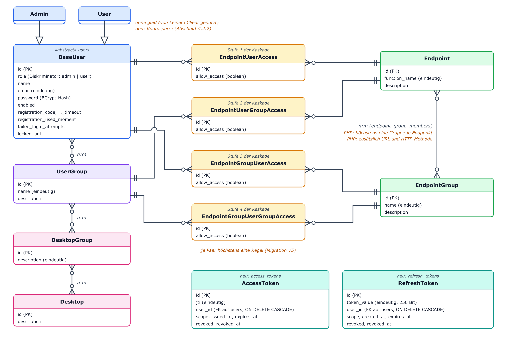
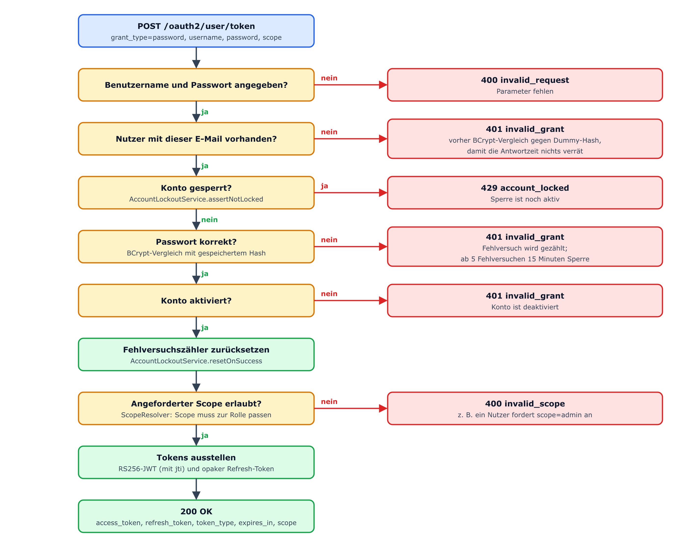
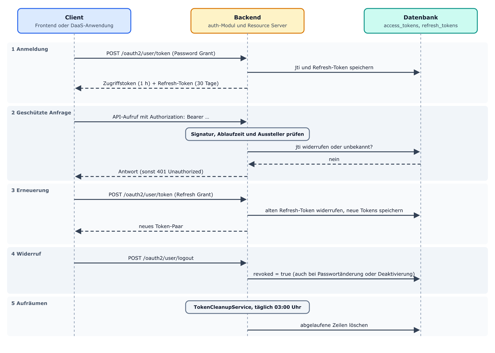
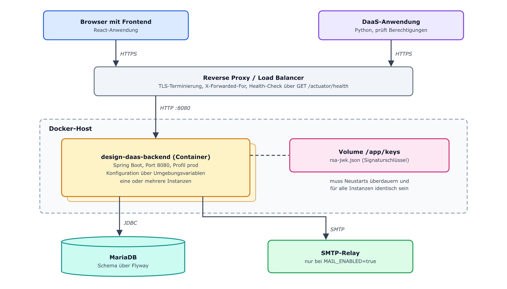
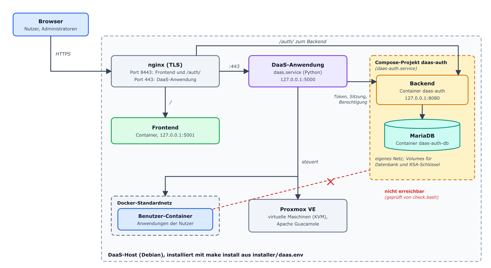

# 4 Realisierung

Dieses Kapitel beschreibt, wie die funktionalen (FA) und nicht-funktionalen
Anforderungen (NFA) aus Kapitel 3 im neuen Backend *design-daas-backend-java*
umgesetzt wurden. Es beginnt mit den Architekturentscheidungen, die für alle
Module gelten (4.1). Danach folgen die vier fachlichen Module *auth*,
*permission*, *user* und *desktop* (4.2 bis 4.5) und die übergreifenden Themen,
die sie verbinden (4.6). Den Abschluss bilden der Demonstrator einschließlich
der Einbindung in die DaaS-Anwendung (4.7), die Tests (4.8) und die
Dokumentation (4.9). Alle Codeausschnitte stammen aus dem Repository
*design-daas-backend-java* in Version 2.0.0 (Stand: 11.11.2026) und sind
teilweise gekürzt. Vergleiche mit dem alten Backend beziehen sich auf
*design-daas-application-backend*.

## 4.1 Architekturentscheidungen

Bevor die einzelnen Module beschrieben werden, klärt dieser Abschnitt die
Entscheidungen, die allen Modulen zugrunde liegen: wie der Quellcode gegliedert
ist (4.1.2), wie diese Gliederung automatisch durchgesetzt wird (4.1.3), wie die
Authentifizierung aufgebaut ist (4.1.4) und wie Datenmodell und Datenbankschema
aussehen und verwaltet werden (4.1.5). Abschnitt 4.1.6 fasst die Entscheidungen
in einer Tabelle zusammen und ordnet sie den Anforderungen aus Kapitel 3 zu.

### 4.1.1 Ausgangslage und Entscheidungsrahmen

Die Anforderungen aus Kapitel 3 verlangen zweierlei. Erstens muss sich das neue
Backend nach außen so verhalten wie das alte (NFA-2, NFA-3), weil Frontend und
DaaS-Anwendung nicht Gegenstand dieser Arbeit sind und ohne fachliche Änderungen
weiterlaufen sollen. Zweitens soll es die Mängel des alten Backends beheben, vor
allem die schlechte Wartbarkeit und die schlechte Dokumentation. Bei jeder der
folgenden Architekturentscheidungen wird deshalb begründet, welchem dieser
beiden Ziele sie dient.

### 4.1.2 Modulare Gliederung nach fachlicher Domäne

Das alte PHP-Backend ist bereits in fachliche Module gegliedert (Verzeichnisse
*src/Main*, *src/Util*, *src/OAuth2*, *src/User*, *src/Desktop* und
*src/Permissions*), jedes mit der inneren Schichtung *Model → Repository →
Service → Controller*. Das neue Backend übernimmt diese Gliederung, benennt die
Module aber um und fasst sie zu vier fachlichen Paketen zusammen, die den
Funktionsbereichen aus Abschnitt 3.2.1 entsprechen:

```text
de.frauas.design.backend
├── auth       (Token-Ausgabe/-Prüfung, Sessions, Lockout)
├── permission (Berechtigungskaskade)
├── user       (Nutzer, Admins, User-Groups, Registrierung)
├── desktop    (Desktops, Desktop-Groups)
├── bootstrap  (Start-Tasks, z. B. Default-Admin)
├── config     (Spring-Konfiguration)
└── shared     (DTOs, Exceptions, Security, Utils)
```

*Code 4.1: Paketstruktur der vier Fachmodule und des Querschnittscodes*

Jedes fachliche Paket ist intern gleich aufgebaut: *controller → service →
repository → model*, ergänzt um eigene Unterpakete für *dto* und *exception*.
Diese Struktur hat zwei Vorteile. Sie entspricht der bekannten Struktur des
PHP-Backends, sodass sich die Bedeutung der fachlichen Logik beim Portieren
nicht unbemerkt verschiebt. Zugleich ist sie im Java- und Spring-Umfeld üblich
und deshalb leicht nachzuvollziehen.

### 4.1.3 Automatisierte Durchsetzung der Architektur mit ArchUnit

Die größte Schwäche des alten Backends ist seine schlechte Wartbarkeit. Damit
die neue Architektur nicht nach und nach verwässert, zum Beispiel weil ein
Controller direkt ein Repository aufruft, steht die Schichtenregel als
ausführbarer Test im Code und läuft bei jedem Build:

```java
@ArchTest
static final ArchRule layerDependencies = layeredArchitecture()
    .consideringAllDependencies()
    .layer("Controllers").definedBy("de.frauas.design.backend..controller..")
    .layer("Services").definedBy("de.frauas.design.backend..service..")
    .layer("Repositories").definedBy("de.frauas.design.backend..repository..")
    .layer("Models").definedBy("de.frauas.design.backend..model..")
    .whereLayer("Controllers")
        .mayNotBeAccessedByAnyLayer()
    .whereLayer("Services")
        .mayOnlyBeAccessedByLayers("Controllers", "Config", "Services", "Bootstrap")
    .whereLayer("Repositories")
        .mayOnlyBeAccessedByLayers("Services", "Config", "Bootstrap")
    .whereLayer("Models")
        .mayOnlyBeAccessedByLayers("Services", "Repositories", "Config", "DTOs", "Bootstrap");
```

*Code 4.2: ArchUnit-Regel zur Schichtenarchitektur (gekürzt)*

Dieselbe Regel legt außerdem fest, dass Entitäten (*model*) nur aus Services,
Repositories, DTOs, der Konfiguration und dem Paket *bootstrap* verwendet
werden. Weitere Regeln in der Testklasse *ArchitectureTest* prüfen
Namenskonventionen: Klassen mit *@Service* müssen auf *Service* oder
*ServiceImpl* enden, Klassen mit *@Repository* auf *Repository*. Außerdem müssen
Services ihre Abhängigkeiten über den Konstruktor erhalten statt über Felder,
*java.util.logging* und *System.out* sind verboten, und das Paket *shared* darf
von keinem Fachmodul abhängen, damit keine zirkulären Abhängigkeiten entstehen.
Insgesamt umfasst *ArchitectureTest* 19 Regeln. Verstößt eine Änderung gegen
eine davon, schlägt *mvn test* fehl. Damit ist NFA-8 umgesetzt: Die Schichtung
wird bei jedem Build geprüft und nicht nur per Konvention eingehalten.

Auch das alte PHP-Backend nutzt schon ein vergleichbares Werkzeug. Die
Testklasse *BasicArchitectureTest.php* enthält fünf *PHPat*-Regeln. Sie schützen
den Namensraum *Application\Core* vor Zugriffen von außen, stellen sicher, dass
*Application\Migrations* und *Application\Test* nicht von anderen Namensräumen
verwendet werden, schirmen das Modul *Main* ab und beschränken das Modul *Util*
auf Composer-Bibliotheken. Architekturtests gab es also schon vorher.
Hinzugekommen ist die Prüfung der inneren Schichtung jedes Moduls, die im
PHP-Code nur per Konvention galt, und die Kopplung an eine feste
Mindest-Testabdeckung (Abschnitt 4.8.1).

### 4.1.4 Zustandslose Authentifizierung statt vollem Autorisierungsserver

Das alte Backend verwendet die Bibliothek *league/oauth2-server* mit dem
Password Grant und dem Refresh Token Grant. Für das neue Backend wurde geprüft,
ob sich ein vollständiger Autorisierungsserver mit
*spring-security-oauth2-authorization-server* lohnt. Benötigt werden aber nur
zwei Grant-Typen, *password* und *refresh_token*, und *POST /oauth2/user/token*
nimmt die Zugangsdaten direkt als Formularparameter entgegen, wie es der
bisherige Vertrag mit dem Frontend vorsieht. Deshalb fiel die Wahl auf eine
schlanke eigene Lösung: einen selbst geschriebenen Aussteller für RS256-JWTs
(*TokenIssuer*), dessen Token Spring Security als Resource Server prüft
(*JwtDecoder*). So entfällt der Konfigurationsaufwand eines vollständigen
Autorisierungsservers für einen Vertrag, der ohnehin nur zwei Grant-Typen kennt.
In Kauf genommen wird dabei, dass RFC 9700 vom Password Grant abrät (Abschnitt
2.2.1). Er bleibt nur deshalb erhalten, weil Frontend und DaaS-Anwendung ihn
verwenden (Abschnitt 5.4).

### 4.1.5 Datenmodell und Schemaverwaltung mit Flyway

Hibernate läuft im Modus **ddl-auto: validate** und erzeugt das Schema nie
selbst. Alle Änderungen am Schema laufen über versionierte Flyway-Migrationen
(*V1__init.sql* bis *V5__unique_permission_rules.sql*). Dadurch ist jede
Schemaänderung ausdrücklich im Code sichtbar und lässt sich prüfen. Zugleich
werden Überraschungen durch automatisch erzeugtes Schema vermieden, das in
Entwicklungs-, Test- und Produktivumgebung unterschiedlich ausfallen könnte. Das
dient der Wart- und Testbarkeit (NFA-8 und NFA-9). Flyway übernimmt dabei die
Aufgabe, die im alten Backend Doctrine Migrations erfüllt hat (Tabelle 3.1); es
wird also kein neues Konzept eingeführt, sondern ein vorhandenes gleichwertig
ersetzt.

Das Datenmodell lehnt sich eng an das des alten Backends an (Abbildung 3.2),
weicht aber an einigen Stellen bewusst ab (Abbildung 4.1). Endpunkte und
Endpunktgruppen stehen jetzt in einer n:m-Beziehung (Tabelle
*endpoint_group_members*). Ein Endpunkt kann also mehreren Gruppen angehören,
während er im PHP-Backend höchstens einer zugeordnet war. Endpunktgruppen
erhalten eine numerische ID und einen eindeutigen Namen, statt den Namen selbst
als Primärschlüssel zu verwenden. Endpunkte speichern neben dem eindeutigen
Funktionsnamen nur noch eine Beschreibung; URL und HTTP-Methode entfallen, weil
die DaaS-Anwendung Berechtigungen allein über den Funktionsnamen abfragt. In den
vier Regeltabellen ersetzt das boolesche Feld *allow_access* das Textfeld
*relation* mit den Werten *allow* und *deny*. Nutzergruppen haben zusätzlich
einen eindeutigen Namen. Bei den Nutzern entfällt die *guid*, die kein Client
verwendet; neu sind die Felder der Kontosperre (*failed_login_attempts*,
*locked_until*, Abschnitt 4.2.2). Hinzu kommen die Tabellen *access_tokens* und
*refresh_tokens*, über die sich Token widerrufen lassen (Abschnitt 4.2.3).



*Abbildung 4.1: Datenmodell des neuen Backends; Abweichungen vom PHP-Backend
sind orange markiert (eigene Darstellung)*

### 4.1.6 Zusammenfassung der Architekturentscheidungen

Tabelle 4.1 fasst die Entscheidungen aus den Abschnitten 4.1.2 bis 4.1.5
zusammen und ordnet jede einer Anforderung aus Kapitel 3 zu. Die Abschnitte 4.2
bis 4.6 zeigen, wie sie im Code umgesetzt sind.

*Tabelle 4.1: Zentrale Architekturentscheidungen und ihr Anforderungsbezug*

| **Entscheidung** | **Begründung** | **NFA** |
|---|---|---|
| Vier fachliche Module, intern einheitlich geschichtet | Struktur des alten Backends beibehalten, Portierungsrisiko senken | NFA-2, <br> NFA-3 |
| Schichtenregeln als ArchUnit-Build-Gate | Architektur nicht nur Konvention, sondern erzwungen | NFA-8 |
| Eigener RS256-JWT-Aussteller statt vollem Autorisierungsserver | Nur zwei Grant-Typen nötig, geringerer Konfigurationsaufwand | NFA-7 |
| Flyway statt Hibernate-Auto-DDL | Nachvollziehbare, reviewbare Schemaänderungen | NFA-8, <br> NFA-9 |
| Datenmodell mit Token-Tabellen und n:m-Endpunktgruppen | Widerruf von Token, flexiblere Pflege der Berechtigungen | NFA-6 |
| JaCoCo-Mindestabdeckung als Build-Gate | Testabdeckung ist kein optionales Ziel, sondern Build-Voraussetzung | NFA-9 |

## 4.2 Authentifizierung

Das Modul *auth* setzt die Anforderungen FA-1 bis FA-4 um: Anmeldung mit
Benutzername und Passwort (FA-1), Erneuerung von Token (FA-2), Abmeldung (FA-3)
und Abfrage der Sitzung (FA-4). Die folgenden Abschnitte folgen dem Weg einer
Anfrage. Sie beginnen bei der Unterscheidung der Grant-Typen (4.2.1) und führen
über die Passwortprüfung mit ihren Sicherheitsmaßnahmen (4.2.2), die Ausstellung
der Token (4.2.3) und ihre Erneuerung (4.2.4) bis zu Abmeldung und
Sitzungsabfrage (4.2.5). Zum Schluss werden die Ratenbegrenzung (4.2.6) und ihre
threadsichere Umsetzung (4.2.7) beschrieben.

### 4.2.1 Unterscheidung der Grant-Typen

*TokenController* nimmt Anfragen an *POST /oauth2/user/token* entgegen und
erzeugt daraus ein typisiertes *GrantRequest*, entweder ein
*PasswordGrantRequest* oder ein *RefreshGrantRequest*. Die eigentliche Logik
liegt in *TokenService.grantToken*, das mit einem *switch* über Pattern Matching
zur passenden Variante verzweigt:

```java
@Transactional(noRollbackFor = TokenGrantException.class)
public TokenResponseDto grantToken(GrantRequest request) {
    return switch (request) {
        case PasswordGrantRequest r
        -> passwordGrant(r.username(), r.password(), r.scope());
        case RefreshGrantRequest r
        -> refreshGrant(r.refreshToken());
    };
}
```

*Code 4.3: Grant-Dispatch in TokenService.grantToken*

Weil *GrantRequest* als *sealed interface* definiert ist, prüft der
Java-Compiler, ob dieses *switch* alle Fälle abdeckt. Käme ein dritter Grant-Typ
hinzu, ohne dass hier ein Fall ergänzt wird, ließe sich der Code nicht mehr
übersetzen. Ein eigener Test für diesen Fall ist damit überflüssig. An dieser
Stelle trägt ein Sprachmittel von Java 21 unmittelbar zur Wartbarkeit bei. Der Token-Endpunkt akzeptiert, wie in
RFC 6749 vorgesehen, nur formularkodierte Parameter
(*application/x-www-form-urlencoded*). Anfragen mit einem JSON-Rumpf lehnt er
mit dem Statuscode 415 ab.

### 4.2.2 Password Grant: Ablauf und Sicherheitsmaßnahmen

*TokenService.passwordGrant* setzt mehrere Sicherheitsmaßnahmen um, die über die
OAuth2-Spezifikation hinausgehen. Zuerst wird geprüft, ob es überhaupt einen
Nutzer mit dem angegebenen Benutzernamen gibt:

```java
var userOpt = userRepository.findByEmail(username);

if (userOpt.isEmpty()) {
    // always run BCrypt to prevent timing-based user enumeration
    passwordEncoder.matches(password, dummyHash());
    log.warn("passwordGrant — unknown user={}", LogMasking.maskEmail(username));
    throw new InvalidCredentialsException();
}
```

*Code 4.4: Schutz vor zeitbasierter Benutzer-Enumeration*

Ist der Benutzername unbekannt, wird trotzdem ein BCrypt-Vergleich ausgeführt,
und zwar gegen einen Dummy-Hash. Dieser wird beim Start mit demselben
PasswordEncoder und damit mit demselben Kostenfaktor erzeugt wie echte
Passwort-Hashes. Ohne diesen Schritt würde eine Anfrage mit unbekanntem
Benutzernamen messbar schneller scheitern als eine mit bekanntem Benutzernamen
und falschem Passwort, denn BCrypt ist absichtlich langsam. Ein Angreifer könnte
so über die Antwortzeit herausfinden, welche Benutzernamen existieren. Im alten
Backend fehlt dieser Schutz:
*OAuth2UserRepository::getUserEntityByUserCredentials()* kehrt bei einer
unbekannten E-Mail-Adresse sofort zurück, ohne einen Hash zu berechnen. Eine
Kontosperre oder eine Ratenbegrenzung gab es dort ebenfalls nicht (NFA-4,
NFA-5).

Danach prüft *AccountLockoutService.assertNotLocked*, ob das Konto gerade
gesperrt ist, noch bevor das Passwort verglichen wird. Ist das Passwort falsch,
zählt *AccountLockoutService.recordFailedAttempt* den Fehlversuch. Nach fünf
Fehlversuchen in Folge wird das Konto für 15 Minuten gesperrt:

```java
private static final int MAX_FAILED_ATTEMPTS = 5;
private static final Duration LOCKOUT_DURATION = Duration.ofMinutes(15);

public void recordFailedAttempt(BaseUser user) {
    int attempts = user.getFailedLoginAttempts() + 1;
    user.setFailedLoginAttempts(attempts);
    if (attempts >= MAX_FAILED_ATTEMPTS) {
        user.setLockedUntil(Instant.now(clock).plus(LOCKOUT_DURATION));
    }
    userRepository.save(user);
}
```

*Code 4.5: Zählung von Fehlversuchen und Kontosperrung*

Eine Besonderheit ist im Javadoc der Klasse dokumentiert: Der Zähler für
Fehlversuche wird nur bei einer erfolgreichen Anmeldung zurückgesetzt
(*resetOnSuccess*), nicht automatisch nach Ablauf der Sperre. Läuft die Sperre
ab und schlägt der nächste Versuch wieder fehl, wird das Konto sofort erneut für
die volle Dauer gesperrt, weil der Zähler nie heruntergezählt wurde. Dieses
Verhalten ist absichtlich streng gewählt. Welche Folgen es im Betrieb hat,
beschreibt Abschnitt 4.8.4 als bekannte Einschränkung.

Sind Sperre und Passwort in Ordnung, wird geprüft, ob das Konto aktiviert ist.
Anschließend gleicht *ScopeResolver.resolveAuthorizedScope* den angeforderten
Scope mit der Rolle des Nutzers ab. Fordert ein normaler Nutzer etwa
*scope=admin* an, lehnt der Server die Anfrage mit dem Fehler *invalid_scope*
ab, statt ihm Administratorrechte zu geben. Erst danach wird ein Token
ausgestellt. Abbildung 4.2 fasst alle Prüfschritte und ihre Abbruchpfade
zusammen.



*Abbildung 4.2: Prüfschritte beim Password Grant mit Abbruchpfaden (eigene
Darstellung)*

### 4.2.3 Tokenausstellung: RS256-JWT und opaker Refresh-Token

*TokenIssuer.issueAccessToken* erzeugt ein RS256-signiertes JWT mit einer
eindeutigen **jti** (JWT-ID) und speichert diese *jti* zusätzlich in der Tabelle
*access_tokens*:

```java
JwtClaimsSet claims = JwtClaimsSet.builder()
        .id(jti)
        .issuer(issuer)
        .subject(String.valueOf(user.getId()))
        .issuedAt(now)
        .expiresAt(now.plusSeconds(accessTokenTtlSeconds))
        .claim("email", user.getEmail())
        .claim("name", user.getName())
        .claim("scope", scope)
        .build();

JwsHeader header = JwsHeader.with(SignatureAlgorithm.RS256).build();
String tokenValue = jwtEncoder.encode(JwtEncoderParameters.from(header, claims)).getTokenValue();
```

*Code 4.6: Aufbau und Signatur des Zugriffstokens*

Dass **RS256** statt HS256 verwendet wird, hat einen praktischen Vorteil
(Abschnitt 2.2.3): Der öffentliche Schlüssel kann weitergegeben werden, ohne das
Geheimnis zum Signieren preiszugeben. Das ist wichtig, falls künftig ein anderer
Dienst Token nur prüfen, aber nicht ausstellen soll. Das Schlüsselpaar wird beim
ersten Start erzeugt und im Verzeichnis *OAUTH_KEYS_DIR* gespeichert. Geht diese
Schlüsseldatei verloren, werden alle zuvor ausgestellten Token ungültig.
Zugriffstoken gelten standardmäßig 3600 Sekunden, Refresh-Token 30 Tage; beide
Werte lassen sich über Umgebungsvariablen ändern.

Da JWTs an sich zustandslos sind und sich auf dem Server nicht widerrufen
lassen, speichert das Backend jede ausgestellte *jti* zusätzlich mit einem
*revoked*-Flag in der Tabelle *access_tokens*. Das ist ein Kompromiss zwischen
Zustandslosigkeit (NFA-7) und Widerrufbarkeit (NFA-6). Das Refresh-Token ist
dagegen kein JWT, sondern eine zufällige Zeichenkette aus 256 Bit in
Hexadezimaldarstellung (*SecureRandom*). Es dient nur als Schlüssel in der
Datenbank und muss selbst keine Angaben transportieren:

```java
private static final SecureRandom SECURE_RANDOM = new SecureRandom();
...
byte[] bytes = new byte[32];
SECURE_RANDOM.nextBytes(bytes);
String tokenValue = HexFormat.of().formatHex(bytes);
```

*Code 4.7: Erzeugung des opaken Refresh-Tokens*

### 4.2.4 Refresh-Token-Rotation

Beim Refresh Grant wird nicht einfach ein neues Zugriffstoken zum bestehenden
Refresh-Token ausgestellt. Stattdessen entsteht bei jeder Erneuerung auch ein
neues Refresh-Token, und das alte wird widerrufen. Dieses Verfahren heißt
Token-Rotation (*TokenService.refreshGrant*):

```java
String newAccessToken = tokenIssuer.issueAccessToken(user, grantedScope);
String newRefreshToken = tokenIssuer.createRefreshToken(user, grantedScope);

refreshTokenEntity.revoke();
refreshTokenRepository.save(refreshTokenEntity);
```

*Code 4.8: Refresh-Token-Rotation in TokenService.refreshGrant*

Das begrenzt den Schaden, falls ein Refresh-Token abgefangen wird, denn jedes
Refresh-Token lässt sich nur einmal einlösen. Ein bereits verwendetes Token wird
abgelehnt, weil es in der Datenbank als widerrufen markiert ist. Nicht umgesetzt
ist dagegen, was RFC 9700 zusätzlich empfiehlt: bei einer erkannten
Wiederverwendung alle Token zu widerrufen, die aus derselben Anmeldung
hervorgegangen sind (Lodderstedt et al., 2025; Abschnitt 5.5). Außerdem prüft
*refreshGrant* vor jeder Erneuerung, ob der Nutzer noch existiert und aktiviert
ist (*userOpt.get().isEnabled()*). Ist das nicht der Fall, wird das
Refresh-Token gelöscht und die Erneuerung abgelehnt. Ein deaktiviertes Konto
erhält so kein neues Zugriffstoken mehr, auch wenn ein früher ausgestelltes
Refresh-Token formal noch gültig wäre. Das bereits ausgestellte Zugriffstoken
bleibt allerdings bis zu seinem Ablauf gültig.

### 4.2.5 Abmeldung und Abfrage der Sitzung

*POST /oauth2/user/logout* ruft *TokenRevocationService.logout* auf. Diese
Methode markiert die *jti* des aktuellen Zugriffstokens und, falls mitgeschickt,
auch das Refresh-Token als widerrufen (FA-3). Im alten PHP-Backend gibt es dafür
kein Gegenstück (Abschnitt 3.2.2). Dort speicherte *league/oauth2-server* die
Token zwar ebenfalls mit einem Widerrufszeitpunkt, nutzte ihn aber nur beim
Einlösen eines Refresh-Tokens. Weil das neue Backend die Token selbst ausstellt
(Abschnitt 4.2.3), musste der Widerruf über die *jti* und damit auch die
Abmeldung neu entworfen werden.

Über *GET /oauth2/user/session* kann das Frontend prüfen, ob ein Nutzer
angemeldet ist, ohne das Token selbst auswerten zu müssen. Dazu liest
*JwtUserResolver* die Nutzer-ID aus dem bereits geprüften JWT (FA-4). Die
Antwort enthält neben Nutzer-ID und Name auch die aktuelle Rolle des Nutzers.
Sie wird bei jeder Abfrage aus der Datenbank gelesen, sodass eine geänderte
Rolle sofort auch für bereits ausgestellte Token gilt. Die DaaS-Anwendung nutzt
denselben Endpunkt, um das Bearer-Token eines Nutzers zu prüfen.

Abbildung 4.3 zeigt den gesamten Lebenszyklus der Token: Ausstellung, Prüfung
bei jeder Anfrage, Erneuerung mit Rotation, Widerruf und schließlich das
zeitgesteuerte Löschen nicht mehr benötigter Einträge (Abschnitt 4.6.6).



*Abbildung 4.3: Lebenszyklus von Zugriffs- und Refresh-Token (eigene
Darstellung)*

### 4.2.6 Ratenbegrenzung sensibler Endpunkte

Zusätzlich zur Kontosperre begrenzt der *RateLimitingFilter*, wie viele Anfragen
eine Client-IP an */oauth2/user/token*, */user* (Registrierung),
*/user/validate_email* und */user/resend_code* stellen darf (NFA-5). Der Filter
ist mit *@Order(-200)* so eingeordnet, dass er vor der Filterkette von Spring
Security (*-100*) läuft. Der Filter greift nur bei POST-Anfragen an diese Pfade.
Zu viele Anfragen weist er ab, bevor überhaupt Authentifizierungslogik
ausgeführt wird:

```java
@Component
@Order(-200)
public class RateLimitingFilter extends OncePerRequestFilter {

    @Override
    protected void doFilterInternal(HttpServletRequest request, HttpServletResponse response, FilterChain filterChain) throws ServletException, IOException {
        String path = request.getServletPath();
        String clientIp = clientIpResolver.resolve(request);
        int limit = limitFor(path);

        if (rateLimiter.tryConsume(clientIp, path, limit)) {
            filterChain.doFilter(request, response);
            return;
        }
        response.setStatus(429);
        response.setHeader("Retry-After", "60");
        // ... JSON error body
    }
}
```

*Code 4.9: RateLimitingFilter (gekürzt)*

Die Client-IP ermittelt der *ClientIpResolver*. Den Header *X-Forwarded-For*
wertet er nur aus, wenn die Anfrage von einem als vertrauenswürdig eingetragenen
Proxy stammt (*RATE_LIMIT_TRUSTED_PROXIES*). Sonst könnte ein Angreifer die
Ratenbegrenzung umgehen, indem er diesen Header fälscht. Die vier Limits für
*auth-token*, *register*, *validate-email* und *resend-code* lassen sich
getrennt einstellen; voreingestellt sind 20, 5, 10 und 3 Anfragen pro Minute
(*application.yml*). Die Werte unterscheiden sich, weil auch die
Missbrauchsszenarien verschieden sind: Die Anmeldung wird im Alltag viel
häufiger aufgerufen als das Anfordern eines neuen Bestätigungscodes.

### 4.2.7 Threadsichere Zählung im Token-Bucket

Gezählt wird je Client-IP und Pfad in der Klasse *TokenBucket*. *RateLimiter*
hält für jede Kombination aus IP-Adresse und Pfad genau einen solchen Eimer in
einer *ConcurrentHashMap*. Ein Eimer startet mit so vielen Token, wie Anfragen
pro Minute erlaubt sind, und füllt sich gleichmäßig wieder auf. Jede Anfrage
verbraucht ein Token; ist keines mehr übrig, wird sie abgewiesen:

```java
synchronized boolean tryConsume() {
    refill();
    if (tokens < 1) {
        return false;
    }
    tokens -= 1;
    return true;
}

private void refill() {
    long now = clock.getAsLong();
    long elapsed = Math.max(0, now - lastRefillMillis);
    tokens = Math.min(capacity, tokens + elapsed * refillTokensPerMillisecond);
    lastRefillMillis = now;
}
```

*Code 4.10: Verbrauch und Auffüllen in TokenBucket (gekürzt)*

Da vom selben Client mehrere Anfragen gleichzeitig eintreffen können, ist
*tryConsume* mit *synchronized* geschützt. Die Sperre gilt nur für diesen einen
Eimer, also für eine Kombination aus IP-Adresse und Pfad, und hält keine anderen
Clients auf. Bei den geringen Anfrageraten der vier begrenzten Endpunkte fällt
sie nicht ins Gewicht. Der Token-Bestand ist eine Gleitkommazahl, sodass
angefangene Token beim Auffüllen erhalten bleiben und die eingestellte Rate
genau eingehalten wird.

Eine frühere Fassung der Klasse kam ohne Sperre aus. Sie packte den Zeitpunkt
der letzten Auffüllung und die Zahl der Token in einen einzigen *long*-Wert und
aktualisierte ihn mit *AtomicLong.compareAndSet*. Dabei wurde der Zeitpunkt auf
ganze Sekunden gerundet, und angefangene Token gingen verloren, sodass sich der
Eimer bei gleichmäßigem Verkehr langsamer füllte als eingestellt. Die einfachere
Fassung mit *synchronized* hat diese Abweichung beseitigt; *TokenBucketTest*
prüft seither ausdrücklich, dass angefangene Token erhalten bleiben. Damit die
Tabelle der Eimer nicht mit jedem Client wächst, der je einen der Endpunkte
aufgerufen hat, entfernt *RateLimiter* alle fünf Minuten die Eimer, die wieder
vollständig aufgefüllt sind; sie verhalten sich genau wie neue. Die Zähler
liegen allerdings im Arbeitsspeicher der jeweiligen Instanz. Laufen mehrere
Instanzen, gelten die Limits deshalb je Instanz (Abschnitt 5.4).

## 4.3 Autorisierung mit der Berechtigungskaskade

Abschnitt 4.2 klärt, wer ein Nutzer ist. Das Modul *permission* entscheidet, was
dieser Nutzer tun darf. Es setzt FA-13 um, die Berechtigungsprüfung für jede
Funktion der DaaS-Anwendung, und ist damit der sicherheitskritischste Teil des
Backends: Ist die Endpunktprüfung eingeschaltet, fragt die DaaS-Anwendung diese
Entscheidung vor jedem Funktionsaufruf ab (Abschnitt 4.7.3). Die folgenden
Abschnitte beschreiben zunächst, wie die Kaskade portiert wurde (4.3.1). Danach
geht es um zwei Fragen, die im alten Code nicht geklärt waren: widersprüchliche
Regeln innerhalb einer Stufe (4.3.2) und fehlerhafte Eingaben (4.3.3). Abschnitt
4.3.4 beschreibt eine Optimierung, Abschnitt 4.3.5 die Tests der Kaskade. Die
Abschnitte 4.3.6 und 4.3.7 behandeln schließlich die Sonderstellung von
Administratoren und die Pflege der Berechtigungsregeln über die
HTTP-Schnittstelle.

Gemessen an den Modellen aus Abschnitt 2.3 verbindet das Backend zwei Ebenen.
Die grobe Ebene ist ein einfaches rollenbasiertes Modell im Sinne von Flat RBAC.
Jeder Nutzer hat genau eine der Rollen *user* oder *admin*; sie steht als Scope
im Token und wird von Spring Security geprüft. Die feine Ebene ist die
vierstufige Kaskade. Ihre Regeln erlauben oder verweigern einzelnen Nutzern oder
Nutzergruppen den Zugriff auf einzelne Funktionen oder Gruppen von Funktionen.
Sie ähnelt damit Zugriffskontrolllisten, deren Einträge sich auf Nutzergruppen
als rollenähnliche Bündel beziehen. Attributbasierte Regeln im Sinne von ABAC,
etwa abhängig von Uhrzeit oder Netzwerk, gibt es nicht. In den Begriffen des
XACML-Modells ist der *PermissionService* der Policy Decision Point.
Durchgesetzt wird die Entscheidung von der DaaS-Anwendung als Policy Enforcement
Point, denn sie führt eine Aktion nur aus, wenn der Zugriff erlaubt ist.

### 4.3.1 Portierung der PHP-Logik

Das alte Backend entscheidet in *PermissionCalculationService::getPermission()*
anhand einer vierstufigen Rangfolge. Im PHP-Code
(*PermissionCalculationService.php*) erscheinen die vier Stufen als Folge früher
Rückgaben. Zuerst wird eine direkte Regel für Nutzer und Endpunkt gesucht,
danach in einer Schleife über alle Gruppen des Nutzers eine Regel für Gruppe und
Endpunkt. Es folgt eine Regel für Nutzer und Endpunktgruppe und zuletzt, wieder
in einer Schleife über die Gruppen, eine Regel für Gruppe und Endpunktgruppe.
Greift keine Regel, gilt **AccessEnum::DENY**. Diese Reihenfolge musste exakt
erhalten bleiben, weil die DaaS-Anwendung ihre Berechtigungsabfragen unverändert
an das neue Backend stellt (NFA-2, NFA-3). Die neue Methode
*PermissionService.checkPermission* bildet die vier Stufen genau nach, verwendet
aber *Optional#or* statt verschachtelter *foreach*-Schleifen:

```java
Optional<Boolean> allow = checkDirectUserRule(userId, functionName)
        .or(() -> checkUserGroupRule(groupIdsSupplier.get(), functionName))
        .or(() -> checkUserEndpointGroupRule(userId, functionName))
        .or(() -> checkUserGroupEndpointGroupRule(groupIdsSupplier.get(), functionName));

if (allow.isEmpty()) {
    return PermissionResultDto.deny(userId, userName);
}
```

*Code 4.11: Vierstufige Berechtigungskaskade in
PermissionService.checkPermission*

Die Verkettung mit *Optional#or* bildet die Kaskade direkt im Code ab. Jede
Stufe liefert entweder ein Ergebnis, dann endet die Kette, oder
*Optional.empty()*, dann kommt die nächste Stufe an die Reihe. Liefert keine
Stufe ein Ergebnis, wird der Zugriff verweigert (fail-closed, NFA-1). Die vier
Stufen entsprechen den vier Zuordnungsentitäten *EndpointUserAccess*,
*EndpointUserGroupAccess*, *EndpointGroupUserAccess* und
*EndpointGroupUserGroupAccess* aus Abbildung 3.2, die im neuen Backend unter
denselben Namen als JPA-Entitäten existieren. Weil ein Endpunkt im neuen
Datenmodell mehreren Endpunktgruppen angehören kann (Abschnitt 4.1.5),
berücksichtigen die Stufen 3 und 4 alle Gruppen, denen der aufgerufene Endpunkt
angehört.

### 4.3.2 Konfliktauflösung innerhalb einer Stufe

Im alten Code ungeklärt ist die Frage, was geschieht, wenn innerhalb einer Stufe
mehrere Regeln zugleich zutreffen, etwa weil ein Nutzer zwei Gruppen mit
widersprüchlichen Regeln für dieselbe Funktion angehört. Die neue
Implementierung entscheidet diesen Fall eindeutig mit *allMatch*: Ein einziges
ausdrückliches *deny* wiegt schwerer als beliebig viele *allow*-Einträge.

```java
private <T> Optional<Boolean> resolveStepDecision(
        List<T> matches, Function<T, Boolean> allowExtractor, String stepName, String principalDescription) {
    if (matches.isEmpty()) {
        return Optional.empty();
    }
    boolean allow = matches.stream().map(allowExtractor).allMatch(Boolean::booleanValue);
    if (matches.size() > 1) {
        log.warn("checkPermission — {} matched {} rules for {}, resolving result={} (explicit deny wins)",
                stepName, matches.size(), principalDescription, allow ? "allow" : "deny");
    }
    return Optional.of(allow);
}
```

*Code 4.12: Konfliktauflösung innerhalb einer Kaskadenstufe*

Diese Regel, nach der eine ausdrückliche Verweigerung immer gewinnt, ist eine
Neuerung gegenüber dem alten Verhalten und im Javadoc der Klasse dokumentiert.
Im PHP-Original (*PermissionCalculationService::getPermission*) durchläuft eine
*foreach*-Schleife die Gruppen des Nutzers und gibt beim ersten Treffer sofort
zurück (*return $endpointUserGroupAccess->relation();*). Gehört ein Nutzer zwei
Gruppen mit widersprüchlichen Regeln an, hängt das Ergebnis dort also von der
Reihenfolge ab, in der die Gruppen geliefert werden, und diese ist nirgends
festgelegt. Das neue Backend ersetzt dieses zufällige Verhalten durch eine
eindeutige Regel, die im Zweifel zugunsten der Sicherheit entscheidet. So kann
eine großzügige Gruppenregel keine Sperre aushebeln, die an anderer Stelle
absichtlich gesetzt wurde. Die Abweichung vom PHP-Verhalten wurde bei der
Analyse in AP2 erkannt und hier ausdrücklich festgelegt. Ein *log.warn*-Aufruf
bei mehrdeutigen Treffern macht solche Fälle im Betrieb sichtbar, ohne die
Entscheidung zu verändern.

### 4.3.3 Fail-closed bei fehlerhafter Eingabe

Unbekannte Nutzer-IDs, *null*-Werte und leere Funktionsnamen werden abgefangen,
bevor die Datenbank überhaupt befragt wird, und führen direkt zu *deny*:

```java
if (userId == null || functionName == null || functionName.isBlank()) {
    return PermissionResultDto.deny(userId != null ? userId : UNRESOLVED_USER_ID, UNKNOWN_USER_NAME);
}

Optional<BaseUser> user = userRepository.findById(userId);
if (user.isEmpty()) {
    return PermissionResultDto.deny(userId, UNKNOWN_USER_NAME);
}
```

*Code 4.13: Fail-closed-Behandlung ungültiger Eingaben*

Das spart Datenbankzugriffe bei offensichtlich ungültigen Anfragen. Vor allem
aber stellt es sicher, dass ein Fehler beim Aufrufer, etwa eine vergessene
Nutzer-ID, nie versehentlich zu einem *allow* führt. Die Methode prüft in zwei
Schritten: zuerst, ob die Eingabe formal gültig ist, und erst danach, ob der
Nutzer existiert. Beide Fälle enden mit *deny*, werden aber unterschiedlich
protokolliert, mit *warn* beziehungsweise *info*. Ein unbekannter Nutzer kommt
im normalen Betrieb eher vor als eine formal ungültige Anfrage.

An dieser Stelle weicht das neue Backend im Statuscode vom alten ab. Das
PHP-Backend beantwortet einen unbekannten Nutzer oder Funktionsnamen mit 400
(Abschnitt 3.1.2.5), das neue liefert in beiden Fällen 200 mit dem Ergebnis
*deny*. Für die DaaS-Anwendung ändert das nichts, weil ihr Adapter nur eine
Antwort mit dem Ergebnis *allow* als Freigabe wertet.

### 4.3.4 Caching der Gruppenzugehörigkeit innerhalb einer Prüfung

Die Stufen 2 und 4 benötigen beide die Gruppen des Nutzers. Diese werden deshalb
erst geladen, wenn sie gebraucht werden, und höchstens einmal je Anfrage
(*Supplier* mit internem Zwischenspeicher). Entscheidet bereits Stufe 1,
entfällt die Datenbankabfrage ganz:

```java
Supplier<List<Integer>> groupIdsSupplier = new Supplier<>() {
    private List<Integer> cachedGroupIds;

    public List<Integer> get() {
        if (cachedGroupIds == null) {
            cachedGroupIds = userRepository.findGroupIdsByUserId(userId);
        }
        return cachedGroupIds;
    }
};
```

*Code 4.14: Bedarfsgesteuertes Laden der Gruppenzugehörigkeit*

### 4.3.5 Testbarkeit der Kaskade

Weil die Berechtigungskaskade der sicherheitskritischste Teil des Backends ist
und über jeden Funktionsaufruf der DaaS-Anwendung entscheidet (NFA-1, NFA-2),
ist sie auch am gründlichsten getestet. *PermissionServiceTest* prüft jede der
vier Stufen einzeln, den Fall ohne passende Regel, die Konfliktauflösung bei
mehreren Treffern in einer Stufe (Abschnitt 4.3.2) und die Sonderfälle aus
Abschnitt 4.3.3, also fehlende Nutzer-ID, leeren Funktionsnamen und unbekannten
Nutzer. *PermissionControllerIntegrationTest* ergänzt Tests gegen den echten
HTTP-Endpunkt mit vollständigem Spring-Kontext (Abschnitt 4.8.2).

### 4.3.6 Administratoren außerhalb der Kaskade

Eine bewusste Abweichung vom PHP-Original betrifft Administratoren. Im alten
*PermissionCalculationService* durchliefen auch sie die Kaskade. Waren für eine
Funktion keine Regeln hinterlegt, wurde ihnen der Zugriff also ebenso verweigert
wie normalen Nutzern. Nur bei der Prüfung des Desktop-Zugriffs
(*hasAccessToDesktop*, Abschnitt 3.1.2.5) ließ schon das alte Backend
Administratoren immer zu. Im neuen Backend erhalten Administratoren dagegen vor
der ersten Stufe ein *allow*:

```java
if (user.get() instanceof Admin) {
    log.info("checkPermission — userId={} is an admin, allowing fn={}", userId, functionName);
    return PermissionResultDto.allow(userId, userName);
}
```

*Code 4.15: Administratoren werden vor der Kaskade zugelassen*

Der Grund liegt im Betrieb der DaaS-Anwendung. Sie prüft Berechtigungen nur,
wenn die Option *DAAS_AUTH_CHECK_ENDPOINTS* aktiviert ist (Abschnitt 4.7.3). Bei
einer frisch installierten Umgebung ist die Regeltabelle leer. Würde man die
Prüfung einschalten, bevor Regeln angelegt sind, wären ohne diese Ausnahme auch
alle Administratoren ausgesperrt, und niemand könnte die fehlenden Regeln über
die Oberfläche nachtragen. Der fail-closed-Grundsatz (NFA-1) bleibt für alle
übrigen Konten unverändert. Die Ausnahme ist im Javadoc von *PermissionService*
dokumentiert und durch *PermissionServiceTest* abgesichert. Sie erweitert NFA-2
um eine vorgeschaltete Regel, ändert aber weder die Reihenfolge der vier Stufen
noch das Standardergebnis für normale Nutzer.

### 4.3.7 Pflege der Berechtigungsdaten über die Schnittstelle

Im alten Backend wurden die Stammdaten der Endpunkte über den
Kommandozeilenbefehl *permissions:import* eingelesen, und nur die Zuordnungen
von Nutzergruppen zu Endpunktgruppen ließen sich über HTTP ändern (Abschnitt
3.1.2.6). Im neuen Backend stellt *PermissionManagementController* eine
vollständige, nur für Administratoren zugängliche Verwaltungsschnittstelle
bereit: Endpunkte (*GET /endpoints*, *POST /endpoint*, *DELETE /endpoint/{id}*),
Endpunktgruppen (*GET /endpoint_groups*, *POST /endpoint_group*, *PATCH
/endpoint_group/{id}*, *DELETE /endpoint_group/{id}*) und die Regeln selbst
(*GET /permission_rules*, *POST /permission_rule*, *DELETE
/permission_rule/{kind}/{id}*). Die vier Arten von Regeln unterscheidet die
Aufzählung *PermissionRuleKind*, deren Werte in derselben Reihenfolge stehen, in
der *PermissionService* die Stufen prüft:

```java
public enum PermissionRuleKind {
    /** Step 1: user → endpoint. */
    USER_ENDPOINT,
    /** Step 2: user group → endpoint. */
    USER_GROUP_ENDPOINT,
    /** Step 3: user → endpoint group. */
    USER_ENDPOINT_GROUP,
    /** Step 4: user group → endpoint group. */
    USER_GROUP_ENDPOINT_GROUP;
}
```

*Code 4.16: Die vier Arten von Berechtigungsregeln (gekürzt)*

Die Logik liegt in *PermissionManagementService*. Wird ein Endpunkt oder eine
Endpunktgruppe gelöscht, entfernt der Service zuerst alle Regeln und
Gruppenzuordnungen, die darauf verweisen. Das Ergebnis ist damit auf MariaDB,
die solche Einträge ohnehin über Fremdschlüssel mit *ON DELETE CASCADE* löschen
würde, dasselbe wie auf der Testdatenbank H2. Doppelte Regeln lehnt die
Schnittstelle mit einer eigenen Exception ab
(*PermissionRuleAlreadyExistsException*). Zusätzlich verbietet die Migration
*V5__unique_permission_rules.sql* sie in der Datenbank selbst, indem sie für
jede der vier Regeltabellen eine Eindeutigkeitsbedingung über Subjekt und Ziel
anlegt. Damit stellt V5 eine Eigenschaft wieder her, die das PHP-Schema bereits
hatte (Abschnitt 3.1.2.4), dem ersten Schema des neuen Backends aber fehlte.
Bereits vorhandene Duplikate entfernt die Migration vorher so, dass das Ergebnis
der Kaskade gleich bleibt: Ein *deny* wird vor einem *allow* behalten, sonst der
älteste Eintrag. In Stufe 1 kann es damit keinen Konflikt mehr geben. In den
Stufen 2 bis 4 bleibt die Konfliktregel aus Abschnitt 4.3.2 nötig, weil ein
Nutzer mehreren Gruppen und ein Endpunkt mehreren Endpunktgruppen angehören
kann.

## 4.4 Benutzerverwaltung

Das Modul *user* setzt FA-5 bis FA-9 um: die Registrierung mit Bestätigung der
E-Mail-Adresse (FA-5), die Verwaltung von Nutzern (FA-6) und Administratoren
(FA-7) durch Administratoren, die Nutzergruppen (FA-8) und die Anfrage zur
Freischaltung von Anwendungen (FA-9). Die Abschnitte 4.4.1 und 4.4.2 folgen dem
Lebenszyklus eines Kontos von der Registrierung bis zur Verwaltung. Abschnitt
4.4.3 zeigt, wie Nutzergruppen die Module *permission* und *desktop* verbinden.
Die Abschnitte 4.4.4 und 4.4.5 beschreiben zwei weitere Funktionen des Moduls.

### 4.4.1 Registrierung mit E-Mail-Verifikation

*UserService.createUser* legt einen Nutzer zunächst deaktiviert an, erzeugt
einen achtstelligen hexadezimalen Registrierungscode, der 24 Stunden gilt, und
verschickt ihn per E-Mail:

```java
private static final String REGISTRATION_CODE_CHARS = "ABCDEF0123456789";
private static final int REGISTRATION_CODE_LENGTH = 8;

private String generateRegistrationCode() {
    StringBuilder sb = new StringBuilder(REGISTRATION_CODE_LENGTH);
    for (int i = 0; i < REGISTRATION_CODE_LENGTH; i++) {
        sb.append(REGISTRATION_CODE_CHARS.charAt(SECURE_RANDOM.nextInt(REGISTRATION_CODE_CHARS.length())));
    }
    return sb.toString();
}

```

*Code 4.17: Erzeugung des Registrierungscodes*

Die E-Mail wird erst nach dem Commit der Datenbanktransaktion versendet, nicht
innerhalb der Transaktion. Dafür gibt es die kleine Hilfsklasse *AfterCommit* im
Paket *shared.util*, die alle Services gemeinsam nutzen:

```java
public static void run(Runnable action) {
    if (TransactionSynchronizationManager.isSynchronizationActive()) {
        TransactionSynchronizationManager.registerSynchronization(new TransactionSynchronization() {
            @Override
            public void afterCommit() {
                action.run();
            }
        });
    } else {
        action.run();
    }
}
```

*Code 4.18: E-Mail-Versand nach erfolgreichem Commit (AfterCommit.run)*

Das hat zwei Gründe. Ein langsamer SMTP-Server hält so keine
Datenbanktransaktion und deren Sperren unnötig lange offen. Außerdem wird keine
E-Mail verschickt, wenn die Transaktion am Ende scheitert und zurückgerollt
wird; sonst erhielte ein Nutzer einen Code für ein Konto, das gar nicht
existiert. Ist keine Transaktion aktiv, etwa in Unit-Tests, wird die Aktion
sofort ausgeführt. Dasselbe Muster verwenden *requestApplication* (Abschnitt
4.4.4), *resendRegistrationCode* und die Benachrichtigung beim Löschen eines
Kontos (Abschnitt 4.4.2). Ursprünglich war die Methode als private Hilfsmethode
in *UserService* angelegt. Als *AdminService* sie für das Löschen von
Administratorkonten ebenfalls brauchte, wurde sie in eine eigene Klasse
ausgelagert, statt den Code zu kopieren.

*UserService.validateEmail* prüft Code und Ablaufzeit und aktiviert erst danach
das Konto:

```java
if (user.getRegistrationCode() == null || !user.getRegistrationCode().equals(registrationCode)) {
    return false;
}
if (user.getRegistrationCodeTimeout() != null
        && Instant.now(clock).isAfter(user.getRegistrationCodeTimeout())) {
    return false;
}
user.setEnabled(true);
user.setRegistrationUsedMoment(Instant.now(clock));
user.setRegistrationCode(null);
userRepository.save(user);
```

*Code 4.19: Prüfung des Registrierungscodes in UserService.validateEmail*

Nach erfolgreicher Bestätigung wird der Code gelöscht
(*setRegistrationCode(null)*), damit er nicht ein zweites Mal verwendet werden
kann. Der Zeitpunkt der Bestätigung wird dauerhaft gespeichert
(*registrationUsedMoment*). Mit 16 möglichen Zeichen an acht Stellen gibt es
rund 4,3 Milliarden mögliche Codes (32 Bit). Zusammen mit der Gültigkeit von 24
Stunden und der Begrenzung auf zehn Prüfanfragen pro Minute und IP-Adresse
(Abschnitt 4.2.6) ist es sehr unwahrscheinlich, einen Code zu erraten.

*resendRegistrationCode* gibt bewusst wenig preis. Bei unbekannten, bereits
bestätigten oder Administratorkonten passiert nach außen nichts Sichtbares, es
gibt weder Fehler noch Bestätigung. So lässt sich der Endpunkt nicht nutzen, um
herauszufinden, welche E-Mail-Adressen registriert sind, ähnlich wie bei der
Maßnahme gegen Zeitmessung in Abschnitt 4.2.2. Der bisherige Code wird durch
einen neuen ersetzt, sodass je Konto immer höchstens ein Code gültig ist.

### 4.4.2 Admin-initiierte Verwaltung

Über *AdminController* und *AdminService* können Administratoren weitere
Administratorkonten anlegen, auflisten, einzeln abrufen und löschen (nur mit
*SCOPE_admin*). *UserController* und *UserService* erlauben es, normale Nutzer
aufzulisten, einzeln abzurufen, teilweise zu ändern (*PATCH*), zu aktivieren, zu
deaktivieren und zu löschen. Ändert sich das Passwort eines Nutzers oder wird
sein Konto deaktiviert, veröffentlicht der Service ein
*UserSessionsInvalidatedEvent*:

```java
if (request.getPassword() != null) {
    accountValidator.validatePassword(request.getPassword());
    user.setPassword(passwordEncoder.encode(request.getPassword()));
    eventPublisher.publishEvent(new UserSessionsInvalidatedEvent(id));
}
// ...

@Transactional
public UserDto disableUser(Integer id) {
    User user = getUserOrThrow(id);
    user.setEnabled(false);
    userRepository.save(user);
    eventPublisher.publishEvent(new UserSessionsInvalidatedEvent(id));
    return UserDto.from(user);
}
```

*Code 4.20: Invalidierung aller Sitzungen bei Passwortänderung (Ausschnitt aus
updateUser) und Deaktivierung (disableUser), gekürzt*

Das Ereignis trennt die Nutzerverwaltung vom Widerruf der Token. *UserService*
muss nicht wissen, wie Sitzungen ungültig gemacht werden; das übernimmt ein
Listener im Modul *auth*. Die Schichtentrennung aus Abschnitt 4.1 bleibt so auch
bei Ereignissen gewahrt. Bei einer Passwortänderung wie bei einer Deaktivierung
ist die Wirkung dieselbe: Alle bisher ausgestellten Zugriffs- und Refresh-Token
des Nutzers werden ungültig. Wer zuvor ein Token gestohlen hat, kann es nach dem
Eingreifen eines Administrators nicht mehr verwenden.

Gelöscht werden Konten dauerhaft über *DELETE /user/{userId}* und *DELETE
/admin/{adminId}*. Die zugehörigen Zugriffs- und Refresh-Token entfernt die
Datenbank selbst über Fremdschlüssel mit *ON DELETE CASCADE*, sodass ein
gelöschtes Konto sofort nicht mehr angemeldet ist. Nach dem Commit erhält der
Betroffene eine E-Mail, dass sein Konto entfernt wurde (Vorlage
*account-deleted.html*). Für Administratorkonten gelten zwei zusätzliche Regeln,
damit das System verwaltbar bleibt:

```java
@Transactional
public void deleteAdmin(Integer id, Integer callerId) {
    Admin admin = findAdminById(id);
    if (id.equals(callerId)) {
        throw new AdminDeletionNotAllowedException("Admins cannot delete their own account");
    }
    if (userRepository.countAdmins() <= 1) {
        throw new AdminDeletionNotAllowedException("The last admin cannot be deleted");
    }
    String email = admin.getEmail();
    String name = admin.getName();
    userRepository.delete(admin);
    AfterCommit.run(() -> mailService.sendAccountDeletedEmail(email, name));
}
```

*Code 4.21: Löschen eines Administratorkontos mit Schutzregeln (gekürzt)*

Ein Administrator kann sein eigenes Konto nicht löschen, und das letzte
verbleibende Administratorkonto lässt sich überhaupt nicht löschen. Beides
verhindert, dass sich die Verwaltung versehentlich selbst aussperrt. Die Kennung
des aufrufenden Administrators stammt aus dem Claim *sub* seines Tokens und
lässt sich deshalb nicht über die Anfrage fälschen. E-Mail-Adresse und Name
werden vor dem Löschen in lokale Variablen kopiert, weil die Entität nach dem
Commit nicht mehr existiert.

### 4.4.3 Nutzergruppen als Bindeglied zum Berechtigungs- und Desktop-Modul

*UserGroup* verbindet Benutzerverwaltung, Berechtigungskaskade (Stufen 2 und 4,
Abschnitt 4.3) und Desktop-Inventar (Abschnitt 4.5): Eine Gruppe kann sowohl
Berechtigungsregeln als auch Zuordnungen zu Desktop-Gruppen haben.
*UserGroupService* bietet die üblichen Operationen zum Anlegen, Lesen, Ändern
und Löschen von Gruppen. Beim Löschen einer Gruppe (*DELETE /user_group/{id}*)
werden zuerst alle Mitglieder aus ihr entfernt; die Nutzerkonten selbst bleiben
erhalten. Die Verknüpfung mit Desktop-Gruppen liegt dagegen im Modul *desktop*
(Abschnitt 4.5), damit keine gegenseitige Abhängigkeit zwischen *user* und
*desktop* entsteht. Eine automatische Prüfung auf solche zyklischen
Abhängigkeiten enthalten die ArchUnit-Regeln bisher nicht; sie wäre eine
sinnvolle Erweiterung. Die Beziehungen entsprechen weitgehend dem Datenmodell
des alten Backends aus Abbildung 3.2.

### 4.4.4 Anwendungsfreischaltung (FA-9)

Schon das alte Backend bietet mit *UserService::requestApplication()* einen
Ablauf, über den ein Nutzer Zugriff auf eine weitere Anwendung anfragen kann,
die er im Frontend sieht. Daraufhin wird eine E-Mail an das zentrale Postfach
des Systems verschickt, deren Antwortadresse die E-Mail-Adresse des Nutzers ist.
Dieser Ablauf wurde unverändert als eigener Anwendungsfall übernommen (FA-9,
Abschnitt 3.2) und in *UserService.requestApplication* portiert:

```java
/**
 * Sends an application-request email on behalf of the authenticated user.
 * Mirrors PHP UserService::requestApplication().
 */
@Transactional(readOnly = true)
public void requestApplication(Integer userId, String application) {
    BaseUser baseUser = userRepository.findById(userId).orElseThrow(() -> new AccountNotFoundException(userId));
    String email = baseUser.getEmail();
    String name = baseUser.getName();
    String id = String.valueOf(baseUser.getId());
    AfterCommit.run(() -> mailService.sendApplicationRequestEmail(email, name, id, application));
}
```

*Code 4.22: Anfrage einer Anwendungsfreischaltung in
UserService.requestApplication*

Anders als *createUser* läuft diese Methode in einer rein lesenden Transaktion
(*readOnly = true*), da sie nichts in der Datenbank ändert, sondern nur eine
E-Mail auslöst. Trotzdem nutzt sie ebenfalls *AfterCommit.run*, damit auch bei
einem Rollback dieser lesenden Transaktion keine E-Mail verschickt wird.

### 4.4.5 Bootstrap eines Standard-Administrators

Ein frisch aufgesetztes Backend hat noch kein Administratorkonto, mit dem sich
weitere Administratoren anlegen ließen; FA-7 setzt ein solches Konto aber
voraus. Deshalb legt *DataInitializer* beim Start einmalig einen konfigurierten
Standard-Administrator an, sofern es noch keinen mit dieser E-Mail-Adresse gibt:

```java
@Override
@Transactional
public void run(@NonNull ApplicationArguments args) {
    if (!properties.isEnabled()) {
        return;
    }
    createDefaultAdmin();
}

private void createDefaultAdmin() {
    String email = properties.getEmail();
    if (userRepository.existsByEmail(email)) {
        return;
    }
    Admin admin = new Admin();
    admin.setName("Default Admin");
    admin.setEmail(email);
    admin.setPassword(passwordEncoder.encode(properties.getPassword()));
    admin.setEnabled(true);
    userRepository.save(admin);
}
```

*Code 4.23: Anlage eines Standard-Administrators beim Start (gekürzt)*

E-Mail-Adresse und Passwort lassen sich über *ADMIN_EMAIL* und *ADMIN_PASSWORD*
einstellen; voreingestellt sind *admin@design.local* und *Admin123!*. Im Profil
*prod* ist die Funktion standardmäßig abgeschaltet (*ADMIN_INIT_ENABLED=false*),
damit in einer Produktivumgebung nicht versehentlich ein Konto mit bekannten
Zugangsdaten entsteht. Das Installationsprogramm von *design-daas* schaltet sie
gezielt ein und übergibt dabei die Zugangsdaten aus *installer/daas.env*
(Abschnitt 4.7.3). *DataInitializer* liegt im eigenen Paket *bootstrap* und
nicht in *user*, weil es sich um eine Aufgabe beim Start der Anwendung handelt
und nicht um fachliche Nutzerverwaltung (vgl. Abschnitt 4.1.2). Da die
Standardwerte öffentlich dokumentiert sind, müssen sie vor jedem produktiven
Einsatz ersetzt werden. Andernfalls gäbe es einen Zugang mit bekannten
Zugangsdaten.

## 4.5 Desktop-Inventar

Das Modul *desktop* setzt FA-10 und FA-11 um, die Verwaltung von Desktops und
Desktop-Gruppen. Es verbindet die Nutzerverwaltung (Abschnitt 4.4) mit der
Infrastruktur, die die DaaS-Anwendung tatsächlich bereitstellt. Da es kaum
sicherheitskritische Logik enthält, behandeln die beiden folgenden Abschnitte
nur zwei Entwurfsentscheidungen, die der Konsistenz der Daten dienen: die
Trennung von Inventar und Bereitstellung (4.5.1) und die beidseitig gepflegte
n:m-Verknüpfung mit Nutzergruppen (4.5.2).

### 4.5.1 Reines Inventar, keine Bereitstellung

*DesktopService* verwaltet nur Metadaten zu Desktops und Desktop-Gruppen.
Container und virtuelle Maschinen stellt, wie in den Abschnitten 2.1 und 3.1
beschrieben, die DaaS-Anwendung bereit, nicht dieses Backend. Mit
*createDesktop* lassen sich auf Wunsch in einem Aufruf auch gleich Untergruppen
anlegen:

```java
@Transactional
public void createDesktop(DesktopCreateRequest request) {
    Set<String> subGroupDescriptions = new HashSet<>();
    if (request.getGroups() != null) {
        for (DesktopCreateRequest.SubGroupRequest sgReq : request.getGroups()) {
            String description = sgReq.getDescription();
            if (!subGroupDescriptions.add(description) || desktopGroupRepository.existsByDescription(description)) {
                throw new DesktopGroupAlreadyExistsException(description);
            }
        }
    }
    Desktop desktop = new Desktop();
    desktop.setDescription(request.getDescription());
    Desktop savedDesktop = desktopRepository.save(desktop);
    if (request.getGroups() != null) {
        for (DesktopCreateRequest.SubGroupRequest sgReq : request.getGroups()) {
            DesktopGroup g = new DesktopGroup();
            g.setDescription(sgReq.getDescription());
            linkDesktopAndGroup(savedDesktop, g);
            desktopGroupRepository.save(g);
        }
    }
}
```

*Code 4.24: Anlegen eines Desktops mit Untergruppen*

Doppelte Beschreibungen werden in zwei Schritten abgefangen: zuerst innerhalb
der Anfrage selbst, wo *subGroupDescriptions.add(...)* bei einem Duplikat
*false* liefert, und danach gegen die bereits gespeicherten Daten
(*existsByDescription*). Ohne den ersten Schritt könnte eine einzelne Anfrage
zwei Untergruppen mit gleichem Namen anlegen, denn zum Zeitpunkt der Prüfung
existiert noch keiner der beiden Einträge in der Datenbank.

### 4.5.2 Verknüpfung von Nutzergruppen und Desktop-Gruppen

*addUserGroupToDesktopGroup* verknüpft eine Nutzergruppe mit einer
Desktop-Gruppe und verhindert dabei doppelte Verknüpfungen:

```java
@Transactional
public void addUserGroupToDesktopGroup(Integer desktopGroupId, Integer userGroupId) {
    DesktopGroup dg = findDesktopGroupById(desktopGroupId);
    UserGroup ug = findUserGroupById(userGroupId);
    if (ug.getDesktopGroups().contains(dg)) {
        throw new UserGroupAlreadyAssociatedException(desktopGroupId, userGroupId);
    }
    linkUserGroupAndDesktopGroup(ug, dg);
    userGroupRepository.save(ug);
}
```

*Code 4.25: Verknüpfung von Nutzergruppe und Desktop-Gruppe*

Die Verknüpfung wird auf beiden Seiten eingetragen
(*userGroup.getDesktopGroups().add(...)* und
*desktopGroup.getUserGroups().add(...)* in *linkUserGroupAndDesktopGroup*).
Beide Entitäten bilden eine n:m-Beziehung über JPA ab; ohne den beidseitigen
Eintrag hinge der Zustand im Speicher davon ab, von welcher Seite man die
Beziehung abfragt. Diese Verknüpfung ist zugleich die Datengrundlage für FA-12,
also die Prüfung, ob ein Nutzer Zugriff auf einen Desktop hat. Über die Kette
*Nutzer → Nutzergruppe → Desktop-Gruppe → Desktop* lässt sich für jeden Desktop
ermitteln, welche Nutzer über ihre Gruppen Zugriff haben. Einen eigenen Endpunkt
für diese Prüfung gibt es jedoch nicht, da weder Frontend noch DaaS-Anwendung
ihn aufrufen (Tabelle 3.5).

Dasselbe Prinzip gilt beim Löschen. *DELETE /desktop/{id}* und *DELETE
/desktop_group/{id}* lösen vor dem eigentlichen Löschen die Verknüpfungen auf
beiden Seiten, sodass keine verwaisten Verweise im Speicher zurückbleiben.
Gelöscht wird dabei nur der Eintrag im Inventar. Ein laufender Container oder
eine virtuelle Maschine der DaaS-Anwendung ist davon nicht betroffen (Abschnitt
4.5.1).

## 4.6 Querschnittsthemen

Die folgenden sechs Themen betreffen nicht ein einzelnes Modul, sondern den
gesamten Code: die Sicherheitsfilterkette, die jede Anfrage durchläuft (4.6.1),
die einheitliche Fehlerbehandlung (4.6.2), die Prüfung von Eingaben (4.6.3),
CORS, Protokollierung und der Schutz personenbezogener Daten (4.6.4), die
erzeugte API-Dokumentation (4.6.5) und das zeitgesteuerte Aufräumen (4.6.6). Ihr
Code liegt größtenteils in den Paketen *shared* und *config*, getrennt von den
Fachmodulen (Abschnitt 4.1.2).

### 4.6.1 Sicherheitsfilterkette

*SecurityConfig* richtet eine zustandslose Filterkette ein. CSRF-Schutz ist
abgeschaltet, weil es weder Cookies noch Sitzungen gibt,
*SessionCreationPolicy.STATELESS* ist gesetzt, und außer einer festen Liste
öffentlicher Endpunkte verlangt jede Anfrage ein gültiges JWT:

```java
http.cors(cors -> cors.configurationSource(corsConfigurationSource))
        .csrf(AbstractHttpConfigurer::disable)
        .sessionManagement(session -> session.sessionCreationPolicy(SessionCreationPolicy.STATELESS))
        .authorizeHttpRequests(auth -> {
            auth.requestMatchers(HttpMethod.POST, "/user").permitAll();
            auth.requestMatchers(HttpMethod.POST, "/user/validate_email").permitAll();
            auth.requestMatchers(HttpMethod.POST, "/user/resend_code").permitAll();
            auth.requestMatchers(HttpMethod.POST, "/oauth2/user/token").permitAll();
            auth.requestMatchers(HttpMethod.GET, "/actuator/health").permitAll();

            if (securityProperties.isSwaggerPublic()) {
                auth.requestMatchers(SWAGGER_ENDPOINTS).permitAll();
            } else {
                auth.requestMatchers(SWAGGER_ENDPOINTS).hasAuthority(Authorities.SCOPE_ADMIN);
            }

            auth.anyRequest().authenticated();
        })
        .oauth2ResourceServer(oauth2 -> oauth2.jwt(jwt -> jwt.decoder(jwtDecoder)));
```

*Code 4.26: Konfiguration der zustandslosen Sicherheitsfilterkette (gekürzt)*

Was nicht ausdrücklich freigegeben ist, bleibt gesperrt. Das ist derselbe
fail-closed-Grundsatz wie bei der Berechtigungskaskade (Abschnitt 4.3), diesmal
auf Ebene der HTTP-Schicht. Eine Ausnahme gilt für die Endpunkte der Swagger-UI,
gesteuert über die Einstellung *app.security.swagger-public*. Standardmäßig
steht sie auf *false* (*application.yml*), sodass die API-Dokumentation nur mit
einem Administrator-Token sichtbar ist. In den Profilen *local* und *dev* steht
sie auf *true*, damit die Demonstration aus Abschnitt 4.7 ohne vorherige
Anmeldung möglich ist. Im Profil *prod* sind Swagger-UI und
OpenAPI-Beschreibung ganz abgeschaltet (*application-prod.yml*). Außer den fachlich öffentlichen
Endpunkten ist nur der Health-Check von Spring Boot Actuator ohne Token
erreichbar, weil Container-Orchestrierung und Load Balancer kein Token mitsenden
können. Er gibt nur den Gesamtstatus aus, keine Details zu einzelnen
Komponenten.

### 4.6.2 Fehlerbehandlung

*GlobalExceptionHandler* und die modulbezogenen Handler *TokenExceptionHandler*
und *SessionExceptionHandler* übersetzen typisierte Exceptions wie
*InvalidCredentialsException*, *AccountLockedException*, *UserNotFoundException*
oder *WeakPasswordException* in ein einheitliches JSON-Format (*ErrorResponse*)
mit dem passenden HTTP-Statuscode. Im alten Backend übersetzten die
*InvalidUserInputHandlerMiddleware* und der *ExceptionHandlerEventSubscriber*
Ausnahmen in Fehlerantworten (Abschnitt 3.1.2.3). Im neuen Backend ist jede
fachliche Fehlersituation eine eigene, aussagekräftig benannte Exception-Klasse
statt eines allgemeinen Fehlercodes. Dadurch ist sowohl im Service erkennbar, wo
ein Fehler entsteht, als auch im Handler, welcher Statuscode dazu gehört.

### 4.6.3 Eingabevalidierung

Alle Request-DTOs verwenden Bean Validation (**jakarta.validation**), sodass
formal ungültige Anfragen abgelehnt werden, bevor sie die Service-Schicht
erreichen. Die Regeln für Passwörter sind an einer einzigen Stelle festgelegt,
damit Prüfregel und Fehlermeldung nicht auseinanderlaufen:

```java
public final class PasswordPolicy {
    public static final int MIN_LENGTH = 8;
    public static final int MAX_LENGTH = 72;
    public static final String MESSAGE =
            "password must be 8-72 characters and contain uppercase, lowercase, and a digit";
    public static final String PASSWORD_REGEX = "^(?=.*[A-Z])(?=.*[a-z])(?=.*\\d).{8,72}$";
}
```

*Code 4.27: Zentrale Passwortrichtlinie*

Die Obergrenze von 72 Zeichen hat einen technischen Grund: BCrypt berücksichtigt
nur die ersten 72 Byte eines Passworts. Ein längeres Passwort würde
stillschweigend gekürzt, und Nutzer würden fälschlich annehmen, ein längeres
Passwort sei sicherer. Streng genommen begrenzt *PasswordPolicy* allerdings
Zeichen und nicht Byte. Ein Passwort mit Umlauten oder anderen Mehrbyte-Zeichen
kann deshalb schon unterhalb von 72 Zeichen länger als 72 Byte sein; eine
Prüfung der Byte-Länge wäre genauer. *PasswordPolicy* wird sowohl von der
Annotation an den DTOs als auch von *AccountValidator.validatePassword*
verwendet, das Passwörter bei Registrierung und Passwortänderung ein zweites Mal
prüft (Abschnitte 4.4.1 und 4.4.2). Beide Prüfungen wenden damit garantiert
dieselbe Regel an.

### 4.6.4 CORS, Protokollierung und Schutz personenbezogener Daten

*CorsConfig* erlaubt nur Anfragen von den Ursprüngen in
*app.cors.allowed-origins* (*CORS_ALLOWED_ORIGINS*); ohne eigene Angabe ist das
die Adresse des Frontends aus *app.frontend.url*. Weil Protokolle oft länger
aufbewahrt und von mehr Personen gelesen werden als die Datenbank, maskiert
*LogMasking.maskEmail* E-Mail-Adressen in allen Log-Einträgen über
Nutzeraktionen (siehe etwa Abschnitt 4.2.2). Das betrifft alle Service-Klassen,
die mit Nutzerdaten arbeiten. Wie der Schutz vor Zeitmessungsangriffen in
Abschnitt 4.2.2 stammt auch diese Maßnahme nicht aus dem alten Backend, sondern
ist eine eigene Verbesserung.

Damit sich eine einzelne Nutzeraktion durch die Protokolle aller drei Dienste
verfolgen lässt, vergibt der *RequestIdFilter* jeder Anfrage eine Kennung. Die
DaaS-Anwendung führt für jede eigene Anfrage ebenfalls eine solche Kennung und
reicht sie im Header *X-Request-ID* weiter, wenn sie das Backend aufruft;
dasselbe gilt für jeden anderen Client, der den Header mitsendet. Der Filter
übernimmt die Kennung in den Logging-Kontext, sodass sie in jeder Protokollzeile
erscheint, und gibt sie in der Antwort zurück. Fehlt der Header oder ist sein
Wert unbrauchbar, erzeugt der Filter eine neue Kennung.

### 4.6.5 API-Dokumentation über OpenAPI/Swagger

Im alten Backend wurden OpenAPI-Annotationen von Hand gepflegt
(*zircote/swagger-php*, Tabelle 3.1). Im neuen Backend erzeugt
*springdoc-openapi* die Beschreibung der Schnittstelle automatisch aus den
Controller- und DTO-Klassen. *OpenApiConfig* ergänzt nur allgemeine Angaben wie
Titel und Version sowie das Sicherheitsschema für Bearer-Token, damit sich in
der Swagger-UI auch geschützte Endpunkte aufrufen lassen:

```java
@Bean
public OpenAPI openAPI() {
    return new OpenAPI()
            .info(new Info().title("Design DaaS Backend API").version("1.0.0"))
            .addSecurityItem(new SecurityRequirement().addList("bearerAuth"))
            .components(new Components().addSecuritySchemes("bearerAuth",
                    new SecurityScheme().type(SecurityScheme.Type.HTTP).scheme("bearer").bearerFormat("JWT")));
}
```

*Code 4.28: OpenAPI-Konfiguration mit Bearer-Sicherheitsschema*

Da die Beschreibung direkt aus dem Code entsteht, können Pfade, Parameter und
Datenstrukturen nicht von der Implementierung abweichen, wie es bei
handgepflegten Annotationen möglich ist. Jede Änderung an einem Controller oder
DTO erscheint sofort unter */v3/api-docs* und in der Swagger-UI. Diese
Dokumentation ist zugleich die Grundlage des Demonstrators aus Abschnitt 4.7.

### 4.6.6 Geplante Aufräumarbeiten

*TokenCleanupService* löscht abgelaufene Einträge aus *access_tokens* und
*refresh_tokens*, damit die Tabellen nicht unbegrenzt wachsen. Widerrufene, aber
noch nicht abgelaufene Token bleiben bewusst stehen, denn nur ihr Eintrag sorgt
dafür, dass sie bis zum Ablauf abgelehnt werden. Er läuft über Spring
Scheduling, standardmäßig täglich um 03:00 Uhr; der Zeitpunkt lässt sich über
*app.token.cleanup.cron* ändern. Im alten Backend erledigte ein eigener
*yacron*-Dienst dieselbe Aufgabe (Abschnitt 3.1.2.7). Hier läuft die Aufgabe in
der Anwendung selbst, sodass ein Bestandteil weniger betrieben werden muss.

## 4.7 Demonstrator (AP5)

Arbeitspaket AP5 verlangt einen Demonstrator, der die wichtigsten
Anwendungsfälle aus Abschnitt 3.5 vorführt. Anders als die DaaS-Anwendung hat
das Backend keine eigene Oberfläche. Als Werkzeug für die Demonstration dient
deshalb die Swagger-UI aus Abschnitt 4.6.5. Mit ihr lässt sich jeder Endpunkt
direkt im Browser mit Beispieldaten aufrufen und die Antwort samt
HTTP-Statuscode ansehen, ohne einen eigenen HTTP-Client wie Postman oder curl.

### 4.7.1 Aufbau der Demonstrationsumgebung

Der Demonstrator läuft mit demselben Artefakt, das auch produktiv eingesetzt
wird. Das mehrstufige **Dockerfile** baut das Projekt mit Maven (*mvn package
-DskipTests*) und kopiert nur die erzeugte JAR-Datei in ein schlankes
Laufzeit-Image auf Basis von *eclipse-temurin:21-jre-alpine*:

```dockerfile
FROM maven:3.9.9-eclipse-temurin-21 AS build
WORKDIR /app
COPY pom.xml .
RUN mvn dependency:go-offline -B -q
COPY src ./src
RUN mvn package -DskipTests -B -q

FROM eclipse-temurin:21-jre-alpine
...
VOLUME /app/keys
EXPOSE 8080
ENTRYPOINT ["java", "-jar", "app.jar"]
```

*Code 4.29: Mehrstufiges Dockerfile (gekürzt)*

Im Volume */app/keys* liegt das RS256-Schlüsselpaar aus Abschnitt 4.2.3, damit
es einen Neustart des Containers übersteht. Für die Demonstration genügt
zusätzlich eine lokal erreichbare MariaDB-Instanz. Konfiguriert wird alles über
Umgebungsvariablen (*.env.example*):

```bash
DB_URL=jdbc:mariadb://localhost:3306/design_backend
DB_USERNAME=design
DB_PASSWORD=design_password
OAUTH_KEYS_DIR=./keys
MAIL_ENABLED=false
FRONTEND_URL=http://localhost:3000
```

*Code 4.30: Umgebungsvariablen der Demonstrationsumgebung (Auszug aus
.env.example)*

Mit *MAIL_ENABLED=false*, der Voreinstellung, verschickt *MailService* keine
echten E-Mails, schreibt den Registrierungscode aber auf der Stufe DEBUG ins
Log. So lässt sich die Registrierung mit Bestätigung (FA-5) ohne SMTP-Server
vorführen: Man liest den Code aus dem Log ab und sendet ihn an
*/user/validate_email*. Beim ersten Start legt *DataInitializer* (Abschnitt
4.4.5) automatisch einen Administrator an (*admin@design.local*, *Admin123!*).
Mit ihm lassen sich weitere Konten verwalten, ohne vorher von Hand einen
Datensatz in die Datenbank schreiben zu müssen. Im lokalen Profil
(*application-local.yml*), das voreingestellt ist, gilt
*app.security.swagger-public=true*; die Swagger-UI ist dann ohne Anmeldung unter
*http://localhost:8080/swagger-ui.html* erreichbar.

Damit erfüllt das Backend den Anspruch der Ausschreibung, dass sich die Teile
von DESIGN relativ einfach installieren lassen (NFA-11). Für einen lokalen Start
genügen zwei Schritte, die im README des Repositorys beschrieben sind: eine
MariaDB-Instanz als Container starten und das Backend mit *mvn spring-boot:run*
ausführen. Das Datenbankschema legt Flyway beim ersten Start selbst an, und der
Standard-Administrator entsteht automatisch. Für den Betrieb als Container
genügen *docker build* und *docker run* mit einer Umgebungsdatei.

Abbildung 4.4 zeigt die vorgesehene Betriebsumgebung. Das Backend ist nicht
direkt erreichbar, sondern steht hinter einem Reverse Proxy, der die
TLS-Verbindung beendet. Das ist nötig, weil Bearer-Token nur über TLS übertragen
werden dürfen (Abschnitt 2.2.1); das Betriebshandbuch des Repositorys führt
diesen Punkt deshalb in seiner Sicherheitscheckliste auf. Damit die
Ratenbegrenzung die tatsächliche Adresse des Clients sieht, muss die Adresse des
Proxys in *RATE_LIMIT_TRUSTED_PROXIES* eingetragen sein (Abschnitt 4.2.6).



*Abbildung 4.4: Betriebsansicht des neuen Backends (eigene Darstellung)*

### 4.7.2 Vorgeführte Abläufe

In der Swagger-UI werden die wichtigsten Abläufe aus Abschnitt 3.5 vorgeführt.
Abbildung 4.5 und Abbildung 4.6 zeigen zwei davon.

- **Anmeldung und Berechtigungsprüfung (FA-1, FA-13):** *POST
  /oauth2/user/token* mit *grant_type=password* und den Zugangsdaten des
  Standard-Administrators liefert ein Zugriffstoken, das über die Schaltfläche
  „Authorize“ der Swagger-UI hinterlegt wird. Danach liefert *GET
  /permissions/{functionName}/{userId}* nach der Kaskade aus Abschnitt 4.3 die
  Entscheidung „erlaubt“ oder „verweigert“.
- **Token erneuern und abmelden (FA-2, FA-3):** *POST /oauth2/user/token* mit
  *grant_type=refresh_token* und dem erhaltenen Refresh-Token liefert ein neues
  Token-Paar; das alte Refresh-Token ist danach nicht mehr verwendbar (Abschnitt
  4.2.4). *POST /oauth2/user/logout* widerruft das aktuelle Token; eine weitere
  Anfrage mit demselben Zugriffstoken wird mit *401 Unauthorized* abgelehnt.
- **Registrierung und Bestätigung der E-Mail-Adresse (FA-5):** *POST /user* legt
  ein deaktiviertes Konto an. Der Registrierungscode wird bei
  *MAIL_ENABLED=false* aus dem Log abgelesen und an *POST /user/validate_email*
  geschickt. Danach kann sich der neue Nutzer anmelden.
- **Desktops und Desktop-Gruppen anlegen (FA-10, FA-11):** *POST /desktop* legt
  mit dem Administrator-Token einen Desktop samt Untergruppe an. *POST
  /desktop_group/{id}/user_group/{userGroupId}* verknüpft diese Gruppe mit einer
  Nutzergruppe, die zuvor über *POST /user_group* angelegt wurde.
- **Freischaltung einer Anwendung anfragen (FA-9):** *POST
  /user/request-application/{application}/{isoCode}* löst die Benachrichtigung
  aus Abschnitt 4.4.4 aus; bei *MAIL_ENABLED=false* ist sie im Log sichtbar.

> [Screenshot aus der lokalen Demonstrationsumgebung hier einfügen]

*Abbildung 4.5: Swagger-UI mit Beispielanfrage und -antwort für den Password
Grant (POST /oauth2/user/token)*

> [Screenshot aus der lokalen Demonstrationsumgebung hier einfügen]

*Abbildung 4.6: Swagger-UI mit einer allow- und einer deny-Antwort von GET
/permissions/{functionName}/{userId}*

Der Demonstrator zeigt damit, dass sich die Anwendungsfälle aus Abschnitt 3.5
mit dem neuen Backend ausführen lassen. Da Frontend und DaaS-Anwendung im
Betrieb genau diese HTTP-Schnittstellen nutzen, eignet sich die Swagger-UI für
diesen Nachweis. Ob die beiden Clients tatsächlich mit dem neuen Backend
zusammenarbeiten, zeigt sie allerdings nicht. Dafür wurde das Backend in die
Installation der DaaS-Anwendung eingebunden (Abschnitt 4.7.3) und das
Gesamtsystem mit End-to-End-Tests geprüft (Abschnitt 4.8.6).

### 4.7.3 Einbindung in die DaaS-Anwendung design-daas

Bisher war das PHP-Backend ein getrennt betriebener Dienst unter einer festen
externen Adresse. Die DaaS-Anwendung kannte diese Adresse und die Zugangsdaten
eines technischen Kontos aus ihrer Konfigurationsdatei *src/config/auth.toml*,
in der beides im Klartext und unter Versionskontrolle stand. Um das neue Backend
im Gesamtsystem an die Stelle des alten zu setzen, wurde es in das
Installationsprogramm von *design-daas* aufgenommen. Die Migration umfasst drei
Teile: die Installation des Backends als Dienst auf dem DaaS-Host, die
Konfiguration der Verbindungen zwischen den drei Teilen und die Bereinigung des
Python-Adapters, über den die DaaS-Anwendung das Backend aufruft.

**Installation als Dienst.** Das Installationsprogramm (*installer/Makefile*)
führt mit *make install* alle Schritte in fester Reihenfolge aus: Proxmox VE,
Systempakete, DaaS-Anwendung, Docker-Images, Backend, Frontend und
Installationsabbilder. Das Backend wird dabei als fünfter von sieben Schritten
installiert, vor dem Start der DaaS-Anwendung, da diese jede Anmeldung gegen das
Backend prüft. Der neue Schritt *auth-install* (*installer/auth/install.bash*)
baut das Docker-Image direkt aus dem Quellcode von *design-daas-backend-java*,
das neben *design-daas* ausgecheckt ist, und startet es zusammen mit einer
eigenen MariaDB-Instanz über Docker Compose
(*installer/auth/docker-compose.yml*, Abschnitt 2.1.1). Ein systemd-Dienst
*daas-auth.service* startet beide Container beim Hochfahren des Hosts. Datenbank
und RSA-Schlüssel liegen in benannten Docker-Volumes und überstehen so ein
erneutes Installieren; nur *make auth-reinstall* setzt beides auf Wunsch zurück.
Nach dem Start wartet das Skript, bis der Token-Endpunkt antwortet, und prüft,
ob sich das konfigurierte Administratorkonto anmelden kann. Weitere Skripte im
Verzeichnis *installer/auth* prüfen die laufende Installation (*check.bash*),
sichern Datenbank und Schlüssel (*backup.bash*), entfernen das Backend wieder
(*delete.bash*) oder setzen das Passwort des Administrators zurück
(*set-admin-password.bash*). Damit lässt sich das Backend gemeinsam mit den
übrigen Teilen von DESIGN in einem Durchgang installieren (NFA-11).

**Konfiguration der Verbindungen.** Alle Einstellungen des Gesamtsystems stehen
in einer einzigen Umgebungsdatei *installer/daas.env*, aus der die
Installationsskripte die Konfiguration aller drei Teile erzeugen. Für das
Backend sind das unter anderem Datenbankzugang, Profil (*prod*),
Gültigkeitsdauer der Token, E-Mail-Server sowie E-Mail-Adresse und Passwort des
ersten Administrators. Abbildung 4.7 zeigt, wie die Teile einander erreichen:

- Das Backend lauscht nur auf *127.0.0.1:8080* und ist von außen nicht direkt
  erreichbar. Die DaaS-Anwendung, die auf demselben Host läuft, ruft es
  unmittelbar unter dieser Adresse auf.
- Das Frontend erreicht das Backend über den Pfad */auth/* des nginx-Servers,
  der auch das Frontend selbst ausliefert (Port 8443). nginx beendet dort die
  TLS-Verbindung (Abschnitte 2.2.1 und 4.7.1) und überschreibt den Header
  *X-Forwarded-For* mit der tatsächlichen Client-Adresse, statt ihn zu ergänzen,
  damit kein Client seine Adresse für die Ratenbegrenzung fälschen kann. Da
  Frontend und Backend damit denselben Ursprung haben, benötigt der Browser für
  diese Aufrufe keine CORS-Freigabe. Die Docker-Bridge, über die nginx den
  Container erreicht, ist in *RATE_LIMIT_TRUSTED_PROXIES* eingetragen (Abschnitt
  4.2.6).
- Die Adressen von DaaS-Anwendung und Backend werden dem Frontend beim Bauen
  seines Images als Build-Argumente (*REACT_APP_DAAS_API_URL*,
  *REACT_APP_AUTH_API_URL*) übergeben. Ein kleiner Patch, den das
  Installationsprogramm auf das Frontend anwendet, ersetzt dazu die bisher fest
  im Code stehenden Adressen.
- Für die DaaS-Anwendung schreibt *installer/daas/configure.bash* eine lokale
  Konfigurationsdatei *config/local/auth.toml* mit den Zugriffsrechten 600. Sie
  enthält Adresse und Zugangsdaten des technischen Administratorkontos, mit dem
  sich die DaaS-Anwendung per Password Grant anmeldet. Die versionierte
  *auth.toml* enthält dagegen kein Passwort mehr.



*Abbildung 4.7: Einbindung des neuen Backends in die Installation von
design-daas (eigene Darstellung)*

Die Benutzerinstanzen, also die Container mit den Anwendungen der Nutzer, laufen
im Standardnetz von Docker. Das Backend liegt dagegen in einem eigenen
Compose-Netz. *check.bash* prüft ausdrücklich, dass das Backend aus einem
Benutzercontainer heraus nicht erreichbar ist. So kann ein Nutzer aus seiner
Arbeitsumgebung heraus weder die Datenbank noch die Verwaltungsendpunkte des
Backends direkt ansprechen.

**Bereinigung des Python-Adapters.** Die DaaS-Anwendung spricht das Backend über
die Klasse *DaasRemoteAuthenticator* (*src/app/daas/auth/auth_daas_remote.py*)
an. Bei der Migration zeigte sich, dass dieser Adapter mehrere Fehler enthielt,
die mit dem alten Backend nicht aufgefallen waren:

- Die Berechtigungsabfrage verwendete unabhängig vom aufgerufenen Endpunkt immer
  den fest eingetragenen Funktionsnamen *debug*. Die vierstufige Kaskade wurde
  also nie für die tatsächliche Funktion befragt. Der Adapter sendet jetzt den
  Namen des aufgerufenen Endpunkts, etwa *vmlist* oder *vmstatus*.
- Eine Anfrage ohne Bearer-Token wurde mit dem eigenen Administrator-Token der
  DaaS-Anwendung an das Backend weitergereicht. Die Sitzungsabfrage hätte
  dadurch für einen nicht angemeldeten Aufrufer die Identität des technischen
  Administratorkontos geliefert. Der Adapter bricht in diesem Fall jetzt ab,
  bevor das Backend aufgerufen wird.
- Bei einem nicht erreichbaren Backend griff die Fehlerprotokollierung auf den
  Statuscode einer nicht vorhandenen Antwort zu und löste selbst eine Ausnahme
  aus.
- Die nicht mehr benötigte Abfrage über *POST /permissions_info* wurde entfernt.

Zusätzlich übernimmt der Adapter das Feld *role* aus der Antwort von *GET
/oauth2/user/session* in das Nutzerobjekt *QwebUser*. Dadurch kann die
DaaS-Anwendung Administratoren erkennen und ihnen zum Beispiel die Einträge
aller Nutzer anzeigen, während normale Nutzer weiterhin nur ihre eigenen Objekte
sehen. Die Prüfung der Berechtigungskaskade für jeden Endpunkt ist über die
Einstellung *DAAS_AUTH_CHECK_ENDPOINTS* schaltbar und standardmäßig deaktiviert.
Erst wenn die Endpunkte der DaaS-Anwendung über die Verwaltungsschnittstelle aus
Abschnitt 4.3.7 angelegt und freigegeben sind, sollte sie eingeschaltet werden,
da sonst jede Anfrage eines normalen Nutzers verweigert würde. Bis dahin genügt
eine gültige Sitzung für den Zugriff, und die Zuordnung zu den eigenen Objekten
prüft die DaaS-Anwendung selbst. Die fachliche Logik der DaaS-Anwendung, also
das Bereitstellen von Containern und virtuellen Maschinen, blieb von all diesen
Änderungen unberührt.

> [Screenshot einfügen: Ausgabe von *make status* bzw. *make auth-check* auf dem
> DaaS-Host]

## 4.8 Tests und Evaluation (AP6)

Die Abschnitte 4.1 bis 4.7 haben beschrieben, wie die Anforderungen aus Kapitel
3 umgesetzt wurden. Dieser Abschnitt zeigt, dass die Umsetzung funktioniert und
die Qualitätsziele aus Kapitel 1 erreicht. Zuerst werden die Qualitätsprüfungen
erläutert, die der Build automatisch durchsetzt (4.8.1), dann Art und Umfang der
Tests (4.8.2) und die erreichte Testabdeckung (4.8.3). Abschnitt 4.8.4
beschreibt eine bekannte Einschränkung, Abschnitt 4.8.5 vergleicht altes und
neues Backend anhand ihres Quellcodes, und Abschnitt 4.8.6 stellt die
End-to-End-Tests des Gesamtsystems vor.

### 4.8.1 Automatisierte Qualitätssicherung im Build

Der Build (*mvn verify*) setzt zwei Qualitätsprüfungen durch: die 19
ArchUnit-Regeln aus Abschnitt 4.1.3 und eine Mindest-Testabdeckung mit JaCoCo
von jeweils 80 % der Codezeilen und der Verzweigungen:

```xml
<properties>
    <coverage.line.minimum>0.80</coverage.line.minimum>
    <coverage.branch.minimum>0.80</coverage.branch.minimum>
</properties>
...
<plugin>
    <groupId>org.jacoco</groupId>
    <artifactId>jacoco-maven-plugin</artifactId>
    <executions>
        <execution>
            <id>check</id>
            <phase>verify</phase>
            <goals>
                <goal>check</goal>
            </goals>
            <configuration>
                <rules>
                    <rule>
                        <element>BUNDLE</element>
                        <limits>
                            <limit>
                                <counter>LINE</counter>
                                <value>COVEREDRATIO</value>
                                <minimum>${coverage.line.minimum}</minimum>
                            </limit>
                            <limit>
                                <counter>BRANCH</counter>
                                <value>COVEREDRATIO</value>
                                <minimum>${coverage.branch.minimum}</minimum>
                            </limit>
                        </limits>
                    </rule>
                </rules>
            </configuration>
        </execution>
    </executions>
</plugin>
```

*Code 4.31: JaCoCo-Mindestabdeckung in der pom.xml (gekürzt)*

Liegt einer der beiden Werte darunter, schlägt der Build fehl. Die Mindestabdeckung
wird so zur Bedingung für jeden erfolgreichen Build (NFA-9).

Eine CI-Pipeline mit GitHub Actions (*.github/workflows/ci.yml*, Abschnitt
2.4.11) führt denselben Befehl *mvn -B verify* bei jedem Push auf den Hauptzweig
und bei jedem Pull Request aus, sodass die Prüfungen nicht vom Rechner einzelner
Entwickler abhängen. Sie läuft auf einem Linux-Runner mit Java 21 und Docker,
sodass dort auch der Test gegen eine echte MariaDB-Instanz ausgeführt wird
(Abschnitt 4.8.2). Der JaCoCo-Bericht wird als Artefakt des Laufs gespeichert.
Ein fehlgeschlagener Lauf markiert den Pull Request als fehlerhaft. Damit er das
Mergen auch technisch verhindert, muss im Repository zusätzlich eine Schutzregel
für den Hauptzweig gesetzt sein, die den erfolgreichen Lauf voraussetzt; diese
Einstellung ist nicht Teil des Codes.

### 4.8.2 Testarten und Umfang

Die Testsuite umfasst 47 Testklassen mit 348 JUnit-Testmethoden und 19
ArchUnit-Regeln, insgesamt also 367 Testfälle (Stand: 09.11.2026, ermittelt aus
den Surefire-Berichten eines Laufs von *mvn verify* unter
*target/surefire-reports*). Eine zusätzliche Basisklasse (*BaseIntegrationTest*)
enthält die gemeinsame Konfiguration der Integrationstests. Tabelle 4.2
schlüsselt die Tests nach Art auf.

> [Ergebnis des lokalen Laufs unter Windows: 365 von 367 Testfällen bestanden.
> *AuthorizationServerConfigTest* scheitert nur unter Windows, weil das
> Dateisystem keine POSIX-Dateirechte kennt. *FlywayMariaDbIntegrationTest*
> erwartet noch Schemaversion 4 statt 5 und muss nach Migration V5 angepasst
> werden. Nach der Korrektur Ergebnis des CI-Laufs hier eintragen.]

*Tabelle 4.2: Testsuite nach Art*

| **Testart** | **Beispiele** | **Umfang** |
|---|---|---|
| Architektur-Tests | ArchitectureTest (Schichtung, Namenskonventionen, Injektionsstil) | 19 Regeln |
| Service-Unit-Tests | TokenServiceTest, TokenRevocationServiceTest, PermissionServiceTest, PermissionManagementServiceTest, AccountLockoutServiceTest, UserServiceTest, DesktopServiceTest, UserGroupServiceTest, AdminServiceTest, MailServiceTest | 10 Klassen |
| Hilfs-/Infrastruktur-Unit-Tests | TokenIssuerTest, ScopeResolverTest, JwtUserResolverTest, SessionServiceTest, TokenCleanupServiceTest, TokenRevocationValidatorTest, SecurityPropertiesTest, GrantRequestTest, GlobalExceptionHandlerTest, SessionExceptionHandlerTest, ClientIpResolverTest, RateLimiterTest, TokenBucketTest, RateLimitingFilterTest, RequestIdFilterTest, LogMaskingTest, AsyncConfigTest, AuthorizationServerConfigTest, DataInitializerTest | 19 Klassen |
| Controller-Unit-Tests (ohne vollen Spring-Kontext) | PermissionControllerTest, DesktopGroupControllerTest, UserControllerTest | 3 Klassen |
| Integrationstests (voller Spring-Kontext, H2) | TokenControllerIntegrationTest, UserControllerIntegrationTest, AdminControllerIntegrationTest, DesktopControllerIntegrationTest, UserGroupControllerIntegrationTest, PermissionControllerIntegrationTest, PermissionManagementIntegrationTest, DeletionIntegrationTest, OAuth2SessionControllerIntegrationTest, AuthHardeningIntegrationTest, InputValidationIntegrationTest, PublicEndpointsIntegrationTest | 12 Klassen |
| Datenbanktest (MariaDB über Testcontainers) | FlywayMariaDbIntegrationTest (alle Migrationen auf MariaDB, anschließende Schemaprüfung durch Hibernate) | 1 Klasse |
| Anwendungskontext-Test | DesignBackendApplicationTests (Spring-Kontext startet fehlerfrei) | 1 Klasse |

Die Integrationstests laufen gegen die eingebettete Datenbank H2 statt gegen
MariaDB. So kommen sie ohne externe Infrastruktur aus und laufen schnell. Die
Flyway-Migrationen aus Abschnitt 4.1.5 werden dabei unverändert gegen H2
ausgeführt, sodass das Schema dem der Produktion entspricht. Weil H2 sich in
Einzelheiten anders verhält als MariaDB, etwa bei Fremdschlüsseln oder bei
Unterabfragen in *DELETE*-Anweisungen wie in Migration V5, prüft
*FlywayMariaDbIntegrationTest* zusätzlich, dass alle Migrationen auf einer
echten MariaDB-Instanz durchlaufen und Hibernate das entstandene Schema
anschließend ohne Fehler validiert. Die Datenbank startet dafür über
Testcontainers als Docker-Container (Abschnitt 2.4.6). Ist kein Docker
verfügbar, wird der Test übersprungen; in der CI-Pipeline läuft er immer.
*AuthHardeningIntegrationTest* und *InputValidationIntegrationTest* prüfen die
Sicherheits- und Validierungsmaßnahmen aus den Abschnitten 4.2 und 4.6.3 gezielt
über die HTTP-Schnittstelle statt nur auf Ebene der Services, zum Beispiel die
Kontosperre nach wiederholten Fehlversuchen oder die Ablehnung zu schwacher
Passwörter.

Die Unit-Tests der Services ersetzen Repositories, den E-Mail-Versand und
weitere Abhängigkeiten durch Mock-Objekte von Mockito (Abschnitt 2.4.6). So
lässt sich etwa jede Stufe der Berechtigungskaskade gezielt mit passenden oder
fehlenden Regeln testen, ohne eine Datenbank zu starten.

### 4.8.3 Tatsächlich erreichte Testabdeckung

Ein Lauf von *mvn verify* am 11.11.2026 ergibt im JaCoCo-Bericht
(*target/site/jacoco/index.html*) für das gesamte Projekt die Werte in Tabelle
4.3:

*Tabelle 4.3: JaCoCo-Testabdeckung, Gesamtprojekt (104 geprüfte Klassen, Stand:
11.11.2026)*

| **Metrik** | **Abgedeckt** | **Gesamt** | **Anteil** |
|---|---|---|---|
| Instruktionen | 6.575 | 6.845 | 96 % |
| Verzweigungen (Branches) | 362 | 415 | 87 % |
| Zeilen | 1.433 | 1.499 | 96 % |
| Methoden | 341 | 351 | 97 % |
| Klassen | 103 | 104 | 99 % |

Mit 96 % liegt die Zeilenabdeckung deutlich über dem Minimum von 80 % (Abschnitt
4.8.1); bei den Verzweigungen ist der Abstand mit 87 % kleiner. Die Schranken
greifen derzeit also nicht, verhindern aber, dass künftige Änderungen die
Abdeckung unbemerkt nach und nach senken. Dass die
Abdeckung der Verzweigungen mit 87 % niedriger ist als die der Zeilen, ist
typisch für Code mit vielen Sonderfällen, wie ihn die Berechtigungskaskade
(Abschnitt 4.3) und die Fehlerbehandlung (Abschnitt 4.6.2) enthalten. Jede
zusätzliche Verzweigung für einen Randfall erhöht die Zahl der Zweige schneller,
als Tests sie in beiden Richtungen abdecken.

> [Hinweis: Im Lauf vom 11.11.2026 schlugen unter Windows die zwei in Abschnitt
> 4.8.2 genannten Tests fehl; sie wurden trotzdem ausgeführt und sind in den
> Werten enthalten. Werte nach einem grünen CI-Lauf bestätigen.]

### 4.8.4 Bekannte Einschränkung der Kontosperre

Beim Schreiben der Tests (Abschnitt 4.8.2, *AccountLockoutServiceTest*) wurde
ein Verhalten der Kontosperre aus Abschnitt 4.2.2 gezielt nachgeprüft. Laut
Javadoc von *AccountLockoutService* wird der Zähler für Fehlversuche nur bei
einer erfolgreichen Anmeldung zurückgesetzt, nicht beim Ablauf der Sperre. Läuft
eine Sperre ab und scheitert der nächste Versuch erneut, etwa weil sich der
Nutzer weiterhin falsch an sein Passwort erinnert, wird das Konto sofort wieder
für 15 Minuten gesperrt; der Zähler steht ja noch auf fünf. Für einen Angreifer
ist das kein Vorteil, die Sperre wird nur länger. Für einen Nutzer, der sein
Passwort schlicht vergessen hat, kann es sich aber wie eine Dauersperre
anfühlen, weil jeder weitere Fehlversuch die volle Sperrzeit neu startet. Diese
Einschränkung wurde in Kauf genommen, weil Sicherheit hier Vorrang vor
Bequemlichkeit hat. Kapitel 5 greift sie als mögliche Verbesserung wieder auf,
etwa durch einen schrittweisen Abbau des Zählers.

### 4.8.5 Vergleich mit dem alten Backend

Tabelle 4.4 vergleicht die wichtigsten Maßnahmen zur Qualitätssicherung beider
Backends. Grundlage sind die Konfigurationsdateien und der Quellcode beider
Repositories, nicht deren Dokumentation: die *pom.xml* dieses Projekts sowie
*phpunit.xml*, *composer.json* und *BasicArchitectureTest.php* des PHP-Projekts.

*Tabelle 4.4: Qualitätssicherung, altes Backend (PHP) vs. neues Backend (Java)*

| **Kriterium** | **Altes Backend (PHP)** | **Neues Backend (Java)** |
|---|---|---|
| Schichtenarchitektur erzwungen? | Teilweise: PHPat prüft Modulabhängigkeiten, aber nicht die interne Model → Repository → Service → Controller-Schichtung je Modul | Ja: ArchUnit prüft zusätzlich die interne Schichtung jedes Fachmoduls sowie Namens- und Injektionskonventionen (19 Regeln) |
| Testabdeckung als Build-Gate? | Nein: phpunit.xml konfiguriert Coverage-Erfassung (<coverage includeUncoveredFiles="true"/>), aber keinen Mindestwert, der den Build scheitern lässt | Ja: JaCoCo erzwingt ≥ 80 % Zeilen- und Verzweigungsabdeckung im Build; tatsächlich erreicht: 96 % und 87 % (Tabelle 4.3) |
| Anzahl automatisierter Tests | 69 PHPUnit-Testdateien (68 unter tests/src/{Unit,Integration}, dazu der Architekturtest) | 47 JUnit-5-Testklassen mit 367 Testfällen, zusätzlich 54 Playwright-Tests des Gesamtsystems (4.8.6) |
| Tests gegen die Produktionsdatenbank | Eigene MariaDB-Testinstanz im Arbeitsspeicher (tmpfs) | Migrationen und Schema auf MariaDB über Testcontainers; übrige Integrationstests auf H2 |
| CI-Pipeline | keine im Repository | GitHub Actions führt *mvn verify* bei jedem Push und Pull Request aus |
| Berechtigungskaskade | 4-stufig, PermissionCalculationService, Konfliktfall bei mehreren Treffern pro Stufe nicht dokumentiert | 4-stufig, identische Priorität, zusätzlich dokumentierte und getestete Konfliktauflösung ("explizite Verweigerung gewinnt", 4.3.2) |
| Schema-Verwaltung | Doctrine Migrations | Flyway, Hibernate nur validate |
| Auth-Mechanismus | league/oauth2-server (Password und Refresh Token Grant), ohne Kontosperre, Ratenbegrenzung und Abmeldung | Eigener RS256-JWT-Aussteller + Spring-Security-Resource-Server, zusätzlich Timing-Schutz und Kontosperrung (4.2.2) |
| API-Dokumentation | Manuell gepflegte zircote/swagger-php-Annotationen | Automatisch aus dem Code erzeugt (springdoc-openapi, 4.6.5) |

Die Zahl der Testdateien (69 gegenüber 47) sagt dabei wenig über die Qualität
aus, da PHPUnit und JUnit 5 Tests unterschiedlich fein aufteilen; eine
JUnit-5-Klasse kann zum Beispiel mehrere mit *@Nested* gruppierte Testmethoden
enthalten. Aussagekräftiger ist der Vergleich der automatischen
Qualitätsprüfungen. Das alte Backend hatte bereits Architekturregeln, aber keine
erzwungene Testabdeckung. Das neue Backend verbindet beides zu einer festen
Voraussetzung für jeden Build. So erfüllt es NFA-8 und NFA-9 auf eine Weise, die
sich bei jedem Build überprüfen lässt.

### 4.8.6 End-to-End-Tests des Gesamtsystems mit Playwright

Alle bisher beschriebenen Tests prüfen das Backend für sich. Ob Frontend,
Backend und DaaS-Anwendung nach der Migration tatsächlich zusammenarbeiten,
prüfen sie nicht. Diese Lücke schließen End-to-End-Tests mit Playwright
(Abschnitt 2.4.10), die im eigenständigen Repository *design-daas-e2e* liegen.
Ein eigenes Repository wurde gewählt, weil die Tests keinem der drei Teile
allein gehören: Sie bedienen ausschließlich das Frontend im Browser und prüfen
damit genau das, was auf dem DaaS-Host installiert ist (Abschnitt 4.7.3). Das
Gesamtsystem starten sie nicht selbst, sondern setzen eine laufende Installation
voraus.

Die Tests sind in TypeScript geschrieben und laufen in Chromium. Konfiguriert
werden sie über eine Datei *.env*, die nicht versioniert wird: Adresse des
Frontends, ein Testkonto mit der Rolle *user* und ein Administratorkonto, etwa
der beim ersten Start angelegte Administrator. Fehlt ein Konto, werden die
zugehörigen Tests übersprungen statt als fehlgeschlagen gewertet. Die Datei
*playwright.config.ts* gliedert die Tests in fünf Projekte, die aufeinander
aufbauen (Tabelle 4.5).

*Tabelle 4.5: Projekte der End-to-End-Tests in design-daas-e2e*

| **Projekt** | **Inhalt** | **Tests** |
|---|---|---|
| setup | meldet Testnutzer und Administrator je einmal über die Oberfläche an und speichert die Token aus dem *localStorage* (*storageState*) | 2 |
| public | Anmeldeseite mit Nutzer- und Administrator-Reiter, Ablehnung falscher Zugangsdaten durch das Backend, Registrierungslink, Sprachumschaltung, Weiterleitung geschützter Seiten zur Anmeldung, 404-Seite | 14 |
| user | Dashboard des Nutzers mit Objekten, Umgebungen und Anwendungen, Dialoge für Dateien und Freischaltungsanfragen, Monitoring; ein Nutzer kann keine Administratorseiten öffnen | 14 |
| admin | Administrator-Dashboard, alle 17 Einstellungs- und Verwaltungsseiten laden ohne Fehler, Monitoring | 22 |
| session | frische Anmeldung und Abmeldung für beide Rollen über *POST /oauth2/user/logout*; danach ist das Dashboard wieder geschützt | 2 |

Insgesamt umfasst die Suite 54 Tests einschließlich der beiden Anmeldeschritte.
Weil alle Tests gegen dieselbe Installation mit echten virtuellen Maschinen und
Containern laufen, werden sie nacheinander ausgeführt (*workers: 1*). Das
Projekt *session* läuft zuletzt, da eine Abmeldung die Token auf dem Server
widerruft (Abschnitt 4.2.5) und sonst die gespeicherten Sitzungen der anderen
Projekte ungültig würden. Einer der Tests im Projekt *user* startet ein echtes
Objekt des Testnutzers, öffnet den Viewer und stoppt das Objekt wieder. Da er
mehrere Minuten dauert und Ressourcen belegt, ist er nur aktiv, wenn
*E2E_ALLOW_START_STOP=true* gesetzt ist.

Gesucht werden die Elemente der Seiten über ihre Rolle und ihren sichtbaren
Namen, etwa die Schaltfläche *Logout*. Die erwarteten Texte stehen zentral in
*tests/support/texts.ts*, die Pfade des Frontends in *tests/support/app.ts*. Der
folgende Ausschnitt zeigt den Test für das Abmelden, der zugleich FA-3 im
Gesamtsystem nachweist:

```typescript
test('login stores a session and logout ends it', async ({ page }) => {
  await login(page, role, env.accounts[role]);
  expect(await page.evaluate(() => localStorage.getItem('role'))).toBe(role);

  const logoutCall = page.waitForResponse((response) => response.url().includes('/oauth2/user/logout'));
  await page.getByRole('button', { name: en.logout }).click();
  expect((await logoutCall).ok()).toBeTruthy();
  expect(await page.evaluate(() => localStorage.getItem('userToken'))).toBeNull();

  // The dashboard is protected again.
  await page.goto(ROUTES.dashboard);
  await expect(page).toHaveURL(/\/$/);
});
```

*Code 4.32: End-to-End-Test für Anmeldung und Abmeldung (gekürzt,
tests/session/logout.spec.ts)*

Schon die Anmeldung im Projekt *setup* durchläuft den gesamten Weg aus Abbildung
4.7: Das Frontend sendet die Zugangsdaten über nginx an das Backend, erhält ein
Token und lädt anschließend über die DaaS-Anwendung, die dasselbe Token beim
Backend prüft, die Daten des Dashboards. Ein grüner Lauf zeigt also, dass
Frontend und DaaS-Anwendung mit dem neuen Backend zusammenarbeiten. Schlägt ein
Test fehl, speichert Playwright einen Screenshot und einen Trace unter
*test-results/*, und *npm run report* öffnet einen HTML-Bericht des letzten
Laufs.

Die End-to-End-Tests ergänzen die Tests im Backend, ersetzen sie aber nicht. Sie
prüfen den Weg über die Oberfläche und damit nur die Endpunkte, die das Frontend
tatsächlich aufruft. Die Berechtigungsabfrage der DaaS-Anwendung wird nur
mittelbar abgedeckt, solange die Endpunktprüfung abgeschaltet ist (Abschnitt
4.7.3). Außerdem laufen die Tests bisher von Hand gegen eine bestehende
Installation und nicht automatisch in einer CI-Pipeline, da dafür eine
vollständige Umgebung mit Proxmox VE nötig wäre (Abschnitt 5.5).

> [Screenshot einfügen: HTML-Bericht von *npm run report* nach einem
> erfolgreichen Lauf]

*Abbildung 4.8: Ergebnis eines Laufs der End-to-End-Tests
(Playwright-HTML-Bericht)*

## 4.9 Dokumentation (AP6)

Neben der Qualität bemängelt die Ausschreibung ausdrücklich die schlechte
Dokumentation des alten Backends (Baun, 2026). Zu AP6 gehört deshalb neben Test
und Evaluation auch die Dokumentation. Das neue Backend ist auf drei Ebenen
dokumentiert (NFA-10): durch eine aus dem Code erzeugte API-Dokumentation, durch
Kommentare im Code und durch Begleitdokumente im Repository.

### 4.9.1 API-Dokumentation aus dem Code

Wie in Abschnitt 4.6.5 beschrieben, erzeugt springdoc-openapi die Beschreibung
der Schnittstelle aus den Controller- und DTO-Klassen und stellt sie über die
Swagger-UI bereit. Pfade, Parameter und Datenstrukturen können deshalb nicht von
der Implementierung abweichen. Die Swagger-UI dient zugleich als Demonstrator
(Abschnitt 4.7).

### 4.9.2 Dokumentation im Code

Für den Code gelten feste Regeln, die im Entwicklerhandbuch des Repositorys
festgehalten sind:

- Jeder Typ und jede öffentliche Methode trägt einen Javadoc-Kommentar;
  ausgenommen sind nur von Lombok erzeugte Zugriffsmethoden.
- Jedes der sieben Pakete (*auth*, *user*, *desktop*, *permission*, *shared*,
  *config*, *bootstrap*) besitzt eine Datei *package-info.java*, die seine
  Aufgabe und seine Beziehungen zu den anderen Paketen erklärt.
- Kommentare erklären vor allem, warum etwas so umgesetzt ist, und weniger, was
  der Code tut. Ein Beispiel ist die Begründung des Dummy-Hashes in
  *TokenService* (Abschnitt 4.2.2).
- Bekannte Einschränkungen werden direkt am betroffenen Code dokumentiert, etwa
  das strenge Zurücksetzen des Fehlversuchszählers in *AccountLockoutService*
  (Abschnitt 4.2.2).

Eine Zählung im Quellcode (Stand: 11.11.2026) ergibt, dass alle 140 Typen und
alle 137 öffentlichen Methoden einen Javadoc-Kommentar haben; überschriebene und
von Lombok erzeugte Methoden sind dabei nicht mitgezählt. Bei einer früheren
Durchsicht wurden auch Kommentare korrigiert, die nach späteren Änderungen nicht
mehr stimmten, etwa nachdem die Namensspalte der Desktop-Gruppen mit der
Migration *V4* entfallen war. Mit *mvn javadoc:javadoc* lässt sich aus den
Kommentaren eine HTML-Dokumentation erzeugen.

### 4.9.3 Begleitdokumente

Tabelle 4.6 zeigt die Begleitdokumente im Repository. Sie richten sich an
unterschiedliche Zielgruppen und sind alle über das README erreichbar.

*Tabelle 4.6: Begleitdokumente des neuen Backends*

| Dokument | Zielgruppe | Inhalt |
|---|---|---|
| README.md | alle | Überblick, Schnellstart, Konfiguration über Umgebungsvariablen, Betrieb mit Docker |
| docs/user-manual.md | Nutzer, Administratoren, Frontend-Entwickler | Registrierung, Anmeldung, Umgang mit Token, typische Abläufe für Administratoren |
| docs/api.md | Entwickler von Frontend und DaaS-Anwendung | alle Endpunkte mit Zugriffsregeln, Anfragedaten und Statuscodes |
| docs/database.md | Entwickler, Datenbankadministratoren | Schema, ER-Diagramm, Migrationshistorie und Auswertung der Berechtigungen |
| docs/arc42.md | Architekten, Entwickler | Architekturdokumentation nach der arc42-Vorlage (arc42, n.d.) |
| docs/development.md | Entwickler | Projektstruktur, Befehle, Konventionen, Hinzufügen neuer Endpunkte, Testhinweise |
| docs/operations.md | Betrieb | Sicherheitscheckliste für den Produktivbetrieb, Geheimnisse, Sicherungen, Überwachung, Fehlersuche |

Damit Dokumentation und Code nicht wieder auseinanderlaufen, schreibt das
Entwicklerhandbuch vor, die Dokumentation in derselben Änderung anzupassen wie
den Code: das Javadoc und das passende Dokument unter *docs/*, *docs/api.md* bei
geänderten Endpunkten, *docs/database.md* bei neuen Migrationen und
*docs/arc42.md* bei Architekturentscheidungen und Risiken. Automatisch geprüft
wird diese Regel allerdings nicht; sie beruht auf Disziplin (Abschnitt 5.4). Die
Begleitdokumente sind wie die Code-Kommentare auf Englisch geschrieben, wie es
in Open-Source-Projekten üblich ist.
